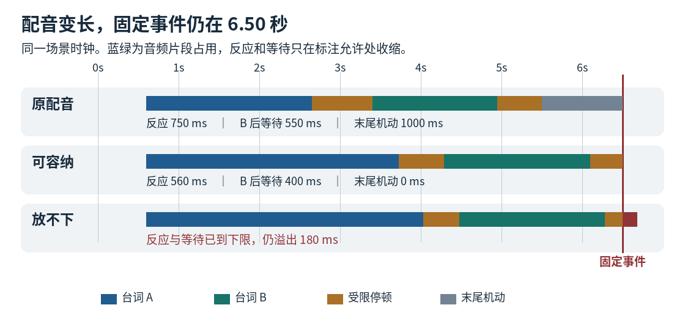

# 过场换了配音，怎样给长台词让出时间

两个角色对话。第一个说完，第二个看向门口、接一句；6.50 秒处门锁响，角色的手碰到门把。换了一轨较长的配音，第二句话就可能抢进第一句，或者还没说完，门锁已经响了。想让译配自然，往往不能把所有语言都挤进原版时长；想保住动作，又不能把整段过场一起拉长。判断的起点是：谁应该跟着这句话走，谁必须跟另一个事件同步，哪里才是真正可以借时间的地方。

这里讨论实时演出的可编辑时间轴。有固定画面的预渲染影片不一定能重剪，更多时候要在录音和配音剪辑时解决。以下案例中的固定时刻是为了演示一个已经确定的场景约束，并非所有门锁动作都必须绑原版秒数。

## 不要让同一个秒数承担三种意思

录音交付时，先给每条音频稳定的台词 ID、语言、录音版本与质量状态，并区分最后一个发声音素的位置、制作允许裁剪的边界，以及剪完后实际占用的片段长度。有的尾巴只是可剪空白，有的是吸气、喘声或共用过渡混音；不能把最后一个字当片段已经让出音轨。反过来，也不要把未裁掉的整文件静音都强制保住。制作方 Side 的资料把自由时长、限定时长、严格匹配、需要保持静默间隔和嘴型同步区别开来；这些是交付不同的约束，不是一个全项目通用的速度百分比。[1]

事件要记录它依赖的时点，而不只是表面落在第几帧。例如，某个表情跟重读词走，应跟目标语言这句话的词/音素标记；听者接话的镜头可以从句尾加一段反应停顿导出；交给另一条动画的手部接触与门锁声必须同刻。如果两者都在本段内，通常可以把它们当成一组共同移动；只有前后段接口或其他依赖锁定这个时刻时，才把它锚到场景时钟。锁的是依赖，不是事件名字。调查故障时保留一张表：事件、时间基准、允许提前/延迟量、跟随对象、哪个工种有权改。

本地化字幕的出入点和口型要按实际选择的语言素材更新。如果字幕与配音采用不同语言，仍要针对实际音轨和文字阅读时间检查，避免为跟音频在一帧上硬切而截断文字。预览用占位时长不能作为最终验收数据。CD PROJEKT RED 的 REDkit 文档中，从未导入语音时的估计时刻到有语音后的更新时间，以及动画、特效与视线事件按 section 的百分比跟随新时长，都有写明。[2] 百分比适合「这一段进行到一半」的事件，不自动适合某个词、第几帧手碰道具或外部任务触发。后几种应分别用语义标记或硬锚，不能因为示例编辑器能跟随就把所有轨一起缩放。

CDPR 在 GDC 展示过同段《巫师 3》对白的英语 12 秒与法语 14 秒。两条时间轴各有多段语音，第一段标注同为 2.19 秒，后续才有长短变化；下面同时列出镜头事件、动画和视线等轨。[3] 因此即便总长只多两秒，也不能用一个比例推算每段开始和结束的时刻。演讲还展示了逐语种修正的余地；这里不推测该项目固定动作和声音的内部绑定。

## 先借可伸缩的停顿，再决定要不要返工

以下用场景时钟的毫秒数，片段依次播放而不允许重叠。试件中的反应、句后等待都从对应音频片段释放占用时开始。第一句 600 ms 起，硬锚 6500 ms，两者相差 5900 ms。反应与第二句后的停顿分别希望保留 750 ms 和 550 ms；制作允许缩到 450 ms 和 400 ms。剩下的时间可以放在一段允许静持的反打，不把自然说话压快。这个镜头能持多久由制作先定；如果有最大持镜时长，短配音多出时间时也报问题，不能无限让人盯着空处。下表原版成立的前提是允许至少持镜 1000 ms。

| 配音 | 两段占用合计 | 反应、句后停顿 | 末尾可持镜时间 | 判定 |
| --- | ---: | --- | ---: | --- |
| 原版 | 3600 ms | 750、550 ms | 1000 ms | 可用 |
| 较长版本 | 4940 ms | 560、400 ms | 0 ms | 可用，但停顿已经缩短 |
| 更长版本 | 5230 ms | 450、400 ms | 0 ms | 仍差 180 ms，不能照此出片 |

较长版本里，第一段到 3730 ms 才释放占用，照抄原版 B 的 3400 ms 起点会重叠 330 ms。模型先不保留末尾机动，再借句后等待 150 ms、反应停顿 190 ms；于是 B 从 4290 至 6100 ms，恰好留到 6500 ms 的 400 ms。是先保护反应、还是先保护句后停顿，要由镜头与导演判断；这里优先保护反应只是一个明确的试件策略。极端版本的最低需求是 5230 + 450 + 400 = 6080 ms，超出 5900 ms。只填音素末端而丢掉仍占用的声音尾巴会误报通过，别把这个假余量交给自动剪辑。

超出时选择应能被制作接住：可以重写或补录该语言的一句，或让剪辑与关卡一起改锚点和下游接口。如果只卡画面嘴型，可以改成不见说话者嘴部的反打，反打本身不增加时间。它只有允许改掉一条明确的限制才有帮助：比如导演准许听者的反应从最后一个音素开始，在前一段保留的 280 ms 尾音上叠加；上表最短反应仍是 450 ms，两条音频仍不重叠，但极端版本可由超出 180 ms 变为留出 100 ms。要确认这次重叠不会吞掉应该被听见的尾音，也不能为了省时间把尾音当空白删掉。如果自动时间伸缩被允许，先限定对象并让导演听审；只改配音速率也不会帮错位的重读表情对回来。固定画面、音乐强拍和分支边界发生冲突时，如果没有可改位置，应在导入时标出该语言与超出的毫秒数，不把镜头跳切或静默吞尾当成通过。

## 验收时听一遍，也要看导入之后的时间轴

同段给参考语言和最长、最短素材分别生成预览，观察句尾有没有被截、听者反应是在台词之后还是提前、接触与音效是否同刻。如果对话开始受流式首包影响，查运行时实际开始与结束，不能用时间轴资产时长解释网络或解码迟到；本方法假设两句的素材都按约定及时可播。不要只试听演员交付的原文件，实际导入裁剪、混音、帧边界舍入都可能改变重叠和静默。

替换配音后如果预览出现异常，先区分三个对照：照抄起点看是否出现片段重叠；把可借停顿缩到授权下限看是否仍跨硬锚；若时间已经对齐，逐个查重读、口型和接触属于哪套时点。第一种修相对偏移，第二种由制作决定内容或镜头，第三种修绑定或单语言表演。这个顺序避免因为一个泛称的「不同步」，让翻译、动画和代码各自用不同秒数返工。

[复现：可收缩停顿与固定事件的时序算例](../../../../管理档案/实验/过场配音的时序预算/README.md)

## 参考资料

[1] Side，Better Loc Next Time – Part 2: Optimizing the Audio Localization Process，2023，Types of VO lines、Script formatting。https://side.inc/lab/better-loc-next-time-optimizing-the-audio-loc-process
[2] CD PROJEKT RED，The Witcher 3 REDkit，HOW-TO: Create a scene，Creating dialogues（Approve local VO 后）。https://cdprojektred.atlassian.net/wiki/spaces/W3REDkit/pages/28770374
[3] Piotr Tomsinski（CD PROJEKT RED），Behind the Scenes of Cinematic Dialogues in The Witcher 3: Wild Hunt，GDC 2016，原始幻灯片第 139–147 页，重点见第 142 页。https://media.gdcvault.com/gdc2016/Presentations/Piotr_Tomsinski_Behind_the_scenes.pdf#page=142
