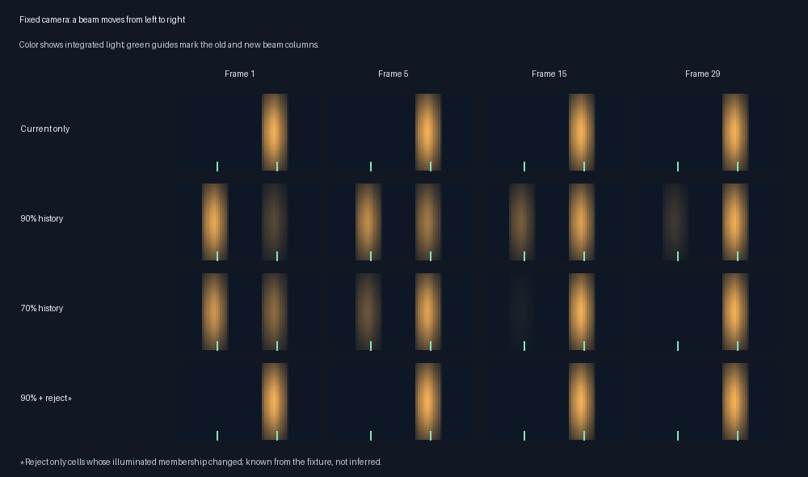

# 手电已经移走，体积雾为什么还留着光柱

手电照过一条走廊，墙面高光早已移动，悬在空气里的光柱却还停在原处。屏幕上看像是抗锯齿拖影，但残光可能在体积雾渲染阶段里就已生成。想保留光柱而减少拖尾，先区分两件事：历史究竟对应同一个空间位置，以及这个位置的**照明是否仍然相同**。

## 重投影找对了位置，也可能带回来错误的光

许多实时体积雾实现先在视锥中的立体网格采样；网格单元常称为 froxel。它不像屏幕像素只代表一条视线的最终颜色，还对应视线上的一段空间。采样密度有限时，逐帧扰动采样点，再在合理范围内累积历史，可以让边缘更平稳。重投影把当前单元代表的位置映射到上一帧，以便取到同一区域的旧估计；随后沿视线组合雾的散射和透射。具体历史量和混合顺序由实现决定，不能假定所有引擎都在同一阶段累积。[1][2]

固定相机和雾，仅把灯从左移到右。左侧网格没有随镜头走，重投影完全可能是有效的，但旧值还带着当时的灯；现在该单元已不在灯束中。重投影只证明「曾经在这里测过」，并不证明「这里现在还亮」。相机切换造成的历史无效、快速移动雾体造成的介质变化，也会留下痕迹，但和固定相机下仅改变照明不是同一条因果链。

用最简的单格模型说明取舍：令上一帧历史为 H、当前采样为 C，历史权重为 w，则输出 `w×H + (1−w)×C`。若旧处已经稳定在 1，灯移开后当前输入一直是 0，连续 n 次更新后的残值为 `wⁿ`。例中 w=0.9，低于原值 5% 要 29 次更新；改成 0.7 要 9 次。若每帧恰更新一次、60 Hz 分别约 483 ms 和 150 ms。同一个高权重会让新灯束也逐步起来，不只拖住旧亮处。数值只是对固定权重模型的解释，不是 UE 或 Godot 的默认参数、性能或实际画面时长。

## 固定相机做一次突变，然后再把镜头放开

先选一块不随手电移动的静止雾，关闭自动曝光，固定相机、分辨率和画面采样设置，记录跳变前后的灯位，并固定标记旧光柱与新光柱的取样点。先拍灯不动的基线，再让它在一帧内移开或熄灭；录下过渡帧，不只对比稳定后的两张图。

| 观察 | 优先检查 |
| --- | --- |
| 当前无历史的体积雾输入里，旧处仍然亮 | 实际灯、阴影、雾体发光、其他照明或数据更新顺序 |
| 当前输入没有旧光，但混合历史后体积雾通道有 | 体积雾历史和拒绝条件 |
| 雾通道已无旧光，只有最终画面留下 | 下游 TAA、上采样、后处理或其他合成；不要先给雾降历史 |
| 动相机才出现，静相机灯突变不出现 | 另查体积重投影的有效范围及遮挡变化，也对照下游历史 |

有调试视图时分别抓当前散射、体积混合后以及最终合成，比较同一线性尺度上的亮度或散射读数；工具只有成片时，分别只关体积历史和只关画面时域过滤作 A/B，并记录选项是否还改变了实现路径。相机和灯都动的测试留到后面，否则一次变化里混着两个坐标问题。量旧处的衰减、新处的起亮延迟，再量静止灯随帧的起伏。旧处更快变暗不等于整幅雾都更稳定。

## 先问光柱要不要保留，再选修法

- **光柱不是必要信息。** 让这盏快速变化的灯不写入体积雾，其他灯仍可用原来的历史。UE 5.9 的 `Volumetric Scattering Intensity = 0` 和 Godot 4.7 的 `Volumetric Fog Energy = 0` 都给出了这种做法。[1][2] 它关闭的是这盏灯的体积贡献，不能用来保留同一束新光、只删除旧影。
- **光柱要保留，允许整幅雾稍不平稳。** 先在压力镜头降低雾历史的影响，再检查静场条纹、逐帧抖动和新光起亮。Godot 的 `Temporal Reprojection > Amount` 文档也明确描述平滑与拖影的取舍。[2] 这是全局质量调节，且不同引擎的参数含义不一定等同于上式。
- **光柱要保留，静态雾也要稳定。** 有自定义渲染路径时，可在能确认照明突变的区域缩短或拒绝历史。例如用受影响灯的旧/新影响范围并集标记单元，使刚离开灯束的旧处和新进灯束的位置都收到变化信号；仅标新范围会漏掉最明显的旧残值。实际影响要考虑阴影与范围近似。用照明差分门槛做替代时，须防止正常采样抖动被当作变化；用静灯对照测误拒率。若历史里已混了多盏灯和多种雾量，不要假定能无代价只删其中一盏灯的旧值。

## 两组试件分开量拖尾和静态起伏

下图是固定相机的 Python 软件试件：在横向 × 深度网格里，把干净光束从左挪到右，再按简化透射沿深度积分。旧光柱的中心列，第 5 帧相对旧稳态还剩 59.0%（90% 历史）或 16.8%（70% 历史）；只用当前帧和在变化单元拒绝历史都为零。图的颜色经过显示映射，比例来自线性读数，不靠目测。

另用一组有固定随机种子的人工扰动测试静态光束，测一条代表视线相对干净值的时间均方根误差。只用当前帧为 17.24%，90% 历史为 4.07%，70% 历史为 7.39%。高历史加局部拒绝在静态试件也为 4.07%，因为遮罩没变，根本没触发拒绝。这只说明已知变化位置时有机会兼顾两边：试件预先知道灯束新旧覆盖的差异，没有从噪声、阴影或几何中推断拒绝条件。没有运行引擎、移动相机或 GPU。

[复现实验](../../../../管理档案/实验/体积雾的灯光历史/README.md)

## 资料

- [1] Epic Games，[Volumetric Fog](https://dev.epicgames.com/documentation/en-us/unreal-engine/volumetric-fog-in-unreal-engine)，UE 5.9，Temporal Reprojection；访问日期 2026-11-24。
- [2] Godot Engine，[Volumetric fog and fog volumes](https://docs.godotengine.org/en/4.7/tutorials/3d/volumetric_fog.html)，Godot 4.7，Volumetric fog properties 与 Temporal Reprojection。
