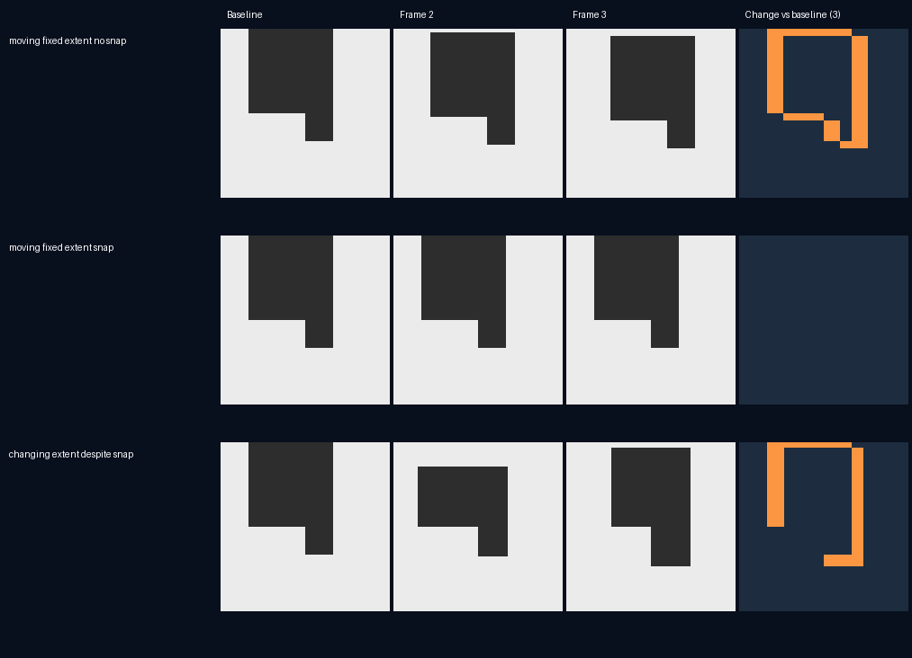

# 级联阴影做了纹素对齐，为什么还会晃

太阳方向没变，投影的墙也没动。镜头从墙边经过，地上的阴影边缘却像在抖。给阴影投影加上纹素对齐，横移时稳了一些，转镜头时又出现。先别增加滤波样本：检查摄像机移动时，静物在阴影图里的**采样格子**是否真的没变。

本文针对方向光的级联阴影图（CSM）。它把相机视锥按深度切成几段，每段用一张正交投影的阴影图。下面只处理单个级联的平面采样稳定性，再说明如何识别级联交界等另一个问题。[1]

## 会动的不只投影中心

在固定的光空间 X 轴上，一张阴影图的覆盖宽度为 W、分辨率为 N，则纹素间距是 δ = W/N。若左边界是 a，第 i 个纹素的中心在 a + (i+0.5)δ。Y 轴同理；如果阴影图不是正方形，要分别算两轴。使用图集时，N 是这个级联实际拥有的分辨率，不是整张图集边长。

从这个式子可以分开查三个量：

| 改变的量 | 仪表上会看到什么 | 如何让这部分稳定 |
|---|---|---|
| 光空间轴的方向 | 固定世界线段在光空间 XY 中转向 | 用由固定方向光决定、与观察相机无关的基底 |
| 投影宽度 W | 相距 1 米的两个点在图上相隔的纹素数改变 | 在同一投影配置下固定每级联的投影尺度 |
| 左边界 a 对 δ 的余量 | 同一固定点的纹素小数位置改变，或相邻样本突然被换掉 | 将投影锚点对齐到同一个世界纹素格 |

相机旋转时，即使光空间轴没跟着它转，按八个视锥切片角点计算的紧贴投影盒也可能忽宽忽窄。这时把原点吸到整数格，只对齐了某一帧的格子；下一帧格距变了，世界采样位置仍会移动。微软的 Direct3D 指南分别给出了紧贴投影和整纹素位移，指出许多稳定化做法依赖投影尺寸保持不变。[2]

只看阴影图上的整数坐标也容易误判。若 a 增加一个 δ，固定世界点的局部纹素编号会减一。只要投影格方向、格距和相位不变，在两帧共同覆盖且不触及边界的区域，新旧局部编号可以对应到同一个世界采样中心。局部编号变了，不一定是采样点变了。

## 先固定尺度，再移动格子

切出当前级联所用的相机视锥段。在相机局部空间，为这段视锥求一个覆盖八角点的球。未必要求最小球：可以用角点平均位置作中心、用该点到最远角点的距离作半径，代价是可能多留一些空白。只要 FOV、长宽比和分段范围没有变，刚体变换只移动和旋转这个球，不改变半径 R。视图通常有为时域抗锯齿而逐帧变化的微抖动；构造这套覆盖时使用未抖动的投影，并检查实际接收区域仍被覆盖。

把球心转到方向光定义的固定基底，以固定宽度 W 覆盖它。令 δ = W/N。可以把球心在光空间的 X/Y 分别除以对应 δ，按明确的舍入规则取整，再乘回去。最后用对齐后的中心 ± W/2 建立阴影投影。在局部光相机每帧以跟随目标为原点的实现里，不要每次都对一个已经被移回零的坐标做取整。应在共同的光空间基准上对齐，或从一个**固定世界点**在阴影纹素空间的漂移反推出投影平移修正。

Guerrilla 在《Killzone 2》的 GDC 讲解中展示了两种镜头方向下的级联切片覆盖：切片朝向改变，包围它的球与世界对齐的方形投影保留朝向，再以整纹素移动来减少相位变化。演讲也明确提到这样会浪费一部分阴影图空间。[3] 这是稳定性与有效分辨率的取舍，不需要照搬它的其他光照或过滤做法。若分段来自逐帧缩紧的可见深度，或镜头正在变焦，R 仍可能变。可以选择稳定的分段和投影尺寸，或把不同尺寸的切换列为另一个需要验收的质量决策。W 不变但动态画质把 N 改掉，也会改变 δ；切换级联分辨率时同样要验收。[4]

### 给取整和滤波留下边界

以最近对齐为例，中心每轴最多移动半个 δ。若 W 恰为 2R，移动后的投影就可能把接收范围裁掉半格。再考虑滤波：若最外的采样足迹比接收点在该轴多伸出 g 个纹素，边缘还需要 gδ 的保留空间。这个 g 由采样偏移及最外一格实际过滤足迹决定，不能直接拿采样次数来替代。

可在**最终可用 N** 下选 W，使 W/2 ≥ R + (g+0.5)W/N；也就是当 N > 2g+1 时，可取 W ≥ 2RN/(N−2g−1)。例如 R=7、N=16、额外足迹 g=2，最低宽度是 224/11，约 20.36，而不是 14。它是理想模型的下限，实做可另留数值裕量。单纯使用向下对齐时，中心偏移可接近一个整格，不再是本式的半格假设。图集的隔离边、边框寻址方式和混合区域都要分别检查；把超出本 tile 的采样夹回边缘，只会掩盖范围不足，不能假定邻接投影因此正确。

这个余量只管接收者在光空间的 XY 覆盖。视锥外的树也可能向视锥内投影。仍需为潜在投射者沿光方向渲染适当的深度范围；只用相机切片的 Z 范围做投射物裁剪，镜头移动时可能直接让整片阴影消失。[1][2] 这和纹素相位没有关系。

## 先盯住一个世界点，再看屏幕

把灯光和投射物都固定。单独测试横移和旋转，临时锁定分段或把近远级联着色，避免比较时同一世界点被换到另一张图；先关会改变取样位置的时域抖动和随机滤波。逐帧记录固定世界探针对应的光空间基底、投影宽度、左下角坐标、所用级联，以及采样结果。

本地的一维诊断用 16 个纹素、W=16，观察固定世界点 x=1.38；理想阴影边缘在 x=1.2，采样中心小于 1.2 就判阴影。投影中心连续移动到 0.55 时，不对齐的实现采到 1.05，固定点错误落进阴影。按整纹素对齐以后，虽然局部编号从 9 变成 8，世界中心仍是 1.5，结果不变。反过来，中心不动、宽度改为 22.4，即便已对齐也会采到 0.7。这说明相位稳定不能替代尺度稳定，不表示任意尺度变化都恰好让这个点翻转。

下图把同一个区别放进二维 CPU 模型：所有格子照同一个固定投射物采样，然后在同一片世界上用最近纹素读取。每排左至右是基准、第二帧、第三帧和第三帧差分，深灰表示阴影，差分列橙色表示分类改变。中间一排固定尺度且吸附，三个帧的固定世界探针分类相同。首尾两排分别只缺少相位和只缺少尺度稳定，都出现了差异。这里没有显示相机的屏幕采样，也没有做完整的 GPU 深度或滤波；图说明的是阴影图采样栅格，不是实际游戏画质承诺。[5]

另一个对照用 Mesa 软件 OpenGL，两遍分别绘制 16×16 深度图和固定世界点的接收遮罩。相对首帧，后两帧改变的探针数分别是：固定宽度但不对齐 12672／22272，固定宽度且对齐 0／0，对齐但变宽 12912／18135，与二维 CPU 对照的计数一致。它确实运行了三角形光深度栅格化和读取深度的着色器，但没有实际相机重投影、硬件阴影比较过滤或跨级联混合。[5]

如果固定世界探针已稳定，屏幕上的边仍粗糙，那是另一个问题：较宽的盒子把有限纹素铺到更大的区域，静止也会看见台阶，可按场景需求重新选择近级联距离、分辨率或滤波。如果只有级联切换附近跳，确认两个覆盖区域都有数据、过滤没有读出各自边界，再看切换与混合政策，不要继续调锚点。若是深度偏置、投射者裁剪、移动太阳或动态物体造成变化，纹素对齐也不该抹去这些真实差异。[1][2]

## 参考资料

1. Microsoft，[Cascaded Shadow Maps](https://learn.microsoft.com/en-us/windows/win32/dxtecharts/cascaded-shadow-maps)，Partitioning the Frustum、Computing a View Frustum Bound、Rendering／Blend Between Cascades，2026-11-19 查阅。
2. Microsoft，[Common Techniques to Improve Shadow Depth Maps](https://learn.microsoft.com/en-us/windows/win32/dxtecharts/common-techniques-to-improve-shadow-depth-maps)，Calculating a Tight Projection、Calculating the Near Plane and Far Plane、Moving the Light in Texel-Sized Increments，2026-11-19 查阅。
3. Michal Valient（Guerrilla Games），GDC 2009，[The Rendering Technology of Killzone 2，第 36 页](https://www.guerrilla-games.com/media/News/Files/GDC09_Valient_Rendering_Technology_Of_Killzone_2.pdf#page=36)及[扩展讲者笔记](https://www.guerrilla-games.com/media/News/Files/GDC09_Valient_Rendering_Technology_Of_Killzone_2_Extended_Presenter_Notes.pdf)，Sunlight – shadow map rendering。演讲相邻幻灯片的演示使用特意修改的步长与过滤设置；这里引用实际查看的覆盖示意与说明。
4. Matt Pettineo，2013，[A Sampling of Shadow Techniques](https://therealmjp.github.io/posts/shadow-maps/)，Cascade Optimization，2026-11-19 查阅。其样例区分 Stabilize Cascades 与 Auto-Compute Depth Bounds。
5. GameLibrary，[原创纹素格与二维固定探针试件](../../../../管理档案/实验/稳定级联阴影/README.md)。

[返回阴影贴图](README.md)
