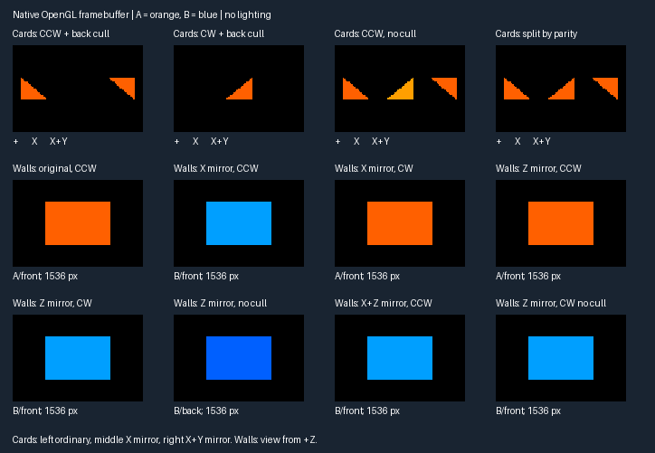

# 单面模型镜像后的绕序与实例剔除

把场景里的一个护栏沿 X 轴镜像，原件正常，镜像件却只剩几根棱，甚至完全消失。换成有厚度的道具，错误更不显眼：轮廓一样，但你看到的是本该被遮住的内侧。两种现象都可能来自同一处：提交镜像实例时，仍用原件的正面绕序绘制。对维护渲染提交或资产接入的开发者，关键是找出错的是网格索引、实例变换，还是这一趟绘制的正面约定。

## 法线没有翻错，面也可能被剔除

三角形的**绕序**是三个顶点的次序。光栅器根据投影后的窗口坐标判断这个次序是顺时针还是逆时针，再用当前绘制的正面约定决定哪一侧叫正面。以常用的 OpenGL 左下原点为例，`glFrontFace(GL_CCW)` 把逆时针定为正面。启用背面剔除时，另一侧在产生片元之前就被丢掉。顶点法线不参与这项判定。[1]

例如在 XY 平面上依次给出 `(0,0,0)`、`(1,0,0)`、`(0,1,0)`，三个顶点法线都是 +Z。固定正交相机从 +Z 看过来，原三角形是逆时针；用 `diag(−1,1,1)` 镜像后，第二个顶点落到 `(−1,0,0)`，屏幕绕序变成顺时针。原法线用该矩阵的逆转置变换后仍是 +Z。翻顶点法线能改变着色，却不能把被剔除的三角形带回来。

引擎也不必逐个三角形算屏幕面积再决定绘制状态。对共享同一可逆仿射变换的刚性网格，取最终线性变换 `M` 的行列式符号：正号保持定向，负号反转定向。原因是 `(Mu) × (Mv) = det(M) · M⁻ᵀ(u × v)`。左边是变换后两条有序边形成的几何法线，右边除了正常的法线变换，还多了行列式的符号。负号表示有序几何与变换后的物体外侧反向；要恢复哪个面被当成外侧，修的是绕序解释。[2]

这里的符号是**相对于未镜像实例要不要交换正面约定**，并不预测某个面在当前镜头里必定顺时针。摄像机换到背面，或镜像把同一个面从物体前部换到后部，屏幕上看到的面会变。正缩放子节点也可能继承负号；两层负号则相消。对 glTF 刚性三角面，规范以节点的全局变换来确定绕序约定，而不是只看节点自己的 scale。[2]

## 轮廓相同，画出来的却是远处那块面

搭两块完全重叠的方墙，A 在 `z>0` 一侧，顶点次序朝外，即从 +Z 看是逆时针；B 在 `z<0` 一侧，次序相反。从 +Z 正交观察，原件应该显示 A。把整个模型只沿 Z 镜像，A 后退，B 前移，但投影用的是 XY，所以两块墙各自的屏幕绕序没变。继续用逆时针作为正面，A 仍被当成正面留在画面里，已经移到近处的 B 却被剔除。

在 Mesa llvmpipe 的 OpenGL 4.5 Core 离屏实验里，A 用橙色、B 用蓝色，着色器用调试色编码面 ID 和正反面分类，不计算光照。测试读回颜色与中心像素的深度：

| 设置 | 应该看见的外侧 | 实际显示、分类及中心窗口深度 |
| --- | --- | --- |
| 原件，逆时针正面，剔除背面 | A | A，正面，0.25 |
| Z 镜像，沿用原状态 | B | A，正面，0.75，留下的是远墙 |
| Z 镜像，只改为顺时针正面 | B | B，正面，0.25 |
| Z 镜像，保留逆时针正面，关闭剔除 | B | B，背面，0.25 |

这四种画面的覆盖像素集合完全相同，都是 1536 个像素。只拿轮廓做回归测试，查不出这里的错。较完整的原始图还包括横向镜像和两个负轴相消的对照。

关闭面剔除不会改变正反面分类。应用如果按正反面做不同着色，错误还能继续传播。glTF 的双面材质就是一个明确的例子：关闭背面剔除，并在为背面着色前反转法线。用双面开关排查很有效，但不该为了修刚性单面资产而把材质改成另一种语义。[2]

## 在提交绘制时，按最终变换分开

先拿同一网格、同一镜头、同一趟渲染里能正确显示的非镜像实例当基准。它的索引、相机、视口约定和绘制状态合起来已经给出正确的正面。计算奇偶性时，在同一个坐标约定中看真正送入渲染的网格到世界的线性部分，包含父节点和作为实例变换应用的反射。坐标系转换若已烘焙进共享网格、并已在索引里做了修正，就不要再按它的符号补一次。需要的是相对基准尚未处理的镜像奇偶性，而不是遍历导入历史里的所有负号。

常规索引实例化中，同一批实例共用索引和光栅状态。实例矩阵可以逐个变化，`glFrontFace` 却不能随 `gl_InstanceID` 变化。[1][3] 做法是把这项奇偶性纳入分批键：同一个网格、材质和渲染通道下，保持定向的实例沿用基准状态，反转定向的实例用相反状态。比如父节点 X 为负，两个孩子分别是 `(1,1,1)` 和 `(1,−1,1)`，前者继承一个负号，走反向批次；后者合计两个负号，走基准批次。若模型跨过零缩放改变符号，批次归属也要更新。零缩放本身没有可逆变换，某些面可能塌缩，不能用正负二分硬套。

如果渲染接口更适合从几何侧解决，可为需要反向的实例准备一份反绕序索引，对索引三角形列表，将 `(i0,i1,i2)` 改成 `(i0,i2,i1)`，并继续使用基准正面状态。顶点仍可共用，但两类索引通常仍需分开提交。不要对同一次镜像既换索引又换正面状态，两处正好抵消。分批增加绘制组，索引变体需要额外维护和存储；选哪种要看既有提交结构，而非假定某一种更快。若网格是蒙皮或顶点动画让不同区域各自翻面，单个实例矩阵的符号无法修正局部变形。

离屏实验也把原件、X 镜像和 X/Y 双镜像三张单面卡片放入同一次 OpenGL 实例化绘制。背面剔除开启时，沿用逆时针正面只留下原件和双镜像，共 320 个像素；把整批改用顺时针又只留下单轴镜像。分成两个批次后，三张都以正面显示，各覆盖 160 个像素。这里测的是普通固定状态绘制的行为，不是不同提交组织的性能。

## 在自己的帧里怎么查

1. **先找一对可比较的绘制。** 固定相机，选同个网格的一正一反实例；用帧抓取工具确认二者确实已提交，并看顶点输出是否仍在视野内。没进 draw 的对象，要先查更早的可见性判断。
2. **只改变光栅变量。** 先尝试暂关背面剔除，再仅对镜像一组交换正面约定。用不依赖光照的面 ID 检查真正可见的是哪一面；若可调试片元着色器，再读 `gl_FrontFacing` 或对应 API 的正反面标志。别只验证轮廓重新出现。
3. **逐通道验收。** 在颜色、深度预通道和使用面剔除的阴影绘制中，分别比较该通道自己的基准和镜像版本。某个通道可能有意剔除正面，修复是恢复它原先所指的物理侧，而不是把所有通道改成背面剔除。若可见的是正确的面、只剩光照或法线贴图反常，再查法线及切线基；那是另一项判断。

检查导入器时，也可以用 Khronos 样例仓库的 Negative Scale Test 作补充，拿它的预期图分别比对绕序、剔除与光照，而不只是确认加载成功。[4]

## 复现材料

[离屏实验的程序和原始读回](../../../../管理档案/实验/单面模型镜像绕序/README.md)。

## 参考资料

1. Khronos Group，[OpenGL 4.6 Core Profile 规范](https://registry.khronos.org/OpenGL/specs/gl/glspec46.core.pdf#page=499)，2022，§14.6.1 Basic Polygon Rasterization。
2. Khronos Group，[glTF 2.0：实例化](https://registry.khronos.org/glTF/specs/2.0/glTF-2.0.html#instantiation)及[双面材质](https://registry.khronos.org/glTF/specs/2.0/glTF-2.0.html#double-sided)，查阅于 2026-11-24。叉积恒等式用于解释这里的符号关系。
3. Khronos Group，[OpenGL 4 Reference Pages：glDrawElementsInstanced](https://registry.khronos.org/OpenGL-Refpages/gl4/html/glDrawElementsInstanced.xhtml)，查阅于 2026-11-24。
4. Ed Mackey，[Negative Scale Test](https://github.com/KhronosGroup/glTF-Sample-Assets/tree/main/Models/NegativeScaleTest)，Khronos glTF Sample Assets，查阅于 2026-11-24。
