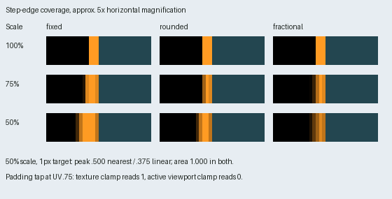

# 动态分辨率降低后，怎样让屏幕描边不变粗

镜头不动、输出还是 1080p，只把内部渲染降到一半，屏幕空间描边就变厚了。常见原因是着色器一直在取相隔两三个**输入纹素**的邻点，实际上想维持的是最终画面里的**输出像素**宽。先把偏移单位纠正，再判断那条边有没有足够信号。在低分辨率里已经消失的细线，不能靠修正一个偏移公式找回来。

## 偏移先落在哪张像素网格上

下面固定输出为 1920×1080。内部每轴以同一比例渲染。一个沿 X 轴取 3 个输入纹素的采样偏移，在 100%、75% 和 50% 时分别跨 3、4、6 个输出像素。想始终偏移 3 个输出像素，应改成 3、2.25、1.5 个输入纹素；若只能取整，按半入分别是 3、2、2，对应输出 3、约 2.67、4。偏移并不直接等于描边宽度：后面还可能有取最大值、比较、滤波和覆盖率阈值。

用每个轴分别计算。令 O 为效果承诺的输出视口尺寸，I 为**正在读取的附件**的有效尺寸，C 为它在分配纹理中的有效矩形原点，B 为底层分配尺寸。q 是同一画面位置在视口内的归一化坐标，d 是想要的输出像素偏移：

```text
纹理 UV = (C + q × I) / B
纹理 UV 偏移 = (d / O) × I / B
```

例如有效宽 960、分配宽 2048，输出 1920，向右偏移 3 输出像素就是 1.5 个输入纹素，即纹理 UV 的 1.5/2048。已经用视口 UV 的接口则先偏移 3/1920，再经过视口到纹理的映射，不要重复缩放。公式按纹素边界定义坐标；若直接用整数索引或需钳到样本中心，注意中心在 i+0.5。若缩放在 X/Y 不同，分别用本轴的 I/O；不能把一个比例套到各方向。

## 分配纹理的边，不是画面有效范围的边

某个视口只占分配纹理横向 [100,1060)，边缘最后一个有效纹素是 1059。从这里向右取两个纹素，得到 1061；纹理的 clamp 不会修正它，因为 1061 仍在分配范围里。边缘出现的线可能来自旁边未写入的区域，而不是场景边缘。

在做边缘检测前，明确越出有效范围时怎样处理：对基级点采样或双线性采样，把位置钳到有效纹素中心范围，例如横轴 `[100.5, 1059.5] / B_x`；或把越界采样视为无效，再决定如何补足滤波。更宽的滤波核或预先生成的 mip 还要检查整个采样足迹，不能只钳一个中心。效果若本来要在裁切处形成轮廓，需要定义有效区外是透明、延伸或不参与，不要碰巧读到填充数据。Unity Core RP 的 RTHandle 文档区分了当前参考视口与分配纹理，并提醒标准纹理地址模式不限制在部分视口内。[1]

## 调整滤波和合成位置时，要测可见宽度

`3` 像素偏移能通过公式保持，但它测的是采样位置；并不承诺有 3 枚像素达到某个亮度或覆盖率。举一个隔离例子：半分辨率的一枚纹素只有 0.5 覆盖，2× 最近邻会产生 `[.5,.5]`；中心对齐的线性重建会把它分给 `[.125,.375,.375,.125]`。两者总覆盖相同，后者峰值更低，而以严格 `alpha > .5` 计宽，两者都是 0。用同一段截面同时记录峰值、alpha 总和和超过明确阈值的像素数，才分得出「取样半径错了」和「覆盖被摊薄了」。

如果效果能拿到可信的输出分辨率遮罩，可把固定像素宽的边缘合成放在上采样之后。若仍依赖低分辨率的深度、法线或物体 ID，就得逐个绑定尺寸与映射，检查细边是否已在输入中丢失。高分辨率的颜色缓冲不会提高低分辨率附件的空间分辨率，也补不回缺失的细节。UE 5.9 文档指出，某些 TSR 之后的后处理位置中 `View Property` 仍返回 TSR 之前的大小；对该位置的 `PostProcessInput0`，用 `SceneTexture` 的 `Size/InvSize` 取得尺度。[2] 这句话针对该输入，不是所有附件的通用承诺。

## 排查时固定输出，逐级改内部尺寸

先用固定的垂直阶跃校准朝右和朝左的宽度，再用水平或斜边查轴向与量化差异，最后让轮廓贴近一个带分配填充的视口边缘。记录每个附件的有效矩形、分配大小、采样滤波、偏移单位和输出截面，不要只截图看整体。如果效果还有自建历史，做一次 75% 切到 50% 的单步检查：上帧坐标要经过上帧实际有效矩形，当前附件走当前矩形。历史若固定全分辨率或有运动重投影，需另记录真实布局和重投影结果；这个尺寸清单不能代替它们。

用 Pillow 13.0.0 进行的空间重采样试件固定了阶跃边的位置。固定 3 输入纹素时，以 `alpha > .5` 衡量的输出宽度为 3、4、6 像素；按输出目标换算但取整后为 3、3、4。保留分数偏移后，这条对齐边在三档都量得 3，但半分辨率的峰值降到 0.875。同一试件还有一个填充区对照：只按分配纹理钳制会读到填充值 1，在有效视口钳制读到 0。图放大了外侧遮罩；右侧底色只标识阶跃内侧，不显示那里可能有的滤波溢出；试件不运行 TSR，也未用它证明任意斜边或运动下的可见宽度恒定。



[复现实验](../../../../管理档案/实验/动态分辨率描边/README.md)

## 资料

- [1] Unity Technologies，[Using the RTHandle system · Core RP 14.0](https://docs.unity.cn/Packages/com.unity.render-pipelines.core@14.0/manual/rthandle-system-using.html)，Using RTHandles in shaders。
- [2] Epic Games，[Temporal Upscalers · Unreal Engine 5.9](https://dev.epicgames.com/documentation/en-us/unreal-engine/temporal-upscalers-in-unreal-engine#post-process-materials-after-tsr)，Post Process Materials After TSR，访问日期：2026-11-23。
