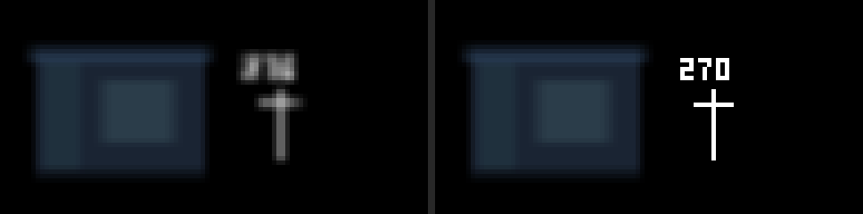

# 调低场景分辨率后，HUD 小字为什么也变糊

把场景渲染比例从 100% 降到 50%，让远处的建筑变软是预期结果。如果窗口像素没变，连屏幕角落的数字、准星的一像素竖线也一起变糊，先别换字体。要问的是：**图形第一次被画进多大的目标，之后又跟着哪张图缩放过？**

这里的 HUD 指贴在屏幕上的准星、资源数字与面板，不是场景里的发光招牌或头顶血条。前者通常不用参与场景的景深和遮挡；后者可能恰恰需要这些效果。

## 把三种尺寸分开看

- **场景渲染尺寸**：场景颜色和深度缓冲的实际像素数。设置里的 50% 通常指宽、高分别到一半，但以实际目标和视口为准。
- **HUD 光栅化尺寸**：矢量字形、图标、线条最终落进的第一张像素图有多大。控件的逻辑尺寸，例如宽 24 个布局单位，并不回答这一问；中间 UI 表面还可能再被放大。
- **交给呈现的尺寸**：渲染器交给窗口或交换链的最终图像。这个尺寸也未必等于设备像素，嵌入编辑器、操作系统或视频录制还可能再缩一次。

两条常见的画法是：

```text
场景和 HUD 合在低分辨率目标 → 放大一张图 → 呈现
低分辨率场景 → 放大到输出目标 → 按输出像素绘制 HUD → 呈现
```

第二条不是“晚一点贴同样的模糊纹理”。如果文字已经在半尺寸的 UI 表面光栅化，最后只把这张表面拉大，即使它是最后一个 draw，也拿不回已经丢掉的细线。Epic 的 Unreal 5.9 文档把常规 2D UI 和场景主比例区分开；另外存在独立的二次空间放大，实际仍要看 UI 之后发生了什么。[1][2] Godot 的 3D 分辨率缩放、根视口 `Viewport` 拉伸模式和 `Canvas Items` 拉伸模式也不是一件事：降低 3D 比例不等于把全部 Canvas 一起缩放；低尺寸根视口整体拉伸时，里面的 HUD 仍会被放大。[3]

## 一个输出像素的差异，可能在中间就消失

下面用同一批黑底标记测试两条路径：固定 96×48 的输出，场景都通过 48×24 的中间表面；同一份位图数字和细准星，一组在缩小前画入场景，另一组等场景放大后再画到输出。OpenGL 用线性过滤作 2 倍缩小和放大；这里刻意在完整像素网格上画完再缩小，用来隔离采样问题，不仿真某个引擎对低分辨率场景的直接光栅化。[4]



图左是一起缩放，图右是放大场景后再画 HUD；为了让笔画可见，两边都按最近邻放大同样倍率。场景在两边同样柔和，变化集中在数字和准星。在黑底读竖线中段的一行，坐标从 0 起算，读到的 8 位红通道是：

| 准星竖线的目标列 | 连 HUD 一起缩放 | 放大场景后再画 HUD |
| --- | --- | --- |
| 62 | 61→32，62→96，63→96，64→32 | 62→255 |
| 63 | 61→32，62→96，63→96，64→32 | 63→255 |

在第一条路径中，第 62、63 列恰好落在同一个中间采样格。两次输入产生**逐字节相同的中间图和最终图**，所以只看这张图，任何后续锐化都不知道线原先在哪一列。第二条路径仍区分它们，线也没摊到相邻输出像素。这个结论依赖于试件的采样相位和过滤器，并不是说所有细线在任何低分辨率下都必然消失，也不评价 TSR、FSR 等时域重建的质量。

## 找到第一次出错的那张图

1. **固定显示输出和 UI 布局，只改场景比例。** 保持同一窗口像素尺寸、UI 缩放/DPI、字体与字重、锚点、背景和相机。在一块纯色下加一条一输出像素的对比线，再加实际的小字。用游戏内部抓图或帧调试器看原尺寸，不用社交平台压过的录像当唯一证据。分别测 100% 与 50%，还要测比例切换前后的几帧；不要同时换抗锯齿算法。
2. **按实际提交顺序抓图。** 查这个 HUD draw 实际写进哪张目标，记实际 viewport、目标尺寸和输出区域；接着对比场景放大后的图，再看刚合成完 HUD 的目标。如果后面还有全屏拷贝或缩放，把它与实际提交呈现前的交换链图分开抓；若 UI 源面清楚但刚合成就糊，先查合成采样、缩放比例和亚像素位置。如果 HUD 在低分辨率场景颜色里已经出现，先分离 HUD 通道；如果场景放大后才叠 HUD，但 UI 自己的源纹理或中间表面已经粗糙，先查 UI 光栅化，不是改场景上采样器。若内部最终帧清楚，窗口或录屏才糊，核对设备像素尺寸以及最后一次拉伸。若只在切档第一帧出现，给各图记同一个帧号，检查 HUD 目标和 viewport 是否在同一帧改到新尺寸。
3. **改在正确的像素网格上验收。** 给屏幕 HUD 用输出尺寸的目标，或者在最终放大后直接按输出坐标绘制。布局仍可用逻辑单位，但转成像素时按实际输出内容矩形做映射，包含分屏、安全区或黑边；不要把场景内部坐标再乘一次动态比例。要保住单像素线时，检查它在当前输出像素网格的覆盖，不把所有连续移动的元素一律吸附到整数像素。最后用细线位置、真实文字和图标在两档比例、不同 DPI 与至少一个非整倍输出尺寸下验收，同时确认场景自身仍按目标比例缩放。

头顶标牌如果必须被墙挡住、与场景曝光匹配或参与景深，不要直接改成无条件覆盖的屏幕 HUD。可以保留世界内渲染，也可以把遮挡和裁剪单独算清后，在输出阶段画高分辨率文字；后者需要保留正确的深度、投影和视口映射，不能只把 draw 提后。至于“HUD 看清了但仍盖不住复杂背景”，是对比度，不是本篇的采样故障。

[复现实验与原始读数](../../../../管理档案/实验/HUD与场景缩放的合成顺序/README.md) · [按输出像素校正屏幕描边宽度](动态分辨率下的屏幕描边宽度.md)

## 参考资料

1. Epic Games，[Unreal Engine 5.9 Scalability Reference](https://dev.epicgames.com/documentation/en-us/unreal-engine/scalability-reference-for-unreal-engine)，Resolution Scale。
2. Epic Games，[Screen Percentage with Temporal Upscale](https://dev.epicgames.com/documentation/en-us/unreal-engine/screen-percentage-with-temporal-upscale-in-unreal-engine)，Primary、Secondary Spatial Upscaling。
3. Godot Engine，[Multiple resolutions，4.7](https://docs.godotengine.org/en/4.7/tutorials/rendering/multiple_resolutions.html)，3D 缩放与 Stretch Mode。
4. Khronos，[OpenGL 4.6 Core Specification](https://registry.khronos.org/OpenGL/specs/gl/glspec46.core.pdf)，§18.3.1，按不同大小矩形复制颜色缓冲时的过滤。

[返回动态分辨率](README.md)
