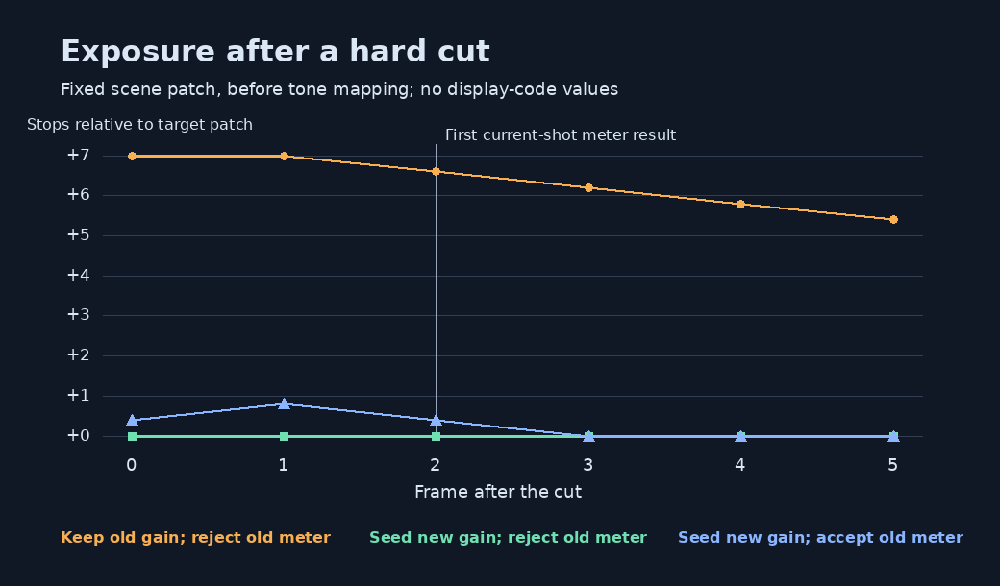

# 硬切镜头后突然过曝，先查曝光历史还是预曝光

过场刚从暗室切到阳光下，屋顶镜头的第一帧几乎看不清；暂停等一会儿，屋顶又恢复正常。另一种情况是曝光调试面板显示新镜头的目标和当前值都合理，画面却还是白了一帧。两者都像“曝光没调好”，但前者可能是沿用了旧场景的适应，后者可能是读场景缓冲时漏算了它的数值比例。

这篇面向图形程序员和过场灯光技术人员。只讨论**全局曝光**在硬切时如何交接。一段走出暗室的连续镜头可以刻意保留适应；剪切镜头则应先决定首帧是否要继承旧镜头亮度，而不是默认所有镜头都用同一种适应速度。

## 记录三个量，不要只盯着亮度曲线

把一个灰色参照物的线性场景值记为 L。先不看色调映射和显示编码，想让它以 L×E 进入色调映射，E 是本帧实际使用的曝光乘数。自动曝光还会根据测光得到目标 Eₜ；适应是从当前 E 向 Eₜ 变化的过程。二者不必在同一帧相等。本文用 e=log₂(E) 表示增益档数，e 增加一档等于乘数翻倍，不把它和引擎面板里的 EV100 混为同一个符号。Epic 的 HDR（Eye Adaptation）调试模式区分目标和当前曝光；Unity HDRP 也提供两者的直方图标记。[1][2]

另有一个量 P：**写入这一份场景缓冲时**已经乘进去的比例，即预曝光。给定一个使用 C=L×P 的渲染管线，后续读取 C 时，应乘 E/P 才会得到 L×E。虽然 E 和 P 都是乘数，它们不是同一件事；有些管线会在写入时直接取当前所需比例，有些使用已知的上帧比例。Epic 文档的例子是以前帧曝光写场景色；Filament 的技术文档则从半精度缓冲的动态范围讲解预曝光，有的光会在进入照明计算前先缩放。[1][3] 下文的比例式适用所声明的乘法编码，不是在陈述这两个引擎的每一条后处理路径。

例如 L=2.88，希望切镜头后 E=1/16，但缓冲仍以 P=8 写入，里面的值是 23.04。读时乘 (1/16)/8 得 0.18；如果直接再乘 1/16，结果变成 1.44，比意图亮三档。这不是适应速度太慢。反过来，如果错误的 E 真的是 8，即使比例换算正确，色调映射输入也会是 23.04。

| 检查到的现象 | 应先看哪一层 |
|---|---|
| 新镜头目标正确，当前 E 还接近旧镜头 | 首帧曝光政策、历史初始化、适应速度 |
| 切过去后，目标 Eₜ 又短暂回到旧镜头 | 测光是哪一视图、哪一帧录得的；也查镜头自身高亮和测光掩码 |
| 实际 E 正确，缓冲经 E/P 手算正确，但实际色调映射入口不对 | 场景色比例、后处理读法、是否已经乘过曝光 |
| 色调映射入口值已经正确，最终画面仍有差异 | 再查局部曝光、色调映射、调色或输出变换，不继续调全局适应 |

## 接管旧历史前，先写清第一帧该怎么办

同一条连续镜头里，沿用上一帧的适应状态可以让从阴影到日照的过程自然过渡。硬切则没有这段连续行走。如果分镜要求第一帧立刻可读，可以用灯光师预先设定的镜头曝光、预先测得的可靠新镜头值，或这条路径上确实来得及使用的当前帧测光。预热需要额外工作；当前测光若要到后面才结束，不能让第一帧假装已拿到它。

实现中可以将历史与测光都标记为“视图或相机 + 这次镜头世代”，延迟结果还带来源帧号。不是换相机对象才算新镜头；同一相机瞬移后，如果分镜规定要硬切，也应更新世代。接收结果时先核对所属镜头，再按源帧顺序防止旧结果覆盖更新结果。拒绝一个旧测光包不意味着清除当前曝光；保持这次切换确定的初值，直到本镜头有效样本到来。对保持原历史的镜头，也可继续保存旧 E，让它向新目标走，但不能把前镜头晚到的测光当当前目标。

下图是一条固定场景色的原创对照。暗室 L=0.0225、增益 8；日照处 L=2.88、所需增益 1/16，相差七档。“第 0 帧”是切后第一帧，当时有上个镜头的测光到达，当前镜头的第一份测光在第 2 帧到达。图的纵轴是色调映射前比目标亮几档，不是显示码值或人眼感知。

- 保留原增益且拒绝旧测光，第一帧仍比目标亮七档；之后等新测光再随时间适应。
- 以已知的新镜头增益开场并拒绝旧测光，参照值从第一帧就是 0.18。
- 只重置增益，但接受旧测光，目标会重新指向暗室；开始正确的增益仍会被往错误方向拉。

该轨迹使用人为指定的两帧延迟、每帧 0.1 秒和每秒最多调整 4 档，只用来验证历史和测光的因果顺序，不等于特定引擎的实施。Epic 另用分段的线性和指数适应；HDRP 也将渐变和瞬时适应作为不同选项。[1][2] 若分镜故意让观众看到闪入日照的变化，可以用明确的曝光曲线；目标是可重复赏看，不是要求一切变化都被提前消除。

## 缓冲的比例要随缓冲走，不随当前相机名字走

如果帧内有多个场景色缓冲，或下游读了一份历史纹理，让它读到**写入时**的 P。切镜头时更新了全局曝光变量，不会自动修改已编码的像素。下游预期消费新的预曝光空间 P_new 时，旧缓冲先换成 C×P_new/P_old 才在同一数值尺度；这只让两份数值可以比较，不会让旧镜头位置、遮挡、物体本身变正确。如果下游时域算法不能安全重用镜头内容，应照它自己的规则作废历史，而不是只换比例。

一份实际 EGL/Mesa 软件 OpenGL [对照](../../../../管理档案/实验/切镜曝光/README.md)先将两块线性亮度写进 RGBA16F，再由另一个着色器读成 RGBA32F。相同亮块以 P=8 写入并读回约 23.031，使用 E/P 后约 0.17993；遗漏除 P 时约 1.43945。把 P 改为 1/16 编码，正确读出的值仍约 0.17993。观察包含半精度量化，不是显示画面，也没有运行 Unreal、HDRP 或实际曝光适应。若写入时高光已截断、溢出或量化丢失，后续乘比例不能找回信息。

在实际项目中，先冻住色调映射与调色，选一个两侧镜头都能可靠取样的中间调及一个高光，再抓切前、切后第一帧和首次有效测光三组数据。记录源帧、视图世代、测光输入所在的数值空间、目标乘数、实际乘数、缓冲比例、色调映射入口值。如果测光读的是已经预曝光的缓冲，也要核对它是否已换回约定的测光单位，别将 P 的变化误当成场景突然变亮。

随后按不同政策重跑：连续镜头要保留哪些适应；硬切首帧要采用什么初值；没有及时测光时用哪一种可靠回退；旧镜头的测光比新镜头晚到时是否无效。最后再打开需要的色调映射、局部曝光和风格设置检查可读性。静态截图正常是有用的对照，但不能替代对切后第一帧和测光交接的检查。

## 参考资料

1. Epic Games，Unreal Engine 5.9，[Auto Exposure](https://dev.epicgames.com/documentation/unreal-engine/auto-exposure-in-unreal-engine)，Exposure Metering Mask、Exposure Change Speed and Movement、Pre-Exposure、HDR (Eye Adaptation)。
2. Unity，HDRP 17.0.4，[Exposure override reference](https://docs.unity3d.com/Packages/com.unity.render-pipelines.high-definition@17.0/manual/reference-override-exposure.html)、[Debug exposure](https://docs.unity3d.com/Packages/com.unity.render-pipelines.high-definition@17.0/manual/test-debug-exposure.html)，Automatic、Automatic Histogram、Histogram View。
3. Google Filament，[Physically Based Rendering in Filament](https://google.github.io/filament/main/filament.html#lighting/directlighting/pre-exposedlights)，§5.2.6 Pre-exposed lights；§8.1.3 Exposure 讨论相机曝光乘数。

以上文档于 2026-11-19 查阅。原创模型与软件 GL 数据见[复现材料](../../../../管理档案/实验/切镜曝光/README.md)。

[返回曝光与色调映射](README.md)
