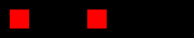

# 顶点着色器把网格移进镜头，为什么还没被画出来

远处的海草被风吹进画面，靠近画面边缘时却突然整株消失。把镜头稍微挪回去又出现。关掉材质中的顶点位移后，不再发生这种闪现。首先应该检查的，不是顶点位移的计算本身，而是**渲染器用哪个范围决定要不要画这一株**。顶点着色器只能移动已进入绘制流程的顶点。如果引擎用不动的原网格范围判定整株在视锥外，新的位置就没有机会算出来。

本文讨论静态源网格加着色器顶点变形，以及主视图的轴对齐包围盒（AABB）剔除。蒙皮、遮挡、阴影和引擎内部网格分簇可能有额外规则；不把改一个对象盒子当成对所有阶段的修复。

## 先判断是没有提交，还是提交后没有像素

把材质冻结成一个确定的位移，关掉时间随机、渐隐和透明等会遮掩结果的效果，选一个从故障前到故障后的小幅镜头移动。检查三处：

1. **未变形的盒子。** 在同一个窗口叠画物体被测试的包围盒与视锥边界；若包围盒在外、按材质算出的网格应该在内，先查剔除入口。也要确认本次用的是单实例的盒、合批的盒，还是另有子的层级。
2. **绘制有没有发生。** 用帧捕捉、对象事件或当前引擎的可见性调试确认。如果绘制未进入这一路，用临时扩大该物体的范围或跳过相关剔除作对照。如果已经提交，位置、裁剪、背面、透明和深度也会让输出看不见，不能继续归咎于 CPU 源盒。
3. **恢复实际设置再查。** 巨大盒子只用于确认假设，不是上线方案。若扩大了包围盒仍不显示，查实际提交决策者是否读取了这个盒，或是否还有距离 LOD、遮挡、材质分支等限制。只看到阴影不见时，另查阴影绘制和该阶段顶点位置，不能套用主视图实测。

用最简单的坐标能看到矛盾：横向可见范围是 −1 到 +1，而原矩形顶点的 x 从 2.75 到 3.25。顶点着色器若让 x 减 3，最终矩形本可覆盖 −0.25 到 +0.25。但提交前只看原矩形，会把它全部拒绝。若位移可能为 −3 到 0，保守范围是 −0.25 到 3.25，允许绘制；这不表示每一帧一定有像素。零位移时原矩形仍在外，哪怕多提交了一次，最终也应该没有可见像素。[复现实验](../../../../管理档案/实验/顶点位移剔除/README.md)

另用 64×64 像素的实际软件 OpenGL 画面做对照。这里单独采用宽 1 的原矩形，x 从 2.5 到 3.5，位移 −3 时应在正中。提交测试由示例程序在 CPU 上实现，顶点偏移和可见像素由 Mesa llvmpipe 的 OpenGL 4.5 实际执行与读回：

| 从左到右 | 提交 | 最终红像素 |
| --- | --- | ---: |
| 不做示例剔除，位移 −3 | 是 | 1024 |
| 原盒拒绝，位移应为 −3 | 否 | 0 |
| 保守盒允许，位移 −3 | 是 | 1024 |
| 保守盒允许，实际位移 0 | 是 | 0 |
| 不做示例剔除，实际位移 0 | 是 | 0 |

这只是把绘制准入和真实顶点/光栅结果拆开验证，不是某个引擎内部的剔除，也没有测量硬件或帧率。

## 只增补着色器可能占到的范围

给着色器和剔除各自独立估一个“差不多”最大风力，最后它们迟早不一致。对轴对齐的盒子有一个简单的保守做法：在**用于剔除的同一坐标系**里，算各轴可能的位移最小值 Dmin 和最大值 Dmax，然后对原来的轴下界 Bmin 加 Dmin，轴上界 Bmax 加 Dmax。如果变形可以关闭，把零位移也纳入。不要求所有最大位移真的同帧同时出现，组合出来可能比最紧的盒大；保证的是实际可能位置不会出界。

例如根部固定、顶端沿同一轴摆动，若顶点权重在 [0,1] 内且材质的幅度上限为 A，那么对该轴取 [−A,+A] 就能包住这种摆法。若只能向右伸，取 [0,A]，没必要向左也扩同样一截。叠多个可能同时生效的位移时可分别加最小、最大值，或用已证明更窄的联合上界；只测一个风相位或看平均值，都不是上界。运行时风参数、材质实例或每对象缩放改变后，不应仍使用为旧最大值算的盒。可以由同一份数据产生变形配置和剔除范围，或者在参数超预算时钳制或重算。若本帧允许位移增大，扩好的盒须在对应的剔除前已生效；不能先发新材质参数、下一帧才补盒。

还要核对**世界和局部坐标**。如果着色器输入是世界位移，而设置接口收局部盒，先用当前物体变换的逆线性部分把位移向量转回局部，不加平移。非等比缩放、对象旋转会让世界 x 位移成为局部另一个轴。若先知道世界里的轴对齐位移盒，转换它的角点再取局部各轴极值，是给该线性映射的保守办法。精确二维试件取「局部 (x,y) 映到世界 (−3y,2x)」。世界位移横向 [0,3]、纵向 [−2,4]，换回局部是 x[−1,2]、y[−1,0]；直接把世界数值加在局部盒上会漏掉位置。三维取角点也是同一原则；带奇异缩放、复杂变形或引擎自己定义的其他空间时，换成能可靠界定的范围，而非强行套用示例。

## 找到真正被读取的盒，再看成本

Godot 4.6 的 `ArrayMesh.custom_aabb` 文档直接提到用来避免着色器移顶点导致的意外剔除；`GeometryInstance3D.custom_aabb` 与额外剔除边距属于实例层选择。[1] 共享网格上改范围会作用到使用它的地方，而每实例的位移预算可以更贴合配置。不要把禁用**遮挡**剔除当作禁用**视锥**剔除，Godot 文档明确区分二者。[1] Unity 6000.0 的 `Renderer.localBounds` 文档也把自定义顶点变形列为用例，提示自定义局部范围需在运行时设置，不能假定会跟着场景或预制件保存。[2]

Unreal 对 World Position Offset 的文档提示，顶点可以超出默认范围，导致剔除和阴影错误；放大范围有代价。[3] UE 5.9 的 `Max World Position Offset Displacement` 还可能限制材质位移并扩充相关范围，设为 0 并不是「自动推导任意位移上界」。Nanite 内部按簇剔除，别把本文的单对象盒对照当作对所有簇或版本的行为证明。[4]

保守盒要覆盖有效时段，却不求越大越好。实际网格不在屏幕内时，大盒会允许不必要的绘制，也可能让其他剔除更难排除对象；有多大代价需用实际资产测。调试时比较原范围、预期上界与故意放大的对照，在最大朝两边的偏移、无风和缩放旋转变体下核验对象进入或离开。验收记录要分开「是否提交」和「最终多少可见像素」。对阴影、深度预绘制或运动矢量有要求的资产，查各自的顶点变形与裁剪边界，不能只修主视图画面。

## 参考资料

1. Godot，[ArrayMesh](https://docs.godotengine.org/en/4.6/classes/class_arraymesh.html) 与 [GeometryInstance3D](https://docs.godotengine.org/en/4.6/classes/class_geometryinstance3d.html)，4.6，`custom_aabb`、`extra_cull_margin` 与 `ignore_occlusion_culling`。
2. Unity，[Renderer.localBounds](https://docs.unity3d.com/kr/6000.0/ScriptReference/Renderer-localBounds.html)，6000.0，自定义局部包围与运行时设置。
3. Epic，[Material Inputs in Unreal Engine](https://dev.epicgames.com/documentation/unreal-engine/material-inputs-in-unreal-engine?application_version=5.8)，5.8，World Position Offset。
4. Epic，[Unreal Engine Material Properties](https://dev.epicgames.com/documentation/unreal-engine/unreal-engine-material-properties)，5.9，Max World Position Offset Displacement 和 Nanite 簇范围。
