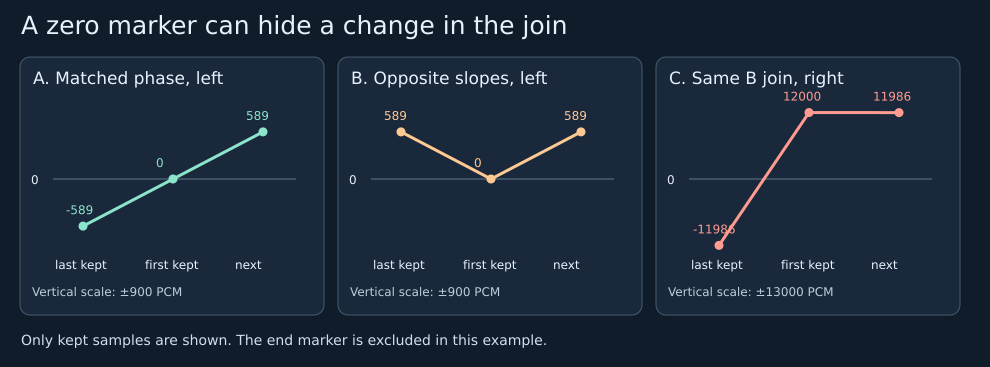

# 环境音找到零交叉，为什么循环点还能听出接缝

风声或机器嗡鸣的循环区间，起点和终点都贴着波形的零线。素材一遍遍回放，接缝却仍像有个小折点；切到立体声时尤其明显。另一些素材单独听很平顺，和同长度的第二条音轨并行播放，几分钟后却渐渐错开。

这两种问题不要混查。**看循环接缝，要读实际相接的样本和各声道；看循环失步，要量相邻两次重启之间的实际时间。** 本文从可复跑的音频试件开始，重点是接缝样本与重复间隔的诊断。正式交接时如果还没核清帧区间、坐标起点和取整，先用[如何标记和检查 PCM 音乐循环区间](如何标记和检查PCM音乐循环区间.md)统一这些约定。

## 两个标记都在零，接起来的波形仍可能拐头

这里只交代读图所需的区间约定。本文试件使用半开区间 `[start, end)`：播放的最后一个样本帧是 `end − 1`，接下来播放 `start`，不会先放 `end` 再回去。一个样本帧包含这一刻的全部声道。不同编辑器、文件格式和运行接口对结束点的约定要分别核对；不能只看它们都显示“0.129 秒”就把同一个整数当成所有工具的参数。

试听前，至少对每个声道读三处：最后保留样本、循环后首样本、其后一个样本，再与原素材在结束附近的自然走向对照。Audacity 的零交叉说明把选择移到上升过零处，同时提醒立体声左右的过零位置可能不同。[1] 这不是说任何两个零点都能接，也不保证另一个声道会赶在同一帧过零。

以 48 kHz、16 位立体声的原创纯音为例。左、右相差四分之一周期；用整周期作对照，再多保留半周期，后者左声道的起点和被排除的末端标记正好都是零，方向却相反：

| 接缝读数（16 位 PCM 计数） | 最后保留 → 首个保留 → 下一个 | 从标记返回时要注意什么 |
| --- | --- | --- |
| 整周期，左声道 | −589 → 0 → +589 | 两步都是 +589，和源素材在零点附近的走向一致 |
| 多半周期，左声道 | +589 → 0 → +589 | 两步的大小相同，方向由 −589 变成 +589；只看一个接缝步长会漏掉这个折点 |
| 多半周期，同一次接缝的右声道 | −11986 → +12000 → +11986 | 该声道在源素材下一步本应从 −11986 到 −12000；循环回首后，接缝步长比自然一步多了 24000 |

图 A 与 B 的纵轴量程相同，图 C 为了显示右声道的大幅变化换了量程。图上的点来自生成后的 WAV 文件回读；辅助折线只是看离散样本方向。左右的步长和步长变化用于定位接缝的不连续，不是响度或可听阈值。实际听不听得出，要用目标素材、音量和播放环境判断。

## 优先找能保持声音发展的接点，再决定要不要叠接

对稳定的嗡鸣或音调，先找相近相位、走向一致的开始和结束。把接缝前后放大，若保留了未裁的源素材，就用结束点附近自然走过的波形作对照；若成品只保留循环段，至少分别看两侧邻近几帧的走向，不把看不到的下一样本假设为零。只有一声道对齐时，不宜把左右各自剪到不同帧，因为这会改变原来的声道时间关系。对呼吸、风声、机械转速变化等非严格周期的素材，还要比较接点两侧几十毫秒内的包络、频谱和左右声像。波形局部接上了，不代表跨过去的音色也不突变。

找不到同时适合各声道的切点时，可以给所有声道在共同时间上做短交叠，把尾部逐渐交给头部，再试听。交叠太短可能过不掉形状差异；太长可能出现幽灵双响、节奏不对或整体音量凹凸。头尾明显同相或反相时，不要把同一种淡化曲线当万能。曲线选择可参考[交叉淡化时为什么声音中间变大或变小](../../音频制作/混音/交叉淡化时为什么声音中间变大或变小.md)。如果剪辑把头尾重叠而使总段变短，或者作者用额外头尾素材预烘焙来维持周期，都应在导出后的**成品**上重新量循环长度、核对标记。一个听着顺的剪辑不能顺便替项目决定节拍长度。

交付时记录素材采样率、总样本帧数、正式循环区间和单位。对同一文件对比监听原始 PCM 与目标平台版本；若实际素材边界干净，但事件录音每次回头都插出一段静音，优先检查事件是否在停止后再启动、解码或流送是否赶上、是否换了一段素材，以及最终版本有没有使用你标的循环点。FMOD Studio 2.04 的资产预览可核对素材循环点并试听压缩或未压缩版本，这是一条检查线索，不替代实际游戏录音。[2]

## 不响也可能越放越偏：另量一次循环有多长

若两条本应同步的循环开头一起触发，首轮接缝却不响，多轮后才开始错位，记录的是另一件事。假如 48 kHz 下两条的实际循环周期分别是 48,000 和 48,032 样本帧，一次相差约 0.667 毫秒；从对齐起点往后数完 150 个间隔，偏移是 `150 × 32 = 4800` 帧，也就是 **100 ms**。这是长度不同的算例，不是说任何 32 样本帧的编解码延迟都会变成播放时长。

FMOD Studio 2.04 的故障说明指出，某些编码会为了满足块大小要求补尾部静音，在循环乐器上可能积累失步，并给 PCM 或 Vorbis 作为针对这种块大小问题的对照。同时它也列出流送、虚拟声部重启等其他来源。[3] 不要把某种格式的块大小、编码启动延迟直接当成游戏一定输出的额外样本。Ogg Opus 规定了开头预跳过和末端裁剪。[4] 本地用 FFmpeg 的 libopus 对整周期试件做一次编码，再解码回 PCM，包侧信息记录开头跳过 312 样本、末端丢弃 456 样本；**原文件和回读文件仍都是 49,152 帧**。这个原生程序对照只验证实际解码长度，不声称信号逐个样本相同，也不推断 FMOD 或任何游戏循环的具体行为。

在游戏里用同一录音时钟保留循环标记和音频输出。固定两条音轨的播放速率和采样时钟；如果项目通过变速实现升降音高，连固定的音高偏移也要暂时关闭，而不只是禁用随机化。把参考音与测试音放在可同时录到的路径，先量首段有效声音何时开始，再量相邻两个循环标记的实际间隔。每轮增长近似等差，如果一直确实是两个各自重复的周期，才像这里的周期差。素材帧数相同但一条的播放速率略高，也会形成周期差；固定错开但后续不增长应先查启动；偶发缺口或跳回到另一个相位应另查调度、流送与声部状态。换成 PCM 或从内存播放可用来隔离几个候选原因，但一次改善不代表已经确定是哪一个条件变化了。

## 验收时把两个问题分开记录

- **每次回头固定响一下。** 先读实际接缝样本、两侧走向、其它声道和最终编码波形，再选择新的切点或短交叠。不要只报“已过零”。
- **单独平顺，叠起来逐轮偏。** 确认两条是同一参考时钟、指定循环长度确实相同，测每轮间隔和累计偏移；不要先重剪波形。
- **编辑器里好，游戏里不稳定。** 用同一素材和标记先做目标平台的短录音，再记录较长一段。将实际解码长度、事件边界、运行时记录和输出录音分开，便于定位变更。

[复现实验](../../../../管理档案/实验/音频循环接缝/README.md)有两条可生成的原创 PCM WAV、接缝读回和独立的周期长度对照。不包含真实素材试听、FMOD 或游戏内测量。

## 参考资料

1. Audacity，[At Zero Crossings](https://manual.audacityteam.org/man/select_menu_at_zero_crossings.html)，该手册描述上升零交叉及左右声道位置不同的限制。
2. FMOD，[Managing Assets](https://www.fmod.com/docs/2.04/studio/managing-assets.html)，Studio 2.04，asset preview 与 Loop Points。
3. FMOD，[Music tracks are getting out of sync](https://www.fmod.com/docs/2.04/studio/troubleshooting.html#music-tracks-are-getting-out-of-sync)，Studio 2.04 §27.5，编码长度和其他调度因素。
4. IETF，[RFC 7845: Ogg Encapsulation for the Opus Audio Codec](https://www.rfc-editor.org/rfc/rfc7845.html#section-4.2)，§4.2–4.4，Pre-skip、PCM Sample Position、End Trimming。
