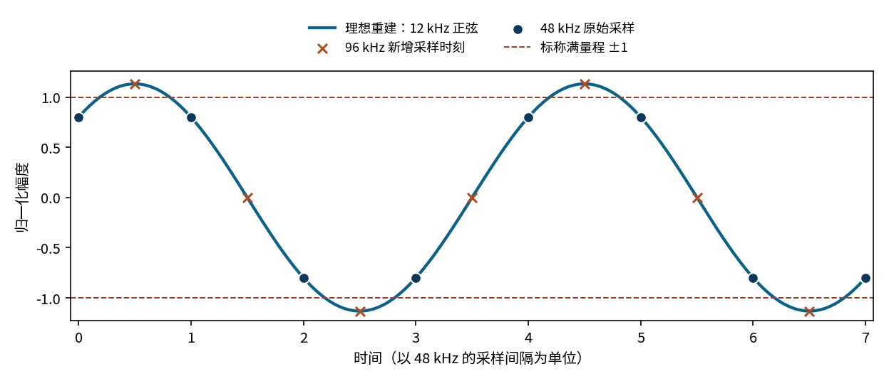

# 样本峰值没到 0 dBFS，为什么游戏音频转采样后还是削顶

一条 48 kHz 音效在编辑器里最高只有 −1.9 dBFS，同一段浮点 PCM 转成 44.1 kHz 后，却出现了幅度超过 1 的样本。如果这一步直接输出 16 位整数，越界部分已经被夹到正、负端值。此时在总线上把音量拉低，只会把已经削平的波形一起调小。

排查要先分清两个问题：原始表头是否只看了已有采样；哪一步真实地把信号限制在满量程。本文面向接素材导入和混音总线的音频设计师与程序员，用同一段输入对照原样本、过采样表头、浮点转换和整数转换，帮助你定位该在哪一级留余量或加限制。

## 两个表头看的不是同一个最大值

把 PCM 样本归一化到标称满量程为 1。**样本峰值**是在现有采样点中取最大的绝对值，读数为 `20 × log10(max(abs(x[n])))` dBFS。**真峰值**问的是这些样本所表示的重建波形，其绝对值最高到哪里；仪表用过采样估计，读数通常写成 dBTP。它比原样本峰值更能提示下游过载风险，并不是用来评价声音听上去有多响。ITU-R BS.1770-5 附件 2 给出 48 kHz 到 192 kHz 的估计示例，先插值低通，再在更密的样本上取峰值。[1]



用一段 12 kHz 的稳态正弦看这个差别。对于 48 kHz，每周期仅取四个点；相位设为 π/4 时，样本正好取在 `+0.8、+0.8、−0.8、−0.8`。四个点都未超过 1，但重建正弦的振幅是 `0.8 × √2 ≈ 1.131`。图中 96 kHz 新增的一些时刻恰好踩到了原来漏掉的波峰、波谷。这样的信号在旧网格读 −1.94 dBFS，理论重建峰值约 +1.07 dB，相差约 3 dB。[1] 这不是素材凭空加了增益，而是旧表头没有测到原来就在采样点之间的峰值。

理想正弦只负责说明机制。实际表头不是按两点直线连起来量，也不会总精确落在波峰上；滤波器和过采样倍率会影响估计，临近验收门槛时要用同一测量设置比较，不宜把一位小数的 0.0 当作刚好安全。

## 同一输入：先看浮点，再看整数

用 FFmpeg 7.1.5 实跑一秒 48 kHz 单声道浮点 PCM，首尾加短淡入淡出以减少边缘突变。对照组是同样样本峰值的 1 kHz 正弦。测量使用 `ebur128=peak=sample+true`；`sample` 测原样本，`true` 在过采样后的数据上估计。不同构建需要启用 libswresample；FFmpeg 汇总行把真峰值也打印为 “dBFS”，辨认时看 “True peak” 栏，不要只看标签。[2]

| 测量点 | 样本峰值 | 真峰值估计 |
| --- | ---: | ---: |
| 48 kHz，1 kHz 对照 | −1.94 dBFS | −1.9 dBTP |
| 48 kHz，12 kHz 试件 | −1.94 dBFS | +1.1 dBTP |
| 12 kHz 试件转 44.1 kHz，仍为浮点 | +1.07 dBFS | +1.1 dBTP |
| 12 kHz 试件转 96 kHz，仍为浮点 | +1.07 dBFS | +1.1 dBTP |

44.1 kHz 比原来更低，但仍可在不同时间点取到高于 1 的幅度；「改成较低采样率」不是降电平。用同一转换器直接输出 s16 时，44.1 kHz 的 12,660 个、96 kHz 的 22,130 个浮点越界样本都落在对应的正、负整数端值上。这里浮点可以保留 >1，整数输出不能；**越界何时成为削顶，要看哪一级首次夹紧**。整数样本贴边本身不一定证明削顶；这里有同一输入不夹紧的浮点输出作逐样本对照。

同一实验将 12 kHz 输入减半，两条同相轨各自仅 −4.9 dBTP，逐样本相加后又回到 +1.1 dBTP。它刻意模拟最强相加：不同音效不一定同相，也不会总增加 6 dB。这能说明为什么给每条素材定一个安全峰值，不能替总线验收，更不能用单条最高读数相加代替实际混音压力测试。

## 找到第一次丢失波形的节点

先选能稳定复现的素材或事件组合。按工程里的实际顺序取样：导出母版 → 导入后解码或变速 → 总线叠加与效果 → 设备采样率转换／最终有界输出。你要的是实际信号路径，不是要求每个项目都有这四级。记录各级的采样率、是否整数、样本峰值和真峰值，保留第一次发生过载前后的同段音频。有条件时在可疑节点同时捕获未夹紧的浮点和实际交付格式。 最好从事件前录到事件后，保留真实的前后波形和效果尾音，而不是只裁出疑似峰值的几个样本。

```sh
ffmpeg -nostats -i capture.wav -af 'ebur128=peak=sample+true' -f null -
```

在上面这版 FFmpeg 中，若一个已知静默的 48 kHz 试件只在距文件末尾四个样本处出现相邻的 0.82、0.85 两点，裸测的真峰读数是 −66.4 dBTP；保留 20 ms 静默再量，变成 +0.5 dBTP。把同样两点摆到末尾之前 100 个样本，裸测也是 +0.5 dBTP。异常只出现在结尾附近，不能拿裸测结果给短截段放行。如果已知尾部本来就是静默，可在该命令的滤镜前加 `apad=pad_dur=0.020,` 复核这类截段；如果还有有效信号或尾音，重新采集，不要用补零代替。

- **导入前样本合格、真峰已越界**：如果待输出的一路必经重采样或整数边界，在越界被夹掉之前降低电平，再以实际目标格式复测。比如这一段读 +1.1 dBTP、你给这个节点设 −1.0 dBTP 上限，静态降低至少 2.1 dB 才碰到名义目标；实做还要留测量余量并重测。这不是通用平台交付值。
- **素材合格，只有同帧叠加或总线效果后越界**：重放代表性的同时触发，保留能重建结果的事件时间、并发数、增益和效果设置。先查峰值来自重复触发还是设计允许的叠层；对应选择并发限制、分配各组余量或调整增益结构，不必一起把所有素材压得更小。
- **整数之前已经变形**：查有无非线性处理提前夹紧，例如某个效果器内部的有界处理；先换为此前的干净源或改该处理前的增益。在已经夹紧的 WAV 上重新量到 −1 dBTP，不能当作修复证据。

需要真峰值限制器时，放在最后一次可能推高电平的效果和增益之后，并在真正输出路径后复测；若设备还会转换采样率，把该变化计入余量，而不是拿处理器显示的 ceiling 代替测量。实时前视限制器增加延时，频繁介入也会改变瞬态包络；若根因是总线叠加过密，先修叠加而不是靠末端一直压住。本例测的是指定转换器的 PCM 路径，没有测有损编码、真实设备或玩家听感；对那些输出应解码或采集后另测。

## 复现材料

[浮点与整数转换的脚本、原始数据、示意图](../../../../管理档案/实验/音频采样间峰值/README.md)

## 参考资料

[1] ITU-R. *BS.1770-5: Algorithms to measure audio programme loudness and true-peak audio level*. 2023-11，Annex 2，尤其是 §3 及 Attachment 1。[正式标准](https://www.itu.int/rec/R-REC-BS.1770-5-202311-I)。

[2] FFmpeg. *FFmpeg Filters Documentation*，`ebur128` 的 `peak` 选项，以及 `aresample`。[滤波器文档](https://ffmpeg.org/ffmpeg-filters.html#ebur128)。
