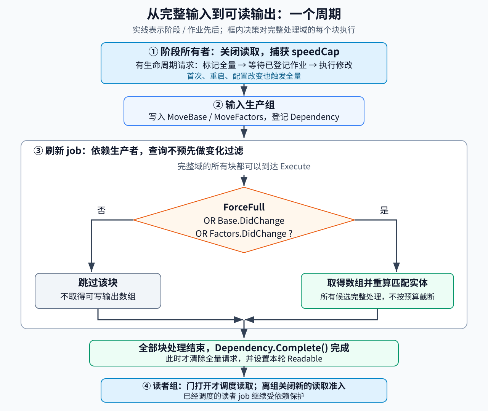

# Unity Entities中派生组件的选择性刷新

考虑一个示例移动管线：装备、地面和状态系统已经更新了单位的移动输入，移动系统却偶尔读到旧速度。为了省下重复计算，刷新系统只处理“发生变化”的块；但切换全局限速后，有些块再也没有进入计算。另一个版本给刷新加了预算，跳过一次后，待处理的变化也没有自动留到下一次。

这些问题有一个共同点：**块的变化版本只提供跳过计算的依据，不能独自证明派生组件已经准备好供本轮读取。** 需要同时建立完整输入、消费窗口、处理范围和重建入口。

本文面向已经会使用 EntityQuery、SystemBase 和 Jobs 的 Unity 运行时程序员。目标是在明确的“生产输入→刷新→读取”阶段中维护纯派生状态，平时按块跳过未变输入，在初始化、配置改变和处理范围变化后完整重建。方法限定于每次运行都处理全部候选的完整域，不提供跨帧预算队列或业务事件日志。

机制核对以 Entities **1.3.15** 为范围：官方文档与固定提交的 Unity 包源码互相对照；源码由第三方 Needle 镜像承载，不是 Unity 官方 GitHub 仓库或安装包鉴证。[1] 下文 C# 是原创、依据源码编写但**未经编译或运行**的集成示例，不是已验证实现，也没有性能测量。

## 先规定哪一版速度才是正确结果

设每个单位有三个普通、非 enableable 组件：

| 数据 | 内容 | 本方法中的所有者 |
|---|---|---|
| `MoveBase` | 基础速度 `BaseSpeed` | 输入生产系统 |
| `MoveFactors` | 合成倍率 `Scale` | 输入生产系统 |
| `MoveCache` | 派生速度 `AllowedSpeed` | 唯一的刷新系统 |

本轮规则为：

```text
AllowedSpeed = clamp(BaseSpeed × Scale, 0, speedCap)
```

`speedCap` 是全局配置，不是单位查询中的组件。本文规定三个输入都有限且非负，并且 **float 乘法的结果也必须有限**。仅检查两个乘数有限不足以排除溢出；生产者应限制合法数值范围，开发检查还应验证乘积。这一前提使算例不必混入 NaN、溢出或跨平台浮点一致性问题。

假设 A、B 在同一块，基础速度都是 6，倍率都是 1，限速为 10。首次刷新得到 6、6。下一轮只把 A 的倍率改为 0.5，则合法读取应得到 3、6。再下一轮只把全局限速改为 4，应得到 3、4。最后这一步没有改任何 `MoveBase` 或 `MoveFactors`；只检测两类组件会漏掉 B 的新结果。

这个小计算用于说明有效性，不用于证明缓存值得做。若真实计算也只有乘法和限幅，全量扫描乃至读取时直接计算，通常都应进入候选方案，而不是预先决定必须使用变化过滤。

这里的“本轮”是一次移动阶段，不一定等于显示帧。合法读者必须使用本轮生产完成后的输入与本轮捕获的配置。输入生产期间，上一轮缓存可以暂时保留在内存中，但不能当作本轮结果读取。输出只保存可重复覆盖的值，不在重算时扣资源、播放一次性音效或累加任务次数。

## 块版本怎样成为安全的跳过条件

Entities 的 change version 按 **archetype chunk 与组件类型**记录。本文的“块”是 ECS 存储块，不是地图分区。`DidChange` 命中表示相对给定基准可能有写入，既不指出块内哪个实体变化，也不比较组件字段。[2]

在核对的实现里，`GetNativeArray(ref handle)` 根据句柄的只读模式走不同路径。可写路径取得地址前就设置该组件类型的块版本，此时调用者尚未给任何字段赋值。因此，一个生产者取得可写倍率数组却保持原值，也足以让刷新系统重新检查这一块；A 确实变化时，B 一起重算同样是正常的保守行为。[2]

本方法使用这样的块条件：

```text
需要重算 = 强制全量
        OR MoveBase 相对本消费者上次版本可能变化
        OR MoveFactors 相对本消费者上次版本可能变化
```

只有三个条件都为假，才能保留整个块的旧输出。输入之间必须是 OR：只改倍率已经足以改变速度，不需要同时改基础速度。对于命中的块，重算查询匹配的每个实体，不把命中当成逐实体事件。

这个跳过规则成立的理由可以分成两步。第一次完整刷新后，每个输出都等于约定纯函数。以后若一个块被跳过，两个受追踪的实体输入都没有相关写入，全局配置没有改变，输出也没有被外部改写，而且这些实体上次确实属于已完成的处理域，那么它们仍对应相同输入，旧结果可以保留。若任一前提不能确认，就走完整重建，而不是让 `DidChange` 替它作答。

正常 ECS 访问与正确的作业依赖是这个推理的前提。绕过追踪的 unsafe 写入、被遗漏的第三个输入、其他实体或外部数组里的依赖，都不能由两个块版本覆盖。若实际规则又读取地面类型，应把它并入已经生产好的 `MoveFactors`，或明确加入刷新依赖与失效条件；不能只把新读取塞进纯函数。

## 消费版本代表一次系统更新，不代表处理进度

刷新系统在调度时把自己的 `LastSystemVersion` 复制进 job，作为两个 `DidChange` 的比较基准。它不是生产者的版本、上一张画面帧号，也不是某个实体“最后处理到这里”的回执。固定实现会在系统更新前设置其管理查询的版本基准，更新后推进该系统的上次版本。比较应调用 `DidChange`，不要改写成普通的无符号整数 `>`；实现包含零基准与环绕比较的约定。[3]

尤其需要注意 `OnUpdate` 提前返回。`SystemBase.Update` 在 `finally` 中执行更新后的版本处理；从运行转为停止的过渡路径也有版本处理。于是，系统运行了却因预算没做刷新，并不会为未处理实体保留旧窗口。[3]

沿用前面的例子：A 的倍率改成 0.5，刷新系统这轮因为预算不足直接返回，却仍让消费窗口前进。下一轮没有新的倍率写入，查询便没有义务再次选中 A。旧缓存 6 可能长期保留。把系统时开时关也不是一个可靠的待处理队列。

因此，本方法做两项选择：正常运行完整消费当前域的全部候选；任何被主动中断、重新启动或无法确认完整消费的周期，下一次有效刷新前都强制全量。如果产品允许几轮不使用移动结果，可以暂停整个阶段，恢复时重建。如果产品要求每轮读取最新结果，却又只能分摊重算，就需要持久的待处理集合、逐项完成状态和明确的读者规则，不能只在这里加一个预算 `return`。

## 由一个阶段所有者负责关闭和放行读取

下面的协议是一种项目设计，不是 Entities 自动提供的缓存服务。它把全量失效与普通输入写入分开，让维护者能够找到每个入口。

`MovePipelineGroup` 位于项目选定的 Simulation 阶段，其四个直接子项依次为：

1. **`MovePhaseOwnerSystem`**：关闭读取，捕获这轮配置，执行排队的生命周期修改。
2. **`MoveInputGroup`**：运行所有本轮输入生产者，只改输入值，不改变处理资格。
3. **`MoveCacheRefreshSystem`**：处理完整域，必要时强制重算；完成刷新依赖后才放行。
4. **`MoveReadGroup`**：只有本轮已经放行才更新其读者；离开该组后关闭新的读取准入。

生产者放进 `MoveInputGroup`，合法读者放进 `MoveReadGroup`，而不是只在两个任意系统上添加一对 `UpdateAfter`。Unity 的更新顺序属性约束同组直接子项，组层级才把这个顺序扩展到内部系统。[4] 此处所有生产者、刷新系统和读者都不得另有一条绕过此组的更新或读取入口。正常周期中四个子项各执行一次，不在子组另配 RateManager，也不单独跳过必需生产者；需要暂停时暂停整个管线，恢复后重建。



图中的“完整域”指当前世界中默认查询可见、同时具有三个组件的全部运行时单位。Prefab 不作为单位处理；缺少输入或输出组件的对象尚未获准读取缓存。这个查询不按临时 shared 值分组，也不以 enableable 状态筛选实体。一个周期内成员资格固定，所有准入、移除及重新可见的变化都在阶段边界完成。

### 把生命周期修改交给同一个入口

阶段所有者提供两个主线程入口：`SetSpeedCap` 保存下一轮配置；`QueueDomainChange` 排队一个边界操作。后者用于创建或加载单位、向旧实体补加缓存组件、清空输出、销毁单位，以及任何会使实体重新进入处理范围的修改。请求只在两个周期之间提交，不允许 job 直接调用托管入口。

在下一次输入生产开始前，所有者先关闭读取，再标记 `InvalidateAll`，等待当前世界已登记的作业完成，最后执行这批修改。边界回调同步完成修改，不再留下未登记的后台工作。新单位必须在该操作返回前具备全部输入和输出；分批加载尚未完成的数据，应留在域外，直到整批可被处理才准入。若使用 ECB，负责这批变化的命令记录作业也必须已经登记，播放应放在同一边界内，不能到刷新之后才播放。[5]

下面是新建一个单位的完整请求形态。默认世界已经创建这些系统，调用发生在阶段开始前的主线程；新组件中的零缓存尚不可读取。

```csharp
var owner = world.GetExistingSystemManaged<MovePhaseOwnerSystem>();
owner.SetSpeedCap(10f);
owner.QueueDomainChange(em =>
{
    var e = em.CreateEntity(typeof(MoveBase), typeof(MoveFactors),
                            typeof(MoveCache));
    em.SetComponentData(e, new MoveBase { BaseSpeed = 6f });
    em.SetComponentData(e, new MoveFactors { Scale = 1f });
});
```

初次运行与刷新系统的 `OnStartRunning` 也设置全量标志。这样既不把“首次版本通常会全部命中”当作唯一初始化方案，也不依赖任意结构变化都更新两类输入版本。源码中的普通创建路径会设置全部组件版本，但另一些结构调整路径会复制原有共同类型的版本；给实体加上新输出组件，不应据此推断旧输入一定重新变脏。[6]

销毁独立单位不会要求清理另一个旧值字典，因为结果就在实体组件中。本示例仍把销毁纳入同一个边界并全量重建，以保留简单一致的入口。大量频繁生成、销毁的项目会为此付出代价，后文的比较必须包含这部分成本。

这个协议允许普通值更新只走块版本，而让难以从两个版本判断的变化统一走全量。例如把限速 10 改为 4，只需提交 `SetSpeedCap(4f)`：所有者下一轮捕获新值，刷新系统发现配置与上轮不同，将所有块重算。业务代码不能直接改 job 已捕获的配置，也不能事后清空 `MoveCache` 却不失效。

### 放行是一次真实完成，不是一个调度成功标记

系统顺序只决定谁先调度，不能让尚未执行的生产 job 自动变成已完成。生产者必须正确声明输入组件的写权限，并把显式调度返回值登记到自己的 `Dependency`。刷新系统以自身相关依赖作为输入，并将新 job 的返回值写回；读者也须把输出作为只读访问并登记后续作业。[7]

本文选择一个容易检查的同步边界：刷新系统调用 `Dependency.Complete()` 后，才把本轮 `Readable` 置为真。`MoveReadGroup` 用这个值控制是否调度读者，结束调度后关闭门。已经调度的读者作业仍按其依赖正常完成；关闭门不是取消它们。下一轮普通输入写入和刷新依靠 ECS 依赖排在有关读者之后；若有生命周期修改，边界的 `CompleteAllTrackedJobs` 先等待已登记作业。[5][7]

这个同步点牺牲一部分流水并行能力，是所给方法的显式成本。若改成异步发布，就需要把“允许调度依赖于刷新结果的 job”与“主线程可以直接读值”区分开，并让每条路径携带正确句柄；不能只删掉 `Complete()`，仍沿用这里的 `Readable` 含义。

## 实现时，先决定是否重算，再取得可写输出

[完整原创示例](../../../../管理档案/研究/TASK-2026-0302/examples/SelectiveMoveCache.cs)提供四个阶段类、边界请求、门控和刷新 job。正文下面保留决定正确性的代码，完整文件只负责把这些类放在一起，不补藏新的生命周期条件。示例使用正常的默认世界创建流程，不添加 `RequireMatchingQueriesForUpdate` 或只因域为空就跳过所有者的条件；空域完成一次空刷新也是允许的，下次准入新实体仍会显式失效。

刷新系统在 `OnCreate` 中拥有以下查询和句柄：

```csharp
_domain = GetEntityQuery(
    ComponentType.ReadOnly<MoveBase>(),
    ComponentType.ReadOnly<MoveFactors>(),
    ComponentType.ReadWrite<MoveCache>());
_baseHandle = GetComponentTypeHandle<MoveBase>(true);
_factorsHandle = GetComponentTypeHandle<MoveFactors>(true);
_cacheHandle = GetComponentTypeHandle<MoveCache>(false);
```

这个查询始终不设置 change、shared 或 order filter。其目的不是否认过滤器的用途，而是保证全量请求能到达所有块。查询提前剔除的块根本不会进入 `Execute`，所以在 job 内添加 `ForceFull` 救不回那些块。[8]

每轮由所有者调用 `BeginRound(cap)`：先关门，配置改变时置 `_forceFull`，再发出一次本轮刷新许可。`InvalidateAll` 只设置全量并关门，不丢掉已经发出的当前许可；`AbortRound` 则同时撤销许可。刷新系统的关键更新路径如下，字段和方法的完整定义见同一示例文件。

```csharp
protected override void OnUpdate()
{
    Readable = false;
    if (!_armed) { InvalidateAll(); return; }
    _armed = false;
    bool fullForThisJob = _forceFull;
    _forceFull = true;

    _baseHandle.Update(this);
    _factorsHandle.Update(this);
    _cacheHandle.Update(this);
    var job = new RefreshMoveCacheJob
    {
        Base = _baseHandle,
        Factors = _factorsHandle,
        Cache = _cacheHandle,
        Since = LastSystemVersion,
        SpeedCap = _cap,
        ForceFull = fullForThisJob
    };
    Dependency = job.ScheduleParallel(_domain, Dependency);
    Dependency.Complete();
    _forceFull = false;
    Readable = true;
}
```

没有本轮许可时确实会提前返回，但这条路径同时保留全量请求并拒绝读者；它没有把被跳过的工作伪装成一次正常消费。临时将 `_forceFull` 设为真，是为了让句柄更新、调度或完成在成功之前中断时，下一次不能悄悄沿用选择性路径。只有全部完成后才清除请求。

缓存句柄必须每次调度前更新；输入的 query、handle 和 job 字段都只读，输出三处都可写。[7] 不要照抄一个“给输出加 `[ReadOnly]`、随后又写入”的混合声明。`[ReadOnly]` 也不能代替初始化句柄时的真实访问模式。

```csharp
[BurstCompile]
public struct RefreshMoveCacheJob : IJobChunk
{
    [ReadOnly] public ComponentTypeHandle<MoveBase> Base;
    [ReadOnly] public ComponentTypeHandle<MoveFactors> Factors;
    public ComponentTypeHandle<MoveCache> Cache;
    public uint Since;
    public float SpeedCap;
    public bool ForceFull;

    public void Execute(in ArchetypeChunk chunk, int unfilteredChunkIndex,
                        bool useEnabledMask, in v128 chunkEnabledMask)
    {
        if (!ForceFull &&
            !chunk.DidChange(ref Base, Since) &&
            !chunk.DidChange(ref Factors, Since))
            return;

        var bases = chunk.GetNativeArray(ref Base);
        var factors = chunk.GetNativeArray(ref Factors);
        var caches = chunk.GetNativeArray(ref Cache);
        var entities = new ChunkEntityEnumerator(
            useEnabledMask, chunkEnabledMask, chunk.Count);
        while (entities.NextEntityIndex(out int i))
        {
            float product = bases[i].BaseSpeed * factors[i].Scale;
            caches[i] = new MoveCache
            {
                AllowedSpeed = math.clamp(product, 0f, SpeedCap)
            };
        }
    }
}
```

输入数组和输出数组的同一索引对应同一实体。这里不跨轮保存 `unfilteredChunkIndex`、块地址或数组引用。[7] 更关键的是，可写输出在跳过判定之后才取得；若把它移到函数开头，即使随后返回，也会先记录输出类型的可能写入，让下游变化追踪看到更多候选。[2]

`ChunkEntityEnumerator` 让循环按传入的匹配掩码迭代，但**不授予随意改变处理域的安全性**。如果以后加一个 enableable 的 `Active` 条件，实体在不匹配期间可以错过消费窗口；重新启用 `Active` 不证明 `MoveBase` 或 `MoveFactors` 又发生了写入。必须把重新准入接入重建入口，或另设计逐实体有效性记录，不能以“循环已经处理 mask”代替它。[9]

## 沿着同一对单位检查正常路径与恢复路径

下面是协议的手算走查，不是 Unity 执行输出。假设 A、B 确实在同一块，所有输入访问和依赖符合前文约定。

| 周期 | 阶段开始前或生产阶段发生什么 | 刷新依据 | 放行后 A、B 的速度 |
|---|---|---|---|
| 首次 | 创建 A、B，基础速度 6，倍率 1，限速 10 | 初始全量且新准入失效 | 6、6 |
| 普通变化 | 生产者把 A 的倍率改为 0.5 | 倍率类型的块候选；整块重算 | 3、6 |
| 配置变化 | 只提交限速 4 | 配置比较触发全量 | 3、4 |
| 无变化 | 没有相关写入，配置和处理域相同 | 跳过该块，不取得可写输出 | 3、4 |
| 缓存被重置 | 边界操作把输出清零 | 操作前已标记全量 | 3、4 |
| 暂停后恢复 | 不在暂停期间读取；恢复刷新 | `OnStartRunning` 全量 | 按恢复时输入重新计算 |

再加一个容易误判的变体：倍率生产者取得可写数组，却没有改变任何数值。块仍可成为候选，重算结果还是 3、4。这对纯派生输出是额外成本，不是正确性失败。若此时播放两次“已减速”，则是把缓存刷新误接成一次性事件。

即使为每个实体另存上次速度，两个端点相同也无法还原中途“减速后又恢复”的两次转换。本方法只承诺在合法读取点给出所需结果；需要每次转换的业务应在拥有转换的写入流程中记录事件。

异常也不属于“部分完成算正常”的路径。边界修改失败时，示例所有者进入故障状态、撤销许可，不再放行本阶段；重新建世界是该示例明确支持的恢复方式。生产者错误、非法数值、调度或 job 失败同样应停止这一消费流程，排除问题后从完整有效输入重建。不能假设外层 `try/catch` 自动发现所有子系统错误：所核对的 `ComponentSystemGroup` 会捕获并记录子系统异常后继续更新后续项。[10] 因此生产系统的错误处理必须主动通知阶段所有者 `Fault()`，job 错误则按项目的故障处理停止流水线；这里没有提供任意运行异常的事务回滚保证。

## 何时可以把判定移回 EntityQuery

如果处理域稳定完整，初始化和配置失效已经有另一条可靠的全量路径，需要检测的组件类型最多两个，可以让 change filter 在进入 `Execute` 前筛块。它可能减少一些调用和检查开销，是否更快仍要测量。

这条替代路径要保留三件事实：

- 两种 changed 类型是 OR。应一次设置完整类型集合；连续调用两次 `SetChangedVersionFilter` 不是累计两个条件。
- 此版本 `SetChangedVersionFilter` 会先清空已有的 shared、changed、order 过滤状态。需要追加时核对 `AddChangedVersionFilter` 的语义；“追加”也不会把两个 changed 条件变成 AND。[8]
- 全量请求必须在调度前选用不受变化过滤排除的查询，或正确去除并恢复过滤配置。job 内的 `ForceFull` 只对已经进入 job 的块有效。

本文保留无变化过滤的系统私有查询，把选择条件放在一个地方，换取更直接的重建路径。不要在主实现外再加一层 change filter，认为两种优化叠加不会改变语义。

## 先定位漏刷，再判断是否省下了工作

出现旧速度时，最有用的第一条记录是“哪个实体、哪一轮、在哪个合法读取点读到了什么”，随后追到本轮输入、配置快照和刷新完成情况。按下面顺序检查，通常比先怀疑版本号随机失效更具体。

| 现象 | 优先观察 | 对应修正 |
|---|---|---|
| 配置改了，部分单位仍旧 | 本轮捕获的 cap、是否全量、实际域大小 | 把配置纳入失效；查有没有查询提前剔除 |
| 一次预算跳过后不再刷新 | 上次真正完成的轮次与系统运行轮次 | 恢复前全量；不把 LastSystemVersion 当队列 |
| 新单位或重启后输出是零 | 准入入口、输入是否齐全、门是否提前打开 | 边界失效，完整刷新完成后再读 |
| 几乎每块都命中 | 输入的实际可写访问者、组件类型范围 | 纠正假只读；区分保守写入与真实数值差 |
| 下游仍然每块都重算 | 跳过块是否提前取得了 RW 输出 | 先判定，再取得可写输出 |
| ForceFull 仍漏掉对象 | 完整域与实际收到块的差异 | 去掉提前过滤；检查准入/enableable 资格 |

诊断至少记录：本轮总块数、候选块数、处理实体数、全量原因、刷新完成与读者放行状态。需要分析候选膨胀时，再用临时只读快照比较逐实体输入，区分“真值变化少”与“可写访问广”。诊断若用 RW 句柄，自己也可能改变版本；主线程直接观察前，还要等待相关作业，不要用与生产并发的读数判断是否漏刷。

性能比较以相同规则、相同读取时刻的**全量重算**为基线。最小控制实验可以沿用同一查询、作业、调度与同步边界，只把基线中的 `ForceFull` 固定为真，然后检查两种方案在合法读点的输出一致。改变 cap、创建/加载、重置和暂停恢复也要进入负载，而不只测试静止场景。这个控制能隔离块跳过的收益；若项目已有更高效的全扫实现，还应另做端到端比较，不能只赢过自己添加了额外同步的基线。

可用一个成本分解决定要测什么。设 K 为总块数，Kc 为候选块数，N 为实体数，Nc 为候选块中的实体数：全扫主要支付 N 次计算与写入；选择性方案额外支付 K 次版本检查，仍支付 Nc 次计算与写入，以及失效管理和同步成本。候选比例低不等于速度提升相同比例，因为不同块的实体数、计算代价和下游工作并不相同。

测量应包括刷新 job、主线程等待、输出写入带来的下游候选与耗时，以及生命周期全量重建频次。固定设备、包版本、构建配置和代表负载，保留多次采样的波动。一个实体写入可以让整个块重算；少量写入若散布到全部块，Nc 仍可能接近 N。只展示“跳过了九成实体”，不足以评价这种同步实现是否更快。

若输入几乎每轮都被写、计算很便宜，或生命周期操作频繁触发全量，保留全扫通常更容易维护。只有少量实体会被读取时，可以考虑读取时计算或懒刷新，但要为每个入口承担检查责任。逐实体 revision 或 dirty 标记能缩小粒度，却新增写入入口覆盖、标记存储与完成语义；它不是一个不花成本的替换按钮。

选择性刷新的价值，最终来自一个可检查的事实：**在完整且已经有效的处理域里，相同输入可以继续使用旧结果。** 先把输入、准入和合法读取组织成闭合流程，再用块版本减少计算；若这些条件尚不清楚，完整重算是比猜测变化更可靠的起点。

## 相关知识

- [Factorio缓存失效与读档后的重算](Factorio缓存失效与读档后的重算.md)：从历史案例理解派生值的依赖与合法读取时刻；本篇提供独立的 Unity 接入方法，不推断 Factorio 使用同一实现。
- [分块模拟中，为什么写不同位置仍可能互相影响](../并行模拟/分块模拟中，为什么写不同位置仍可能互相影响.md)：讨论读写关系和模拟阶段；空间分块与本文的 archetype chunk 不是同一种机制。

## 参考资料

官方网页访问日期为 2026-11-06，`@1.3` 是可变入口；当日页面元数据为 1.3.15。以下源码链接均固定到 Needle 镜像提交 `c5c05da45c71c388896c7895b15c3aa96bf9fbe4`。引用的是 Unity 包实现与文档，不把镜像、上游测试源码或纸面算例称为本次运行验证。阶段所有权、失效协议、示例代码、图示和成本比较方法为本文原创设计。

[1] Unity Technologies，Entities 包身份。[package.json](https://github.com/needle-mirror/com.unity.entities/blob/c5c05da45c71c388896c7895b15c3aa96bf9fbe4/package.json)：自报 `com.unity.entities 1.3.15`、Unity 2022.3 / 20f1、内部来源 revision。官方 [Implement IJobChunk](https://docs.unity3d.com/Packages/com.unity.entities@1.3/manual/iterating-data-ijobchunk-implement.html) 的同日元数据与之相容；未核对官方安装包签名。

[2] Unity Technologies，[EntityQuery filters](https://docs.unity3d.com/Packages/com.unity.entities@1.3/manual/systems-entityquery-filters.html#use-a-change-filter)，Use a change filter。固定实现：[ArchetypeChunk.GetNativeArray](https://github.com/needle-mirror/com.unity.entities/blob/c5c05da45c71c388896c7895b15c3aa96bf9fbe4/Unity.Entities/Iterators/ArchetypeChunkArray.cs#L1716-L1745) 与 [ChunkDataUtility.GetOptionalComponentDataWithTypeRW](https://github.com/needle-mirror/com.unity.entities/blob/c5c05da45c71c388896c7895b15c3aa96bf9fbe4/Unity.Entities/ChunkDataUtility.cs#L182-L205)：读写分流及取得地址时设置版本。

[3] Unity Technologies，固定源码 [SystemState.BeforeUpdateVersioning / AfterUpdateVersioning](https://github.com/needle-mirror/com.unity.entities/blob/c5c05da45c71c388896c7895b15c3aa96bf9fbe4/Unity.Entities/SystemState.cs#L453-L471)、[BeforeOnUpdate / AfterOnUpdate](https://github.com/needle-mirror/com.unity.entities/blob/c5c05da45c71c388896c7895b15c3aa96bf9fbe4/Unity.Entities/SystemState.cs#L582-L606)、[SystemBase.Update](https://github.com/needle-mirror/com.unity.entities/blob/c5c05da45c71c388896c7895b15c3aa96bf9fbe4/Unity.Entities/SystemBase.cs#L390-L455)、[ChangeVersionUtility.DidChange](https://github.com/needle-mirror/com.unity.entities/blob/c5c05da45c71c388896c7895b15c3aa96bf9fbe4/Unity.Entities/ChangeVersionUtility.cs#L15-L34)。这些实现共同支持消费者窗口、提前返回和停止过渡的说明；不是逐实体完成记录。

[4] Unity Technologies，固定包文档 [System groups](https://github.com/needle-mirror/com.unity.entities/blob/c5c05da45c71c388896c7895b15c3aa96bf9fbe4/Documentation~/systems-update-order.md)，Creation order、Update order、System ordering attributes。只使用文字规定，不采用其中编辑器截图作为观察依据。

[5] Unity Technologies，固定源码 [EntityManager.CompleteAllTrackedJobs](https://github.com/needle-mirror/com.unity.entities/blob/c5c05da45c71c388896c7895b15c3aa96bf9fbe4/Unity.Entities/EntityManager.cs#L4209-L4217)：等待当前世界已登记作业，阻塞主线程。本文只在有生命周期修改的边界使用这项保守同步，不声称它等待任何未登记的外部工作。

[6] Unity Technologies，固定源码 [ChunkDataUtility.Allocate](https://github.com/needle-mirror/com.unity.entities/blob/c5c05da45c71c388896c7895b15c3aa96bf9fbe4/Unity.Entities/ChunkDataUtility.cs#L915-L929)、[原地 archetype 调整](https://github.com/needle-mirror/com.unity.entities/blob/c5c05da45c71c388896c7895b15c3aa96bf9fbe4/Unity.Entities/ChunkDataUtility.cs#L1085-L1102)、[CloneChangeVersions](https://github.com/needle-mirror/com.unity.entities/blob/c5c05da45c71c388896c7895b15c3aa96bf9fbe4/Unity.Entities/ChunkDataUtility.cs#L1191-L1232)。用于区分普通新建与可能保留共同类型版本的路径，不是全部加载、克隆和结构变更流程审计。

[7] Unity Technologies，固定包文档 [Implement IJobChunk](https://github.com/needle-mirror/com.unity.entities/blob/c5c05da45c71c388896c7895b15c3aa96bf9fbe4/Documentation~/iterating-data-ijobchunk-implement.md)，ComponentTypeHandle fields、Schedule the job、Skipping chunks；固定源码 [ComponentTypeHandle.Update](https://github.com/needle-mirror/com.unity.entities/blob/c5c05da45c71c388896c7895b15c3aa96bf9fbe4/Unity.Entities/Iterators/ArchetypeChunkArray.cs#L2695-L2718)、[SystemState.Dependency](https://github.com/needle-mirror/com.unity.entities/blob/c5c05da45c71c388896c7895b15c3aa96bf9fbe4/Unity.Entities/SystemState.cs#L392-L426)、[IJobChunk.ScheduleParallel](https://github.com/needle-mirror/com.unity.entities/blob/c5c05da45c71c388896c7895b15c3aa96bf9fbe4/Unity.Entities/IJobChunk.cs#L163-L182)及其[调度实现](https://github.com/needle-mirror/com.unity.entities/blob/c5c05da45c71c388896c7895b15c3aa96bf9fbe4/Unity.Entities/IJobChunk.cs#L279-L336)。句柄、数组对应关系和依赖登记的依据。原包[示例](https://github.com/needle-mirror/com.unity.entities/blob/c5c05da45c71c388896c7895b15c3aa96bf9fbe4/DocCodeSamples.Tests/JobChunkExamples.cs#L189-L240)存在输出只读标记与后续写入不一致，本文未照搬该声明。

[8] Unity Technologies，固定源码 [EntityQuery 过滤重置](https://github.com/needle-mirror/com.unity.entities/blob/c5c05da45c71c388896c7895b15c3aa96bf9fbe4/Unity.Entities/Iterators/EntityQuery.cs#L1590-L1601)、[SetChangedVersionFilter / AddChangedVersionFilter](https://github.com/needle-mirror/com.unity.entities/blob/c5c05da45c71c388896c7895b15c3aa96bf9fbe4/Unity.Entities/Iterators/EntityQuery.cs#L1654-L1695)、[两个类型的容量](https://github.com/needle-mirror/com.unity.entities/blob/c5c05da45c71c388896c7895b15c3aa96bf9fbe4/Unity.Entities/Iterators/EntityQueryFilter.cs#L10-L35)、[MatchingArchetype.ChunkMatchesFilter](https://github.com/needle-mirror/com.unity.entities/blob/c5c05da45c71c388896c7895b15c3aa96bf9fbe4/Unity.Entities/Iterators/EntityQueryManager.cs#L1373-L1410)。进入 Execute 之前跳过过滤不匹配块的合约，见 [IJobChunk 固定文档](https://github.com/needle-mirror/com.unity.entities/blob/c5c05da45c71c388896c7895b15c3aa96bf9fbe4/Documentation~/iterating-data-ijobchunk-implement.md#the-unfilteredchunkindex-parameter)。

[9] Unity Technologies，固定包文档 [Use enableable components](https://github.com/needle-mirror/com.unity.entities/blob/c5c05da45c71c388896c7895b15c3aa96bf9fbe4/Documentation~/components-enableable-use.md)，Querying enableable components；固定源码 [ChunkEntityEnumerator](https://github.com/needle-mirror/com.unity.entities/blob/c5c05da45c71c388896c7895b15c3aa96bf9fbe4/Unity.Entities/Iterators/ChunkEntityEnumerator.cs#L22-L60)。它们支持匹配与遍历的机制；域重入需要重建是本文从消费窗口推导的集成要求。

[10] Unity Technologies，固定源码 [ComponentSystemGroup.UpdateAllSystems](https://github.com/needle-mirror/com.unity.entities/blob/c5c05da45c71c388896c7895b15c3aa96bf9fbe4/Unity.Entities/ComponentSystemGroup.cs#L692-L733)：捕获子系统异常并记录，随后继续更新。异常不自动建立本项目的有效性或回滚语义。

[返回缓存与存档](README.md)
