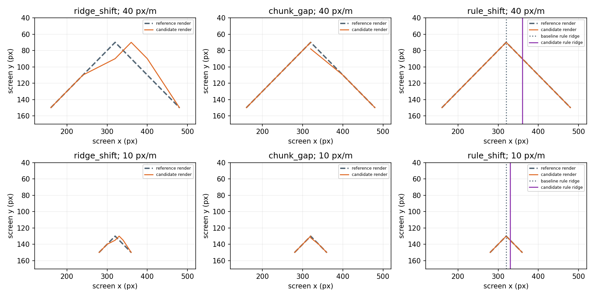

# 手工地形分块后的验收：沙丘轮廓、接缝与玩法边界

近景车辆旁的沙脊要保持形状，拉远又要能读清地形走向；为运行时拆成多个块以后，相邻块还不能裂开。与此同时，关卡设计已经验证过的通路和射击遮挡，不应因为美术替换悄悄改变。这不是“低模看起来差不多”一项检查能覆盖的交付。

本文面向熟悉网格导出和关卡灰盒的环境美术、技术美术与工具程序员。以《家园：卡拉克沙漠》的公开制作分工为参照，给出分块地形的三项独立验收。这里不还原该项目的分块或 LOD 算法；下面的剖面和规则反例是原创教学模型。

## 从可玩的布局到雕刻地形，中间保留什么

Jeff Lydell 在制作访谈中描述，团队先用简单布局试玩迭代，再做重要区域概念图与整图覆盖绘制，随后手工雕刻高模，用 Chunker 分块，最后布置物件、贴花和光照。[1] 这说明艺术细化接续的是已有设计意图，而不是一张可以随意替换的空地。

另一份团队访谈谈到，他们用 Unity Terrain 做原型，但当时高度图产生的沙脊效果不符合项目要求，因而采用雕刻工具；极大的镜头缩放范围也是地形制作约束。[2] 这是该团队的历史选择，不是“高度图不能做沙丘”的一般结论。

交给美术的基线应保存两类东西：可读的视觉目标，以及不允许无意变化的设计关系。例如入口到目标的通路、车辆所需宽度、关键高地和遮挡射击的脊线。设计允许修改时就更新基线并重测，不要要求最终顶点逐个贴住灰盒，也不要只留一张概念图让下游猜哪些坡必须保留。

## 分开验证轮廓、块边界和规则数据

GDC 2017 讲义将远方平面、渐变细节的外围地形与高细节分块游玩区域分别展示。[3] 它支持“不同区域承担不同呈现任务”的观察，却没有公开 Chunker 如何切网格、如何生成不同细节版本或如何处理接缝。因此，以下是可用于自己项目的验收方法，不是给这些图补写实现。

第一项是参考形状：分块、简化后的组合结果，是否保住作者指定的重要轮廓。第二项是相邻块：两侧在同一世界坐标下是否连接，法线和材质是否出现不期望的断点。第三项是玩法表示：视觉地形与通行、高度、遮挡数据是否仍表达同一设计。

这三项可以独立失败。把峰顶移走但保持块间连接，接缝检查会通过；两块分别保住大部分形状，却在公共边界错开，仍会裂开；完整保留渲染网格也无法证明规则数据没有读到旧版本。

## 两个缩放下看三个具体反例

下面的原创试件用沙脊侧向剖面隔离这些问题，不渲染真实地形。横向 x、高度 z 以米计，参考折线是 `(-4,0)、(-2,1)、(0,2)、(2,1)、(4,0)`，左右块以 x=0 分界。使用侧向正交投影：`u=320+s×x，v=150−s×z`，s 分别为 40 和 10 像素/米。较大的 s 表示放大观察，不是透视相机距离。

图中灰色虚线为参考，橙色为候选；坐标轴数值是模型的屏幕坐标，排版后的图片可能再次缩放，不能拿网页显示尺寸直接量像素。

左列把峰顶从 x=0 移到 x=1，保持峰高为 2，并把 x=0 的接合点改为 1.5。左右块在这个点仍相接，却改变了沙脊形状。两种缩放下，最高点横向位移分别为 40、10 像素。这是特定对应特征的位移，不是整条轮廓的最大距离。

中列保留左块末端 `(0,2)`，把右块起点改为 `(0,1.8)`。公共边界差 0.2 米，投影端点间距分别为 8、2 像素。若项目给这项检查设定“不超过 3 像素”的示例阈值，缩小观察会过，放大观察会失败。阈值不是推荐标准；这个结果说明只在战略远景验收不足以保证近景接缝。

右列完全不改渲染剖面，只将规则脊线从 x=0 移到 x=1，紫线标出错误位置。画面几何可以逐点相同，玩法却改变了：假定本例射击线沿 x 从 −0.5 到 0.5，跨过规则脊线即阻挡，那么基线阻挡，错位后不阻挡。该规则是为了暴露不同数据版本的简化约定，不是原游戏的射击算法。类似地，若教学规则规定高度至少 1.75 米有优势，同一位置的基线高度 2 与过期数据 1.5 会给出不同结果，渲染画面也不负责替它纠错。

脚本实际生成图像并计算、记录这些比较；没有用三幅“看起来有区别”的插图替代数值。它只覆盖一个二维剖面、两种正交缩放和两个规则判定，不测试三角形光栅化、遮挡、材质、车辆碰撞或真实玩家对沙脊的辨认。

## 把反例变成生产验收

先锁定参考资产、候选资产、导出坐标与单位，再锁定相机及分辨率。对目标镜头范围至少选近、中、远视图和会暴露关键山脊的方向；保存相机矩阵而不只记“离地几十米”。透视画面中，同一世界偏差的投影大小还依赖深度和方向，不能把上面的正交比例直接套上去。一个固定屏幕高度的选级阈值，也不能自动保证轮廓误差合格。

在无阴影、无纹理干扰的几何检查通道中，对齐参考与候选的轮廓或遮罩，找峰顶、鞍部和重要负空间的差异；再切回正式材质与灯光查看观感。前一种检查帮助定位几何，后一种能暴露法线和材质接缝，两者不能互相代替。多个镜头采样都正常只覆盖这些视图，不构成连续相机空间的最大误差证明。项目若需要硬上界，就需要另选有界算法或限制相机集合。

对块边界应检查同级与实际允许出现的混合细节组合。共享端点相同仍不够：一侧有中点、另一侧跨过它的大边，可能形成 T 接点；两侧顶点位置相同但法线不同，也会产生明暗断线。根据工具实际能力选择固定公共边界、共用边界数据或连接条带等方案，并在组合后复验。本文不指定其中哪种最优，也不把任何一种归给 Chunker。

最后用设计基线跑玩法检查，不要将渲染 LOD 自动当作通行或射击几何。记录每个可玩通道、指定车辆、关键高地和跨脊线射击的预期结果；美术版本变了而规则数据没变，或反过来，都应该能从版本记录定位。视觉沙脊与规则线不必逐顶点重合，但允许偏差及其可读性应由设计与美术共同确认，不能让两份数据独立漂移。

## 渲染高度图和玩法高度图不是同一个选择

GDC 讲义第 40—46 页展示二维模拟中的高度图、脊线、射击遮挡与高度优势；第 44 页的示意图明确把射击线与脊线相交联系起来。[3] 所以，团队不用原型阶段的地形方式来表达最终沙脊，并不意味着玩法不再使用高度数据；“二维模拟”也不表示高低差无关紧要。

对自己的项目，正确交付应分别写清：最终渲染来自哪一版雕刻与分块；规则高度、通路和遮挡来自什么输入；修改一方后如何重新生成或核验另一方。观察到剖面偏移，就先修形状；观察到公共边界断开，就查分块与组合；画面相同而射击结果改变，就查规则数据和版本。不要把三种失败都归到“模型不够精细”。

## 相关知识与复现

- [简化网格的验收：实际索引预算与曲面偏差](简化网格的验收：实际索引预算与曲面偏差.md)：解决数量与曲面误差，不能替代本文的相机及多块组合检查。
- [相机距离没变，为什么模型已经换了细节级别](相机距离没变，为什么模型已经换了细节级别.md)：选级规则与形状验收属于不同问题。
- [原创剖面脚本、图与运行结果](../../../../管理档案/实验/地形分块边界/README.md)。没有执行原游戏、Unity 或性能测量。

## 参考资料

[1] Jeff Lydell，Kirill Tokarev 采访，[The Creation of Homeworld: Deserts of Kharak](https://80.lv/articles/the-creation-of-homeworld-deserts-of-kharak)，80.lv，2017-09-15，Level Creation。

[2] Blackbird Interactive 团队，[A Deserts of Kharak Round Table: Part 2](https://www.fistsofheaven.com/deserts-of-kharak-blackbird-round-table-interview-part2/)，Fists of Heaven，手工地图问答，Yggy King 与 Mike Kuzel 的回答。本文仅引用团队的历史制作判断。

[3] Yossarian King，[The Great Divide: Unique Visuals and Deterministic Gameplay in Homeworld: Deserts of Kharak](https://media.gdcvault.com/gdc2017/Presentations/King_Yossarian_TheGreatDivide.pdf)，GDC 2017，PDF 第 12—14 页（地形层）、第 40—46 页（规则地形）。资料核读于 2026-11-19；未观看演讲视频。
