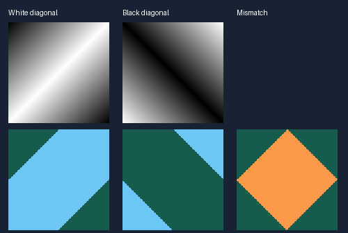

# 网格轮廓没变，为什么顶点色遮罩会跳

一段墙脚的苔藓在近处连续，镜头后退切到下一档网格时却突然断成两截。两档轮廓完全对得上，材质里读的也都是顶点色 R 通道。先别调换档距离：把远档单独显示，如果苔藓已经断了，慢一点换过去也不会把它接回来。

本文面向用顶点色控制材质混合的环境美术和技术美术。要判明的是：颜色没带过来、低模采样太稀，还是同样的顶点颜色经过另一种三角剖分后，已经代表了不同的遮罩。

## 顶点颜色相同，三角形中间仍可能不同

把墙面简化成一个平面方块，四个角的颜色沿周边依次为白、黑、白、黑。两张网格都用这四个顶点、两个三角形，唯一不同的是切哪条对角线。

- 连两个白角：中心落在两端都是 1 的边上，中心遮罩就是 1。
- 连两个黑角：同一个中心落在两端都是 0 的边上，中心遮罩变成 0。

顶点色只在顶点存值。画到某处时，用覆盖该处的三角形的三个顶点插值；换了连接关系，参与插值的点也会变。本例没少一个顶点、没丢一个颜色、没改任何几何位置，却能把中心从一种材质切成另一种。实际低模还可能删掉窄带中间唯一着色的顶点，这又是另一种失效：通道虽然还在，高频图案却没有足够的样本表达。

用软件 OpenGL 画这两张网格，读取 100×100 个对齐像素。测试着色器把线性遮罩不小于 0.503 的像素分给苔藓：两档分别有 7,450 和 2,450 个，整整 5,000 个对应位置换了材质。这里的阈值只是对照设置。对应表面点比较插值属性的思想也可见 Hoppe 论文 §4；这个方块是手工翻对角线，不是简化器的输出。[1]

上排为两张网格的原遮罩；下排蓝色为超过或等于阈值的部分，右下橙色标出两档选择不同材质的位置。两档轮廓与顶点值完全相同。

## 先看原遮罩，再看材质边界

在引擎中强制显示两档，固定相机、实例姿态和材质，把淡化、自动换档先关掉。单独输出实际用到的线性遮罩通道，例如 R；若查看器会套显示曲线，用读回的线性值比较，不要拿两个截图的视觉亮度代替输入值。先查两档是否真的有正确通道、着色器是否用的是同一分量、实例覆写是否已经迁移。一片恰好等于默认值的遮罩可能只是导入或实例配置问题，不能直接归咎于三角形简化。

通道没丢，再把两档的值配到同一处比较。平墙选固定正交镜头，两张图的同一像素位置可对齐；曲面或姿态变了，用同一 UV 图表或先验证对应关系的表面点。接缝、薄墙两层、相邻物件那里，最近点可能落到另一面；把对应不明确、新增遮挡、轮廓外像素另列，不要报成遮罩误差。

分别留两份结果。一份画原遮罩差 `|近档−远档|`，方便排查插值和重采样；另一份按**实际材质规则**画换材质的位置，方便看玩家会在哪里看到跳边。如果是硬切，在每张图上分别应用同一阈值再比较，不只报苔藓总比例。比如两条等宽的带各覆盖 2,000 格，但中间互不重叠，逐格看有 4,000 处改变。平滑混合则比较实际混合权重和成品效果，只有制作确实关心某条边界时才另设检查阈值。

差图能指出哪里走样，不能单独说明原因。若既换了拓扑又删了顶点，可先固定顶点和颜色只换索引，单独看连接关系带来的变化；再与删点、传色后的实际低档做同位置对照。真实低档往往同时变了几项，不必把整张差图强归给一种原因。

## 要保的不是顶点数量，而是这条边

如果问题其实是低档没带颜色，先修导入、实例覆写或低档传递。Unreal 的 Mesh Paint 有把 LOD0 顶点色应用到各 LOD 的操作，但这只说明颜色会传递，不保证原遮罩在更稀的三角形上仍可表达。传完要重做对应位置的对照。[2]

如果两档都有颜色但边界走样，优先试一种跟资产问题对应的解法：

- **边界是结构的一部分。** 可手工保留关键边或采样点，或试属性参与简化。以 meshoptimizer 的属性权重接口为例，可提高这个线性遮罩通道的相对权重，让它影响简化选择；要按输入通道数值范围定权重。权重不是边界偏移上限，目标索引数也未必达到；用实际输出重新量预算、几何和遮罩。[3]
- **图案比低档网格能表达的还细。** 若两档有稳定对应的 UV，可以烘到纹理里，让纹素而不是新增顶点提供图案采样。代价是纹理、UV 和采样成本；在实际切换距离检查 Mip 下的边缘。若两档 UV 本身不对应，先解决图表映射，不能单靠换一种载体。
- **远处可以舍掉小细节。** 明确远档保留哪条主边，哪些斑点有意淡掉。用强制档先看远档本身能不能读，再恢复过渡看动起来是否突兀。过渡可以藏跳变，不能替远档重新画回不存在的边。

验收时给制作者三份图：同镜头近／远档原遮罩、同位置的边界改动、目标距离的最终画面。另记实际三角数与几何偏差。这样同事可以指出“苔藓在下沿向上挪了”的具体位置，而不是面对两张看起来覆盖率差不多的图猜哪一步出了问题。

相关：[简化网格的验收：实际索引预算与曲面偏差](简化网格的验收：实际索引预算与曲面偏差.md)；[对角线读回与等覆盖条带的复现材料](../../../../管理档案/实验/顶点色遮罩与三角剖分/README.md)。

## 参考资料

[1] Hugues Hoppe, [New Quadric Metric for Simplifying Meshes with Appearance Attributes](https://www.hhoppe.com/newqem.pdf#page=3)，§4、图 2。
[2] Epic Games, [Mesh Paint Mode Tools and Settings](https://dev.epicgames.com/documentation/unreal-engine/mesh-paint-tool-reference-in-unreal-engine)，To LODs。
[3] meshoptimizer, [Attribute-aware simplification](https://github.com/zeux/meshoptimizer/blob/f0a684f11ead064e176775c9b796f82a55910e92/README.md#attribute-aware-simplification)。
