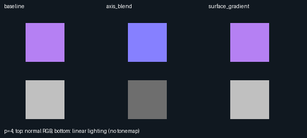

# 三平面材质换成平法线，为什么坡面还是变暗

给岩壁换上三平面材质后，坡面在两种投影之间变暗。你把三张法线贴图都换成无凹凸的平图，亮度竟然还没回到关闭法线贴图时的样子。这是个很有用的排查信号：如果纹理不提供任何斜率，输出就该保留材质启用这层细节前的基准法线。只调权重把暗带挪走，可能只是掩盖了基底或混合错误。

三平面投影用同一空间的位置生成三组 UV，分别沿 X、Y、Z 投影，然后按表面朝向加权。混颜色时，三份数据的 RGB 都指同样的量；混法线时，同一个 `(0,0,1)` 在三份数据中却指向三个不同的投影轴。本文用「平图不应改变基准法线」作为第一个验收，再给出可移到着色器里的斜率做法。

## 先把平图当作基准测试

设一个斜面的基准法线是 `N=(sin 25°, 0, cos 25°)`，也就是从 +Z 向 +X 倾斜 25°。如果各张平图都被旋到各自的投影轴，再用归一化的 `abs(N)^p` 权重进行加权并归一化，输出在这个正象限里就是 `normalize(N.x^p, 0, N.z^p)`。当 `p=1` 会还原原方向；当 `p=4`，较大的 Z 又被偏重，法线几乎直立。一个本来用来收窄纹理过渡区的参数，改变了无纹理细节时的受光。



我用两三角形构成这块斜面，在 Mesa 的软件 OpenGL 中实际读取同一张浮点平法线纹理，固定几何与光向，只换法线计算。指数 4 下，轴混合读回的倾角是 2.707°、比基准偏了约 22.293°；固定灯光的线性读数从约 0.753225 降到 0.432438。下文的梯度法仍约 25°，整张读回与基准的最大差约 7.15×10⁻⁷。指数 1 控制中，轴混合也还原了基准。这只是平图恒等性的实渲染，不是某个引擎、显卡或曲面接缝的对比；均匀斜面上的灰度也不是球面高光形状。

在工程里先输出基准与着色法线，不必先看最终画面。平图一开方向就变，查重定向和混合；法线方向没变但亮度变，则去查粗糙度、遮蔽、灯光与材质其它通道。用解码后的常量 `(0,0,1)` 能隔离格式导入，随后用实际贴图再跑一遍，才覆盖色彩空间、压缩和绿通道约定。

## 混合表面斜率，而不是混入三根平面朝向

对于按高度场约定解码的切线法线 `m=(mx,my,mz)`，若 `mz>0`，它可写成 `normalize(-du,-dv,1)`。因此 `(du,dv)=(-mx,-my)/mz`，而不是只拿前两个分量。平法线的斜率为零，不再向混合式贡献一根额外的轴。接近横躺的法线使分母接近零；例如可固定最低分母或最大斜率，并把它写进材质约定。任意画出的法线不保证能积成一张全局高度图，这里只使用局部斜率。[1]

**转换斜率要用实际采样 UV。** 设 U、V 都是由同一个世界或物体空间的位置 `P` 算出来的。某投影面的一对斜率为 `du,dv`，则它在共同空间的梯度是 `du*grad(U)+dv*grad(V)`。例如三平面取 `X:(z,y)`、`Y:(x,z)`、`Z:(x,y)` 时，对应为：

| 投影 | 共同空间中的梯度 `g` |
| --- | --- |
| X | `(0,dv,du)` |
| Y | `(du,0,dv)` |
| Z | `(du,dv,0)` |

表格假设单位尺度，没有翻转；换成 `X:(-2z,y)` 时，X 面的 Z 分量是 `-2*du`。实际用有限差分核对：`du=-0.35,dv=0.15` 得 `(0,0.15,0.70)`，忽略 UV 镜像会把重建法线的 Z 偏转变到反方向。这里用高度单位固定的测试函数，所以缩放进入链式法则；若素材只当法线细节使用，平铺密度与凹凸强度是不是联动，是另一个制作选择。纹理绿通道的导入修正负责把原文件读成与 V 轴一致的局部约定；之后才按实际 UV 的负号投影。不要因为两处都提到「翻转」就把同一个符号反两次。

把三份梯度按权重合成后，还不能直接减到基准法线上。梯度在共同空间中可以有沿基准法线的分量，而能够表示表面坡度的部分必须沿着表面。减去法向分量，再重建：[1]

```text
N = normalize(这层细节加入前的基准法线)
a = abs(N)
a = a / max(a.x, a.y, a.z)        # 单位法线至少有一个非零分量
w = pow(a, p)                    # 有限的 p > 0，最大项恒为 1
w = w / (w.x + w.y + w.z)
G = w.x*gX + w.y*gY + w.z*gZ       # 已按各自的实际 UV 转到共同空间
S = G - N*dot(N,G)                # 投到表面切平面
out = normalize(N - S)
```

先除以最大分量不会改变相对权重，但能防止高指数下三项都变成零。例如三个法线分量都是 `1/√3`，指数取 256，直接求幂在 32 位浮点里会全下溢；改写后三项都是 1，再各除以 3。平图时 `G=0`，于是 `out=N`，和权重指数无关。这里将权重当作本着色点的常量，不计算「表面位置变化时权重本身如何变化」。如果你真的要位移几何，并让法线严格对应全局高度 `H=Σwi*hi`，其导数还有 `Σhi*grad(wi)` 项，不能把上式直接当作那个高度场的精确导数。Mikkelsen 的原论文 §4.4 做了同样的局部权重假设；图 5 的对照也区分了直接取法线前两项造成的细节压扁，以及没有投到切面时在交界出现的伪影。[1]

## 到实际材质里怎样验

1. **先验平图**：固定光照、粗糙度和网格，依次扫正反面、轴间斜面、权重指数。比较基准与输出的夹角，不靠亮度猜。这里的基准应是加入本层细节前、与你的采样空间一致的单位法线；用物体坐标采样时，不要直接拿世界法线与物体空间的梯度相减。如果有非等比缩放且要按固定的世界高度做凹凸，按世界位置求实际 UV 梯度，在世界空间投影和重建；如果采样轴仍随物体，权重仍按物体投影轴的朝向算，不能悄悄换成世界 X/Y/Z 的分量。
2. **再验一个方向的凹凸**：给投影面一张只沿 U 变化的斜坡，锁定另两面，记录输出向哪边倾。镜像 U 后只反这一分量；恢复后再试 V。实际资产测试还要保留解码设置和正确的 UV 选择。若单轴就错，不要先调混合带。
3. **最后验交界带**：单轴都正确后，在倾角连续变化的曲面上扫权重，显示世界法线与各轴权重，找出方向是否和细节强度一起跳变。这里仍可能遇到三次采样的 MIP、不同坐标空间或纹理内容本身差异；平图通过不代表这些问题也通过。

如果不替换现有引擎的实现，这三步仍能判断当前材质的问题发生在哪一级。结果应该是平图时只保留基准，给局部坡度时方向能按采样轴解释，到了交界才讨论权重与材质取舍。

## 复现材料

[斜率有限差分、真实软件渲染与读回](../../../../管理档案/实验/三平面法线混合/README.md)。

## 参考资料

[1] Morten S. Mikkelsen. [Surface Gradient–Based Bump Mapping Framework](https://jcgt.org/published/0009/03/04/). *Journal of Computer Graphics Techniques* 9(3), 2020。方程 (5)、(6)、(16)，Listing 2/8，§4.4、Listing 13/14 与 Fig. 5。
