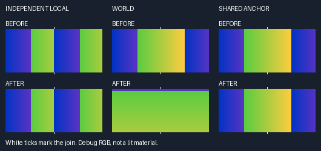

# 两块墙一起搬动，污渍怎样跟着走又不断缝

两块墙拼成一整面，污渍刚好横跨接缝。改用每块墙自己的局部投影后，污渍跟着墙走，却在拼缝处断了。改成世界投影，静止时接上了；整面墙一转，污渍又像留在原地。要让它像画在这组墙上，既不能让每块墙独立从零开始，也不能把投影钉在世界原点。可以给需要一起移动的几块墙一个共同的取样坐标系。

## 先决定图案应该跟谁走

| 想要的效果 | 取样坐标 | 必须接受的代价 |
| --- | --- | --- |
| 地面风化跨很多不移动的模块，连续铺开 | 同一个固定世界坐标系 | 移动几何会穿过图案；改变世界坐标原点时要保持相位 |
| 一块可独立搬动的木板保留自己的花纹 | 木板自己的局部空间或模型 UV | 邻板各从自己的原点开始取样，未约定拼接就可能有缝 |
| 一节可移动的车厢或墙组，污渍跨多个模块 | 整组共享、随组移动的坐标系 | 必须统一传递投影的原点、朝向与尺度；各块分开移动后不再自动续接 |

例如 Godot 4.5 的 StandardMaterial3D 文档将默认局部三平面投影与 **World Triplanar** 明确分开：后者改用世界空间。[1] 它提供了表中前两种坐标选择；共享可动坐标系是另一个接入方案，不是说打开该开关就能让污渍跟整个墙组走。

## 把每个片元换算回同一把尺

设墙组锚点的世界位置为 `A`，墙组旋转为正交矩阵 `R`，某个片元的世界位置为 `P`。当墙组整体只有平移和旋转时：

```text
墙组位置 = transpose(R) × (P − A)
取样坐标 = 墙组位置的投影分量 ÷ 每次平铺所需的米数
```

`transpose(R)` 是这种纯旋转的逆变换，不是任意物体矩阵的逆。比如墙面沿组内 X、Y 延伸，就拿这两个坐标去采样；想做三平面时，用同一空间的位置构造三组取样坐标，决定混合权重的几何法线也得转到对应空间。镜像或非均匀缩放下，不能把普通向量的变换直接照搬给法线；有关投影法线的验收，见[三平面材质的平法线测试](三平面材质换成平法线，为什么坡面还是变暗.md)。

每块墙都从实际的网格/实例变换算出自己的 `P`，但整组共用 `A、R` 和取样尺度，独立的绘制不影响公式。用共享父节点的坐标是一种实现，也可把墙组的逆变换按实例传给材质。不要把一个会被不同墙组轮流覆盖的全局参数当作逐组参数。两边即使拿到同一坐标，也还要使用一致的取样函数、纹理和参数；如果三平面权重随几何法线在硬边上改变，等坐标不等于等颜色。

用三米重复一次的条纹做纸面检查：两块各宽两米的墙相接，接缝位置在墙组的 `x=2`。按单块局部坐标看，左边从 `x=2` 接到右边的 `x=0`，相位直接从 `2/3` 跳到 `0`。共用墙组坐标后，两边都读 `2/3`；整体搬动或者旋转，只要逆变换仍指回同一个墙组，该表面点就仍读 `2/3`。

## 转动前后锁定同一个表面点做对照

我用离屏 OpenGL 将两个模块分开绘制，用着色器把条纹相位写成调试色。第二组对照给取样使用的世界位置做 90° 旋转和平移，但画面仍按模块原来的布局并排，方便逐点比较。图中白色短线标记拼接处；这不是灯光渲染，也没有执行真实引擎的三平面材质。



| 坐标来源 | 变换前，缝两侧相邻像素的相位 | 同一表面点，旋转和平移前 → 后 |
| --- | --- | --- |
| 单块局部 | 0.661458 / 0.005208 | 0.005208 → 0.005208 |
| 固定世界 | 0.661458 / 0.671875 | 0.671875 → 0.494792 |
| 共享可动锚点 | 0.661458 / 0.671875 | 0.671875 → 0.671875 |

缝两边像素不是同一个点，连续投影下相隔一点是正常的；有问题的是相位突然跳回去。读回表明，在本例里单块局部能固定到表面却接不上；固定世界能在静止时接上却改采样；共享锚点同时保留相位与接缝。若项目只观察最终光照，颜色和法线的变化容易混在一起，建议先固定采样参数，用无光照坐标条纹确认到底是哪一层发生了变化。

## 原点和缩放是两个独立的验收项

大地图重定位原点时，把 `P` 和 `A` 同时换算到新的同一个坐标系，差值不变。相机相对渲染也要保持这个条件，不能一个用绝对位置、另一个已经减去相机原点。本实验把坐标减去同一偏移，固定世界相位从 0.338562 变成 0.005219，共享锚点保持 0.671875。若艺术目标本来就是图案固定于绝对世界，应保留稳定世界锚或等价的平铺相位补偿，而不是随原点重置图案。这个试验选用较小的坐标，没有测大坐标浮点精度。

缩放需要另定规则。让完整的逆仿射变换带走缩放，原来的表面点仍读同一相位；但从两米拉成四米，图案也会拉长。若纹理必须保持每三米重复，就只消除平移、旋转，留下实际米数变化，同一表面点可能改采样。两种要求在可缩放方向上不能同时无条件满足。可以把需固定的编号或锈斑留给模型 UV 或贴花，把要求米数一致的砖纹交给另一层，并按[两向纹素密度](墙面横向拉长后，怎样保持两向纹素密度.md)验收。

最终至少检查三种操作：两块拼接不动、整组旋转加平移、各模块或整组缩放。对跨块的大污渍，应先查那几块拿到的是不是同一个锚点，再查投影宽度和纹理参数。若原点可重定位，还要专门做一次前后对照。

[复现实验、图像和读回](../../../../管理档案/实验/material-anchor-moving-modules/README.md)

## 来源

1. Godot Engine，[Standard Material 3D and ORM Material 3D](https://docs.godotengine.org/en/4.5/tutorials/3d/standard_material_3d.html#world-triplanar)，4.5 文档，UV1/UV2 的 Triplanar Mapping 与 World Triplanar。本文实际实验采用 Mesa OpenGL 的调试着色器，不把结果当作 Godot 功能的运行测量。
