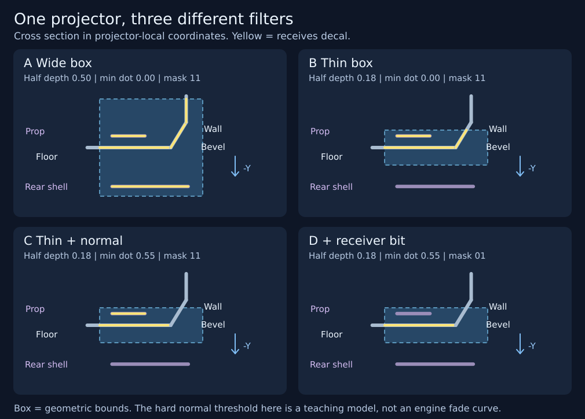

# 地面贴花为什么投到了道具上

车库地面的编号本来只该印在混凝土上。把一只矮箱推过编号，箱盖也出现同样的字；附近的地面倒角则拉出一条很长的色带。两处看起来都是“投多了”，但改投影方向解决不了平行箱盖，缩短投影也可能把本来要保留的坡面裁掉。要找对参数，先确定是哪一项把不该上色的位置放进来了：投影盒、表面朝向，还是接收类别。

## 投影盒圈出候选，不替你选接收面

以朝局部 −Y 投射的正交盒为例：把接收表面上的点变到投影器的局部坐标；X、Z 决定是否落在贴图范围及对应的纹理坐标，Y 决定是否在投影深度内。两个点可以有同样的 X、Z 和不同的 Y，因此会读到同一块图案。在没有另做投影可见性测试的实现里，画面会根据相机可见表面上色，但从投影器看过去，并不是打中第一层就停。相机暂时看不见后壳也不能说明后壳没接收；换相机角度，或把前面的道具移开再看。[1][2][3]

先把深度收紧到能包住**目标**的最小实用范围。平整地面只需薄盒，落在更深处的背面壳体可被排除；斜坡、地砖接缝和视觉上预期连续的高低变化要留余量。装配多块地面时，从最高和最低的目标面都看一遍。若箱盖与地面只差一点高度，或者共面，收紧盒子既可能伤到目标，也不保证区分箱子。

## 倒角处理朝向，平行箱盖处理接收类别

在正交投影的一个剖面里，若沿坡面最陡方向走，表面长度 s 对应投影平面长度 s·cosθ，θ 是表面与投影平面的夹角。没被盒边裁掉且纹理在该方向覆盖宽度相同时，一段宽为 1 的图案在 60° 坡上要走 2 个表面单位；75° 约要走 3.86 个单位。不是整个贴花都等比放大：沿等高方向没有这项拉伸。表面朝投影方向越接近侧立，沿坡向的同一纹理区间就越难走完。Epic 的 Unreal Engine 4.27 示例也明确指出，表面越平行于投射方向，拉伸越明显。[2]

如果倒角不该着色，可以让斜面按法线朝向淡出。在 Godot 4.7 的 Forward+ 中，`normal_fade` 非零时用法线点积的映射值算平滑权重，乘到原有衰减上；这不是把参数当成某个角度，过线就全部丢弃。实际调参要看最陡的**目标**面和最缓的**非目标**面；若两者朝向重叠，单靠朝向也不能区分。若编号原本就该弯上路缘，先保留目标坡度；角度淡出会减少拖尾，却不会把已经拉伸的字重新排正。字形必须跨两面而不变形时，可改成沿两面排布的贴片或直接在资产材质里放图案。[1][3]

箱盖和地面法线相同，朝向衰减对它们给出同样的权重。给地面渲染对象增加“接收地面标识”的位，让编号投影器只选这一位，不给箱子这位。保留箱子的其他渲染层，使它仍能接收该接收的其他效果。Godot 4.7 的 Decal `cull_mask` 匹配 `VisualInstance3D.layers`；贴花支持 Forward+ 与 Mobile，不支持 Compatibility，Mobile 还要留意可影响单网格的贴花上限与可见性包围盒。Unity URP 15.0.4 要先在 Decal Renderer Feature 开启 **Use Rendering Layers**；官方在固定投影器的情况下移除油漆桶的接收位，桶盖和桶身的橙色消失，墙面与地面的标记保留。这一位表示接收资格，不表示哪些面会为其他面挡住投影。[1][3][4]

## 用同一个镜头逐项排查，再换镜头验收

把成品图先换成边界清楚、只有底色的调试图，关闭贴花写入的法线和粗糙度，固定投影器与观察镜头。摆一块应接收的平地、一件可移动的平行道具、一块更深的后壳，以及有代表性的倒角。先允许两类物体接收并看宽盒，再每次只改一项。若引擎还带沿深度的淡出，先用不淡出的调试设置看几何裁切，否则缩盒可能让盒内的点也变淡；记录硬边界后再恢复成品所需的淡出。

| 操作 | 看什么 | 如果仍有问题 |
| --- | --- | --- |
| 收盒深度，不动 X/Z 范围 | 后壳是否退出，预期着色的地面范围是否完整 | 从盒坐标核对目标是否真的在深度内；不要靠扩大平面尺寸补深度 |
| 固定盒和接收层，调朝向淡出 | 倒角色带是否减弱，应着色的斜坡是否变淡 | 用同一张图看平地和目标坡；坡度重叠时换接收划分或改贴图方式 |
| 固定盒和淡出，只改道具接收位 | 平行道具是否变干净，地面是否仍着色 | 检查启用的渲染路径、相机实际所用的 Renderer，以及渲染组件而不是碰撞层的设置 |

[四组对照的原创剖面图与复现](../../../../管理档案/实验/投影贴花的接收边界/README.md)把这个差别画出来：把盒半深从 0.50 缩到 0.18 后，深处后壳和较高的墙消失，箱盖和仍在盒内的那一段倒角都还在。加朝向筛选后倒角退出，箱盖仍在；最后才用接收位排掉箱盖。图用硬阈值来单独演示变量，并不是 Godot 或 Unity 的淡出实测。

恢复成品材质，从不同镜头检查仍会露出的后侧；让道具移入、停留、移出，再放回该受影响的坡面。确认地面没有跟着道具的接收位变化而丢掉图案，并在交付所用的渲染路径上复测。若数个表面被合成同一个渲染对象、只有一套接收位，改对象位通常会一起影响几个面。此时可以按接收类别拆对象，但得检查合批、资产维护和光照归属；若只有一块固定标志不必投影，往往更直接的是让专用贴片随指定资产走，检查深度打架与细节级别切换。若本来就要一张污迹跨多个模块，反而应该保留共同接收位，只用盒与淡出限定范围。较好的验收条件是“哪些表面在什么情况下要留下图案”，而不是“把盒调到尽量薄”。

## 参考资料

[1] Godot Engine，[Decal 类文档](https://docs.godotengine.org/en/4.7/classes/class_decal.html)，4.7，类说明、`size`、`cull_mask`、`normal_fade`。
[2] Epic Games，[1.4 - Projection on Multiple Surfaces](https://dev.epicgames.com/documentation/en-us/unreal-engine/1.4---projection-on-multiple-surfaces?application_version=4.27)，Unreal Engine 4.27，Decal 示例地图。
[3] Godot Engine，[Forward+ 的贴花分支](https://github.com/godotengine/godot/blob/ed1daf0bf/servers/rendering/renderer_rd/shaders/forward_clustered/scene_forward_clustered.glsl#L1462-L1474)，固定提交 `ed1daf0bf`，接收层、盒内测试与角度权重。
[4] Unity Technologies，[Rendering Layers](https://docs.unity3d.com/kr/Packages/com.unity.render-pipelines.universal@15.0/manual/features/rendering-layers.html)，URP 15.0.4，Enable Rendering Layers for Decals 与 How to use Rendering Layers with Decals。
