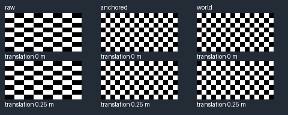

# 墙面横向拉长后，怎样保持两向纹素密度

关卡把一块两米宽的墙横向拉成四米，贴图、材质和 UV 都没换，砖缝却变成了原来两倍宽。旁边另一块没缩放的墙仍正常。问题不一定在贴图分辨率：同样数量的纹素，现在被摊在更长的表面上。

本文面向环境美术和技术美术。目标是数清密度在哪个方向降低、选出要不要跟随模块的贴图方式，并在引擎里区分尺寸修好了与贴图滑动了。

## 要算的是表面上一米分到几枚纹素

先选墙面上两段实际边长，一段横向、一段纵向。以引擎中的实例世界尺寸为准，不用 DCC 导出前的顶点坐标代替。再看材质给这两段安排了多少 UV 距离。矩形墙的两边刚好各沿一个 UV 轴时：

```text
横向纹素/米 = 贴图宽度 × |横边上的 ΔU| ÷ 横边世界长度
纵向纹素/米 = 贴图高度 × |纵边上的 ΔV| ÷ 纵边世界长度
```

单位是原图纹素，不是屏幕像素；距离、分辨率感、Mip 与流送会改变最后看到多少信息，但不会替你纠正 UV 在表面上铺的比例。比较时先固定近景、材质与采样设置，排除不同级别的 Mip 或压缩差异。

例如一张 1024×1024 平铺材质，原来一整张图铺满 2 m × 2 m 的墙，两向都是 512 纹素/米。关卡只把横边拉到 4 m，UV 仍各走 0→1，于是横向变为 256，纵向仍是 512。面积加倍后得到一个平均密度数字，不能告诉你砖缝是哪一边变宽；统一把 U、V 都乘 2，又会把本来正确的纵向抬到 1024。

有倾斜 UV、镜像、UV 旋转或上级变换时，不要猜横边就是 U。对任一世界边长 d，把这条边的两分量纹素位移写成 `(宽×ΔU, 高×ΔV)`，向量长度除以 d，得到沿该边的密度。有剪切时仅测两条边仍可能漏掉斜向变形：可再用棋盘检查对角方向，程序化工具则可把同一三角形的两条独立边投到正交的表面切平面，以纹素边矩阵乘表面边矩阵的逆，求这个映射的最小和最大伸长率（奇异值）。退化三角形没有稳定的逆，应另报而不是作正常样本。

## 同样是 512，砖缝跟不跟着模块走？

对前述矩形，横向改为重复两次、纵向维持一次，就得 512×512。实施前先看贴图是否允许重复：可平铺的石纹和每个部件独有的破损、标号、烘焙遮蔽不是同一层。后者重复两次会复制标号或把细节错放。这时要保留独有细节的 UV，只在可平铺细节层补尺度；若最终几何永久修改且独有纹理也要重新分配密度，回资产重新展开或调整纹理预算。

可平铺层可以按两种坐标计算：

- **跟着实例的原点。** 在简单不剪切且 UV 与实例轴对齐的平面，用实例的方向尺度修正各自平铺次数。若用投影，也可以先减去实例世界原点，再对跟随物体旋转的正交基取分量，以米为单位除以平铺周期。注意完整的世界转局部反变换通常也会除掉缩放；如果退回原始 2 m 的局部坐标却没补尺度，横向仍是 256。邻接模块的原点不同，纹理接缝需要单独验收。
- **跟着世界的原点。** 沿固定的世界方向投影，以米设周期。适合不动且想跨模块连续的墙；移动或旋转模块时，表面会从固定图案下滑过。UE 5.9 的 WorldAlignedTexture 允许用世界单位指定 TextureSize，文档明确说明移动物体可能出现这种滑动。[1] 投影方向、法线选择和接缝是另一个条件，不要将一块正面墙的结果推广到任意倾角的所有表面。

需要物件移动后仍像刷在物件上的图案，就选前一种，或者保留资产自己的 UV。极端非均匀缩放、旋转后的上级缩放和剪切，不适合只对 U、V 乘两个数字；先量实际表面两个方向，必要时回资产消除剪切、为实际形状再展开，或重新确定投影基。如果墙完全不会动，且核心需求是在相邻模块跨缝保持同一相位，世界坐标往往更直接；仍要确认所有面用的是同一世界尺度和对齐约定。

## 把密度与贴附做成两次检查

先摆一块原尺寸和一块横拉的模块，用同一可平铺棋盘，按已测得的世界边长记横、纵重复次数。随后锁定观察的是**模块表面的同一点**，把模块与测试相机一起平移。修正了密度的两种方式在原点对齐时可以完全一样；只看这一帧无法判断贴图归属。再用非整周期平移，避免正好移到重复花纹上；若贴图高度对称，换不对称的测试标记。若项目允许旋转，补一组旋转和相邻模块拼接。不只看截图，还可记 UV 或采样位置随坐标变化的趋势。

在一个 64×32 的离屏 OpenGL 试件里，我把 4 m × 2 m 的面分别分配给原 UV、实例锚定和世界锚定三组，使用真正上传的 8×8 最近邻棋盘。读取对应的一行和一列，横向黑白跳变从原 UV 的 7 次变为两种修正的 15 次，纵向始终 7 次。再固定屏幕中的几何，只给世界坐标加 0.25 m（等效于墙和相机一起平移），实例锚定的整张读回不变，世界锚定则从黑白格的一侧移到另一侧。这里计的是小棋盘读回的边界跳变；1024×1024 算例中的源贴图尺寸用于上面的计算，未上传 1024×1024 贴图。试件是 Mesa 软件 OpenGL，不是 Unreal 或 Unity 实机，也不测 Mip、压缩、画质或帧率。



## 复现材料

[OpenGL 试件、读回数值与运行说明](../../../../管理档案/实验/缩放实例的纹素密度/README.md)。

## 参考资料

[1] Epic Games，[Texturing Material Functions](https://dev.epicgames.com/documentation/en-us/unreal-engine/texturing-material-functions-in-unreal-engine)，WorldAlignedTexture 与 TextureSize，UE 5.9 文档，2026-11-21 读取。
