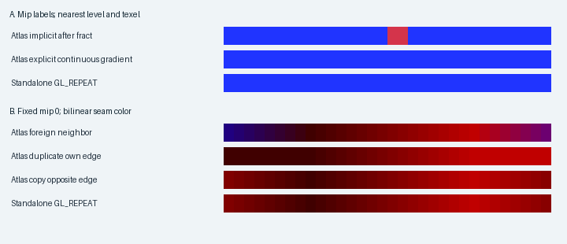

# 重复贴图在图集接缝处发糊，先分清梯度与周期边缘

一张地砖单独使用时可以连续重复，塞进图集后却每隔一块在边界糊一条。邻图若是蓝色，缝还会泛蓝。有时加护边消除了蓝色，却留下一条同色系的亮暗线。这不是同一个修复能处理的三种颜色结果：先看是否选错缩小级别，再看固定级别时，采样器有没有把这张地砖的最后一列接回第一列。

## 先关掉会混色的过滤，看接缝选了哪一级

假设每块 32 个纹素，两枚相邻屏幕像素对应的重复坐标是 `0.984375` 与 `1.015625`。连续坐标只走了 1 个纹素；取 `fract` 后却变成 `0.984375` 和 `0.015625`，差了 −31 个纹素。这是同一条表面上的相邻像素跨进了下一个周期，不是真实缩小倍率突然变大。只考虑横向的简化估算 `log2(变化幅度，以纹素计)` 从 0 变为约 4.95；实际隐式导数与级别还取决于像素组、滤波、钳制和实现，不保证每个接缝像素都选中同一级。

隔离这个问题时，给不同 Mip 填入不同识别色，保持整级纯色；用最近纹素和最近级别，让颜色只表达选中的一级，不可能来自邻图。用同一个连续坐标场，比较三条路径：独立纹理、连续地址交给硬件 Repeat；图集内折回地址后隐式采样；折回地址不变但显式传入连续梯度。除了缝，还要查看相同缩放比例的块内点作为对照。

连续坐标必须包含真实重复次数，梯度还要换到实际图集单位。下例是固定不旋转的内容子矩形；`origin` 和 `tileScale` 以整张图集的归一化坐标表示，宽高按**内容区**算，不包括两边保护带：

```glsl
vec2 continuous = uv * repeats;
vec2 gx = dFdx(continuous) * tileScale;
vec2 gy = dFdy(continuous) * tileScale;
vec2 atlasUV = origin + fract(continuous) * tileScale;
vec4 color = textureGrad(atlas, atlasUV, gx, gy);
```

例如 32 宽的砖位于 128 宽的图集，水平方向梯度也乘 1/4；否则用错了单位。若打包时旋转图块，则地址和两份梯度都用同一个连续线性变换，只有地址加原点。求导放在满足语言要求的一致控制流中，不要在相邻像素可能分开的分支里临时求导。[1][2] 图块 ID 如果并非固定，应该先从连续参数计算有效梯度，再应用正确的那一块映射；混合着不同图块地址直接差分没有意义。

## 固定 Mip 再看边缘：没有串蓝，也可能没接对

把 Mip 锁在基级或当前可疑级，使用级内双线性，先用没有图集的独立 Repeat 做同坐标参照。若地砖首列线性红通道 0.25、末列是 0.75，刚好在重复线的样点，会在这两列中心的中间，各取一半，应该是 0.5。[3] 把图集的左护边复制成首列，虽然挡了邻图的蓝色，样点却变成首列混首列，红通道只有 0.25。复制末列到左护边、复制首列到右护边，才模拟这一级的周期边界。两轴都重复时，角落也要从对应的对角边缘取值。

整页图集的 Repeat/Clamp 只认识整张纹理的边，不认识应用划定的子矩形。[3] 如果该块正确的行为本来就是不重复，边缘扩张则是另一种合理做法；先经独立纹理确认材料本来应该 Repeat 还是 Clamp。若瓦片自己首尾图案在视觉上不连续，周期护边只能使采样等价于 Repeat，不能替美术消除原本就存在的接缝。

## 交付前要同时检查每级内容与实际过滤

上一步的护边试验只说明一个固定级别。要在各级维持局部 Repeat，生成缩小图的时候也要按各子图周期滤波，避免一开始就把邻图烘进内容；再保证各级的布局和保护带覆盖实际的采样足迹。一个级里的护边有效，不保证较低级、三线性参与的另一层，或掠视角扩大的各向异性采样也有效。自建各级图集时，若沿用同一套归一化 UV，各级内容区必须仍落在它应对应的位置，不能在每级随意重新装箱。[2][4]

如果预过滤已串色，先看[非重复图集的缩图与边界检查](图集缩小时为什么串色：区分%20Mip%20生成与边界采样.md)，用单纹素读取确定颜色何时进来的。不希望团队维护跨级护边时，可以评估纹理数组：同规格图块放进独立层，按各层自身的坐标重复；代价是层规格、格式、平台和材质访问约束。若必须用图集，可限制最粗参与级别来避开保护带不足的级，但远处可能更容易走样；以真实最远距离和视角验收，而不把限制当无损修复。

## 两个独立的帧缓冲对照

在 Mesa llvmpipe 的 OpenGL 4.5 软件实现里，第一组用不同纯色标记各级。图集隐式采样只有接缝处的第 16、17 列（从零开始）选到 Mip 5，其余 30 列是 Mip 0；同一折回地址改用连续梯度后，和独立 Repeat 一样全是 Mip 0。这里的「5」是用色标读到的，不是用公式推定的。上半图用蓝色标 Mip 0、红色标 Mip 5，蓝色不代表邻图串色。

第二组固定 Mip 0、级内线性过滤，不再比较梯度。左接缝读回的 RGB 字节分别为：无护边 `(32,0,128)`、复制自身边缘 `(64,0,0)`、复制对侧边缘 `(128,0,0)`、独立 Repeat `(128,0,0)`。后两者整条条带的像素一致。该试件只在水平轴重复，不代表旋转打包的图块、压缩纹理、各向异性或硬件实现已验证。



[复现实验](../../../../管理档案/实验/重复图集的梯度与周期护边/README.md)

## 资料

- [1] Khronos，[The OpenGL Shading Language 4.60](https://registry.khronos.org/OpenGL/specs/gl/GLSLangSpec.4.60.pdf)，§8.9 纹理采样、§8.14.1 导数函数。
- [2] Li-Yi Wei，[Tile-Based Texture Mapping](https://developer.nvidia.com/gpugems/gpugems2/part-ii-shading-lighting-and-shadows/chapter-12-tile-based-texture-mapping)，GPU Gems 2 第 12 章，§12.3–12.5。
- [3] Khronos，[OpenGL 4.6 Core Profile Specification](https://registry.khronos.org/OpenGL/specs/gl/glspec46.core.pdf)，§8.14.1–8.14.3，纹素中心、寻址与过滤。
- [4] Mikola Lysenko，[Texture atlases, wrapping and mip mapping](https://0fps.net/2013/07/09/texture-atlases-wrapping-and-mip-mapping/)，2013，周期缩图与跨接缝的 LOD 问题。
