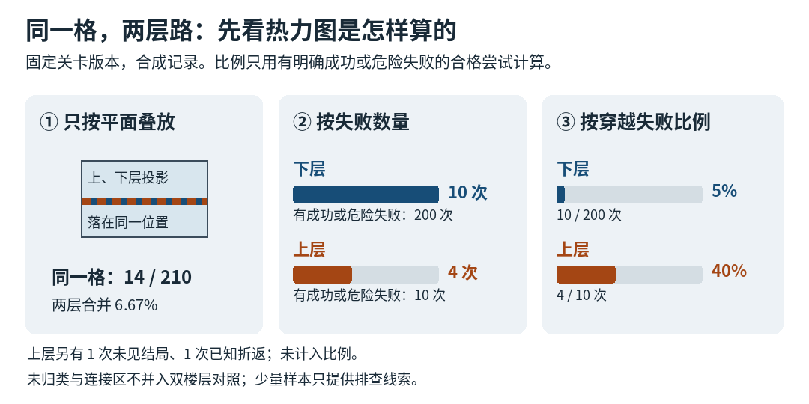

# 热力图把楼上楼下压成一层时，怎样找对问题地点

俯视关卡图上，桥面和桥下通道占着同一格。试玩时，关卡设计师发现这格的死亡标记很密，准备调整桥下敌人的位置。但把日志分层后，桥下只是过人多，桥面才是每次进入后更容易出问题的路线。如果玩家从桥上被击落，死亡位置还可能在桥下，那里既有自己的失败，又背上了桥上失足的那一笔。下面的方法用于定位该去哪段路线看回放，不用一张热力图直接判断应该削弱什么。

## 先分清要找的是死亡位置，还是问题路线

死亡位置用来查尸体回收范围、观战镜头或实际死亡集中在哪里，应该保留结局发生的位置。路线诊断问的是「进入这段路之后，有明确成功或危险失败的尝试中，有多少次以危险失败告终」，应该在尝试开始时确定路线归属，再关联这一次的结局。二者都可以用，不应让一个坐标字段同时回答两个问题。

Amazon Game Studios 的《Breakaway》开发团队公开过一套二维死亡事件查询：按竞技场和横向位置分格，再数每格死亡事件。这个口径适合发现哪儿死的人多，但公开的查询没有按每处经过次数归一，也没有分楼层；它不能单独回答哪段路线更容易失败。[1]

先拿一组回放在编辑器确认坐标约定：哪个轴朝上、平面图原点朝哪、缩放与旋转如何换算。把已知入口和桥孔在底图里各投一次。然后让分析键在平面格以外附上关卡构建版本和路线区域。例如 `(关卡版本, 区域, 横向格)`，同一格的桥面、下层、楼梯不共用区域。横向格取入口标记点在底图上的格，沿途移动与死亡位置都不重写它。入口横跨多格时，可以让同一入口共用固定锚点，避免边界抖动把同一路线拆开。比较发生在同一段路线、观察窗和同一类目标里；地图改了先按版本分开，不能因为两个版本叫同一个名字就拼接。

## 让区域跟着尝试走，不跟着最后的坐标跳

为需要比较的危险段定义入口和结束：进入桥头的标记区域开始；从约定出口出去是成功，在这段尝试内触发跌落失败或死亡则是失败；已知主动折返、传送或对局结束另记为其他终止，不是危险失败，也不是缺失。仍在进行、超出观察窗或没有收到结局单独显示；不满足参与条件的进入不纳入。这里比较已观察到成功或危险失败的合格尝试，不是所有进入者最终遭遇危险的概率。若大量玩家选择折返，折返本身也值得查，不要让它从仪表盘消失。路线的长度、规则或交战角色明显不同时，比例仍可用于各自回看，不能据此做难度排名。

记录尝试 ID、发生时的构建和区域、事件 ID、时间及结果。区域最好由游戏当时已经知道的地面/平台语义或设计标注给出，用在产生尝试的一侧；取支撑面必须是当时已经确定的支撑，不能在客户端事后向下射一道线就当它是起点。桥上开始的一次跌落不应改记下层；楼梯和升降机在进入连接段时用明确的连接区。没有可靠支撑或标记的事件留在未归类，别按 Z 硬猜。移动平台等动态支撑如果要独立分析，也应有跨采样稳定的标识。若任务是给每段路径各记一次，穿过两个区域就开两个有独立定义的局部尝试；不能把单次结局无条件算到途经的所有格。

传输重试可按事件 ID 去重；同一次尝试即使换了消息 ID，也不能记两次失败。真正的重试有新的尝试 ID，却仍可能是同一个玩家；对照时并列显示玩家/对局数，在真正做估计时考虑同一玩家反复尝试的相关性。时间顺序用发生时刻和可信序号，需要时留迟到窗口，不因上报顺序颠倒就抢先判定未完成或把失败发给下一个尝试。

## 数量和比例同时看，缺的结局不要抹掉

两层固定使用同一观察口径：下层 200 次有明确结局，失败 10 次；桥面 10 次失败 4 次。压平后得到 14 次和 14/210；分开看下层失败最多，却只有 5%，桥面是 40%。合并比例按各层的分母加权，不是把 5% 与 40% 取平均。图里是故意造出来的对照，4/10 只值得先看回放，不说明桥面在玩家总体中一定更难。不让低于所需资料量的格自动排第一；并列展示每格失败数、已知成功或危险失败的尝试数、其他已知终止数，以及没观察到结局的尝试数。

有一个上层尝试还没到结局时，不把它算成功。先看缺失是否集中在楼层、平台、退出或特定版本；让每次进入有同样的跟踪期限；即便如此，如果失联常发生在失败时，仅看已知结局仍会偏。若这次入口确认有效且能假定最终只可能是成功或危险失败，把它分别按两个极端情况计算：桥面是 4/11 到 5/11，下层仍是 10/200。这个范围不是置信区间，也不覆盖漏记的入口或第三种终止。大量未知时范围可能重叠，就先补事件和覆盖，不急着改关卡。没有已知成功或危险失败时显示“无数据”，而不是填成零失败。

## 查入口和转移，再决定改几何还是改记录

先挑几条原始轨迹，从同版本底图和分层面读出路线：桥上开始却摔到下层、经楼梯双向通过、从桥边单向跳下、传送切段。确认进入点、结局位置、是否经过连接区分别记录；日志跨度里跨过多个区域的轨迹不能只靠两个点补出一条不存在的路线。研究《Quake III》和《Unreal Tournament 2003》的 Bauckhage 等人从连续的三维位置推导出有向路线关系，下跳可达但不一定能返程。[2] 用同样的判断反查问题是楼层分类错、确实是单向落差，还是玩家走向另一个入口，而不是按图上的相邻格推断可通行。

接着对桥面 10 次都看一遍：从哪个入口进，失败前发生了什么，没失败的走了哪条线。Ubisoft 的 Jonathan Dankoff 介绍过用路线覆盖图定位降落伞教学里测试玩家没有按预期走的路线，再交给设计师检查区域。[3] 这里也先用录像检验是否总在同一个动作或障碍失败；若桥面只由一小类玩家选择，进一步按角色、入口、版本和玩家经验拆开。改动后在同一套入口和结局规则下验收新版，保留旧版对照。热力图能缩小排查范围，不能独自区分曝光量、玩家构成、关卡机制与记录缺失。

相关：[如何计算关卡完成率](如何计算关卡完成率.md)，详述乱序、重试与观察窗口的口径。

[复现：固定输入下的分层、合并和未知结局计数](../../../../管理档案/实验/叠层路线的热力图口径/README.md)

## 参考资料
- [1] Brent Nash（Amazon Game Studios），《Building an Event-Based Analytics Pipeline for Amazon Game Studios’ Breakaway》，Transmitting gameplay events、Analyzing gameplay data。https://aws.amazon.com/blogs/big-data/building-an-event-based-analytics-pipeline-for-amazon-game-studios-breakaway/
- [2] Christian Bauckhage、Rafet Sifa、Anders Drachen、Christian Thurau、Fabian Hadiji，《Beyond Heatmaps: Spatio-Temporal Clustering using Behavior-Based Partitioning of Game Levels》，IEEE CIG 2014，§II、§III，图 1 与 §V.A。https://andersdrachen.com/wp-content/uploads/2014/07/beyondheatmapsspatiotemporalclusteringusingbehaviorbasedpartionioningofgamelevels_ieeecig2014.pdf
- [3] Jonathan Dankoff，《Game Telemetry with DNA Tracking on Assassin’s Creed》，Part 3，Geographic representation。https://www.gamedeveloper.com/design/game-telemetry-with-dna-tracking-on-assassin-s-creed
