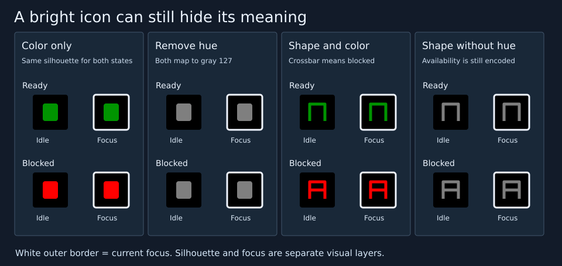

# 游戏界面不用颜色也能辨认状态：门标记与操作焦点

地图上的两扇门图标都十分醒目：绿色表示可通过，红色表示锁定。玩家用手柄把焦点移到红门，外框也亮了，却仍想知道：外框是不是表示这扇门能打开？如果只能在两种色相之间找答案，哪怕玩家看得清图标轮廓，也可能无从判断门的状态。

这里讨论游戏界面里的**辨认状态**。会测试图标能不能从底图上看见，但不把“看见一个亮标记”当成“读出了它的意思”。门只是示例；做材料不足、技能不可用或地图路线提示时，也应先定清用户必须读到什么，再决定形状、文字和颜色怎么分工。

## 图标对背景足够亮，两种状态仍可能一样

设背景是纯黑，绿图标用 sRGB `#009400`，红图标用 `#ff0000`。按 W3C 的 sRGB 相对亮度算法，先把各通道从编码值还原到线性值，再由线性 RGB 计算亮度；对比度为 `(较亮值 + 0.05) / (较暗值 + 0.05)`。[1] 这个计算只用于本例的固定色值，不代替按游戏实际背景及显示配置做检查。

| 比较对象 | 本例结果 |
| --- | --- |
| 绿标记对黑底 | 约 5.24:1 |
| 红标记对黑底 | 约 5.25:1 |
| 两种标记颜色彼此 | 约 1.003:1 |
| 取相对亮度后再编码成 8 位灰度 | 都是 127 |

这不是说两种颜色在正常彩色画面里看起来一样。它说明一个具体反例：两种图标单独对背景的亮度对比都不低，但移除色相以后，它们可以完全是同样的像素。**可见性**和**状态可区分**不能用同一个对比度数字验收。背景发生变化时，另按[HUD 文字与背景对比度](背景变化时怎样保持HUD文字的对比度.md)检查文字是否仍可读；本篇不重新规定文字阈值。

WCAG 2.2 的 Use of Color 是网页标准。其解读允许在某些只需分辨区域的情形用足够的明暗差作为额外区分；如果任务要求知道某一颜色具体代表“有效”还是“无效”，解读仍要求额外的可见标记，而不是凭比值认定玩家会知道颜色含义。[2] Xbox Accessibility Guideline 103 对游戏强调给重要信息加其他提示渠道。[3] 两份来源用途不同，不应把网页中的某个数字照抄成整个游戏或主机审核的通过条件。

## 把门的状态和玩家的操作焦点分两层

可用的门用开口形状，锁定的门在内部加明显的横闩。颜色仍可以帮助快速扫视，但不再是表示状态的唯一手段。可焦点化的门另有外框，表示手柄或键盘现在停在哪里；锁定的门也可以被聚焦，以便玩家读到锁定原因。焦点框不能覆盖横闩，进入悬停、按下、禁用样式时，也不要让控件的通用材质把门状态统一刷掉。

下图由同一批状态生成。每列从上到下是可用和锁定，成对的两个图标分别是无焦点和有焦点；白框只表示焦点。左半的门状态仅靠色相，去色后只能继续区分有框和无框。右半用门形状表示状态，去色后四个组合仍有不同的编码。图的行标签是为讲解加的：如果游戏能一直显示“锁定”“可通过”的文字，本身就是另一种非颜色编码。

要让人读懂形状，还得解释它的意思。首次遇见时给图例，在选中门的详情里说明“锁定：缺少钥匙”，不要只增加两种玩家从未学过的花纹。密集地图可以保留图形作常驻标记，把原因文案放在详情；但不能让玩家为了判断哪条路线能走而必须逐个聚焦几十扇门。还要让文案、标记和实际操作状态读取同一份状态。若从不允许操作变成可用，变更不只应触发改色。

《Grounded》的制作菜单截图提供了不同职责并存的例子：Xbox XAG 103 展示的缺材料位置有警告三角、数量文字，另有红色强调。[3] 这个可见例子可以借鉴，不意味着每个图标语义都已用玩家实测，也不是本例门标记的画法要求。对于会影响玩家行动的关键状态，有非颜色视觉提示仍不等于非视觉玩家能获得它；按游戏的交互形态补可聚焦的状态名称、菜单朗读或能区分的音频提示等，不把白框或轮廓当成这部分的替代品。[3]

## 标记画在源文件里，不表示目标尺寸还能辨认

给锁定门加了横闩以后，还要在实际输出的像素上找得到横闩。一个合成对照把横杆宽度固定为图标横向的一半，厚度为图高的 1/20，恰好跨在两行像素的分界处。试件先用面积平均得到每个像素的覆盖率，再用 50% 门槛输出二值遮罩：

| 尺寸和条件 | 横闩最实像素的覆盖率 | 过门槛的像素数 |
| --- | ---: | ---: |
| 24×24，横闩中心在两行分界 | 3/5 | 24 |
| 12×12，相同位置和相对厚度 | 3/10 | 0 |
| 12×12，细横闩在竖直方向移动半个像素 | 3/5 | 6 |
| 12×12，厚度提高到图高的 1/6，仍跨在两行中间 | 1 | 12 |

这个反例只说明：采用这类遮罩和缩放规则时，小图标里的非颜色特征能随位置变弱甚至消失。直接渲染带抗锯齿的透明度时，3/10 的像素不会因为本试件的阈值就必然消失；是否仍可辨认要看其对比、背景、距离和实际渲染。不能把本试件的 12 或 24 像素当通用规范。一个可能的修法是在最小尺寸使用单独简化的门形状、加粗主要横闩，或者提供能读到的文字，而不是将桌面大图标等比例缩到任何地方。

## 用真实输出验收一次具体决策

1. **列出会同时出现的状态。** 先列门的可用、锁定、未知，再列焦点和玩家主动选中的标记。可同现的属性若用同一个框或同一个符号，需要重分层；例如未侦察的门可以有问号或“未知”说明，不能让“不明确锁定”走到开口门的默认分支。试件只枚举两种门状态和两种焦点状态。
2. **从最终合成里分两次查。** 固定一个画面，分别问“这两个标记能否在实际背景上找到”和“我能否在不靠色相时指出哪扇锁了”。切换灰度可以隔离色相，但不是色觉差异的模拟。若用色觉模拟作为补充，记清转换与严重程度；也不能拿模拟图代替实际玩家判断。
3. **按目标设备和玩法节奏复测。** 取最小图标、支援的 UI 比例、最亮与最暗地图、重叠标记、客厅电视与近距离手持等适用情形。不仅查看静态样式，还要移动焦点、切换门状态、触发重绘，确认焦点与状态提示不会覆盖或冻结。两个标记各自清楚，不等于重叠后还能判断：若必须聚合，给“状态混合”的组另做提示，并允许展开确认各自状态，不要拿其中任一个门的颜色或形状代表整组。
4. **验收玩家任务，而不只对着色卡。** 请目标玩家在不记色名的条件下规划一条可走路线，并解释为何避开另一扇门；键盘或手柄用户还应能指出焦点在哪。如果找得到但说不清意图，改形状语义或加直接文字；如果放大后能答、最小尺寸不能，先修实际输出的辨识度。若玩法还要覆盖不用视觉的玩家，另验朗读、音频等路径。

[复现实验](../../../../管理档案/实验/非颜色状态标记/README.md)包含色值计算、状态编码检查、遮罩覆盖数和原创示意图。不测真实用户识别率，不评价具体商业游戏的整体无障碍。

## 参考资料

1. W3C WAI，[Understanding SC 1.4.3: Contrast (Minimum)](https://www.w3.org/WAI/WCAG22/Understanding/contrast-minimum)，Contrast ratio、Relative luminance：这里仅采用 sRGB 计算。
2. W3C WAI，[Understanding SC 1.4.1: Use of Color](https://www.w3.org/WAI/WCAG22/Understanding/use-of-color)，显著明暗差和必须辨认某种颜色的条件区别；适用于网页。
3. Microsoft Game Dev，[Xbox Accessibility Guideline 103](https://learn.microsoft.com/en-us/xbox/accessibility/xbox-accessibility-guidelines/103)，Symbols and shapes、Color、Grounded 制作菜单与非视觉提示。
