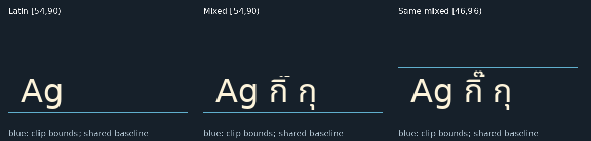

# 字体已经能显示文字，为什么附标还是被裁掉

同一个任务按钮，英语正常。换成泰语后，字母能显示，也没有缺字方框，某些顶上的声调记号却只剩一条细线。把按钮放到调试面板里单独绘制，记号又出现了。遇到这种情况，先不要换翻译或换字体：**字形可能已经画出来，只是最后只准它露出一部分。**

## 把有字、占多高、画在哪分开

- **字形与位置**：字体回退是让另一份字体补出主字体不能提供的字符；塑形决定实际用哪个字形，以及附标、连写和间距放在哪里。先弄清用了哪些字体和字形、是否报告缺字。存在可用字形，不保证它已经跟底字正确定位。
- **行的尺寸**：基线是大多数字母对齐的参考线；上升量和下降量让排版器知道要给这一行在基线两侧留多少空间。字号相同，不同字体的这两项可以不同；行距还可能包含额外间隔。[1][2]
- **实际绘制范围**：字形轮廓或栅格化所占的范围不一定等同于行框。附标、斜体悬出、描边和阴影都可能让像素伸出去。真正的裁剪又可能来自父容器、卷动窗口或某张离屏纹理，和控件名义上留了多少高不是一回事。[1]

OpenType 的 OS/2 表区分用于排版建议的 `sTypo*` 和可用于裁剪空间的 `usWin*`，不是说所有引擎都选同一组字段。若已经拿到实际行度量，还要查裁剪采用它没有。[2]

## 同一基线，两次对照

先用 Godot 4.7.2 的 TextServer，按 DejaVu Sans、Noto Sans Thai 的顺序给同一行塑形，禁用系统字体替代。字号固定为 32。只含拉丁字母的样本 `Ag` 的上升量、下降量分别是 30、8；加入带附标的泰文字串后变成 34、15，返回的字形中也实际用了第二个字体，试件未检出缺字。这个对照读取的是引擎的排版结果，没有绘制或测量引擎最终按钮的裁剪。[3]

再用 Pillow 和 FreeType 在一个可读回像素的缓冲中画相同内容，把拉丁段和泰语段明确交给各自字体。三组字号都为 32，基线都在 `y=80`，坐标向下。图中蓝线标出裁剪边界，原始像素按同一倍率放大方便比较：

| 绘制内容 | 不裁剪时有墨迹的纵向范围 | 只允许留在 [54,90) 时丢失的墨迹像素 |
| --- | --- | ---: |
| `Ag` | [57,87) | 0 |
| 同一行加入泰文字串 | [49,88) | 44 |

只把允许绘制范围改成 `[46,96)`，不换字、不调字号、不移动基线，混排行的 44 个像素全部保住，结果与无裁剪的原始缓冲逐字节相同。两组数据测的是不同阶段：Godot 测字体选择和行度量，Pillow 测显式选好字体以后裁剪会丢什么。不能把 Pillow 的像素范围当成 Godot 的按钮实测，也不能用 Godot 的行高反推这些像素的绝对边界。

## 找出第一次少掉正确字形的地方

1. **用同一条文本跑有裁剪和无裁剪两次。** 保持字体资源、字号、实际 UI 缩放、基线和布局宽度不变，尽量只扩大或关闭最终裁剪，避免重排换行导致对照失效。沿子控件、父容器、滚动区域、离屏表面查实际裁剪矩形，先统一到同一坐标系。放宽后附标回来，优先修绘制边界；始终缺失或位置不对，去看实际字体、字形和塑形切分，别用空白边距掩盖。
2. **对照布局的账和实际画面的账。** 记录每行基线、最终字体段与行的上升/下降量，并把墨迹和裁剪框画到同一张图里。有些实现已经为 fallback 字体扩大行度量，却仍让标签复用旧语言缓存的控件高度。更换语言或字体时，要让依赖它的布局重算；修的是那个真正截断字形的矩形，不是只把内部字体配大。若外框必须固定，就明确限定产品支持的字号、语言以及边缘效果，留出经实测的空间；装不下时换能扩展或换行的版式，至少别把有意义的附标切掉。
3. **让回归覆盖实际字体和真实的文字组合。** 同一个按钮至少留一条普通文案、一条带上下附标的译文；在打包后字体、实际设备缩放和描边样式下复测。对多行容器，另外核对行距和相邻行是否相叠。不要把只跑字库覆盖统计或拉长英文的伪本地化当成完成；它们很有用，但不验证运行时字形位置或像素裁剪。

[复现实验和原始读数](../../../../管理档案/实验/文字回退与字形裁剪/README.md) · [字母可见但连写仍断开时查塑形](阿拉伯文的字体回退与连写塑形.md)

## 参考资料

1. FreeType，[Glyph conventions III: Glyph metrics](https://freetype.org/freetype2/docs/glyphs/glyphs-3.html)，基线、字形包围框、字体尺度和行距定义。
2. Microsoft OpenType，[OS/2 and Windows metrics table](https://learn.microsoft.com/en-us/typography/opentype/spec/os2)，`sTypoAscender`、`sTypoDescender`、`usWinAscent` 和 `usWinDescent`。
3. Godot，[TextServer，4.7](https://docs.godotengine.org/en/4.7/classes/class_textserver.html)，`shaped_text_add_string`、`shaped_text_get_glyphs`、`shaped_text_get_ascent` 和 `shaped_text_get_descent`。
