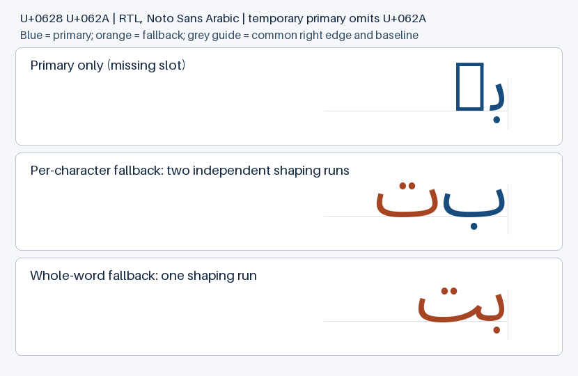

# 字母都显示了，阿拉伯文为什么还是断开

任务奖励里有一个阿拉伯文物品名。主字体少一个字母，回退字体补上了，屏幕上没有方框，却在词中裂开一道缝。两边字母用的还是正确的码位，文字甚至仍从右往左排。问题可能出在字体回退的切段：**每个字母能画出来，不等于它们经过了同一次连写塑形。**

## 先分清缺字、次序与字形

字体的码位映射表 `cmap` 能回答某个 Unicode 码位有没有名义字形。塑形（shaping）还要根据方向、文字系统、语言和上下文，选出实际字形、位置和前进量。阿拉伯字母视左右邻接关系可能用不同的孤立形、起始形、中间形或终止形；并非所有字母都能向两侧连写。换一个字母、删掉控制符或者把词拆成独立塑形段，都可能改变连接方式。双向算法解决的是逻辑顺序如何投影到屏幕次序，[不是把字符串反转](双向文本的索引映射为何不能直接用来重排字符串.md)。

做一组简单对照：同一句、同方向、同字号，让完整字体一次塑形；再让相同字体在可疑字体边界两侧分别塑形。若整段连得上，切段后两边各像词尾或词首，先检查切段，而不是修改原文或交换视觉顺序。缺字检测也不要只看截图：记录实际字体、字符范围、方向/文字系统、字形 ID、簇和前进量。常见 OpenType/HarfBuzz 路径中输出字形 0 是缺字的重要信号；但默认可忽略的控制字符并不一定应当独立绘制，不能把每个不可见码位都判成缺字。

## 字素簇是回退的下限，不是所有切段都安全

基础字母与它后面的组合附标可能是一个扩展字素簇。Unicode 的字素簇规则用于避免把这些输入拆成两个用户感知单位；HarfBuzz 的输出簇则由输入标记以及排版操作合并或保留，取决于配置，并不等于每种语言的安全切段表。[1][2] 连写还可能发生在**两个独立字素簇之间**。例如两个可互相连接的阿拉伯字母分别是两个字素簇，不代表可以拿两次互不知道邻居的塑形结果接起来。

在 HarfBuzz 中，`HB_GLYPH_FLAG_UNSAFE_TO_BREAK` 标记这个簇的起点：如果在这里断开并分别排版，要重做断点两侧的塑形，不能直接拼接原来得到的字形串。[3] 它也不是其他字体的连写能力保证；换了字体或语言后要核验新结果。只检测 `cmap` 缺什么、对每个缺字单独换字库，是常见的失败做法。

## 回退的单位按文字系统选择，最后再做排版

对游戏里的短标签、道具名和人物名，如果主字体不能完整塑形其中一个阿拉伯连写词，可以优先选一个能覆盖并正确塑形**整段连写上下文**的备用字体。先以词为保守候选，再沿项目已验证的边界切开。并不需要把整个 UI 或整条混排消息换成同一个字体。一般可以这样接入：

1. 按真实的逻辑字符串分段，保留方向、语言、文字系统和原始索引；不要对已经反转的视觉字串选字体。必要时从整词或相邻文字中保留塑形所需的上下文。
2. 在当前字体中用实际方向和语言塑形，定位缺字或异常字形对应的文本范围。向外把回退范围扩到完整字素簇；遇到连写或依赖邻接的塑形，再扩到可独立处理的片段。对短阿拉伯词，可先让同一个候选覆盖整词，再看是否正确。停在标点或空格的经验只适用于经过验证的场景，不是通用分割算法。
3. 用选定字体重新塑形该范围，检查输出的字形、簇与前进量，而不是只把一个孤立的缺失字形贴到旧结果上。再用新结果做测宽、断行、对齐和绘制；复查主备字体大小、基线和行高，否则缝解决了，标题还可能被裁。
4. 不存在覆盖整段的候选时，把具体范围列入字体覆盖问题，评估补充合适的字库或更换主字体。某些文字栈能在独立 font run 保留更多上下文，但不同字体字形的连接轮廓、基线和附标定位仍需实测；不能假定「传入前后文」就等价于同字体整段。

如果使用 DirectWrite，`MapCharacters` 返回前缀适用的字体、长度与缩放，它解决的是回退映射；返回长度不能当作不需验证的连写断点。[4] 若引擎有自己的文字处理或富文本实现，先确认它是字形塑形前按字体切段，还是已经知道更完整的连写上下文。把分段日志与最终绘制对上后再决定是换配置还是修切段策略。

## 验收时保留有区别的对照

保留四个对照结果：原本能完整显示整词的字体、已知缺字的主字体、逐字回退、整词回退。额外放入一个不可连写的自然边界、一个组合附标、与拉丁文字/数字并列的实际控件；确认正确的断开仍断开，真实连接不被破坏。如果字体切换还影响光标、选择、命中或省略号，按塑形后的布局结果检查，不要用码位数代替字符宽度。

下图以 Noto Sans Arabic 实际塑形。输入依次是 U+0628、U+062A；试件只从主字体的临时副本删去 U+062A 的码位映射，备用仍用原字体。系统 HarfBuzz 10.2.0 对主字体整段输出字形 0；逐字回退后没有字形 0，却选出两个独立塑形的字形。Pillow 13.0.0 的 RAQM 渲染采用它自己的 HarfBuzz 14.5.0：同样是 96 px 字号，逐字回退时的总前进量约 190.66 px，整词回退是 130.75 px，图中也实际恢复了连写。这里的量是文字排版前进量，不是可见像素边界。

这是一条手动构造的回退路径，不是对操作系统或游戏引擎默认回退的测试。用同源字体是为了控制字形轮廓和风格，只比较缺字及切段；需要换成实际项目主备字体重新确认外观。

[复现实验](../../../../管理档案/实验/阿拉伯文回退切段/README.md)

## 资料

- [1] Unicode Consortium，[UAX #29: Unicode Text Segmentation](https://www.unicode.org/reports/tr29/)，§3 Grapheme Cluster Boundaries。访问日期：2026-11-24。
- [2] HarfBuzz 项目，[Working with HarfBuzz clusters](https://harfbuzz.github.io/working-with-harfbuzz-clusters.html)，簇级别、合并与顺序。
- [3] HarfBuzz 项目，[hb-buffer](https://harfbuzz.github.io/harfbuzz-hb-buffer.html#hb-glyph-flags-t)，`HB_GLYPH_FLAG_UNSAFE_TO_BREAK`。
- [4] Microsoft，[IDWriteFontFallback::MapCharacters](https://learn.microsoft.com/en-us/windows/win32/api/dwrite_2/nf-dwrite_2-idwritefontfallback-mapcharacters)，`mappedLength`、`mappedFont`、`scale`。
