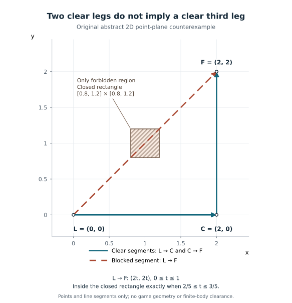

# 同伴跟随候选位置的前方连通检查

玩家沿着院墙前进，同伴与他不远，当前位置也能走到；再向前几步，两人却隔在墙的两侧。对同伴 AI 来说，“现在离得近”只描述了一个瞬间，并没有检查继续前进后的相对位置。

本文面向熟悉导航网格与路径查询的 AI 程序和关卡制作人员，解释怎样给跟随候选增加一个短距离的前方连通检查，并把它与查询错误、候选评分及实际移动分开。历史出发点是原版《最后生还者》的跟随选点；下文的几何、接入流程和诊断方法是教学整理，不是原作完整算法。方法限定于局部、单层导航表面，不负责战斗掩体选择、角色碰撞或完整跟随控制。

## 三组查询检查三种位置关系

Max Dyckhoff 介绍的系统在领队周围的环形区域生成候选：先从领队向区域发射导航网格射线，再从候选向前查询，最后从领队查询到这个前方端点。后两组分别检查面前的墙与前进后插入两人之间的障碍。作者报告，第三组减少了门口或栅栏两侧的分隔。[1]

令领队为 L，候选为 C，前方试探端点为 F。三个问题可写成：

| 线段 | 它回答的问题 |
|---|---|
| L→C | 从领队出发，这个候选是否与领队直接连通？ |
| C→F | 从候选向所选方向试探，是否马上遇到导航边界？ |
| L→F | 即使 C 前面有空间，F 与领队之间是否仍直接连通？ |

这三条线不是角色需要依次走完的路线。L 也不是当前同伴的位置；即使 L→C 通过，仍须另外规划当前同伴到 C 的路线。这里的“连通”专指所查线段沿导航表面的直连关系，不是图论意义上的“存在某条绕行路径”。

原书图 35.1 的三幅图分别显示扇出候选、候选向前试探、领队连到前方端点。它支持这种检查顺序，却没有给出可直接照抄的采样数量、前方距离或评分权重。原书还把候选评分与移动过滤分开，并以限制不必要的短距离移动等方式处理反复起步。[1] 因此，这里的几何检查只应产生候选资格，不能单独输出“现在移动”。

## 前两条通过，不能推出第三条通过

下面是原创二维点模型。除一个障碍矩形外，其他位置均可通行；角色没有体积，接触障碍边界也算受阻。

- L＝(0, 0)，C＝(2, 0)。
- 示例选择正 Y 方向向前试探两单位，所以 F＝(2, 2)。
- 障碍是闭矩形 [0.8, 1.2] × [0.8, 1.2]。



图中坐标和方向由本文选定，不是原书地图或参数的复原。[图件说明](../../../../管理档案/支持资料/同伴跟随几何示意/README.md)

L→C 的 Y 恒为 0，低于障碍，因此通过。C→F 的 X 恒为 2，也避开障碍。但 L→F 可写成 (2t, 2t)，0≤t≤1；当 t∈[0.4, 0.6] 时，两个坐标同时进入障碍范围，因此受阻。

同时，L→C→F 是一条避开障碍的折线。所以第三条受阻不表示 F 完全不可达，而是说明它不满足本例的直连要求。若体验目标要求同伴与领队保持局部直接连通，绕行路径不能替这项检查“补考通过”。若项目本来允许隔墙跟随，是否采用这个附加限制则应重新评估。

前方距离决定检查的空间范围。仍用本例，令 F＝(2, d)，d≥0。L→F＝(2t, dt)，障碍要求 t∈[0.4, 0.6] 且 dt∈[0.8, 1.2]，两区间有交集时受阻，即 4/3≤d≤3。于是 d＝1 通过，d＝2 受阻，d＝4 又通过。最后一种情况并不矛盾：改变 d 也改变了 L→F 的方向，更远的端点可能让线段绕到障碍另一侧。不能把“试探更远”理解为对原来检查结果的单调加强，也不能为了消除失败随意缩短距离。

## 把几何规则接到候选流水线

以下是一条原创、保守的接入流程，便于明确接口责任；不是对原作隐藏实现的补写。它要求三个查询使用同一份有效导航数据、相同通行过滤条件和一致的坐标约定。

1. **先固定本次问题。** 保存领队位置 L、候选采样区域、前方单位方向 u、试探距离 d，以及所用导航数据版本。示例可取领队在导航平面上的朝向作为 u；若朝向无效或投影近零，就让本次检查返回未确定，不能直接归一化零向量。用速度方向则还要规定静止与急转弯时的处理。选择哪一种，取决于希望预测朝向还是移动趋势。
2. **生成并检查 C。** 对候选验证 L→C，失败则不继续检查这个候选。检查使用导航表面上的有效点，不能把墙内或另一楼层的最近点投影结果直接当作原候选。
3. **构造 F 并查询另外两条线。** 按 F＝C＋d·u 形成试探端点，检查 C→F 和 L→F。三个结果均确认通过，才把 C 交给评分阶段；受阻与查询未确定分别记录。方向和距离是策略参数，原书没有提供可复用的通用数值。[1]
4. **从合格候选中选目标，再判断是否需要移动。** 一个近似同分的新点不必立即替换当前目标。当前同伴站位是否仍可接受、必须离开的原因、目标切换阈值及移动紧迫度应由跟随策略决定。若目标改变，再从同伴实际位置查询到 C，并按路径完整性、角色通行能力和身体移动结果处理。

其中“未确定”包括无效起点、数据失效和无法解释的查询状态。把它算成受阻，会把系统或输入问题误报为关卡几何问题；把它算成通过，则让无依据的候选进入评分。

所有候选都被拒绝时，输出“本轮没有合格候选”，不要悄悄撤掉第三条限制。调用者可以在确认当前站位仍安全且满足跟随要求时短暂保持，并安排下一次重查；当前站位必须离开时，应转入明确的恢复策略，例如重新采样或请求较宽范围的规划。等待需要项目规定的超时或失效处理，不能因为候选为空而永久不动。绕行是另一种策略选择，应保留它不满足局部直连约束的事实。

这条流水线的直接代价是更多查询。若有 N 个初始候选，且每次检测都通过，则最多需要 3N 条射线；按失败尽早退出可以减少后续调用。这个计数不等于 CPU 成本：每条射线经过多少多边形、查询频率和同伴数量都会影响开销。降低采样数或隔帧更新还会改变覆盖与时效，应在目标地图记录候选分布、拒绝原因和实际耗时后决定。

## Detour 中的成功位不等于直线通过

在 Detour v1.6.0 的固定实现中，`raycast` 是沿导航表面的可行走射线查询，`dtRaycastHit.t` 记录命中位置；`FLT_MAX` 表示没有墙命中。实现命中无可通行邻接的边界时，也可以返回 `DT_SUCCESS`。因此，成功位与几何结果必须分别读取。[2]

本库保留了一组 2026-11-04 的有限原生观察。它直接构造三块平面正方形 P0、P1、P2：左下、右下、右上可通行，左上没有面；P0↔P1↔P2 相连，P0 与 P2 没有跨角点连接。采用 Detour 的 (x,y,z) 坐标，y＝0：L＝(0.25,0,0.5)，C＝(1.25,0,0.5)，F＝(1.25,0,1.5)，分别位于三块面的内部。这是另一个输入，不是前面的矩形障碍模型。

| 调用 | 状态 | 几何或路线结果 |
|---|---|---|
| raycast L→C | `DT_SUCCESS` | `t=FLT_MAX`，经过 P0、P1 |
| raycast C→F | `DT_SUCCESS` | `t=FLT_MAX`，经过 P1、P2 |
| raycast L→F | `DT_SUCCESS` | `t=0.5`，在 P0 上边界受阻 |
| findPath L→F | `DT_SUCCESS` | 完整通道 P0→P1→P2 |

第三行的交点为 L＋0.5(F−L)＝(0.75,0,1)。第四行找到了绕行通道，并没有让第三条直线变得畅通。历史记录包含同一操作者、同一环境下两份新副本执行，结果一致；本次编辑没有重跑，也没有角色碰撞、动画、动态障碍或玩家体验测试。精确输入、原始输出和复现材料见[有限观察记录](../../../../管理档案/研究记录/companion-detour-l-shape-20261104/README.md)。

将该接口用于本节的局部检查时，可以采用以下保守结果分类：

```text
先确认起点在有效多边形内，数据、过滤器及楼层范围符合本次约定。
调用 raycast。
若失败，或返回了本接入尚未处理的附加状态：未确定。
否则若 t == FLT_MAX：本次直连检查通过。
否则若 t 为有限值且 0 <= t <= 1：本次直连检查受阻。
否则：未确定，保留原始结果供诊断。
```

这是一种宁可暂不接收候选的策略，不是说 Detour 的每个附加状态都会让命中参数失效。例如 `DT_BUFFER_TOO_SMALL` 说明记录经过多边形的数组不够；固定实现仍继续遍历，几何结果与通道记录是否完整应分开理解。[2] 上面的保守入口暂不使用带附加状态的结果，调用者可扩展处理，但不能只凭成功位吞掉它们。

另一项关键限制是 Detour 射线忽略终点的 y 值。如果 F 在上层平台，它可能沿下层表面到达相同 xz 后返回 `FLT_MAX`，并不表示到达 F 所在的楼层。[2] 因而这条方法只用于已确认的局部单层范围；遇到重叠楼层，必须先建立起点与候选/试探点的正确表面关系，不能用这条射线替代楼层归属检查。平面直连也不等于身体能穿过门洞。

## 用失败记录区分问题出在哪一层

调试显示至少应包括 L、C、F、每条线的状态与命中点，以及最终选中目标。另记录当前同伴位置、目标变化及开始/停止移动的原因。这样可以对照以下情形：

| 现象 | 下一步看什么 |
|---|---|
| L→C、C→F 通过，L→F 受阻 | 查前方端点与障碍关系，按当前规则拒绝 C；不要据此宣布 F 无任何路线 |
| 查询失败，却在画面上显示为“撞墙” | 先查输入、导航数据与返回状态，恢复“未确定”和“受阻”的区别 |
| 合格候选很多，同伴仍频繁小步起停 | 查评分稳定性、当前站位是否仍合格与移动触发；增加射线不能直接修好这类抖动 |
| 选点稳定且路径完整，身体却卡门 | 查角色体积、导航净空、动态碰撞和移动控制器 |
| 上下层点的射线通过，却走不到目标楼层 | 查表面归属与接口维度，不要调大距离容差掩盖楼层错误 |

例如，一帧内三个查询都通过，只能把 C 列入候选。若同伴当前站位仍合格而新目标只变化很小，是否启动由移动策略判断；若下一帧 L→F 受阻，则先撤销该候选资格，再处理替代目标或恢复策略。这两种情况不能都归为“距离阈值太小”。

前方连通检查的价值，是把一个容易混进距离评分的几何要求明确化。它适合需要保持局部位置关系的跟随行为，但不保证画面可见、身体通行或跟随自然。应先确认项目确实需要这一约束，再用实际地图、角色尺寸与移动表现评估误拒绝、漏检、稳定性及查询成本。

## 相关知识

- [如何判断导航路径是否真正可用](../路径查询/如何判断导航路径是否真正可用.md)：从有效数据、目标与路径结果继续检查身体通行和实际任务完成。

## 参考资料

[1] Max Dyckhoff. *Ellie: Buddy AI in The Last of Us*. *Game AI Pro 2*, 2015，第35章。跟随候选、图35.1与移动过滤见 §35.3.1–35.3.2，印刷页433–434；非战斗范围见 §35.4 开头，页435。本文只引用这一局部方法，不复原战斗掩体或完整同伴系统。
https://www.gameaipro.com/GameAIPro2/GameAIPro2_Chapter35_Ellie_Buddy_AI_in_The_Last_of_Us.pdf

[2] recastnavigation/recastnavigation. Detour v1.6.0，固定提交 `6dc1667f580357e8a2154c28b7867bea7e8ad3a7`。[dtRaycastHit 定义](https://github.com/recastnavigation/recastnavigation/blob/6dc1667f580357e8a2154c28b7867bea7e8ad3a7/Detour/Include/DetourNavMeshQuery.h#L121-L146)；[raycast 的说明与实现](https://github.com/recastnavigation/recastnavigation/blob/6dc1667f580357e8a2154c28b7867bea7e8ad3a7/Detour/Source/DetourNavMeshQuery.cpp#L2430-L2691)，包括命中参数、终点高度限制、输出容量与邻接遍历。历史运行范围仅为上文链接的固定网格。

[返回同伴跟随](README.md)
