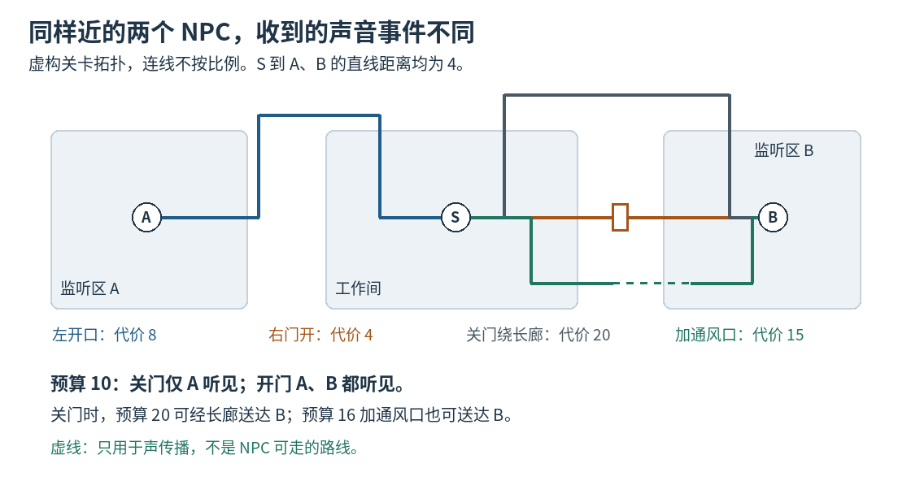

# 同样近的两个 NPC，为什么只有一个听见

潜行关卡的工作间里，玩家碰倒了一个道具。NPC A 和 B 在俯视图上离道具一样远。A 与工作间经一个开口相连，B 要么隔着一个能关的门，要么从长廊绕过去。若按半径，两人都会掉头；若只做一条射线，拐弯后仍应听到的角色也会被剔掉。关卡需要三件事分别正确：声音事件有没有到达这个 NPC、它趁此知道了什么、玩家怎样看出反应的原因。

## 先决定声音用哪张图走

玩家耳机播放的音效、AI 用来作判断的事件、NPC 能走的路，是三个不同的结果。一个音效被混音器压低，不应默认让 AI 也听不见；搭配的反馈如果因此几乎听不到，应该另验可读性。通风口能传事件而不能走。反过来，电梯可能需要呼叫才能走，静止且关闭时是否传声应由关卡明确标注。共用房间和门的稳定 ID，不等于共用每条边。

Martin Walsh 记录了《细胞分裂：黑名单》的做法：声音先有事件半径和优先度，同一区取直线距离；跨区先找区域路径，再沿相邻区连接点逐段相加。作者说明这是近似，也解释了为什么取消直接调用当时的声音引擎做任意距离查询：有些调用昂贵，未构建的音频数据还会让测试出现假检测。[1] 团队先找区域序列再按局部选择连接点，不等于在所有连通口组合中找全局最优。下文用带权的声音图，是另一个可实现的选择，不是在反推游戏的内部算法。

在图上表达事件从声源到此房间的接收者，每条允许连接有在游戏里使用的非负代价：同样的长度可以因一扇门或一个开口的设定有不同损耗。如果决定同房用直线，也要检查房间是否过大、拐折或另有隔板；“房间”只是定好的分区，不是自动有无遮挡。跨区不要只用房间中心的距离，连接点到声源、连接点之间、最后一个出口到 NPC 都可计入。代价可以是长度与门损耗换算后的同单位之和；它不是分贝。若想把材质、不同频段或真实延迟引入，需要另外定义并验证信号模型。

Epic UE 5.8 的 Noise Event 接口提供游戏事件的地点、响度修饰、最远范围与标签。[2] 这些字段可以承载你的声音规则，并不证明默认事件按本文的门、长廊和通风口走。查看具体引擎的感知事件从哪儿进入，再分别挂相应的声音图和玩家听到的表现。

## 关上门，变化的是哪条路

下面的合成关卡，声源 S 到 A、B 的直线距离都为 4。两边固定同样的监听预算；某条路径的总长度加损耗不超过预算就算能收到。这里使用总成本最低的一条合法声音路径，不叠加不同路径的能量。如果代价相同却指向不同出口，用固定连接 ID 打破平手，或只给一个更宽的估计区域；不要让遍历顺序决定 NPC 突然改往哪儿。

| 开口条件和预算 | A 最小代价 | B 最小代价 | 谁收到事件 |
| --- | ---: | ---: | --- |
| 右门关，预算 10 | 8 | 长廊 18 + 2 = 20 | 仅 A |
| 右门开，预算 10 | 8 | 直门 4 | A、B |
| 右门关，预算 20 | 8 | 长廊 20 | A、B |
| 右门关，增加通风口，预算 16 | 8 | 通风口 7 + 8 = 15 | A、B |

关门的含义是关闭那条直接边，不是把两房整体断开。即便直线被挡，预算足够时仍可绕长廊；通风口连上后，虽然 NPC 不能穿过，声音能用它。对想要封闭的隔断，试件应另外测试真正无路径；在完整版关卡也检查有哪些未标的开口或路线让声音意外绕过。若门不能阻绝、只减少某类声音，就把关门由“边无效”改成“边代价增加”，而不是为每扇门复制一套监听代码。

给动态门一个可复现的时间约定。试件在事件发出时立即按当时的图版本算一次，记下结果；第 100 步道具响，第 101 步门打开，不应倒回去让 B 补听第 100 步。下一次事件按新的图计算。若产品要模拟传播时差，另定义门在发出时还是经过它时决定传递；多条路到达不可当成多次独立脚步。第一条可能早到但弱，较晚一条可能强；若两者要更新同一个线索，按事件 ID 去重、记录收到时间和更新规则，不要只从“第一条来了”自动推导“它最可信”。增加门状态缓存时要按图版本、起终点和适用的声音类别区分条目，也不要拿上次预算下的接收结果替代这次判断。

## 让 NPC 去查它听见的线索，而不是锁定玩家

接收以后先生成一条有寿命的观察：事件 ID、类型、发出时间、估计区域、可靠程度。试件按 B 侧的出口给“门边”“NPC 这一侧的长廊口”或“通风口一带”的粗粒度线索，选哪一个由设计；真实调试坐标可以存入受控日志，不必把活的玩家位置或对象句柄交给调查行为。玩家之后离开，旧声音不能跟着它走。接收与反应也应分开：NPC 忙于现有目标、已听到更重要事件或正在冷却时，可以记录声音而暂不转身。若导航走不到估计位置，用附近可达的查看区、保持警戒或放弃，别让角色走进通风管，也别因它不能走过去就删掉已收到的线索。

Walsh 也提到，内测从正常游玩机位看不见部分角色，对方却在响动后反应，玩家很难明白关联。团队只对满足条件的部分画外事件降低听觉，并让早期的反应台词更明确地点出响动，随后用更通用的措辞以减少重复。[1] 这不是“屏幕外永远听不到”的规则。给玩家的反应可用朝向、停顿、回头动作和情境提示；重要线索不宜只能从单一音频通道获知。它们要解释“刚才听见了哪类动静”，不需要承诺 NPC 已经看见玩家或泄露所有地图信息。

抓一份可以让制作人员复演的日志：图版本、发出时间和类别、每个候选 NPC 的最小路径、长度和附加损耗、预算及结果、分配到的调查区域、最终反应或没反应的原因。用同一个录制输入在门开、门关、长廊可达但贵、通风口可听不可走几档试；听声后移动玩家，检查旧线索有没有追人。再让不知道实现的同事只看正常镜头，说明谁为什么转身、下一步会查哪。日志正确只能说明实现和试件吻合，正常玩家能不能读懂仍要靠这一层检查。

[复现：固定声源、门和通风口的路径对照](../../../../管理档案/实验/虚构关卡的NPC听觉/README.md)

## 参考资料

[1] Martin Walsh，Modeling Perception and Awareness in Tom Clancy’s Splinter Cell Blacklist，Game AI Pro 2，第 28 章，§28.3.1、§28.4.1–2（印刷页 317–322）。https://www.gameaipro.com/GameAIPro2/GameAIPro2_Chapter28_Modeling_Perception_and_Awareness_in_Tom_Clancy%27s_Splinter_Cell_Blacklist.pdf
[2] Epic Games，FAINoiseEvent，Unreal Engine 5.8。https://dev.epicgames.com/documentation/unreal-engine/API/Runtime/AIModule/FAINoiseEvent?application_version=5.8
