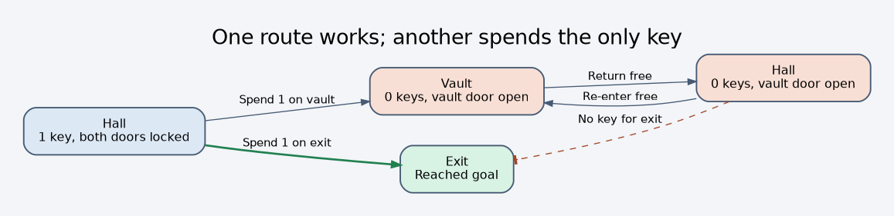

# 地牢明明有通关路线，玩家为什么还能被一把钥匙卡死

玩家带着唯一一把通用钥匙进了地牢。大堂里有宝库门和出口门，两扇门都要消耗一把钥匙。用钥匙开出口，当然能通关；但如果先开宝库，玩家还能原路回到大堂，出口却永远打不开了。只演示过一条通关路线的验收，发现不了这个问题。

做关卡验证时，可以把问题改成：**从这份关卡允许走到的任一状态，还有没有一条路能完成当前这次挑战？** 本文用消耗钥匙、永久开门和单向通道说明如何自动检查，最后输出能交给设计师复现的动作序列。

## 玩家回到了同一个地方，关卡却不是原来的关卡



图中的出口和宝库在同一个大堂。宝库门打开后可以免费往返；红色虚线带叉的出口不是一条可走的边。此时玩家仍能行动，甚至离出口只有几步，但已经进了一个再也到不了终点的区域。这是本文所说的软锁，和「角色一动也不能动」不同。

房间连通图只告诉我们门连着哪里。验证时还需要知道这扇门此刻能否通过，以及通过后会消耗或改变什么。Dormans 将任务的前置关系与玩家实际行走的空间分开表示。[1] 在这个例子中，消耗钥匙把两个层面连了起来：玩家的空间选择改变了另一条路线的前置条件。Durham 和 Alvin 对地牢行走的建模也保留了现有钥匙、未领取钥匙和已开门；他们找的是最短走法，这里检查的是所有可能走到的状态。[2]

把出口门改成通往一个可以返回大堂的前厅，前厅另有一条免费通路通往终点。现在两种走法都能让玩家空手回到大堂：

- 先开前厅门再返回：出口方向的门已经开了，仍能通关。
- 先开宝库门再返回：前厅门还锁着，没有钥匙，通关无望。

两次都是「大堂，零把钥匙」。如果检查器把它们记成同一个状态，前一种走法的免费出口就可能被错误地算到后一种头上；只保留先遇到的状态，也可能反过来删掉一条合法路线。

## 把能改变下一步的事实记进状态

对这个关卡，状态可以表示为 `(房间, 钥匙数, 已开锁集合, 已领取拾取物集合)`。门和地上的钥匙各有稳定 ID。同一扇双向门的两个方向共用锁 ID；单向落差只导出允许的方向。领取一把地上的钥匙要把它的 ID 标记为已领取，否则检查器会允许玩家反复回来刷钥匙。

每次从状态生成当下可执行的动作及其结果：

| 动作 | 何时可用 | 结果 |
| --- | --- | --- |
| 走无锁或已开门的通道 | 通道从当前房间出发 | 到另一房间，不扣钥匙 |
| 开锁并进门 | 通道从当前房间出发，锁未开且至少有一把钥匙 | 扣一把钥匙、标记锁已开、到另一房间 |
| 领取地上的钥匙 | 拾取物在当前房间且没领过 | 钥匙加一、标记已领取，原地不动 |

这里的「开锁并进门」是一个动作。如果游戏允许开了门先不走，就应拆成两个动作，保留开锁后仍站在原地的中间状态。要是任务旗标、机关位置或值守 NPC 会改变可行动作或完成判定，也得纳入状态；纯装饰变化则不用。判断两个状态能不能合并，可以问：它们是否同样算完成，是否允许同样的动作，而且执行相同动作后仍然等价？

## 先枚举能到的状态，再找能通关的状态

从初态用先进先出队列搜索，每个状态只展开一次。对每条合法转移，记下终点可以从哪个状态到来，即使这个终点已经访问过，也要保留这条边。首次发现每个状态时，再单独记录前驱和动作，用于输出复现步骤。 若到达出口后还得撤离或保住任务物品，就把这些条件也写进完成判定；只有挑战确实结束，才停止展开。

随后从本轮找到的**所有完成状态**出发，沿刚记录的边倒着走。能被标记的状态，都有一条按真实方向通往完成的路径；没被标记的可达状态都没有。倒着走只是分析手段，并没有给玩家增加逆行能力。尤其别只倒查首次发现状态时留下的前驱树：例如初态能分别走到 A 和 B，A 也能走到 B，而 B 能到终点。首次发现 B 时记下的前驱是初态；若丢掉 A → B，就会错判 A 无法通关。

```text
首次 = {初态: 无前驱}
前向队列 = [初态]
完成 = 空集合
来路 = 按终点保存的前驱列表

前向队列非空时：
    s = 取出队首
    若 s 满足完成条件：
        将 s 加入完成；不再展开这个终点
        继续
    对每个从 s 可执行的动作 a 及其结果 t：
        来路[t].追加(s)
        若 t 不在首次中：
            首次[t] = (s, a)
            t 排到前向队尾

还能完成 = 完成的副本
反向队列 = 完成中的所有状态
反向队列非空时：
    t = 取出队首
    对来路[t] 中的每个 s：
        若 s 不在还能完成中：
            标记 s；s 排到反向队尾

被卡住 = 首次的所有状态 - 还能完成
```

如果有被卡住的状态，取最早被前向搜索发现的一个，沿 `首次` 回到初态，再把动作反过来。每个动作算一步时，这就是最短的复现前缀。若初态本身就在差集中，前缀是空的，说明这个初态根本无解；否则前缀最后一步就是第一次进入不可通关区。日志保留门 ID、扣除前后的钥匙数和发生变化的旗标，通常比只给出「大堂不可通关」更容易复现。

把有限状态图实际跑一遍，得到以下结果。这里按**状态**计数，而不是按房间计数：

| 规则 | 可达状态 | 其中不能完成 | 最早进入坏状态的动作 |
| --- | ---: | ---: | --- |
| 一把通用钥匙、两扇锁门 | 4 | 2 | 开宝库门并进入 |
| 宝库内可领一次保险钥匙 | 7 | 0 | 无 |
| 不补钥匙，改为宝库另有免费出口 | 5 | 0 | 无 |
| 有保险钥匙，大堂另有单向落坑 | 10 | 3 | 从大堂直接落入坑中，手里仍有一把钥匙 |
| 出口门后增设可返回的前厅，不补钥匙 | 6 | 2 | 开宝库门并进入 |

落坑一行说明库存检查还不够：钥匙解决不了单向地形，三种不同的资源和开门状态都会卡在同一个坑里。这个试件只枚举声明的离散动作；它没有测角色能否从实际碰撞体上跳回去。

## 先决定算哪一种恢复，再动关卡

如果验收要求保住本次进度，重新开始就不是通关路径。给每个状态加上一条「重开」到初态的边后，只要初态有解，所有这些状态都能经由重开到达终点，宝库反例就会被这项不同的口径掩盖。可以把结果分开报：本次还能完成、只能丢进度重试、连认可的重试入口也够不到。若游戏在跌落时明确结算失败并可靠地重开检查点，按设计意图另记为失败/恢复，不要与没有提示、继续游玩却永远开不了出口的状态混报。

需要保住进度时，优先修反例指向的断点：

- **宝库补钥匙**：保留原来的路线，但要从实际卡住的状态拿得到。若奖励可以提前取走、再用于别处，或者满背包时会被丢弃，就用实际规则再跑一遍。
- **宝库增设回路或出口**：解决单向拓扑问题。若新路绕过必经首领或剧情，完成条件应检查这些里程碑，不能只看是否踏进终点房。
- **改为专用钥匙或保留主线用量**：从规则上阻断误花，但会减少原本允许的路线选择。用不同钥匙时，状态也必须区分类型，不能继续只记总数。

## 把检查接到关卡数据上

让编辑器导出实际的通道方向、锁的共用 ID、钥匙有效范围与拾取效果、脚本开关和起始存档所允许的状态。给每个受支持的起点单独验收；例如新开局和从检查点读档，可能给同一扇门完全不同的初始标记。拿工具给出的最短动作前缀回到实际关卡走一遍。若玩家做不了其中一步，先查导出规则是否虚构了路线；若玩家可以用动作逃出而图没有这条边，则更新模型，不要把缺失的转移当成设计缺陷。

图一旦枚举出来，前后两趟遍历的开销都随状态数和边数线性增长，不含生成动作的额外成本。真正容易超预算的是状态组合：只有一种钥匙、库存上界为 K、L 个独立锁位和 P 个拾取位时，仅表示空间的上界就有「房间数 × (K+1) × 2^(L+P)」种组合，实际可达的是其中一部分。可以按不再互相影响的区段缩小状态，但跨区携带的钥匙、已开门和回头路必须仍在验证边界上；不能把「走得出这个区」直接当成「以后一定能完成」。超预算时报告**未查完**，不是无软锁；抽样能找到问题，不能代替全量结论。

这项检查证明的是按所列规则**存在延续办法**。允许玩家故意反复兜圈，也不保证玩家看得懂提示。若核心转移依赖随机结果或敌手，允许的结果是否可控会改变保证：反向可达只能说有一条可能路线，不能说玩家有策略保证抵达。

## 复现材料

[五组关卡规则、原始输出与图源](../../../../管理档案/实验/消耗钥匙关卡的软锁检查/README.md)

## 参考资料

[1] Joris Dormans. *Adventures in Level Design: Generating Missions and Spaces for Action Adventure Games*. Procedural Content Generation Workshop, 2010，§2、§6。[原文](https://pcgworkshop.com/archive/dormans2010adventures.pdf)。

[2] Christopher Durham、Chris Alvin. *Shortest Walk in a Dungeon Graph*. The 37th International FLAIRS Conference, 2024，§2–3。[DOI 10.32473/flairs.37.1.135299](https://doi.org/10.32473/flairs.37.1.135299) · [论文 PDF](https://journals.flvc.org/FLAIRS/article/download/135299/139628/259510)。
