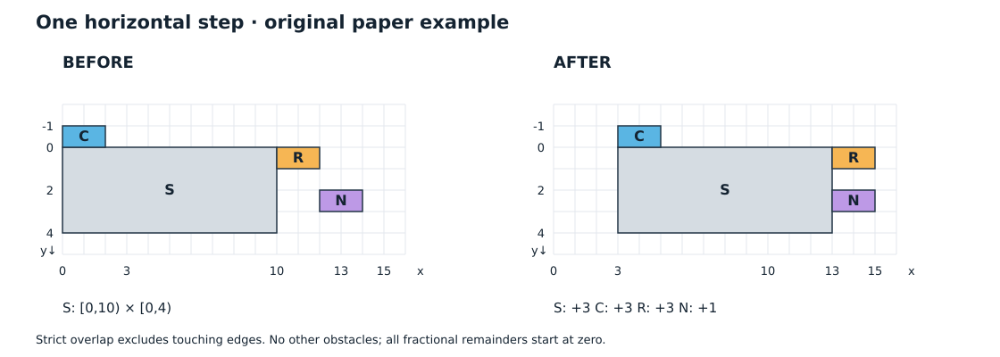

# Celeste与TowerFall的移动平台为什么要区分搭乘与推挤

本篇给二维角色移动的实现者一个有限对照：一块平台、三名角色，只向右移动一次。Maddy Thorson 的公开文章区分搭乘与推挤，下面用原创整数场景解释它。[1] 数字不是原作关卡测量，全部是未执行的纸面推导。

## 把三个角色放在同一块平台周围

用与坐标轴平行的矩形表示碰撞形状，也就是 AABB。坐标单位为像素，x 向右、y 向下。矩形写成 `x区间×y区间`；例如 `[0,10)×[0,4)` 的左、右边界分别是 0 和 10，上、下边界分别是 0 和 4。

本例使用整数坐标，也不带入上次移动留下的小数部分，所有这类累计余量都从零开始。只有两轴都存在正长度的相交区间，才算交叠；边界相接不算。角色没有自身移动，没有其他障碍；平台平移，不旋转。按来源的处理，这一步暂时不把移动角色的平台自身当作障碍。[1]

平台 S 从 `[0,10)×[0,4)` 向右移动 3，成为 `[3,13)×[0,4)`。先给定三名角色及本例的搭乘政策：

| 角色 | 初始矩形 | 移动前是否搭乘 S |
|---|---|---|
| 顶部 C | `[0,2)×[-1,0)` | 是，本例按底边贴顶面且横向正重合判定 |
| 侧前方 N | `[12,14)×[2,3)` | 否 |
| 右侧 R | `[10,12)×[0,1)` | 是，本例允许抓附侧面者随行 |

R 的资格是题设，不是“碰到侧面就自动成为乘客”。识别资格的玩法条件需要项目自己规定。

图中左侧是输入，右侧是本例计算后的矩形。C、R、N 的颜色只用于区分角色，不表示额外的碰撞规则。这是原创示意图，不是游戏截图。

## 顶部 C

新平台 `[3,13)` 与尚未移动的 C `[0,2)` 不相交。此时才查搭乘会漏人，查交叠也补不回来。先记录移动前关系，再给 C 随行请求 +3，得到 `[3,5)×[-1,0)`。[1]

## 侧前方 N

推挤 N 只需 `13−12=1`，即可到 `[13,15)×[2,3)`，贴着新平台右边；若加平台全量 +3，则到 `[15,17)×[2,3)`，多出 2 像素空隙。[1]

## 右侧 R

R 既预先搭乘，又发生新交叠。推挤 `13−10=3` 后到 `[13,15)×[0,1)`；若再随行 +3，会错到 `[16,18)×[0,1)`，所以推挤后不能再随行。[1]

## 从纸面结果走向项目检查

这些输出只成立于前述题设。要把例子接到项目中，可先复现相同输入，再逐项加入一个障碍、角色自身运动或另一块平台，记录请求与实际结果；本篇没有执行这些检查。随行请求可能被其他障碍挡住。[1]

本文没有检查平台整段运动经过的所有位置。若平台一步完全越过角色，末态没有交叠，上面的例子不能证明它会被发现。旋转、斜面、多平台同时影响一个角色，都需要另外研究。

原文省略了 Y 分支，不是完整的游戏实现。[1] 本文不补齐它，也不声称核实了当前游戏版本。若要排查角色自身移动中的位移与速度分工，可以继续读[贴墙移动的位移修正与速度裁剪](角色贴墙移动时为什么要分别修正位移和速度.md)；它不提供本文的平台处理方案。

## 参考来源

[1] Maddy Thorson，*Celeste & TowerFall Physics*，[作者个人站归档](https://www.maddymakesgames.com/articles/celeste_and_towerfall_physics/index.html)，The Heavy Lifting 及前置条件。归档未标日期；[同文 Medium 版本](https://maddythorson.medium.com/celeste-and-towerfall-physics-d24bd2ae0fc5)标注 2020-05-02。2026-11-04 完整读取文字与公开代码；未查看原始图像、运行游戏或核验生产源码。

---

[返回本书架](README.md)
