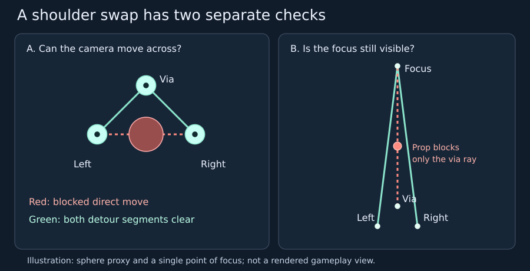

# 过肩镜头换边：保住观察点，检查整段过渡

在第三人称解谜里，玩家正看着机器上的小按钮，想从角色右边换到左边继续观察。两边停住时都不穿墙，按钮也都能看见。但镜头一移动，可能先掠过墙柱；就算绕开了墙柱，画面中心仍可能偏离按钮，或按钮在途中被另一件装饰遮住。

把这三个结果分开验收：**换边后指向哪儿，镜头能不能沿这条路径过去，途中还能不能看见目标。** 这里的“观察点”是镜头应对准的空间位置，不是摄影机的景深焦距，也不代替角色能否伸手操作按钮的判定。

## 保持朝向，不等于保持观察点

设俯视平面里前方为 y 正方向。左镜头中心 L=(−1,−3)，右镜头中心 R=(1,−3)，玩家正在看 T=(0,5)。从 L 指向 T 的向量是 (1,8)。如果只换镜头位置，仍保持旧方向 (1,8)，从 R 发出的画面中心线到 y=5 时落在 (2,5)，不是按钮所在的 (0,5)。镜头只横移了 2 个单位，中心线同一深度的位置也横移了 2 个单位。

如果换边意图是“我还要看同一个按钮”，应在开始时取目标 T，并在得到本帧**避障和过渡后的实际相机中心 C**后，从那个位置重新计算朝向。对居中目标，在无退化条件下使用 `normalize(T − C)`；这使示例中的右镜头朝向变成 (−1,8) 的单位方向。保存的是玩家想看的同一点，不是上一次计算出的相机角度。若按钮绑定在移动物体上，可保存该物体及其局部点，并在同一更新阶段取得新的世界位置；保存初始世界点会留在物体移动前的位置。

自由探索不一定该锁定观察点：玩家可能预期换肩只改构图，不改变自己输入的世界朝向；这时选择保持朝向是有意的，而屏幕中心改看别处是预期结果。应用固定点时，需要明确手动输入怎么打断、目标消失怎么释放。无目标、目标与镜头中心太近或跑到计划观察方向后面时，不应为了追逐旧点突然转半圈，可释放锁定、保留用户朝向或暂缓换边。不要每帧拿变换后的屏幕中心重新找一个目标又当成原目标，这会让遮挡物无意间替换玩家所选的按钮。若设计要求按钮稳定在屏幕某个偏置而非居中，需按实际投影求取并验证屏幕偏移；只执行上述居中公式不会满足偏置构图。

Unity Cinemachine 3.1 的 Third Person Follow 把 Camera Side、肩偏移、镜头距离与碰撞半径列为不同属性。其 Third Person Aim 扩展在处理镜头噪声时，会重新调整朝向来稳定一个观察位置。[1][2] 这是“肩边位置”和“观察朝向”可以分开处理的实例，并没有保证改变 Camera Side 时自动保住任意外部目标，也没有给出下面的换边路径。

## 两边都能放镜头，直线也可能穿过中间的柱

先用固定半径的圆形代理近似俯视平面上的镜头。它半径为 0.20，墙柱横截面的圆心在 (0,−3)、半径为 0.35。镜头中心距柱心至少要大于 0.55。L 与 R 各离柱心 1，单独看都合格；但从 L 直接插值到 R 会经过柱心。把平滑速度加慢，只会更慢地经过不合法的位置。

一个候选是先向前靠到 V=(0,−2)，再去 R。两段直线到柱心的最小距离都是约 0.707，圆形代理能通过。这里的安全判断用的是**沿整段运动扫过去的形状**，不能只试起点、终点，也不能把两个可落脚位置直接当成彼此可达。线上若用样条把折线变顺，曲线可能在拐角切近障碍，要用实际将执行的路线再验。圆形或球形代理便宜，但未必包住广角镜头转动后的近裁面；要么选有足够余量的保守形状，要么对渲染相机的实际近裁区域另做检查。

左图画的是相机移动路线；右图画的是三个相机位置到同一个按钮的视线，比例不同。右图特意加了第二个障碍：半径 0.20 的小道具在 (0,1)，离镜头绕行路线很远。它不会害镜头碰撞，但恰在 V 到 T 的中心线上。两端的射线都通，途经点却看不见按钮。若项目承诺整段都看得见，应检查过渡中的实际视线；一个小道具遮住单条中心线也不一定遮完整个互动区域，按钮面积较大时可按可读面积或多个采样点判定。可见性和角色是否在操作距离、角色动作会不会碰墙是不同条件。

## 弹簧臂检查本帧的臂，不等于替换边检查横向路径

Godot 4.6 的 SpringArm3D 按当前臂轴投射查询，再把子节点移到可用臂长；未显式设形状时，引擎还可能用直接子 Camera3D 的近裁部位形状，或回退到射线。在 4.6.3-stable 发布标签所指的源码中，可以看到查询从当前臂原点沿变换后的 +Z 方向出发，不是从上一帧实际相机中心横扫到本帧新的肩位。[3][4] 弹簧臂仍适合处理肩位到镜头方向上的遮挡；它回答的是不同问题。

用官方 Godot 4.6.3 headless 和 GodotPhysics3D 做了一个小场景。左右两支 SpringArm3D 都设定为 3 个单位长，并都使用显式球形代理；柱子的这个位置不使任何一侧缩短，横向形状扫掠却报告碰撞。另测两段绕行都能通过，左、中、右三个观察点取样的视线是“通、挡、通”。另外把代理起点放进柱子里，静态重叠查询报有交集，离开这个重叠体的 `cast_motion` 却报告整段可移。Godot 4.6 的接口文档解释了这个边界：扫掠会忽略已经重叠的形状，已有重叠需要另查。[5] 实际运行不能把接近 1 的安全比例当作全程无碰撞；若发生阻挡，按返回的安全距离截短并留余量，再单独确认最终姿态没有重叠。

这组故意安排的静态障碍只验证原生查询与两个端点弹簧臂的行为，不运行游戏镜头控制器、渲染或相机近裁面，也不证明所有过渡帧的目标可见。附录提供原生项目和独立有理数对照。[复现实验](../../../../管理档案/实验/过肩镜头换边/README.md)

## 换边器应该保留什么，又必须允许放弃什么

实现时把三个中间结果留下来：**目标肩位、实际镜头姿态、所选观察点**。每次换肩请求先决定用自由朝向还是固定观察点，再算期望侧和可用肩位。对本帧想走的位移，先查当前是否已经重叠，再从上一帧实际应用的位置扫到下一目标位置；动态障碍应在应用前按同一物理时刻重查。移动被截短或绕行后，用真实位置更新观察朝向，再测该位置的遮挡与构图。若你采用朝向相关的碰撞代理，最终转向也可能改变近裁面占用，不能只检查旋转前的形状；圆球不能代表这一旋转效应。

| 画面或查询结果 | 应先做的决定 |
| --- | --- |
| 两边静止都好，换边中间穿柱 | 保留当前肩，或试沿经过扫掠检查的短臂路线绕行；不要只调整插值时长 |
| 轮廓安全，按钮偏到一边 | 查是否沿用了旧朝向，或从避障前的虚拟位置计算了观察方向 |
| 按钮几何位置居中，但途经时看不见 | 查目标视线／可读面积；若整段必须可见，换路线、延迟或取消；若是自由探索，可允许有限时长遮挡 |
| 障碍移动后当前代理已重叠 | 先走项目的解重叠或安全位置恢复策略；不能把下一次扫掠未命中误判成当前相机安全 |
| 窄槽里两肩都不满足要求 | 优先不穿插与尊重玩家输入；可保持可用的旧肩、缩短到居中的安全镜头，只有新落点本身安全且允许视觉突变时，才把切镜作为明确备选 |

自动换边时，遮挡在边缘一进一出容易造成来回切肩。可给留在当前侧与切过去设不同阈值，对短时的边界变化加一个稳定窗口，但不要延迟处理真正的镜头穿插。手动换边则应允许一次尝试后清楚地延迟或取消，不要一边替玩家自动换回去，一边保留过时输入。验收至少包括静态窄柱、跨肩中途才出现的遮挡、受碰撞限制后焦点仍对准、目标失效和玩家反向输入；记录路径是否被截断、可见性及响应，而不是只看最终一帧。

## 参考资料

1. Unity，[Third Person Follow](https://docs.unity.cn/Packages/com.unity.cinemachine@3.1/manual/CinemachineThirdPersonFollow.html)，Cinemachine 3.1.0，Properties 和 Built-in Collision Resolution。
2. Unity，[Cinemachine Third Person Aim Extension](https://docs.unity.cn/Packages/com.unity.cinemachine@3.1/manual/CinemachineThirdPersonAim.html)，Cinemachine 3.1.0，位置噪声中的朝向校正；不是换边时序规范。
3. Godot，[SpringArm3D](https://docs.godotengine.org/en/4.6/classes/class_springarm3d.html)、[Third-person camera with spring arm](https://docs.godotengine.org/en/4.6/tutorials/3d/spring_arm.html)，4.6。弹簧臂的形状、回退和近裁面。
4. Godot，[spring_arm_3d.cpp，4.6.3-stable 发布标签所指提交](https://github.com/godotengine/godot/blob/35e80b3a8822a9df9be390814b62f44c0a9c69e8/scene/3d/physics/spring_arm_3d.cpp#L128-L187)，`process_spring()` 的查询起点、方向和子节点位置。实跑二进制单独记录为 4.6.3-stable 官方版，未做源码构建溯源。
5. Godot，[PhysicsDirectSpaceState3D](https://docs.godotengine.org/en/4.6/classes/class_physicsdirectspacestate3d.html#class-physicsdirectspacestate3d-method-cast-motion)，4.6，`cast_motion` 与已有重叠。
