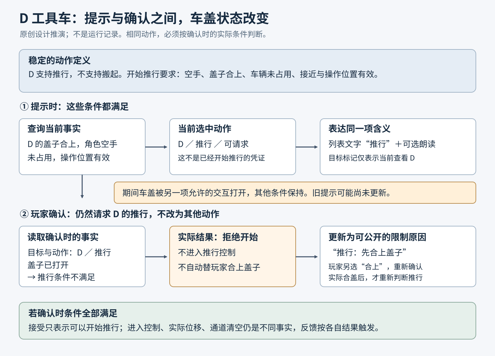

# 场景物件的交互规则与提示设计

仓库里有几件相似的木制物件：入口的箱子可以搬走，靠墙的箱体搬不动却能打开，转角处另一只搬运箱又在角色抱着东西时拒绝抓取。若它们都只显示一个“可交互”亮边，玩家仍不知道该做哪个动作、限制来自物件还是自己，以及刚才那次操作究竟有没有成功。

制作问题也会因此分散到不同岗位：美术重画固定件，关卡人员修改实例，程序增加条件判断，音频在按键时播放确认声。每项修改单独看都合理，合起来却可能继续传递错误含义。

本文帮助关卡、交互设计、环境美术与玩法协作者，为一组重复使用的场景物件建立动作规则、提示和检查方法。读者需要了解场景资产、实例与基本交互输入；这里不实现抓取物理、目标射线或网络控制器。下面的仓库及其操作约定是原创设计示例，尚未实现或进行玩家测试。方法综合了开发者实践与设计资料，具体步骤不是任何一家工作室公开的内部规范。

## 从物件用途写出动作，不从材质推断能力

先把仓库中的用途确定下来：

- 搬运箱 A 挡住通往开关的通道，需要搬开；C 是同一种箱子，放在另一处。
- 储物柜 B 提供仓库钥匙的取用位置。它必须留在墙边，箱体不能搬走，柜盖可以打开。
- 工具车 D 用于挪出工作空间，也允许取用里面的工具。它很重，只能推行，不能搬起；打开的盖子会妨碍推行，因此移动前必须合盖。

这几件物件可以共用木板和五金的美术语言，却不应共用一个决定全部行为的“可交互”值。**搬起、推行、打开、破坏是不同动作。** 本例没有破坏和燃烧玩法，不能因为是木制品，就在提示中暗示这些能力。

Frictional 在《Penumbra: Black Plague》的开发回顾中，将物件操作区分为抓取、推动和用于门、抽屉等的移动，再逐件调整相关性质。团队还遇到小物件的定向修正力把大物件撞飞、限制力或改变质量各有副作用的问题。[1] 这里可借鉴的是动作与对象差异会影响实际制作，不能靠“都接物理”消除；该历史案例不提供本仓库的抓取实现或参数。

为每个动作分别记录三个问题：这个类别是否提供它；当前条件是否允许开始；完成后哪项事实应该改变。表中的“空手”是本例选择的规则，不是现实中开柜必然需要双手。

| 对象与动作 | 稳定能力 | 当前开始条件 | 应观察到的结果 |
|---|---|---|---|
| A、C：搬起 | 搬运箱提供此动作，不提供开盖 | 角色空手，箱子未被占用，满足共同接近条件 | 箱子确实进入本角色的持有状态；之后显示放下入口 |
| B：打开／合上 | 固定箱体提供开合，不提供搬起和推行 | 空手，盖子不在运动；打开要求当前关闭，合上要求当前打开 | 盖子到达对应状态。打开只让内容可取，不等于钥匙已进入背包 |
| D：推行 | 工具车提供推行，不提供搬起 | 空手，车盖已合上，车辆未被占用，操作位置可用 | 进入推行控制；移动多少由实际移动结果决定 |
| D：打开／合上 | 与推行分别存在的开合动作 | 空手，车辆未被占用，盖子不在运动；方向符合当前开合状态 | 车盖实际打开或合上，随后重新判断推行资格 |

表中所有动作还须满足共同接近条件，包括角色可以行动、目标仍有效，以及项目交互系统确认的距离、遮挡和操作位置要求。这里不替项目设定距离数值；接入时必须使用实际判定，不能一边按镜头距离显示提示，另一边按角色距离执行，却不说明两者的关系。内容物拾取仍由独立拾取操作负责，不把开盖结果冒充获得物品。

表中还区分了两种“成功”。搬起结束时可以确认已经持有箱子；推行开始时只能确认已经进入控制，不能宣告“通道已清空”。后者需要车确实离开通道，且关卡另行检查通路。先说清动作交付什么，才能知道该用什么反馈。

## 保留哪些差异，先作设计决定

如果 A、C 的用途完全相同，只有 C 被某个场景实例设置成不能移动，第一步是检查这个覆盖是否错误，而不是给 C 加上固定底座。用外观解释错误配置，会把一次缺陷变成需要长期维护的新类别。

若 B 必须固定，则应保留“固定箱体”和“可打开的盖子”两个含义。把整件 B 改为静态布景，虽然解决了搬动问题，却一并丢掉了取钥匙的入口。反过来，只因它看起来像 A，就让 B 可搬，也可能改变钥匙位置、路线约束和后续场景布置。

任天堂的《王国之泪》开发者访谈提供了两种实际选择：曾把原本不能搬动的木箱改成可搬；对确实不能移动的物件，再用绳和覆布等表现限制。[2] **改变规则与改变提示，是需要分别评估的方案。** 官方配图展示的是带说明文字的裸露建材与覆布堆料，不是同款箱子只增减一根绳子的对照，不能用它证明某个单独形状的识别效果。访谈中“不可破坏的壶有盖子”也是开发者的具体陈述，不能倒推为所有带盖容器都不可破坏。

对仓库可比较以下候选，而不是默认“提示越多越好”：

| 候选 | 适用条件 | 获得什么、承担什么 |
|---|---|---|
| 统一 A、B 的搬运能力 | B 固定的理由已经获准取消 | 少一种能力差异；但必须重新检查钥匙位置、通路、碰撞与内容物处理 |
| 保留 B 固定，并修改结构线索 | 固定是关卡约束，玩家需要在接近时辨认 | 可以维持用途；需要制作连接结构，并检查各接近方向和变体，不能只画背面支架 |
| 暂保留外形，用明确动作列表区分 | 原型期或资产改动成本较高，允许靠近后再判断 | 能交代当前可做什么；远处仍可能误认，菜单与文本还增加阅读和操作成本 |

本文继续采用第二条，并保留动作列表。原因是 B 固定属于已定用途，而取钥匙又是必须保留的交互。若以后用途改变，应重新打开第一条方案，而不是永远维护最初的限制。

工具文档也说明了为什么要查到实例层。访问时的 HPL2 文档分别描述 StaticProp 与可设交互回调的 Object (Static)，并给 Object 提供实例项 StaticPhysics 来禁止移动；破坏还有另设的 BreakActive 与 DisableBreakable。[3] 因而“类型看起来正确”不够，仍须核对具体实例和具体动作。这里引用的是可编辑文档中的字段安排，未核对固定源码或执行 HPL2，不把它当作任一当前构建的实测行为。

## 让稳定外观表达稳定能力，让短期提示解释当前条件

可做的动作与传达动作的线索是两回事。Norman 将 affordance 解释为特定行动者与环境之间的动作可能性，将 signifier 用于可以被感知和解释的线索；线索也可能是无意产生的，并不总可靠。[4] 放到仓库中，设计者没有把某条横梁当作抓取提示，不代表玩家不会从它推断“这里可以搬”。

本例提出一组需要在项目中检验的外观约定：A、C 保留独立落地的箱体轮廓和握持横梁；B 的下部显示与墙面、底座的连接，上部保留清楚的盖缝与把手；D 用轮组和推杆表达移动方式，同时让盖子的开合部位可见。这些不是天然通用符号，也不保证新玩家第一次就理解。它们的意义要由项目中的使用、教学和实际结果共同建立。

约定的范围应足够具体：“这一组搬运箱支持搬起”，而不是“有木板就能搬”。制作新变体时，要查看最容易混淆的非目标物：如果固定货架也复用了 A 的握持横梁，横梁就不再足以区分类别；如果项目另有割绳玩法，用绳固定 B 又可能暗示可割断。此时应改变分类特征或明示动作，不把冲突归咎于玩家没记住例外。

临时限制则保留物件原来的类别。角色抱着 A 时，C 仍是搬运箱，只是当前不能再搬。它的操作行可以显示“搬起：先放下手中物品”，而不把整件物体改成固定物的外观。D 开盖后也仍是工具车，只是推行行暂不可用。合盖后应恢复推行资格，不能留下永久禁用状态。

在本例中，目标边框只表示“操作列表将针对这件物体”，不表示每个动作都可用。稳定造型、目标边框与动作行各自回答不同问题。若一个亮边同时被用来表示看向、可执行和操作成功，改变某一项条件时，就很容易错误抹掉另外两项信息。

## 一件物体有多个动作，必须给出选择方法

对 D 只写“可以推、可以开”仍不能交付。玩家瞄到车盖时按交互键，是开盖、推车，还是沿用上一次动作？当开盖后不能推时，同一键会不会突然变成关盖？这些决定不能留给实现顺序。

本例采用**先查看操作，再确认动作**的列表方案，A、B、C、D 都遵守同一入口：

1. 项目目标选择系统确定一件可接近的物件后，显示物件名称和“查看操作”的输入提示。按下它只打开列表，不执行列表中的第一项。
2. 列表固定当前目标，并列出本例允许玩家知道的动作。A、C 显示“搬起”；B 按当前盖状态显示“打开”或“合上”；D 以固定次序显示“推行”和“打开／合上”。不支持的搬起不会出现在 D 的列表里。
3. 玩家用列表导航选择一行，再单独按“确认”请求该动作。“取消”关闭列表且不操作。界面显示当前设备与重映射后的真实绑定，不把设计文档里的键名硬编码进提示。
4. 暂不可用的行仍可选中并说明允许披露的原因。D 开盖时“推行”行留在原位，显示“先合上盖子”；不会因为它不可用，就让原本指向这一行的确认键自动执行“合上”。
5. 列表打开期间世界仍会变化。目标失效或离开接近范围时关闭列表；不能悄悄改绑到身后另一件物体。动作正在执行时不重复接收它，完成或中止后重新建立可选项。开盖完成后出现的“合上”，必须经过一次新的明确确认才能执行。

这样，玩家要先合上 D，再推车，就会选“合上”并确认，等实际合盖后，再选择“推行”并确认。选中了暂不可用的推行再确认，只得到对应的限制反馈，不会替他执行另一动作。选中行和发出的请求必须对应同一个物件、同一个动词。

确认推行后，本例进入独立的推行控制，方向输入请求移动车辆，“停止推行”退出。拿起 A 后则显示“放下”；若项目放置检查拒绝当前落点，保留持有并说明“此处无法放下”，只有实际解除持有才撤去该状态。这些是接入既有控制器需要遵守的交互含义，不规定推力、运动求解或放置算法。

列表方案的代价很明确：即使 A 只有一个动作，也增加一次选择步骤，不适合未经评估就用于高频快速拾取。若项目更看重连续操作，可以用稳定主动作加“其他操作”入口；但必须明确哪个动作是主动作，主动作暂不可用时是否仍占据原输入。另一个候选是瞄准推杆来推、瞄准盖子来开，适合部位较大且实际视角能稳定命中的场景；小把手、拥挤摆放和辅助瞄准会增加选择难度。不能仅因空间式操作看起来更自然，就省略部位命中与替代入口的检查。

## 提示说明当前判断，操作结果要等待实际事实

制作时可把动作描述整理为“目标物件、动作、当前资格、可公开的原因、结果含义”。模型、界面文字、朗读与声音围绕这项含义分工；无需各自在资源表里推测资格。图 1 以 D 的推行为例，展示提示与执行的关系。

图 1：原创关系图。上行表示观察时的提示，下行表示后来确认动作时的判断；两次读取之间车盖、占用和角色条件都可能变化。箭头说明信息依赖，不规定引擎模块、线程或网络时序。可公开的原因受信息设计约束。

假如 D 合盖时显示“推行”，随后车盖被另一段已允许的交互打开，旧提示不应成为执行许可。确认时仍检查 D 的推行条件，拒绝这次推行，并更新为“先合上盖子”。相反，若显示仍旧不可用但实际条件已经恢复，也应重新查询并修正显示；不能让提示层保存另一份永久过期的资格。

“使用同一项规则事实”不要求图形和物理每一刻都由同一函数同步运行。它要求两边遵守同一动作定义、读取实际条件，并能解释更新间隔产生的差别。开发记录应能看到提示所依据的条件、确认时的条件及实际结果，不能只存一张显示正确的截图。

本例至少分清以下反馈触发点：

| 发生的事实 | 可以表达的含义 | 不能提前宣告的事 |
|---|---|---|
| 目标被选中，操作列表可查看 | 正在查看 D 或 C 的操作机会 | 其中所有动作都已获准 |
| 搬起或开盖请求被接受 | 正在开始该动作 | 已经持有、已经打开、已经拿到内容物 |
| 请求被拒绝 | 本次动作没有开始；给出可告知的原因 | 自动成功，或改为另一个动作 |
| A 确实进入持有状态 | 现在拿着 A，提供放下入口 | 已经搬到目标位置 |
| B 的盖子实际打开 | B 已打开，可以继续处理内容物 | 钥匙已经拾取 |
| D 进入推行控制，但被障碍挡住 | 正在推行但尚未移开 | 通道已经清空 |
| 已开始的动作中止 | 动作停止，按实际剩余状态恢复提示 | 自动回到开始前状态或自动完成 |

最后一行需要具体落实。开盖过程被中止时，要查看项目是否留下半开的盖子、复位到关闭，或仍处于不能再次操作的恢复阶段，然后显示对应状态。若控制器有“部分打开”状态，就必须为它定义后续允许动作；不能让美术自行选一张“关闭”图来填空。本例的原型若只提供开／关两种稳定状态，可选择中止后恢复关闭，但这项恢复本身也要由控制器实际完成。

声音遵守同样的语义约定：选择提示音可以确认已选中某项，开始声表示动作开始，拒绝反馈表示没有开始，完成声等待对应结果。如果成功声绑在交互键按下而不是实际结果上，增加音量无法解决误报。本文没有试听这些候选，不判断音色、响度或声画同步质量。

任天堂访谈还讨论了连接后的胶状表现；官方原图可见原木接缝与帆杆底部的绿色形体，但带有红箭头说明。[5] 这能说明团队制作了可见的连接状态，不能从静图推断无箭头时的识别效果或声音触发时刻。对仓库而言，闭合盖子的状态表现与操作前“可以打开”的提示也需要各自解释，不能互相替代。

## 不把内部拒绝原因变成泄题提示

开发工具可以记录完整原因，玩家提示只能提供按设计已可知的信息。D 的盖子就在眼前，本例允许直接提示“先合上盖子”；C 因角色正在持物而不能搬，也允许解释占手条件。

若某柜门暗中受尚未发现的机关控制，则不能直接显示“未按下楼上隐藏开关”。可选择保留项目原本允许的“暂时打不开”反馈，或把发现机关设为获得新解释的条件。相同规则也要覆盖朗读、声音、列表项和辅助模式；不能在画面上藏住答案，却让一个按内部条件命名的朗读条目说出来。

隐藏一个动作本身也会改变发现过程。若“可打开”是原本要发现的秘密，通用动作列表不能无条件把它列出。团队需要为此动作单独定义何时可被发现、此前允许什么尝试及反馈；不能简单把所有秘密物件从交互系统移除，再期待玩法自然成立。本仓库的普通动作都允许直接获知，因此可以采用前面的完整列表。

在允许披露的范围确定后，再检查信息通过哪些感官到达。关键限制不能只靠两种颜色，图标加文字仍然只依赖视觉；触觉也不能独自承担唯一含义，因为它可能关闭或设备不支持。XAG103 明确讨论了这些问题。[6] 本例可为所选动作及原因提供文字和可选朗读，声音提示只作为补充；若还需要不依赖视觉来发现目标，则须同时提供项目相应的目标发现支持，朗读一个尚未选中的列表并不能补齐它。

Naughty Dog 的《The Last of Us Part II》历史功能说明列出交互、拾取等探索声音提示，以及可浏览试听的声音词汇表和独立音量控制。[7] 这提供了一个具体制作参照：声音的含义可以有学习入口和配置，而不必假设玩家天生听懂。它不是本仓库声音的听感或效果验证。完整的感官替代与可知范围，可接着阅读[怎样让关键声音信息不只依赖听觉](../../../本地化与无障碍/无障碍设计/声音信息/怎样让关键声音信息不只依赖听觉.md)。

## 用少量有区别的情境找出失败环节

检查时先取得“哪个对象、哪个动作、什么条件、出现什么提示、实际结果是什么”。不必一开始记录所有引擎状态，但不能只写“木箱没反应”。下面的各行是待执行的检查情境，不是已经发现或修复的项目缺陷。

| 观察情境 | 先取得什么事实 | 据结果怎样继续 |
|---|---|---|
| 对 C 按下后毫无反应 | 当前目标是否真是 C、选中哪个动作、请求是否到达；接近查询是否通过 | 未选中或未送达，先查目标发现、输入与遮挡；收到请求后才查资格，不先重画模型 |
| A 能搬、同类 C 空手也搬不动 | 两者的类型、场景实例覆盖、实际拒绝原因 | 覆盖违反已定用途就修实例；若存在新的用途要求，先决定是否真的增加类别，再改提示 |
| B 因不能搬，连开柜入口也消失 | 分别查询搬起与打开，不用整物件禁用值概括 | 打开仍应允许时，修正动作列表组合；不能把固定箱体等同于没有操作 |
| 抱着 A 看 C，仍显示可直接搬起 | 显示时和确认时的持有状态、C 的实际返回 | 修资格更新与占手解释；放下 A 后再检查 C 恢复，不用更换模型掩盖问题 |
| D 开盖后确认原来选中的推行，却发生合盖 | 列表选择和请求中的动作是否一致 | 取消自动替换；保留推行行的不可用原因，让玩家明确选择合盖 |
| 搬起声或开盖成功声响了，物件没到目标状态 | 声音触发的是输入、接受，还是完成事实；动作是否中止 | 对应真实阶段接线，给中止定义退出；不能用已播音效证明规则成功 |
| B 规则、提示都对，但入口正面仍像 A | 连接结构在实际判断位置是否可见，是否被货物或简化模型遮掉 | 对比改变摆放、连接位置或近处提示的候选，复查其他视角，不直接全局修改规则 |

这些分支有先后关系：先确认请求作用到了谁，再看规则是否正确，再看提示是否对应，最后判断线索是否可见和可理解。不过也允许同时修复已经明确的独立问题，例如错误实例与遮挡恰好同时存在；不能因为找到一个故障，就假定所有症状只有同一个原因。

检查场景要含正常件、必要例外、临时受限件和最相似的非目标物。以本仓库为例，至少走通 A 搬起再放下、B 固定而开合可用、持有 A 时 C 受限且之后恢复、D 开盖与推行互相制约的过程。D 开盖中取消或被中止的路径也应走到稳定状态，而不是只检查正常完成。

再从实际接近方向和交互距离查看它们：B 背面的连接件是否从入口完全看不到；C 的握持横梁是否被转角货架遮住；D 的推杆与盖子是否在默认镜头里重叠；低画质的简化模型是否删掉了分类部件。检查结果分别记录规则事实、所显示含义和实际可见范围。编辑器里能找到这个零件，并不证明玩家站的位置看得到。

## 修改家族规则，要先找到实际使用者，再选检查代表

资产家族不是“所有名字带箱子的模型”，而是希望玩家迁移同一项动作知识的一组物件。但是，**共享动作与共享模型是两种不同的关系**：外形不同的物件可能使用同一动作定义，同一模型也可能被固定装饰复用。只列出家族名称和几张典型截图，还找不到一次修改影响了谁。

为此，可以在现有资产清单旁维护一份简短的关系记录：每种预制体或变体指向实际动作定义、承担含义的模型或组合部件，以及使用它的场景实例；实例有覆盖时，另记覆盖项、实际生效值和保留它的用途理由。引用要能打开资源或定位场景对象，不能只写会重名的“木箱”。项目可以使用资源路径或稳定 ID；场景实例则需要场景标识与实例 ID，重命名或替换资源后同步更新。动作定义可以指向实际使用的配置项或实现位置，不要求另造资源格式。若预制体通过另一个变体继承规则，也要保留这层引用，不能只记屏幕上显示的最终名称。

下面把仓库扩展到一只窄版 C 和固定杂物堆 E，示范这份记录。表中的路径与编号都是虚构项目引用的简写，实际制作时应换成项目里能定位的真实引用。B 的“仅从过道侧接近”是本例进一步选择的合法实例覆盖，理由是背靠墙；它不取消打开动作。

| 资产引用与用途 | 形状来源 | 动作定义引用 | 场景实例与覆盖 |
|---|---|---|---|
| 资产/搬运箱标准：搬开通路 | 模型/箱体M1、部件/握持H1 | 规则/搬起R1 | 仓库/入口/A；无覆盖 |
| 资产/搬运箱窄版：同类搬运箱 | 模型/窄箱M2、部件/握持H1 | 同一个规则/搬起R1 | 仓库/转角/C；无覆盖 |
| 资产/固定杂物堆：装饰，不提供搬起 | 复用模型/箱体M1，另加固定结构，不用握持H1 | 不引用搬起R1 | 仓库/侧廊/E；固定用途来自资产定义 |
| 资产/储物柜：固定而可开 | 模型/柜体M3及柜盖 | 规则/开合R2 | 仓库/墙边/B；接近侧覆盖为过道侧，保留背靠墙的布局 |
| 资产/工具车：可推且可开 | 模型/车体M4、轮组与车盖 | 规则/开合R2、规则/推行R3 | 仓库/货区/D；无覆盖 |

这张表只列本节需要追踪的来源，并非完整控制器配置；例如搬运后的放下规则仍按前文约定接入。木板旧化、贴纸可以自由变化，握持部、固定关系与轮组等则承担已选定的类别含义，应在关系记录里指出。这里让 B、D 复用共有的开合定义，D 仍组合前文的未占用条件，两者也保留各自模型、接近限制和移动能力；复用一项定义不等于整件物体的全部规则相同。

修改前先说明改动发生在哪个真实资源、哪个条件或哪个实例，然后反向查找使用者。可以使用项目已有的资源引用查询和场景清单，也可以在规模较小时逐项核对；关系记录是定位线索，实际资源和场景中的引用才是核对对象。

- **改动作定义或其共用条件**：从定义查到直接使用它的资产，再沿变体继承、组合引用找到实际实例。改开合 R2 时，B 与 D 都进入待核对集合，不能按外形只找柜子；改搬起 R1 时，A 与窄版 C 都在集合内，E 不因共用箱体而自动算作搬起行为受影响。逐项查看实例覆盖：B 的过道侧限制需要与新版开合要求一起核对，不能把所有覆盖重置为默认，也不能见到覆盖就把它排除。若覆盖确实使某个改动不生效，应记录排除的具体理由。
- **改模型、组合部件或分类特征**：从形状来源查所有使用它的资产，再找到它们的场景实例和实际采用的简化版本。改箱体 M1 会涉及 A 和装饰 E，即使 E 没有搬起动作；改握持 H1 则涉及 A 与 C。另核对由该来源生成、却不是直接引用它的简化模型是否需要同步。由此判断改动是改变了可见类别、造成装饰误示，还是仅改变自由装饰，不能用行为家族名单代替模型使用名单。
- **只改摆放或实例覆盖**：先圈定实际被改动的场景实例；移动父节点时也包括随它移动的子物件。再沿接近视角、遮挡和目标选择关系，加入被其影响的邻近物件。移动 B 不必重画所有柜子，但若它遮住 A 的握持部，A 也要进入本次场景检查。若操作其实写回了共享预制体，而非只改实例，就重新按共享来源找使用者。

把查到的每项写成“可定位的资产或实例、为何受影响、是否有需保留的覆盖”，得到本次待检查集合，**再**从中挑运行检查的代表。先核对集合成员的实际引用与覆盖，再按不同规则路径、形状组合、合法例外和接近环境选例；共用定义且没有不同条件的实例可以选择代表，但不能用一只正常 A 代替有独立模型的 C、装饰 E 或有覆盖的 B。改变占手规则时仍检查空手、持有和放下后的恢复；改 D 开合时仍检查中止及推行资格恢复。代表检查减少运行成本，不等于名单中的其他成员已逐个运行通过。

若项目还没有这份映射，就从本次修改的源资源开始，用已有引用查询找直接使用者，打开候选预制体、变体和场景实例逐项补记，直到能说明本次检查范围。还需询问或核对运行时生成、按名称加载等未被引用查询列出的使用入口；查不到记录不能解释成没有使用者。无法确认的场景或入口应单列为未知范围，先补查或缩小改动范围，并明确仍未覆盖的风险，不宣称搜索结果自动穷尽全部依赖。

每个例外仍要能解释为什么存在。如果 C 只是为摆拍临时固定，应在交付玩法场景前恢复；如果设计后来决定 C 是固定的供电外壳，就应按新用途重新划分类别，而不是让它继续以搬运箱承诺出现。规则决定改变时，同时更新关系记录、动作入口与反馈。这样记录才能继续指向真实制作内容，而不是在下次换资源后成为另一张过期清单。

## 工程对应正确之后，再问玩家怎样理解

上述检查可以回答实现是否符合已定规则、提示是否对应当前事实、关键部件是否在指定位置存在。它们不能独自回答玩家是否注意到线索、理解动词，或者愿不愿意承担列表操作成本。

在仓库中，可以观察一个不泄露解法的任务，例如“到控制台前恢复入口供电”，让参与者面对挡路的 A；随后把他带到需要使用同类 C 的新情境，观察是否迁移已经学到的搬运规则。另安排 D 的取工具任务，观察玩家能否选择开盖，而不是把推行当作唯一动作。记录的是注意到的物件、实际选择、操作前的预期与失败后的解释，不能仅看最后有没有到达目的地。

若目标是自然发现，操作前直接问“这只箱子能不能搬”已经改变了注意方向，应把这种明确判断任务与自由操作观察分开。A 之后的 C 可以用于研究学习迁移，却不是第二次首次接触；先教“底座连墙就是固定”，再看参与者答对，也不能证明外观无需学习就懂。主持介入与版本比较的处理可参看[主持人提示会怎样影响关卡测试结论](../../../项目管理与测试/玩家测试/关卡引导/主持人提示会怎样影响关卡测试结论.md)。

回到最初的制作决定，观察结果应能改变下一步：玩家根本没发现目标，就检查场景线索和发现支持；看到 D 但不知道怎样选开盖，就检查动作入口与动词；理解动作却反复误触，才进一步比较列表、稳定主动作或部位选择的成本。不能把所有问题都交给更亮的高亮处理，也不能以更多日志代替理解研究。

最终交付应让下一位制作者回答五件事：这组物件承担什么用途，各自提供哪些动作，眼下哪些条件限制它们，玩家怎样明确选择并得到真实反馈，以及共享资产变化后该复查哪些代表情境。外观一致不意味着所有动作相同，提示丰富也不意味着含义正确。真正需要维持的是物件用途、动作规则、可获得信息和操作事实之间可解释的关系。

## 相关知识

- [用图形表现按钮和界面的状态](../../界面美术/状态表达/用图形表现按钮和界面的状态.md)：需要设计目标、选择、禁用与处理中等组合的具体图形时继续阅读。
- [玩法程序员如何实现和验证设计规则](../../../玩法程序/玩法系统/岗位与协作/玩法程序员如何实现和验证设计规则.md)：需要深入规则来源、取消、结果与表现分工时继续阅读。本文没有建立另一套通用状态机或事务实现。

## 参考资料

[1] Thomas Grip / Frictional Games，[*‘Penumbra: Black Plague’ Developer Diary #3 – Screens*](https://frictionalgames.com/2008-01-penumbra-black-plague-developer-diary-3-screens/)，2008-01-23。参见 Implementing physics，以及 Using the physics to design puzzles。页面另有 2023-10-10 标记；本文按历史项目回顾使用，未运行该游戏或引擎。

[2] 任天堂，[《開発者に訊きました：ゼルダの伝説 ティアーズ オブ ザ キングダム》第5页「できるかな？がちゃんとできる」](https://www.nintendo.com/jp/interview/totk/05.html)，2023-05-11。藤林谈木箱、绳和覆布，随后堂田谈壶盖及类别线索。[官方说明图 06.jpg](https://www.nintendo.com/jp/interview/totk/photo/06.jpg) 为裸露建材与覆布堆料，带分类文字；不是单变量实验，也没有提供本文的玩家效果数据。

[3] Frictional Wiki，[*HPL2/TDD/Entity Types*](https://wiki.frictionalgames.com/page/HPL2/TDD/Entity_Types)，访问于2026-11-06。相关范围为 StaticProp，Object 的公共、类型与实例字段及 Static、Grab、Push、Slide 小节，LevelDoor 的焦点文字、锁定与交互拒绝反馈字段。可编辑工具文档，本文未固定源码或执行实现，仅作为字段职责分开的具体实例。

[4] Don Norman，[*Signifiers, not affordances*](https://jnd.org/signifiers-not-affordances/)，2008-11-17，ACM Interactions 15(6) 作者版本。参见线索的有意／偶然性质、可靠性讨论及 Signifiers, Not Affordances 段；设计论述，不是仓库方案的游戏实验。

[5] 任天堂，同系列[第4页「そういうところが『ゼルダっぽい』」](https://www.nintendo.com/jp/interview/totk/04.html)，2023-05-11。青沼、滝澤、若井讨论接着剂外观与声音的段落；[官方说明图 04.jpg](https://www.nintendo.com/jp/interview/totk/photo/04.jpg)。图带红箭头，系列页面说明含开发中素材；本文只用静态图解释可见连接状态，不作音色、动态时序或最终版本的评价。

[6] Microsoft，[*Xbox Accessibility Guideline 103: Additional channels for visual and audio cues*](https://learn.microsoft.com/en-us/xbox/accessibility/xbox-accessibility-guidelines/103)，访问于2026-11-06。采用 Goal、Overview、Color、Haptic options 与 Implementation guidelines 的多感官要求。平台指导，不是本文的认证或玩家研究结果。

[7] Matthew Dunnerstick / Naughty Dog，[*The Last of Us Part II: Accessibility Features Detailed*](https://www.naughtydog.com/blog/the_last_of_us_part_ii_accessibility_features_detailed)，2020-06-09。采用 Text-to-Speech and Audio Cues、Traversal Cues、Audio Volumes 与 Audio Cue Glossary；历史功能说明，未试听其声音或验证当前补丁行为。

[返回场景交互](README.md)
