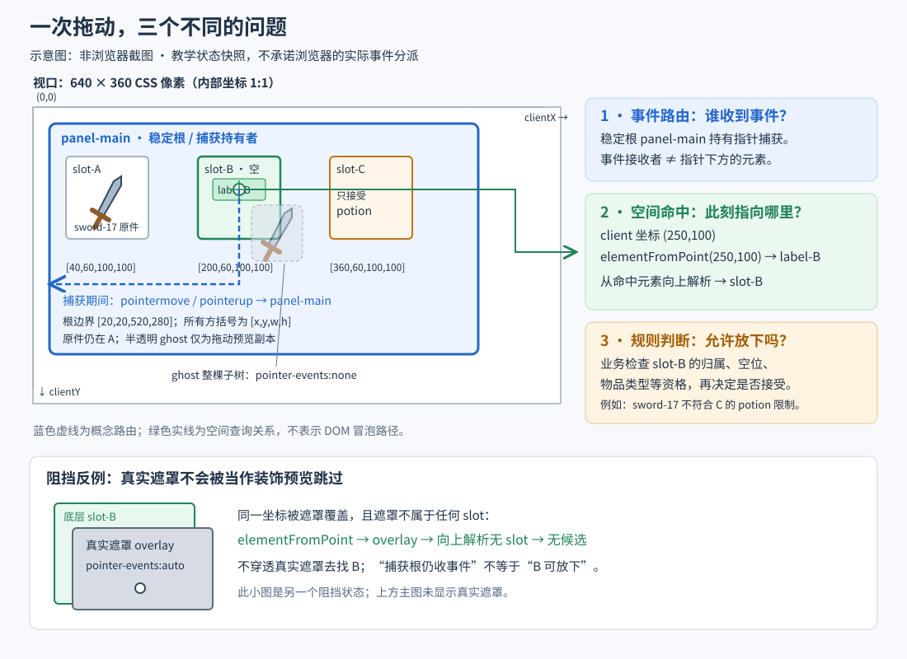

# 网页背包物品拖放：捕获、命中与取消

考虑这样一组接入故障：一把剑从背包格 A 拖到空格 B 上方，B 已经高亮，松手后却没有移动。把放置判断改成坐标查询后，另一个问题出现了：正常松手刚移动成功，随后的失去捕获通知又把剑放回 A。再加一层忙碌遮罩，物品甚至可以穿过遮罩落进背包。

这是用于分析的假设场景。这几个故障发生在同一条操作上，却分别涉及输入交给谁、指针下现在有什么、游戏是否允许移动，以及何时结束本次尝试。本文为懂 JavaScript 事件、DOM 和基础状态管理的网页游戏开发者，给出一套把这些职责接起来的方法。采用单文档普通 DOM、专用拖动把手、一次一个鼠标左键会话；物品只可移到同一背包中合格的空格，规则同步在本地执行。

方法的核心是：**开始时记录本次拖放及物品身份，移动时只做临时预览，松手时重新命中并校验，终结后才清理输入和通知表现。** 下文的业务策略和算法是原创设计；规范支持浏览器接口含义，附带演算只运行应用层状态机，未运行浏览器参考实现。

## 从 A 到 B，分别问三个问题

设背包根元素为 `panel-main`。A、B、C 是其中三个登记过的格子，A 内有物品 `sword-17`，B 为空且接受武器，C 只接受药水。按下 A 的把手以后，捕获放在背包根上，物品节点仍留在 A，另画一个跟随鼠标的副本。

指针捕获会让相关事件按捕获目标分派，而不再按指针下的普通命中决定 `target`。[1] 因而在 `(250,100)` 的 B 上方，`pointermove`、`pointerup` 的目标可以仍是根元素。DOM 的 `currentTarget` 则表示当前正在调用哪个对象的监听器；它也不能作为落点。[4]

| 本次要回答的问题 | 读取什么 | 示例答案 |
|---|---|---|
| 谁接续本次输入？ | 保存的捕获拥有者、匹配的 `pointerId` | `panel-main` |
| 当前视口坐标下是什么？ | `elementFromPoint(clientX, clientY)`，再解析本背包格子 | B 的标签 → 格 B |
| 当前规则是否接纳？ | 当前物品、来源格、目标格和背包实例 | B 启用、为空、允许武器，且剑仍是开始时那件 |



图中的蓝线是事件路由，绿线是空间命中，橙色部分是业务判断。图为原创示意，不是浏览器截图。单独改对绿线仍不足以完成拖放：如果 B 刚被禁用，或原剑已经被另一操作移走，仍要拒绝本次移动。

捕获也不表示必须一直留在 A。本文允许移出背包、再移回来：在外部没有候选格，但会话仍在；真正松手、取消或丧失操作资格才结束。不要用捕获期间的 `pointerleave` 代替坐标判断，因为此时边界事件按捕获关系处理。[1]

## 开始时保存的是这一次操作

`pointerId` 只用于匹配当前输入流，值可以复用；它不适合给每次拖放编号。[1] 本例使用单调增加的 `attemptId`，并给每次打开背包分配新的 `epoch`。同一个 DOM 名称、同一鼠标编号，都不能让上次打开的回调进入新背包。

一次会话保存以下信息。这里的“版本”是由物品规则维护的修改序号，不是 DOM 属性。

| 字段 | 用途 |
|---|---|
| `attemptId`、`phase` | 本次尝试的身份，以及 starting、dragging、settling、ended 阶段 |
| `pointerId`、`owner` | 配对输入；保存明确的稳定捕获根引用 |
| `inventoryId`、`epoch` | 属于哪一个背包及哪一次打开 |
| `itemId`、`sourceId`、`sourceVersion` | 开始时拖的是哪件物品、来自哪格、物品当时的版本 |
| `lastPoint`、`candidateId` | 最后收到的视口坐标及临时合格候选；二者都不授权提交 |
| `result`、`cleaned` | 已确定的结果，以及本次临时资源是否已清理 |

例如记录 `sword-17 / A / version=5`。拖动中另一操作把它移到 C、版本加到 6，又让 A 的旧 DOM 节点显示 `sword-18`，本次拖放必须失效。检查节点还在、A 非空，都会漏掉这个变化。版本还防止“移走后又放回 A”被误认成原状态；凡是影响可移动资格的物品修改，都应更新该版本。格子类型、禁用状态等目标条件则在提交时读取当前值。

背包视图创建时，建立“格子节点 → 本实例的格子 ID”和“把手节点 → 物品及来源格”的登记。可使用 `WeakMap`，值包含背包引用、世代和业务 ID。数据属性只用于找到节点，不作为授权数据。重建、回收或复用节点时，先更新登记，再开放输入。DOM 的 `closest`、`contains` 和 `isConnected` 分别处理祖先匹配、树内关系与连接状态，不检查游戏资格。[4]

本例的状态顺序是 `starting → dragging → settling → ended`；捕获失败从 starting 直接终结，其他取消从 dragging 终结，ended 不能退回拖动。开始流程按下面顺序完成，不在中间等待网络或动画：

1. 没有活动会话，也不在终结清理中；确认事件来自本实例登记的专用把手。
2. 仅接受 `pointerType === 'mouse'`、`button === 0`、`buttons === 1`。读取当前物品与来源格，建立 starting 会话。
3. 在稳定根上用本次真实 down 的 `pointerId` 调用 `setPointerCapture`。捕获根不要随着物品或预览被搬动。
4. 捕获请求抛错，或调用返回后 `hasPointerCapture(pointerId)` 为 false，都结束为取消，不产生物品移动。成功才进入 dragging 并创建预览。

`hasPointerCapture` 检查待定捕获；它可以在 `gotpointercapture` 之前为 true。[1] 所以会话应由开始逻辑建立，不能等 got 回调才记录物品，也不能把“调用没有抛错”当成已经设置捕获。got 在本例只作诊断，不再创建第二份会话。全局单会话锁由应用维护，不依赖 `isPrimary`。

专用把手让这里不必再解决“点击使用还是拖动”的阈值竞争。把手不做链接、图片或原生 draggable，也不承载使用／装备的 click；使用按钮是另一入口。外层委托只响应明确登记的使用按钮，不能收到根元素的 click 就使用当前物品。捕获释放并不负责吞掉 click，规范还有捕获相关的 click 目标规则。[1] 若项目要让整个物品图标同时点击和拖动，需要另行设计激活判定，不能直接删去这项分工。

## 每次重新命中，只解析最前面的有效对象

本例直接配对 `clientX/clientY` 与同文档的 `elementFromPoint`。本例采用普通页面与容器滚动，不涉及捏合缩放或多视口坐标转换。CSSOM View 用视口坐标定义这两个接口，并在命中算法中考虑适用的变换；结果也可能是 null 或文档根。[2] 不要给 client 坐标再加滚动距离，也不要把相对事件目标的 `offsetX/offsetY` 放进同一查询。捕获后事件目标变了，用 offset 做放置判断尤其容易换错原点。

下面是 DOM 适配伪代码。根标记 `data-inventory`，每格标记 `data-slot`；需要阻挡投放的子控件标记 `data-drag-blocker`。`view` 是当前背包视图，`slotRegistry` 是建立界面时维护的登记表；代码假定普通 DOM、同一文档，没有 iframe、Shadow DOM 或嵌套背包跨层投放。

```js
function slotAt(s, point) {
  if (view.epoch !== s.epoch || view.root !== s.owner ||
      !s.owner.isConnected) return null;

  const hit = document.elementFromPoint(point.x, point.y);
  if (!(hit instanceof Element)) return null;
  if (hit.closest('[data-drag-blocker]')) return null;

  const node = hit.closest('[data-slot]');
  if (!node || !s.owner.contains(node)) return null;
  if (node.closest('[data-inventory]') !== s.owner) return null;

  const entry = slotRegistry.get(node);
  if (!entry || entry.inventoryId !== s.inventoryId ||
      entry.epoch !== s.epoch) return null;
  return entry.slotId;
}
```

标签是格子的子元素，所以命中 `label-B` 后向上找到 B；命中页外装饰、根背景或其他背包则无候选。只解析这一次命中的元素及祖先，不在整页寻找同名 ID，也不向下穿透不合适的前景。

预览需要配合这个政策。它是装饰副本，不能自己挡住要放入的格子：给预览及其全部后代设置 `pointer-events: none`，不要在子图标上重新设成 auto。CSS UI 明确允许后代恢复参与命中，也明确 none 不会禁止顺序焦点导航。[3] 因此本例预览只含无交互、不可聚焦的图形与文字，不复制使用按钮；这项 CSS 不是完整的交互禁用方案。

真正的忙碌遮罩恰好相反。它保持可命中，标记 `data-drag-blocker`，其后代也按阻挡用途处理。即使遮罩恰好放在某个格子里面，先检查 blocker 仍会拒绝它。不要写 `elementsFromPoint(x,y).find(任意格子)`：该列表能包含下层盒子，[2] 而本例产品规定上层遮罩阻挡投放。无条件搜索 B 会绕过这个规定。想让某类提示穿透，应把那类纯装饰层明确排除命中，而不是遇到任何遮挡都继续往下找。

预览可放在与视口对齐、没有变换祖先的固定定位容器中，以 `lastPoint + 小偏移` 更新显示，避免盖住指针。它只表示“正在拿着剑”；源物品仍由正式模型保存在 A，可用淡化样式表示占用。候选格可显示“可放入”或拒绝原因，不能只靠一个颜色暗示所有状态。预览、高亮和正式物品移动分别更新，取消时才不需要猜测该往哪格补回一份物品。

### 鼠标不动，候选也会变化

移动处理先匹配当前会话的 `pointerId`。如果仍然只按左键，保存 client 坐标，重新调用 `slotAt`，再用当前业务规则检查候选。无候选就清掉原高亮；不能保留“最后一次成功找到的 B”。

只有 move 时更新仍有空隙：滚动、布局重排、动画或遮罩出现，都可能在指针不动时改变下方对象。本例选择仅在 dragging 期间运行一个 `requestAnimationFrame` 循环，用最后坐标重算预览；应用修改物品或目标资格后，也安排同样的刷新。若项目能完整报告所有相关布局与模型变化，可以改成按变化刷新，减少查询，但不要把 ResizeObserver 当成涵盖所有位置和遮挡变化的通知。

帧回调捕获本次 `attemptId` 与 `epoch`，执行前核对活动会话仍匹配；过期就退出，不清理新会话。每帧一次命中及布局读取有成本，应在目标页面观察，不凭这份小例子宣称没有性能影响。无论预览刷新多及时，**up 都另查一次当前坐标及当前规则**，不等下一帧，也不把高亮当成缓存许可。

## 用一个入口决定移动，并先关闭本次提交资格

本例的接纳条件很具体：背包仍是当前实例且开放，`sword-17` 仍在记录的来源格、版本未变；目标是当前命中的已登记格，不同于来源，启用、为空，接受这件物品的当前类型。交换、堆叠和拆分不进入这个入口。

可把规则写成纯函数 `planMove(model, session, targetId)`：失败返回原因；成功返回更新后的完整模型和结果。它复制源格与目标格记录，源格置空、目标格放入该物品，同时更新物品位置与版本。模型是普通数据，校验与构造期间不调用外部监听器、代理 setter 或渲染代码。最后以一次模型引用替换发布，避免观察者看见“源已清空但目标尚未写入”的中间状态。

把这项纯数据规则写出来，可以看清哪些条件必须一起成立。以下 `model` 含背包身份、世代、开放状态、按 ID 索引的 `slots` 与 `items`；条目为应用自己管理的普通对象。登记表和模型中的业务 ID 均为非空字符串，`slotAt` 的 `null` 只表示没有候选。应在查字典前拒绝它，不能让对象索引把它转换成同名字串的格子键；真正命中 ID 为字符串 `"null"` 的格子则仍可按规则判断。失败不会修改模型。

```js
function planMove(m, s, targetId) {
  const reject = reason => ({ accepted: false, reason });
  const item = m.items[s.itemId], source = m.slots[s.sourceId];
  if (!m.open || m.inventoryId !== s.inventoryId || m.epoch !== s.epoch)
    return reject('背包已失效');
  if (!item || item.slot !== s.sourceId ||
      item.version !== s.sourceVersion || source?.item !== s.itemId)
    return reject('来源物品已变化');
  if (typeof targetId !== 'string' || targetId.length === 0)
    return reject('没有新目标格');
  const target = m.slots[targetId];
  if (!target || targetId === s.sourceId) return reject('没有新目标格');
  if (!target.enabled || target.item !== null || !target.accepts.includes(item.type))
    return reject('目标不接纳');

  return { accepted: true, nextModel: {
    ...m,
    slots: { ...m.slots,
      [s.sourceId]: { ...source, item: null },
      [targetId]: { ...target, item: s.itemId } },
    items: { ...m.items,
      [s.itemId]: { ...item, slot: targetId, version: item.version + 1 } }
  } };
}
```

这段代码没有把 `candidateId` 当参数，调用者必须提供松手时重新解析的目标。`targetId` 也只能来自本次 DOM 适配结果，不能直接接受外部字符串。本文允许目标资格变化后仍继续拖动，而来源失效会取消；所以预览刷新发现来源变化时应立即终结，不必等到 up。

为何先进入 settling？JavaScript 没有 await，不代表业务函数永远不会重入。同步派发自定义通知、执行状态订阅者，都可能再次调用取消或完成。若等所有回调返回后才标记结束，同一会话仍会被看成可提交。

下面给出终结入口的伪代码；`planMove` 和状态发布是受控的纯数据操作，预览、捕获释放及订阅者在它们之外。

```js
function finish(s, cause, point) {
  if (active !== s ||
      (s.phase !== 'starting' && s.phase !== 'dragging')) return;
  if (cause === 'up' && s.phase !== 'dragging') return;
  s.phase = 'settling';
  finishing = true;                 // 清理结束前拒绝新开始

  let result = { status: 'canceled', reason: cause };
  if (cause === 'up') {
    const targetId = slotAt(s, point);       // 此刻重新命中
    const plan = planMove(model, s, targetId);
    if (plan.accepted) {
      model = plan.nextModel;               // 唯一正式移动入口
      result = { status: 'accepted', targetId };
    } else result.reason = plan.reason;
  }

  s.result = result;
  s.phase = 'ended';
  active = null;                    // 先保存结果，撤销提交资格
  try { cleanupOnce(s); }
  finally { finishing = false; }
  notifyResult(s.attemptId, result); // 此后不再清理共享拖动状态
}
```

这里不能把 `planMove` 换成内部会触发应用回调的任意状态管理库调用。接入响应式仓库时，要先找到能原子发布并延后通知的边界；否则这段顺序并不成立。普通校验失败通过返回值表达，不能写一半模型后抛错。意外程序异常需要暴露和修复；若已发布成功模型，不能在 catch 中伪称取消并补做另一笔反向移动。

清理只释放本次资源，不决定物品归属。`cleanupOnce(s)` 先标记 `s.cleaned`，取消该会话的帧请求，只删除保存于 s 的预览节点，并仅在高亮所有者仍为该 `attemptId` 时移除高亮。它在只执行一次的清理中检查 `owner.hasPointerCapture(pointerId)` 后尝试释放捕获；用独立的异常处理保护释放步骤，失败应记录，但不改变已经接受的业务结果。释放捕获的检查与调用也只执行这一次，不能让迟到的旧清理去释放相同鼠标的新捕获。这里不等待 lost 才移除预览。

如果清理中发生重入，s 已 ended；新开始又被 `finishing` 拒绝。清理完成后的通知可以导致界面更新，甚至进入另一条合法操作，但函数随后不再执行“清空当前预览”这样的全局收尾。旧动画、帧请求或其他延迟工作，仍须携带并核对自己的尝试与背包世代。

这个顺序给出的保证是**一次尝试在本地至多提交一次**：第一次终结把它从可结束阶段取走，其他入口再来就退出。保证依赖只有这个入口可移动本次物品，以及检查、模型发布之间没有外部回调或异步等待。它不包括网络重试、持久化失败、崩溃恢复或跨进程 exactly-once。

## 哪些通知结束拖动，哪些只是后续消息

鼠标的 `button` 表示此次按钮变化，`buttons` 表示当前按下集合；额外按钮的变化可以出现在 move，鼠标 up 对应退出所有按钮按下状态。[1] 本文只支持左键单按钮，所以 move 的 `buttons !== 1` 时保守取消；有效完成要求匹配指针的 up 同时满足 `button === 0 && buttons === 0`。不要只在 move 检查 `button === 0`，普通移动常是 -1；也不要等待每个按钮各有一次 pointerup。

下面是接入表。根元素的监听器与它的背包世代绑定；不把事件对象放进异步队列再读取 `currentTarget`，分派结束后这个字段会清空。[4]

| 输入或应用变化 | 仍活动时的处理 | 已终结后的处理 |
|---|---|---|
| 合格的匹配 up | `finish(s, 'up', 当前坐标)`，重新命中及校验 | 不再移动 |
| 匹配 pointercancel | 取消，不用它的坐标提交 | 不改变既定结果 |
| 匹配 lostpointercapture | 本文无捕获转交，异常丢失即取消 | 不回滚，不补做移动 |
| 另一个 pointerId 的 move/up/cancel/lost | 忽略，不更新预览也不清理 | 同样忽略 |
| 应用关闭背包、移除捕获根、来源失效 | 先关闭操作资格，再取消本次尝试 | 已接受的结果保留 |
| 指针移出 A 或背包 | 离开 A 不结束；背包外清空候选，允许返回 | 不复活旧尝试 |

pointercancel 表示输入流被抑制，其坐标继承同指针最近事件；它不提供一次新的放置确认。[1] 假设 B 仍高亮，cancel 分支仍只取消。由于此前仅移动装饰副本，取消不应向 A 再插入一把剑，也不应撤销别的系统已作出的合法移动。

正常 up 或 cancel 之后也会隐式释放捕获。[1] 因而 R01 的顺序可以是：up 接受 A→B；lost 到达时本次已 ended，只剩已经做完的收尾。反之，若活动中另一段代码先释放捕获，本文在 lost 时取消，之后才来的 up 不再恢复它。这是无转交政策的选择；允许控件间交接捕获的界面需要另外的转交协议。

关闭背包必须由掌握生命周期的代码主动调用取消，随后才拆 DOM、注销监听和增加世代。不要等卸载后的根自己收到 lost：规范对捕获节点断开后转到 document 的处理使用 SHOULD，[1] 应用既不应把它写成所有实现绝对相同，也不该靠迟到通知决定是否仍有业务资格。刷新与输入入口可再检查根是否连接，作为漏接生命周期的防御。

本例还建议在窗口 blur、页面隐藏或应用切离背包上下文时主动取消未完成尝试，恢复后要求新的合格 down。它们是分别接入的产品取消入口，不把窗口失焦等同于控件焦点变化，也不承诺浏览器窗外仍能持续收到 move/up。捕获不等于键盘焦点或 Pointer Lock。

## 沿同一组输入比较错误接法

附带的原创输入使用 A=`(40,60,100,100)`、B=`(200,60,100,100)`、C=`(360,60,100,100)` 的视口矩形，坐标单位为 CSS 像素。每组从 A 中有剑、B 为空开始；命中结果是明确给定的输入事实。

| 输入变化 | 本方法的模型输出 | 被排除的错误 |
|---|---|---|
| R01：根接收 up，当前命中 B，随后 lost/click | 剑在 B；提交 1 次 | 用 target 找落点；lost 无条件回滚；click 又使用物品 |
| R02、R03：B 上 cancel；或先 lost 后 up | 剑仍在 A；提交 0 次 | 取消仍沿用高亮提交；迟到 up 复活 |
| R04、R05：先移出背包，分别在外松手或返回 B 松手 | 前者仍在 A，后者移到 B | 缓存最后高亮；一离开源格就取消 |
| R06：B 前有真实阻挡层 | 剑仍在 A；无候选 | 穿透遮罩找下层格 |
| R07、R08：B 被禁用；或 B 移走、指针没动 | 剑仍在 A；提交 0 次 | 只信 DOM 存在或上次高亮 |
| R09：别的操作把剑移到 C，A 复用旧节点显示另一物品 | 本次提交 0 次；剑保留在 C | 把取消当回滚；把旧节点里的新物品当旧物品 |
| R10：p99 的 up，随后关闭／重开及旧101回调 | p99 被忽略；旧101已取消，新102仍活动 | 任意 up 结束拖动；旧回调清掉新预览 |

R09 的 C 不接受武器是本拖放的投放限制；题设中的另一规则操作仍可把剑安置到 C，本控制器只负责让自己的旧尝试失效，不撤销那次外部操作。

R07 与 R08 尤其能分辨两道检查。R07 的命中仍是 B，失败在业务规则；R08 的旧 B 仍可能启用且为空，失败在当前命中。两者都不能由一个 `candidateId` 缓存解释。

模型还运行了捕获适配返回失败的两种输入、额外鼠标按钮，以及一次重入对照。重入对照在清理回调里再次要求完成旧会话并尝试新开始，结果没有第二次提交，也没有新会话；清理后的通知再开始102，并重复清理旧101，102的预览仍保留。输入模拟的是应用回调，不是浏览器释放捕获时的实测事件顺序。

两个刻意错误的小基线进一步说明差异：R01 中直接按事件 target 找格子，没有发起移动；另一个基线改用命中，却缓存最后高亮，让 up、cancel、lost 各自调用移动。它在 R02 的取消及 lost 各调用一次，在 R04 离开背包后仍向旧 B 调用两次。这里统计的是错误入口调用数，不能据此假定真正的物品规则会接受这些调用。

### 接到项目后，还要观察浏览器这一层

纯模型把“当前命中是 B”“捕获请求成功”等当输入，所以它无法检验这些事实。接入项目时，应另用真实鼠标操作检查：移出后事件是否继续交给根、预览子树是否确实穿透、真实遮罩是否阻挡、滚动与布局变化后 up 的查询结果、关闭背包后是否仍有旧预览或业务调用。保留浏览器版本、视口、事件类型与指针 ID、target/currentTarget、client 坐标、当前命中、业务格 ID、尝试与世代、模型前后值和提交次数。

如果尚未找到可记录的原生 pointercancel 触发方式，就保留它的规范分支和应用模型检查，不把 `dispatchEvent` 构造事件包装成真实设备取消。复杂裁剪、捏合缩放、跨文档、Canvas 命中、触控手势及跨浏览器兼容，需要相应条件的单独验证；本方法不声称已经覆盖。

专用把手增加了界面面积，同步本地规则限制了适用环境，但换来了清楚的输入用途与提交边界。完成这条操作后，键盘／手柄选择目标、无障碍替代操作和联机物品权威应分别接入，而不是因为鼠标拖动成立，就宣布整套背包交互已经完整。

## 复现材料

[原创输入、纯状态模型与实际输出](../../../../管理档案/研究/TASK-2026-0299/复现/README.md)包含运行命令、输入转换说明、全部状态轨迹和错误基线。程序不启动浏览器、不分派 DOM 事件、不修改正式物品数据；只在指定输出目录写演算文件。

## 参考资料

[1] W3C Pointer Events Working Group，[*Pointer Events, Level 3*](https://www.w3.org/TR/2026/REC-pointerevents3-20260630/)，Recommendation，2026-06-30。§4.1 指针身份；§4.1.1 按钮；§4.1.3 分派与待定捕获；§4.2.6–7、§4.2.11–12 终止及 click；§5、§9.2–9.5 捕获接口及释放。2026-11-06读取所列段落。本文的把手、无转交、取消和提交政策不是 W3C 规定的背包算法。

[2] W3C CSS Working Group，[*CSSOM View Module*](https://www.w3.org/TR/2025/WD-cssom-view-1-20250916/)，Working Draft，2025-09-16，§5 `elementFromPoint/elementsFromPoint`，§10 client/page/offset 坐标。2026-11-06读取。草案接口算法不作为任意 CSS 布局和浏览器构建的兼容性证明。

[3] W3C CSS Working Group，[*CSS Basic User Interface Module Level 4*](https://www.w3.org/TR/2026/WD-css-ui-4-20260120/)，Working Draft，2026-01-20，§6.2 `pointer-events`，2026-11-06读取。

[4] WHATWG，[*DOM Standard* 固定源码](https://github.com/whatwg/dom/blob/6cc24159f1fe0857686d6712affb37d33229777e/dom.bs)，提交 `6cc24159f1fe0857686d6712affb37d33229777e`，2026-11-06读取。L524–530、L594–601、L1545–1552：事件目标及分派结束清理；L4832–4833、L5401–5403、L8119–8136：isConnected、contains、closest。本文没有阅读浏览器内部命中实现，也没有用这些 DOM 查询代替业务判断。

[返回指针交互](README.md)
