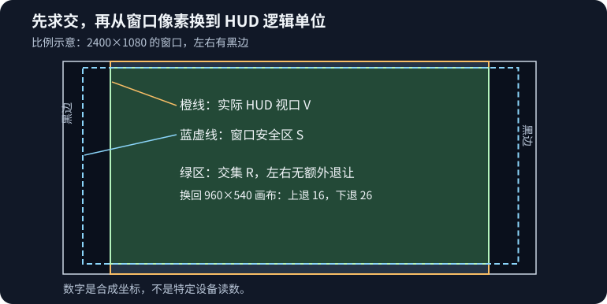

# 手机 HUD 安全区怎样换算到实际画布

游戏允许画面铺满异形屏，关键按钮却必须避开摄像头缺口和系统操作区。一个常见故障是：竖屏没问题，转到横屏后按钮一下挤到中间，或靠右按钮还落在缺口里。单看手机型号和「多加一点边距」都解释不了这个问题。需要先知道安全区属于哪个窗口、HUD 画在哪里，再把两者放进一个坐标系。

这里用矩形安全区处理被遮挡的边缘。背景、装饰可以铺到边；可点的按钮与必须读到的信息单独布局。折叠屏中间的铰链可能把可用空间切成两块，需分别布局，不是给单个矩形再加边距。软键盘和手势争用也要看平台提供的专门数据；本文不把各种遮挡都合进一个永远正确的数。

## 先为每个矩形标来源和单位

| 哪个范围 | 项目用它做什么 | 常见误用 |
| --- | --- | --- |
| 设备显示范围 | 理解系统方向、缺口位置及窗口在该屏幕哪里 | 把设备分辨率直接当应用画布大小 |
| 应用内容窗口及其安全区 | 标明窗口目前能画哪些位置、哪些位置可放关键 UI | 将已经相对窗口的安全区再减一次窗口原点 |
| HUD 映射到窗口的实际矩形 | 确定 UI 有哪些屏幕像素可用，含黑边策略和实际目标层 | 把整个窗口当相机视口，或误用较小的动态渲染纹理尺寸 |
| HUD 逻辑画布 | 放按钮、文字、命中框，约定逻辑单位与原点 | 直接把物理像素边距写成画布逻辑边距 |

先确定项目的 HUD 是覆盖整个窗口，还是限定在相机实际显示矩形里。两种都能成立。不能因为世界图像有黑边，就假定所有 UI 也由黑边约束。如果安全区来自设备坐标，先根据内容窗口的真实边界转换成窗口坐标；如果 API 已返回窗口坐标，直接用它。Unity 6000.0 的 `Screen.safeArea` 文档说明它相对应用窗口；在 Android 14 及以下，某些设置已经让窗口适配设备安全区，返回的安全矩形通常就是整个窗口。[1] Android 文档也区分 Android 15 上目标 SDK 35 的非浮动窗口与其他情况，不以系统版本一个条件替代全部配置。[2]

Godot 4.6 的 `DisplayServer.get_display_safe_area()` 是移动平台显示安全区域接口；非 Android、iOS 返回主窗口屏幕的 usable rect 作为回退，headless 的大多数窗口读数是占位值。[3] 不要用开发机窗口的结果宣布手机已经通过。原生 UIKit 中，若子视图本来就在父视图的安全区里，它自己的安全边距可以是零；尚未加入视图层级或还未显示时也可能得到零。根视图则可能还包含系统栏以及额外指定的边距。[4] 在宿主平台和引擎之间搭桥时，要搞清哪一层已经让过了同一个遮挡。

## 转换两条边，再与实际视口求交

用窗口的左上为共同原点，横向、纵向均用窗口像素。若读到的是以左下为原点的矩形 (x, y, w, h)，窗口高度为 H，则转换后横向边界仍是 x、x+w，上边是 H−(y+h)，下边是 H−y。只把原 y 变成 H−y、再把 h 原样接在它下面，等于把下边误当成上边。例如 H=2200、y=24、h=2100，正确范围为 [76,2176]；误法变成 [2176,4276]。采用 Rect 类型时，确认 API 的字段是最小角还是中心，以及目标布局系统的方向。这个反例针对矩形公式，不表示引擎给出的原始安全区有错。

转换完得到窗口内的安全矩形 S。再取 HUD 的实际显示矩形 V，先算 R=S∩V，最后把 R 的边界用 HUD 映射的反变换送回逻辑画布。对没有旋转的轴对齐缩放，左边的逻辑坐标就是 (R.left−V.left)/横向缩放；右边、上、下同理。若有额外旋转或视口投影，先把边界与映射放回同一朝向，不能直接把两个不同朝向的包围盒求交。没有有效交集时，不要编造一个可点区域；交集非空也不保证放得下完整按钮和文字。遇到窄区域应换可读的布局或把动作移到仍可用的入口，而不是缩小到无法操作。

以 2400×1080 的窗口为例，HUD 随 16:9 内容显示，左右各有 240 像素黑边：V=(240,0) 至 (2160,1080)。逻辑画布为 960×540，每逻辑单位对应两个窗口像素。若窗口安全区是 (100,32) 至 (2310,1028)，则左右安全边都已被黑边吸收；真正限制画布的只有上下。交集换回 UI 坐标是 (0,16) 至 (960,514)，即左、右不再加，上 16、下 26。若安全区左边改到 300，左边才真正侵入视口 60 像素，等于 30 逻辑单位。把 300 直接作为左内边距，或者对整个窗口归一化后直接套给这个 HUD，都会把按钮错推向中间。

## 同一种遮挡只算一次

一种可维护的布局是：保持背景和装饰层用原画布，将安全矩形用在一个专门承载重要控制与文字的父容器。按钮在该容器的局部框里布局，保留自己的设计间距；不再从子节点使用一次原始设备 inset。假如父容器已从左退 30、子按钮又从它自己的坐标退同一个 30，实际全局位置便退 60。反过来，父层故意不留安全区时，子层确实要负责它，不能只删第二段代码看画面顺不顺眼。

另用 Godot 4.6.3 的 Control 做了三组布局实跑。把 2400×1600 窗口中合成的四边安全边距按 2:1 换成逻辑单位后，在完整父容器加一次，或让子节点直接填满已缩好的安全父容器，得到相同的全局矩形 (60,40,1080,720)，这里依次是 x、y、宽、高。若在已经安全的父容器里再加一遍，则变成 (120,80,960,640)。它验证了实际控件布局与坐标叠加，输入矩形是手工提供，没读取手机安全区或点击系统手势。

窗口本身也可能已经裁过一次。例如平台给出的内容窗只是 2210×996，窗口坐标安全区正好从 (0,0) 到 (2210,996)，它对应的 1105×498 逻辑画布全部可用；不应再拿物理屏上记的 100 左边距来缩它。给布局输入附上来源，例如「来自窗口」和「父容器已消费」，比根据边距是不是零猜开关可靠。另留美术边距不算重复消费，前提是项目明确它是保持视觉间距，不是第二次绕同一个缺口。

## 旋转时，不把旧安全区套给新画布

旋转、窗口拖拽和系统栏变化不一定同时到。若 2400×1080 的新横屏视口与 1080×2400 的旧竖屏安全区求交，结果未必空，错误可能悄悄通过「宽高大于零」的断言。合成测试中，新横屏正确左界是 8；用旧矩形却会将右边裁到窗口宽度约 44.8%。转 180° 还可能不改变宽高，但左右或上下依然换边。

让更新阶段一次读取并提交**窗口大小和朝向、安全区、实际视口、HUD 映射**，视觉和命中范围用同一版本。若适配层能给同次布局数据一个版本号，拒绝不匹配的组合。如果只给独立通知，收到尺寸或方向变更后重新采集整组，并在可确认的一轮布局刷新后公布，不把简单等待一帧当成平台保证。对已经过期的画布，不要继续用旧可点击范围处理新的触摸；在没有一致数据的过渡帧可以暂缓危险的边缘交互，并保留能访问的替代操作。最终按目标设备验证回到应用、系统栏出现和消失、横屏两个方向与窗口变化。

验收时用不同颜色画出窗口、应用安全区、实际 HUD 矩形、最终容器与按钮命中区。每条记录带单位、来源和布局版本：一张按钮看着没被裁的截图，不能证明点击框也移动了。用三项回归固定最有区分力的输入：

1. 缺口处在黑边里，则不额外推进对面或本侧按钮；缺口进入视口后，才按实际重叠退让。
2. 交换左右横屏，或模拟尺寸不变的 180° 旋转，观察安全区域与按钮是否同轮更新。另单独验平台已经裁窗的模式。
3. 在手势区域旁放一个边缘按钮，也放一个仅作装饰的全幅元素。前者检查文字与命中都安全，后者不应被收缩容器错误裁掉。若对语音、虚拟键盘或系统手势有独立策略，按实际设备分别测试。

[复现材料](../../../../管理档案/实验/HUD安全区坐标/README.md)包含精确坐标与新旧布局混用对照，以及假设输入下运行的 Control 布局，不是实际异形屏设备或系统窗口时序的验收。

## 参考资料

1. Unity，[Screen.safeArea](https://docs.unity.com/en-us/engine/6000.0/script-reference/unityengine/screen/safearea)，6000.0，应用窗口范围、屏幕原点和 Android 配置说明。
2. Android Developers，[Support display cutouts](https://developer.android.com/develop/ui/views/layout/display-cutout)，窗口与屏幕坐标、目标 SDK 35 及 Android 15 的非浮动窗口。
3. Godot，[DisplayServer](https://docs.godotengine.org/en/4.6/classes/class_displayserver.html)，4.6，移动安全区、桌面回退和 headless 的窗口行为。
4. Apple，[UIView.safeAreaInsets](https://developer.apple.com/documentation/uikit/uiview/safeareainsets?language=objc) 与 [UIViewController.viewSafeAreaInsetsDidChange()](https://developer.apple.com/documentation/uikit/uiviewcontroller/viewsafeareainsetsdidchange%28%29)，子视图相对边距与安全区域变更通知。
