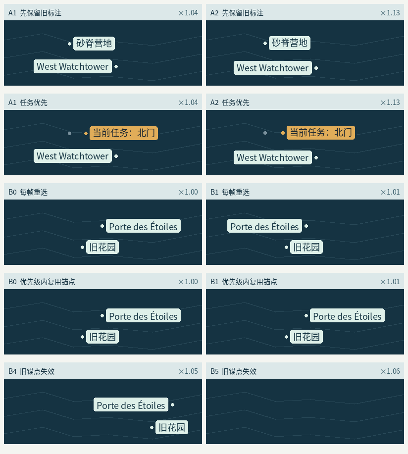

# 游戏地图缩放时，怎样保住关键任务标注

地图缩小以后，一座村庄的名字把任务地点挤没了。再拖一点，任务字样回来了，却换到图标另一侧；向反方向拖，又跳回去。这里有两个独立的问题：空间不够时谁先选位置，以及空间还够时要不要保住上次的位置。把历史位置一律优先，会把偶然占位变成特权；只看本帧有没有空，又会让本来可读的标签不断换边。

本文讨论玩家打开的二维游戏地图。地点、入口和任务图标已有世界坐标，界面要在有限屏幕区域显示其中一部分文字。箭头、引导路线和战斗 HUD 的规则另算。

## 先在屏幕上算占地，再决定谁让谁

把地点投影到地图视口，再用最终字体、字号与译文得到标签矩形。不要用字数估计宽度，也不要把世界坐标上的这两点够远当作屏幕上不相撞。至少把字形所需面积、背景和留白计进去；如果要保住按钮、图例或边栏，可以把它们先作为保留区写入占用表。用与实际裁切一致的视口，而不是整个窗口。仅在边沿改变时做缩放门槛的迟滞，并不能解决框之间的竞争。

把**放置优先级**和**绘制层级**分开。例如先处理当前任务，再处理可交互地点，最后处理地名；每类内部用稳定标识打破平局。每个标签都尝试一组固定偏移的候选位置，不通过裁切或碰撞检查就试下一处，没有可用位置则暂不显示。这个顺序决定谁拿得到空间。绘制层级只是决定已经留下来的元素谁盖住谁，调大任务文字的层级，救不回在排版阶段已经丢掉的标签。

MapLibre 的样式规范也区分这些情况：关闭重叠时，`symbol-sort-key` 的低值优先获得放置机会；允许覆盖时，高值可以压在低值上。这个比较适用于同层可比较的符号；跨层还有样式层顺序。它还允许按顺序列出文字的替代锚点。[1] 这是平面地图渲染中的参照，不意味着游戏必须引入地图 SDK。

## 保留的是上次的锚点，不是上次占过的像素

锚点可以是「文字在图标右侧」或「在图标左侧」。用地点的稳定 ID 记住它上帧用了哪个锚点。缩放、拖动或切换语言后，地点要重新投影，文字也要按这次的尺寸放置。试上帧的锚点，就是在**本帧**重新算出框，再做视口和冲突检查。不要把上一帧的屏幕矩形当成已占空间。MapLibre GL JS 5.9.0 也只优先重试仍在候选集合内的旧锚点，而且仍做当前轮碰撞检查；找不到新位置时保留旧偏移以供淡出，不等于它拿到了放置位置。[2]

例如在同一高度，两段横向范围都是实际碰撞框：当前任务应占 [45,85]，低优先级地点上一帧用的锚点，本帧重算后是 [70,110]。若先放所有上帧可见的标签，后进来的任务被挡住。正确的次序是先按任务优先级放 [45,85]。轮到低优先级地点时，可以先试它自己的旧锚点；若重新算出的框仍是 [70,110]，就试另一个锚点，或者隐藏。对于同级，稳定的排序保证某个地名不会因数据到达顺序来回抢位置。

再看一个位置变化而等级不变的情况：某标签原来在左边，本帧左右都能放，优先留在左边；如果本帧左边已经越界，就试右边。如果左右都冲突，应该退出，不能为了保持稳定而固定贴屏。退出后的旧锚点若保存在缓存里，只是下次出现时可尝试的偏好，不继续占位。优先级变更、文本换语言、地图旋转、当前裁切区变化都必须触发重新检查。别为了保留旧锚点，让临时任务永远进不来。

可以用一段简单的放置循环实现：

```text
occupied = 本帧的界面保留区
for label in 稳定排序(本帧符合可见条件的地点, 级别, 稳定ID):
    candidates = 上次锚点仍在本帧的候选中则先试它，然后试其余锚点
    for anchor in candidates:
        rect = 计算矩形(本帧投影位置, 此语言和字号的排版结果, anchor)
        if rect 在地图可用视口里且不与 occupied 相交:
            输出 label 和 anchor
            occupied 加入 rect
            break
用本帧的成功结果替换显示集合
```

同级稳定 ID 是一种简单的取舍，并不保证总显示数量最多。例如两个任务同级，A 先占了旧左锚点但也可以放右边，B 只能在与 A 左框冲突的位置显示。贪心排序会隐藏 B，重排这一对却能让两者都出现。若希望做这类重排，可以仅对少数关键标签试有限的候选组合，不必每帧搜索所有普通地名。特别繁忙的区域，可以先把兴趣点聚合成一个标记，或缩减候选，再用同样的排序。在产品设计要求任务始终可发现、但按当前放置策略没有任何可用锚点时，应有地图外的任务列表或边缘提示，而不是硬盖住其他关键按钮。这是产品兜底，不是优先级算法能证明的保证。

## 用三种失败输入验收

不要只看一帧排得漂亮。至少准备三条拖动或缩放轨迹：低优先级地点先出现、任务随后进入；画面轻微移动而两个备选都还有空间；一处标注跨出裁切区，同时切到更长的译文。逐帧记录「稳定 ID、优先级、投影点、排版后框、上帧锚点、每个候选被拒原因、最终结果」。数关键标注缺失的帧数、两帧都可见时的锚点换边数，以及是否有越界或互盖。这样能区分真正没有空间，以及某条不该占位的旧标签挡住了空间。如果用动画淡出失配的旧标签，要让它及时退出命中测试，并检查淡出有没有临时遮住关键文字。画面改用截断、多行或避让图标时，改用最终渲染和点击的真实几何，不能沿用单行文本框。

我用 400×130 像素的合成地图验证了这个区分。文字以 Noto Sans CJK SC 18 px 排版，碰撞用带内边距的整框。任务入场后的两帧，按「上帧可见的先放」排序时，任务两帧都没放下；按任务优先时，两帧都显示。在另一段四帧微移中，两侧都能放；从头按点的左右位置选边，法文地名换边三次，优先重试仍可用的锚点则没有换边。到右边确实越界时，算法仍改放左边；地点出视口后不再占位。这些是同一组测量尺寸下的放置结果，不是玩家阅读速度或所有缩放路径的保证。



[复现实验](../../../../管理档案/实验/游戏地图标注布局/README.md)

## 参考资料

- [1] MapLibre，[Style Specification：symbol-sort-key](https://maplibre.org/maplibre-style-spec/layers/#symbol-sort-key)、[text-variable-anchor](https://maplibre.org/maplibre-style-spec/layers/#text-variable-anchor)，访问日期：2026-11-23。
- [2] MapLibre GL JS 5.9.0，[placement.ts：重试旧锚点](https://github.com/maplibre/maplibre-gl-js/blob/v5.9.0/src/symbol/placement.ts#L571-L617)、[旧偏移与淡出](https://github.com/maplibre/maplibre-gl-js/blob/v5.9.0/src/symbol/placement.ts#L667-L676)、[pauseable_placement.ts：单层排序](https://github.com/maplibre/maplibre-gl-js/blob/v5.9.0/src/style/pauseable_placement.ts#L17-L45)。
