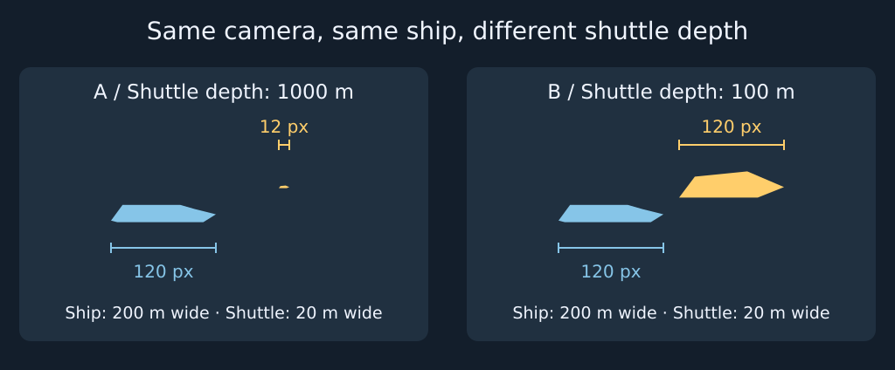

# 太空场景概念图的尺度参照与透视检查

画面里，一艘穿梭艇差不多和后面的母舰一样宽。问题可能出在构图，也可能出在模型，还可能只是因为小艇离镜头更近。把像素宽度直接当尺寸，会让美术把本来正确的模型改错。评审这类镜头时，先用一张仍保留原构图的对照图区分透视和模型尺寸，再决定该改镜头、改设计，还是补一张交付图。

## 把屏幕上的宽度和设定里的宽度分开

在理想透视下，若要比的宽度两端处在同一相机空间深度，屏幕宽度为 `p = f × W / z`。`W` 是两端沿相机横轴的间距，`z` 是沿相机朝向量得的深度，`f` 是以像素计的水平焦距。这个关系来自相似三角形，[1] 给出的横向投影公式相减便得到这里的宽度关系。这里的深度不是物体到镜头的斜线距离；舰体倾斜或遮住一端时，也不能拿可见轮廓代替同一对端点。

原创示意固定相机、焦距和蓝色大舰，两艘物体均用面向相机的平面轮廓。大舰宽 200 米，深度 1000 米，投影宽 120 像素。黄色穿梭艇宽 20 米：A 中与舰体处于同一深度，投影宽 12 像素；B 中沿穿过它中心的视线移到 100 米深处，小艇中心在画面中的位置不变，投影宽随之变为 120 像素。真实宽度没变。若只有 B 的成图而没有两者的深度或尺寸标注，像素宽度相同并不意味着两者同样大。若要比较两艘舰本身的设定宽度，可以像 A 那样对齐它们所在的深度及量取方向；若舰体无法在该角度露出可比的端点，就用同一比例的正交并排图比较。

## 给镜头加上一个能复核的参照

先写下要评审的关系。例如：穿梭艇能否通过母舰机库口？要比的是艇的通行宽度与开口的可用净宽，不是艇与整艘母舰的轮廓。

1. **保留原构图。** 复制相机和白盒，锁定视角、焦距、画幅和主体。选一个已经约定尺寸的对象，记录型号、要比的端点，以及它与目标在哪个工作面。在对照图中，让穿梭艇位于机库入口平面、对齐通行方向；标出艇身包络与开口内缘。这里的净宽应使用真正限制通行的窄处，不能把整个外框的装饰算成开口。
2. **做一张可判定的工作图。** 若透视镜头看不到同一截面的两端，补一张沿通行方向看的正交图，用同一比例绘出开口与艇身，标净宽、艇宽与所需余量。例如机库净宽 24 米、艇宽 20 米，两侧各需 3 米，以居中直行为假设，需要 26 米，现有设计不够。这个判断只验证该截面的横向净空；完整可通行还要检查高度、内部最窄处和转向扫掠范围。
3. **按检查结果改对东西。** 净宽不足，就处理几何或重新定义通行要求；净宽合格但原图看不出大小关系，就改构图。在同一局部，把一艘已定尺寸的艇靠近入口，再用遮挡或连接结构交代它所处的深度。补图能证明尺寸关系，却不能代替主镜头自身的可读性。只有气氛图、参照不明时，先标“不能判断”，不要凭像素改模型。交给模型师的最小资料是原镜头、同尺度截面、净宽和包络尺寸（带单位）以及必要余量。

《家园3》创作者访谈所附的图片可以用来比较两种画法。Karl Gryc 段落中的舰队对照把母舰、航母、巡洋舰和小单位并排标注，便于比较等级，但图上没给可量取实际尺寸的比例尺。Brennan Massicotte 的战场图里，右上近处的黄色飞行器在画面中很显眼；附近有多处遮挡和尾迹，但仅凭这些无法确认黄色单位是否同型号，更不能把画面宽度当成设定宽度。[2]

表面细节也要做同样的区分。Paul Chadeisson 的环形巨构图上，壳体、开口与后方环体的叠置让空间层次可读，局部亮点和重复面板增加层次，但点亮的图形没有可确认的用途和已知尺寸。它们可以帮助组织画面，不能单凭密度证明整座巨构有多大。若想把入口当真正的参照，要能从画面或补图辨认它与已知尺寸对象的关系。[2]

> 如果参照来自游戏截图，先查它是否改变了单位的显示尺寸。《家园3》开发者说明，NLIPS 会按镜头距离放大舰船模型，方便缩远后辨认和选择小舰，并提供关闭选项。[3] 这是运行时画面的额外变量，不是概念图采用了相同做法的证据。

## 参考资料

- [1] Antonio Torralba、Phillip Isola、William T. Freeman，《[Foundations of Computer Vision，Chapter 5: Imaging](https://visionbook.mit.edu/imaging.html)》，§5.3.1，式 5.3。
- [2] Luke Plunkett，《[From The Sketchbook To The Stars: The Art Of Homeworld 3](https://aftermath.site/homeworld-3-concept-art-making-of/)》，Aftermath，2024-07-09。见 Karl Gryc、Brennan Massicotte、Paul Chadeisson 各节访谈及附图。
- [3] Lance Mueller，《[Dev Update: 5 Big Changes We’re Making Because Of Your Feedback](https://steamcommunity.com/games/1840080/announcements/detail/4145073329281827772)》，《家园3》官方更新，2024-03-27，第 4 节。亦见 [Steam 完整公告文本](https://store.steampowered.com/news/posts/?enddate=1711562861&feed=steam_community_announcements)。
