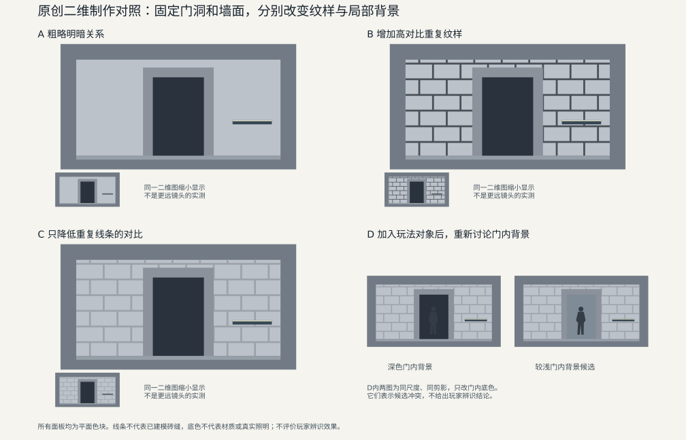

# 环境场景细化中的明暗分组与视觉层级检查

入口的宽高没有变，石材、砖缝和倒角也比草模精细了，评审却觉得原先那块托住深色门洞的亮墙变碎了。有人建议减少面数，有人想重画贴图，还有人把灯调亮。这些修改都可能改变画面，但“看起来碎”本身还不足以决定该改哪一项。

本文面向懂模型、Base Color、法线贴图与灯光基本用途的环境制作协作者。我们沿着一个虚构入口，先确定要保留的视觉关系，使比较条件一致，再从可见变化选择局部候选，最后处理近景材料、其他视点和玩法对象之间的冲突。正文给出的是制作检查方法；原创图只把二维关系画清楚，不代表已完成三维场景或玩家测试。UE 5.6 的视图只是工具例，更换引擎或使用特殊着色路径时，应核对各视图实际保留了哪些输入。

## 把“像概念”说成具体关系

**明暗分组**是把画面中若干部分组织成较大的亮、暗区域。例如，墙面内部虽有接缝，但从接近方向看仍构成一个相对连贯的亮组，门洞则是其中一块较大的暗形。**视觉层级**是这些信息在当前用途中的主次：接近建筑时要确认入口，走到门前要理解材料和台沿，交战时又必须看清门内对象。它描述制作目标，不是已经测出的眼睛注意顺序。

这个入口有四项约定：

- 通行开口与主要遮挡沿用已接受的白盒。不能为了加深门框阴影，把装饰挤进通行带。
- 在主要接近方向，墙面衬托门洞；石材接缝提供结构，不要求每条缝都像门洞边界一样强。
- 右侧台沿在本例中承担可攀爬提示。它不是随墙面纹样一起淡化的装饰，具体形状、位置与项目既有提示方式都要保留。
- 门内允许出现需要被辨认的角色。“门内永远是一整块很深的暗色”若妨碍这个用途，就应修改这条视觉要求，而不是默认角色必须迁就空场景概念。

第一项限定能改的空间，后面三项定义不同情境要比较的对象。若这些要求尚未被共同接受，先补齐用途和空间说明。概念图若是覆盖在白盒截图上的 paintover，还应保留对应白盒与镜头；《NINJA GAIDEN 4》的开发博客明确介绍了这种以已有机关和敌人布置为前提的覆盖绘制。[1] 自由绘制的气氛图则适合传达关系，不宜当作精确投影目标。

细化不必一味减少。Valve 在 2007 年的 TF2 论文中，一面增加三维环境细节，一面选择性简化重复结构和纹理变化。图 3 上排概念与下排游戏场景的视角并不相同；图 5 展示的是绘画感纹理及其三维应用。这些材料支持“几何与表面共同组织风格”的制作思路，不是一组控制变量后的效果对照。[2]

Riot 的 2020 年环境制作文章则把美术块体、制作与游玩检查联系起来：布局仍可能调整，也要检查环境是否与角色争夺视觉信息。[3] 两个项目的风格不同。可迁移的做法是说明哪些变化服务用途，而不是把某一项目的低对比外观定为所有环境的标准。

## 同一条暗缝，可能由几个输入共同形成

先区分制作控制，不急着划分责任。墙面上一条暗线可以画在 Base Color 中，也可以来自凹进去的几何、法线贴图改变后的受光、遮蔽或投影。它们可能恰好重合，让本来不强的几种变化叠成一条很强的边界。

| 可以修改的输入 | 它怎样改变这面墙 | 为什么不能只凭成图认定原因 |
| --- | --- | --- |
| 空间形状与遮挡 | 增加轮廓、改变面朝向，产生真实遮挡与投影 | 同一个凹槽既改变形状，也改变照明结果 |
| 表面颜色分布 | Base Color 中的接缝、斑驳和图案改变颜色关系 | 最终暗边可能还有阴影；成图高光不等于贴图里有白线 |
| 材质对光的响应 | 法线、粗糙度等改变局部受光和反射 | 同一法线在不同光向下表现不同；粗糙度输入也不是高光亮度图 |
| 照明与显示 | 光源、环境、阴影、曝光和后处理改变已有信息的显现 | 调灯可能同时改变墙、门内背景、角色和曝光反应 |

贴图是数据载体：颜色、法线、粗糙度都可能由贴图提供，不能把“纹理”和“材质”当成互不相关的物理层。统一灰材质也往往同时替换多个输入，不能据此得到四个互相独立的实验。

对于常见不透明表面，可以把最终画面粗略理解为：几何决定空间轮廓和真实遮挡，几何法线与法线贴图参与确定着色时使用的表面方向，材料决定怎样响应入射光，观察方向还会改变反射，最后经过曝光与显示处理。这个关系足以解释为何“缝很暗”不能直接推出“颜色画太黑”。这里不把它简化成所有着色模型通用的一条乘法公式。

同样，**画面细节密度不等于面数或贴图分辨率**。低模墙面上的重复深色图案也会产生大量边界；几何丰富的表面在某个视点下可能只表现为缓慢变化。直接降面或缩图，会同时触及轮廓、过滤和稳定性，未必改变真正有问题的对比。

## 先取得一组可以比较的画面

从当前场景保存未修改版本，选定已经暴露问题的“接近”相机书签。对比它与候选时，使用同一位置、朝向、FOV、输出尺寸和裁切。保存场景、网格、材料及贴图版本，并固定本次相关的天气、时间、光照与后处理。不要用旧版近景和新版广角截图比较砖缝：门洞占据的画面面积已经变了。

这里的基线是**当前可重现的场景状态**，概念图是关系目标，两者职责不同。若概念与当前布局已经不一致，先指出门位或遮挡变化，不要要求材质补偿一个空间版本差异。若确实来自同一白盒镜头的 paintover，可以叠看轮廓，仍需分清图上强调笔触与实际几何、材料的含义。

曝光需要比“锁了”更具体。UE 5.6 文档区分全局曝光、Local Exposure 与编辑器视口覆盖；自动曝光还有适应过程。[4] 因而本次至少要知道：生效的是项目设置还是编辑器覆盖，是否保留局部曝光，使用哪个补偿及显示方案。固定全局曝光不会自动移除其他处理。

若两次画面亮度会随等待时间变化，可以先保存项目目标方案，临时使用同一明确的固定曝光作为诊断参照，并固定或明确记录相关局部处理。原版与候选采用相同进入过程和等待条件；能观察实际曝光状态时，也应确认其一致。不要一边改接缝，一边手动补亮候选。保留局部曝光等依赖画面的处理时，颜色候选还可能引起这些处理的输出变化；此时观察的是候选经过该显示方案后的效果。若要判断某项处理是否放大了变化，应另作仅改变该处理的成对比较。诊断结束后恢复项目目标方案，它可以是自动曝光、手动曝光或项目自己的组合，而不是一律开启自动曝光。

本例还预留“门前”和“侧向”两个书签，稍后复查材料与反射。三个镜头不需要拥有相同画面面积，但**每个镜头自己的原版与候选必须成对可比**。也不必在第一轮就截完所有视点：先在问题位置做出有区分力的变化，再到可能受影响的位置检查。

如果同一版本重复取图仍不稳定，先查动态光照、自动曝光、资源流送、LOD 切换或依赖历史帧的效果。尚未稳定的输入不能作为某项美术改动有效或无效的依据；把具体不稳定区域交给相应技术人员，比继续盲调更有用。

## 用一个二维对照说明“改对比”和“删细节”的差别

图 1 是原创平面示意。A 给出粗略关系，B 添加深色重复线，C 只降低这些线与墙面的颜色差；D 在 C 的基础上加入相同剪影，左右两幅以相同尺度比较两种门内底色。它们不是三维渲染或材质实验。

为了看清改了什么，图中每个场景采用 600×320 的绘图坐标：墙面从 `(40,35)` 到 `(560,280)`，门框从 `(210,30)` 到 `(390,260)`，门内从 `(235,30)` 到 `(365,235)`。A 至 C 的墙面均为 `#bcc2ca`，门内均为 `#29323d`。B、C 的横线均位于 `y=70、110、150、190、230、270`；竖线按行交错排列，间距为 70 个绘图单位，这些接缝笔画的宽度为 4.8 个绘图单位。两幅图的线位、数量和线宽相同，只有线色从 `#4a5057` 改为 `#9da3aa`；右侧台沿没有随之变淡。D 的剪影颜色固定为 `#343c46`，右图仅把门内底色改为 `#7f8b97`。

这些坐标不是米，RGB 编码不是材料反射率、线性亮度或灯光强度。线条只是假想装饰的二维载体，不表示已经建成的凹槽。图中小图是同一场景图形缩小显示，用来讨论粗略组织，**没有模拟更远的相机、mip、LOD 或玩家视力**。

在 B 与 C 中，线条仍在原来的位置，墙面结构并未删去；变的是它们相对墙面和门洞的颜色关系。这正是一个值得先试的局部候选：先改变造成竞争的一组信息，不连同必要的台沿一起消除。图并不证明真实入口应该使用这些颜色，也不能告诉我们实际暗线来自颜色还是法线；后一问题要回到场景输入中判断。

## 从异常关系选下一次比较

先在最终显示的彩色原图上指出异常，例如：“新增横缝贯穿两侧墙面，形成一组反复出现的强暗边；它们正在打断门洞外的亮组。”这比“石材有噪声”更具体，因为它给出了区域、变化类型和受影响关系。必要时附同一转换方式生成的灰度图观察明暗，但保留原彩色图；色相、饱和度和材质区别不会被一张灰度图完整表达。

### 颜色里已有同样的重复线，先改这一组颜色

在 UE 5.6，可用 Buffer Visualization 中的 **Base Color** 查看颜色输入。[5] 假设这里确实出现与成图同位置的暗缝，下一步不是宣布贴图有错，而是在隔离副本中保留原网格、法线、粗糙度及灯光，**只减弱那组接缝在 Base Color 中的对比**。不要同时换整套材质或重做 UV；否则变化范围就比问题大了。

回到相同书签的最终显示，比较墙面是否恢复了需要的连续关系，台沿是否仍保持原样，以及门洞与墙面的区分是否还在。图 1 的 B→C 是这种候选在二维中的表达：保持图案，改变图案与底色的差距。

若真实场景中候选符合预期，可以保留它进入近景和其他状态的复查。能得到的结论是“这个颜色改动在这些条件下有用”，不必同时证明其他因素完全无关。若 Base Color 已明显改变，最终暗缝却几乎没变，应继续查重合的法线、几何或阴影，而不是把颜色一路推到不再像石材。若最终图和颜色图都没变，先核对是否改到了实际生效的材料实例和贴图版本。

### 颜色解释不了暗边，再区分法线细节与其余受光

UE 5.6 的 **Detail Lighting** 使用中性材质，但保留原材质的法线贴图；**Lighting Only** 不显示这些法线贴图。[5] 两者不是同一个“灰模模式”。如果重复细节在前者明显、后者明显减弱，这个差异提示继续检查法线参与的受光，不足以认定烘焙损坏，也不是最终材质的完整因果分解。

接着回到实际材料副本，只减弱对应接缝的法线细节，并保持颜色、粗糙度和光照不变。最好使用该细节层已有的强度控制；若必须改节点，应保持正确的法线解码、组合与归一化，不把法线贴图当普通颜色直接涂灰。目标是改变这一组表面方向细节，而非同时把石材换成完全光滑的塑料。

如果原材料把一个遮罩同时用于颜色、法线与粗糙度，直接拖这个遮罩参数会联动多项。能拆开时先在诊断副本中分开控制；不能拆开就把候选称为“接缝材料组合改动”，不要声称已经单独验证法线。组合候选也可以进入制作评估，只是归因与后续维护范围不同。

弱化法线的代价往往首先出现在近景：接缝仍有颜色，却不再产生所需的表面起伏。若问题不是强弱，而是出现了邻件形状或方向异常，应进入烘焙和切线约定的检查，不能继续以降低强度掩盖错误。该问题可转到[法线烘焙串到附近零件时，为什么不能只加大投射笼](../../模型制作/贴图烘焙/法线烘焙串到附近零件时，为什么不能只加大投射笼.md)。

### 亮线随视角变化时，保留原材质检查反射与几何

若颜色中没有相应亮线，法线候选也不足以解释，而亮线随视角变化，就应把反射作为下一项假设。UE 5.6 的 **Roughness** 缓冲显示粗糙度输入，不能直接显示该处最终高光有多亮。[5] 先找出异常是否对应特定粗糙度图案，再在实际材料副本中只调整那一小块，回到“接近”和“侧向”两个镜头分别比较。

抬高粗糙度可能改变高光形状，也可能让原本需要的抛光石材或金属装饰失去材料特征。若降低所有反射才能让墙面平静，先问目标材料是否还成立。一个局部装饰层的修改，也不该顺手改变整个共享石材。

如果重复边界在不显示法线贴图的视图中仍存在，继续观察具体几何、遮挡件与光源，而不是反过来认定它必然来自网格。可以做一个保持开口的浅缝几何候选，或仅改变一个已识别光源的方向、范围或贡献，两项分开比较。前者要复查轮廓、净空和烘焙；后者要检查它照到的其他对象。使用预计算光照时，取得对应的新结果再比较，旧光照图不能用来证明新几何或新灯光“没有影响”。

统一灰材质适合快速发现“更换材料后关系变了”，但它同时可能删掉颜色、法线、反射或其他响应。应把它当作选择下一次检查的线索，随后回到上述局部候选，而不是凭一次切换要求整个材质专业返工。

## 正面有效、侧光失效时，比较相互作用

一次局部改动不必在所有条件下产生同样结果。假设接缝法线弱化后，正面照明下的墙面符合意图，而项目需要的侧光状态仍显得零碎。应针对这个具体疑点，比较四个组合：

| 同一相机、颜色与粗糙度 | 原法线细节 | 弱化后的法线细节 |
| --- | --- | --- |
| 原光照状态 | 记录原状态中的重复边界 | 与左格比较：本光照下弱化改变了什么 |
| 目标侧光状态 | 记录侧光下的重复边界 | 与左格比较，并回看上格：候选是否只在原光照下可用 |

这个小比较不要求所有项目跑全因素实验。它回答的是“同一法线候选在两种目标光照中是否都足够”。若只在一行有效，就不能把第一行的接受结论扩大到第二行；也不必否认第一行确有变化。再沿第二行寻找残留边界来自凹槽几何、其他材料输入还是投影。

制作选择随结果而定。若更温和的接缝表达能同时满足两种状态，采用共同材料最容易维护；若两种区域用途确实不同，可以保留有明确理由的局部变体，但要承担版本和引用维护；若必须同时调整表面与照明，就保留这个组合，不必虚构唯一根因。不能为了证明“一次只改一个变量”，拒绝最后确实需要组合修改的方案。

修改的层级也要明确。最初的隔离副本用于比较，准备合并时再决定改共享资产、场景实例还是某个有用途的变体。共享灯具的变更尤其可能波及其他接收表面，具体继承和覆盖问题可读[共享灯具如何管理资产与场景实例的修改](../../../技术美术/环境管线/场景光照/共享灯具如何管理资产与场景实例的修改.md)。

## 墙面安静下来以后，重新放回材料与玩法

现在沿图 1 继续做方案选择。C 保留了石材分块位置，也保留了台沿，但这还没有回答近处材料是否足够。在真实项目的“门前”镜头中，应比较石材块之间的结构、需要的磨损与表面起伏是否还存在，而不只是问墙面是否更整齐。若颜色候选损失了近景所需的接缝，可以减小降低幅度，或只调整确实造成竞争的区域；恢复全部深色线条并非唯一选项。每个新变体仍需回到“接近”镜头，确认没有把原问题带回来。

台沿要单独看。图中的强边没有被弱化，但真实项目中“保留了像素”不等于可攀爬关系已经成立；还要确认它与实际位置、形状和既有交互提示相符。为降低装饰对比而连同提示一起删掉，会把一个画面问题变成玩法信息问题。

接着把角色放回门内。D 左图沿用深门内底色，与固定深色剪影的颜色接近；右图只改门内底色，给剪影提供了不同背景。与此同时，门洞与外墙原先很强的暗亮差也被削弱。**同一个改动可以有利于一种关系，又削弱另一种关系。**

本例在方案层面选择先保留 C 的墙面和台沿，再把 D 右图作为门内背景候选提交讨论，而不整体提亮建筑。理由是：墙面装饰竞争与门内角色背景是两个范围不同的问题，前一项没有必要连带改变整个照明环境。这个选择同时要求修改原目标：从“门内必须始终极暗”，改为“接近时保持入口与墙面分组，交战时门内对象仍有需要的背景区别”。若项目坚持前一个目标，就应明确它与当前角色设定的冲突，不让环境美术独自用参数补偿。

二维底色并没有指定三维实现。实际制作可以提出局部背景材料或照明方案，再检验是否影响附近对象、昼夜氛围与曝光；也可能需要由角色、关卡和光照人员共同讨论对象的活动位置和显示方式。改变战斗位置会触及玩法约定，不能以“画面更好”自行实施。Riot 在历史文章中提出的材料对比、暗区照明和装饰位置取舍，正是服从其战术射击用途的实践，而不是本例可以直接套用的参数。[3]

Riot 文章所附的[阶段图](https://cmsassets.rgpub.io/sanity/images/dsfx7636/news_live/12e158ca6619be8b1daa4b35679f3e25609834b3-1755x1024.gif)，从 GREYBOX、两幅 ART BLOCKOUT 到 ART PRODUCTION，可见颜色、构件、灯具和积雪等多处变化。它展示制作持续发展，却没有为这些变量逐一隔离；不能把最终阶段的画面单独归功于降低某种细节，更不能由图推算玩家辨识改善。[3]

## 回归到最终情境，再决定交付什么

候选进入正式场景后，恢复项目目标曝光、后处理和目标显示方式。沿实际接近路线移动，在门前与侧面停留，并加入该区域需要的角色、交互件和关键状态。检查范围由本次改动决定，不是机械收集远中近各几张截图。

对这个入口，墙面颜色候选需要在接近位置复看门洞分组、在门前复看石材；若还改了法线或粗糙度，则增加侧视与目标侧光；门内背景候选要在角色出现的情境中复看，同时回看空景中的地标关系。材质是共享的，就抽查真正受影响的其他使用位置；动了几何，就重查开口和台沿，不以截图代替空间检查。

实际移动尤其不能由图 1 的小图替代。相机会改变投影和遮挡，项目的 mip、LOD、抗锯齿与时序效果也可能改变细节呈现。若出现闪动或突然跳变，把它作为另一项待定位的问题，不再仅凭一张静态图调低对比。目标画质和显示条件下仍需要查看原彩色画面，不能在诊断模式里批准最终效果。

交付决定应包含改了什么、为何接受以及还缺什么。例如，本例能够形成一份待执行提案：“先降低墙面装饰颜色对比，保留开口与台沿；另试较浅的门内背景，以角色出现时的区别为要求，同时复看入口分组。近景材料、侧光与目标曝光下的实际场景结果尚待检查。”真正执行后，再把哪些位置已看、哪些未看写清楚，不把提案当作验收结果。

制作检查能说明输入、可见关系和代价是否符合团队选择。若要回答“玩家是否及时发现入口或对手”，还需要对应任务中的玩家观察，不能用编辑者能指出门洞、或者空景更整齐来代替。最终保留的应是有用途的主次关系，以及让它成立的具体条件；不是细节越少越好，也不是让每个视角都复制同一张概念画。

## 相关知识

- [环境概念图怎样指导后续制作](环境概念图怎样指导后续制作.md)：先说明用途、空间、材料含义与未决设计。
- [模块化环境套件的接口设计与组合验证](../模块化环境/模块化环境套件的接口设计与组合验证.md)：细化涉及门框、台沿或占位时，回到实际空间约定。

## 参考资料

[1] 西井智子（Tomoko Nishii），PlatinumGames，*コンセプトアートについて*，2025-09-19。采用“背景オーバーペイント”部分关于白盒截图、既有机关与敌人布置的说明。[开发博客原文](https://www.platinumgames.co.jp/dev-ninjagaiden4/article/42)。访问日期：2026-11-06。

[2] Jason Mitchell、Moby Francke、Dhabih Eng / Valve，*Illustrative Rendering in Team Fortress 2*，NPAR 2007。采用 §4.2 World Modeling、§4.3 Texture Painting，图 3、5 位于 PDF 第 3 页（从文件第一页计数）。[Valve 托管原论文](https://cdn.fastly.steamstatic.com/apps/valve/2007/NPAR07_IllustrativeRenderingInTeamFortress2.pdf)。历史材料用于解释制作选择，不作为当前游戏或本文方法的玩家效果证据。

[3] Lydia “PHRISK” Zanotti，Riot Games，*The Art of VALORANT Map Environments*，2020-11-16。采用 AFTER LEVEL DESIGN、MAP FOUNDATIONS、CONSTRUCTION, MINUS THE HARD HATS、MORE ON MAP CLARITY 与 MAP MOTIFS；阶段 GIF 采用其全部四幅静态阶段图。原文记录 UE4 时代实践。[署名原文](https://playvalorant.com/en-us/news/dev/the-art-of-valorant-map-environments/)。访问日期：2026-11-06。

[4] Epic Games，*Auto Exposure*，Unreal Engine 5.6 文档。定位 Manual Algorithm、Local Exposure、Exposure Change Speed and Movement、Editor Viewport Override、Visualization and Debugging。[5.6 版页面](https://dev.epicgames.com/documentation/en-us/unreal-engine/auto-exposure-in-unreal-engine?application_version=5.6)。访问日期：2026-11-06。

[5] Epic Games，*Viewport Modes*，Unreal Engine 5.6 文档。定位 Lit、Detail Lighting、Lighting Only，以及 Buffer Visualization 中的 Base Color、Roughness。[5.6 版页面](https://dev.epicgames.com/documentation/en-us/unreal-engine/viewport-modes-in-unreal-engine?application_version=5.6)。访问日期：2026-11-06。

[返回概念设计专题](README.md)
