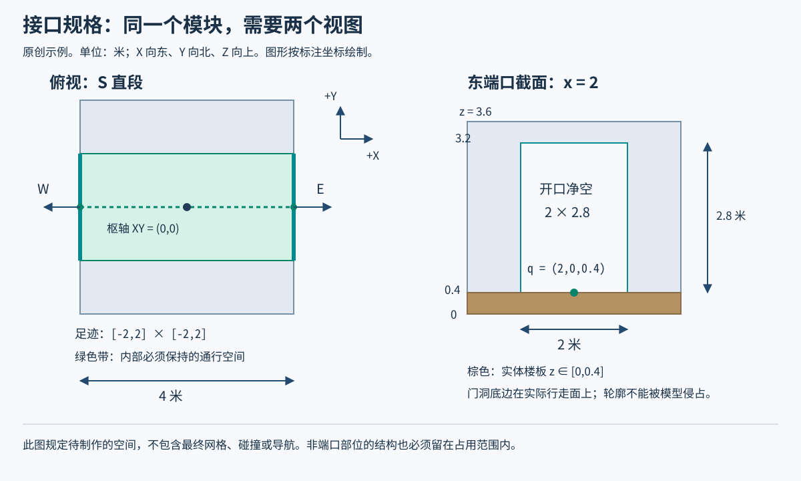
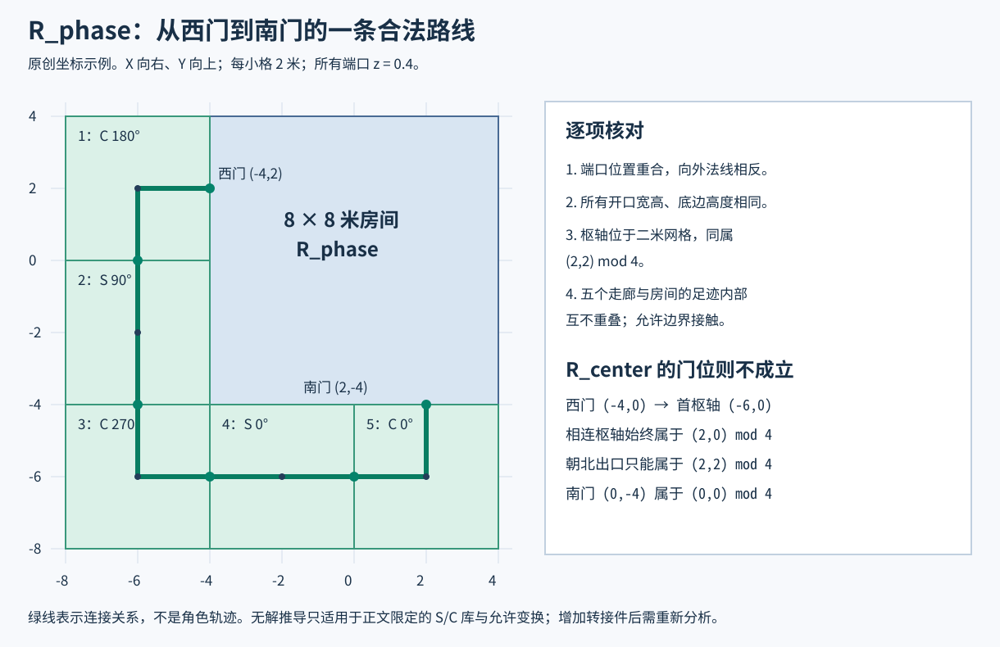
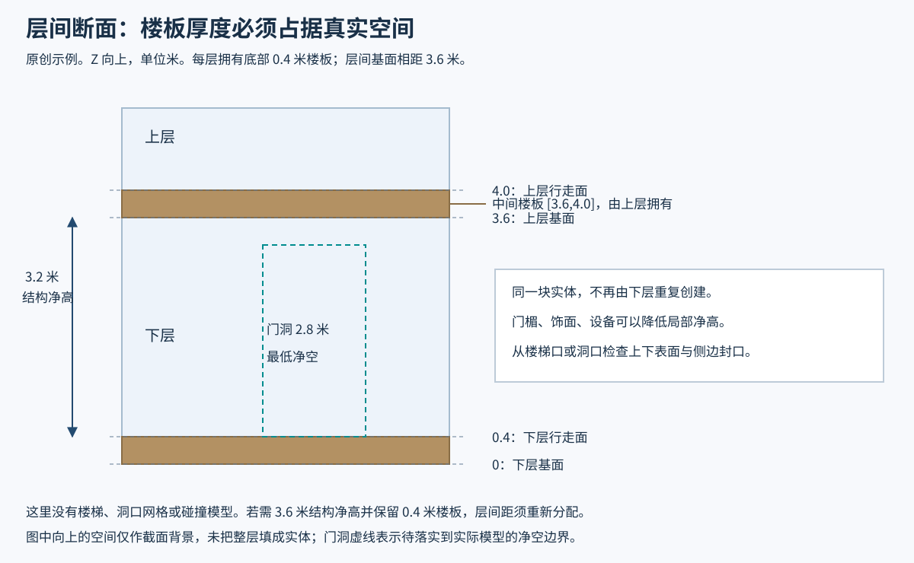

# 模块化环境套件的接口设计与组合验证

房间、直走廊和转角各自都吸附在网格上，绕房间一圈却接不上另一扇门。此时追加一块短走廊，可能解决了真实的转接需求，也可能只是把错误藏到了库存里。要区分两者，必须知道：单件究竟承诺了什么，合法连接怎样改变空间位置，以及目标布局是否本来就在这套规则的能力之内。

本文帮助环境美术和关卡搭建者，为**正交房间与走廊**建立可测量的接口约定，计算装配位置，检查局部接缝与整体占位，再决定修资产、改组合规则还是设计过渡件。读者需要理解局部坐标、旋转和平移，不需要特定建模软件。示例只允许绕竖直轴作四分之一圈旋转，不包含自由角度、镜像、缩放或任意三维拼装。

开发团队的公开案例用于说明生产问题；本文的接口表达、8 米房间、4 米走廊、坐标推导和验证步骤都是原创方法示例。图中的米数不来自历史截图。

## 先约定要搭出的空间，再选择模块粒度

不要只交一张“直段、转角、房间、门框”的资产清单。先由环境美术与关卡设计选出需要反复搭建的空间关系，例如：走廊从房间西门出发，绕到南门；两条走廊并排；楼上楼下按规定层高叠放；一种岩壁侧面接到另一种侧面。把这些关系画进简单布局，并写清哪些必须成立、哪些暂不支持。核心件的范围由这些布局倒推，而不是默认一套模块应该能拼出所有建筑。

Bethesda 的 2013 年讲稿有一个直接相关的反例：走廊从房间西侧绕回南侧时出现缺口，团队把原因追到转角伸出的部分，而没有用半长走廊掩盖它。[回接原图](https://4.bp.blogspot.com/-Bp4Yq6g2OyI/UW__xGNPNZI/AAAAAAAAAZs/s_Pu2L1mZ-0/s640/webLoopbackStressTest.jpg)确实并列标出了失败和修正位置；它没有给出本文的坐标模型。[1]

模块也不必是一整段封闭走廊。Fallout 4 的后续课件中，[第 86 页](https://image.slidesharecdn.com/gdc16modularldfallout4-160319181438/85/GDC-2016-Modular-Level-Design-of-Fallout-4-86-320.jpg)把地板、天花、墙和墙角拆开标识，[第 96 页](https://image.slidesharecdn.com/gdc16modularldfallout4-160319181438/85/GDC-2016-Modular-Level-Design-of-Fallout-4-96-320.jpg)则并列展示预制组合与拆开的细粒度形式。[2] 因此，必须先明确本项目验收的是单个网格，还是由若干网格组成的可复用组合。

本文以整段灰盒作为装配单元，方便解释空间约束。若生产中采用墙、地、顶分件，仍可把它们组合后的外部接口作为关卡搭建接口，同时分别核对内部部件。拆开预制组合后，地板不能因为少了父对象便改变原点或高度；自由修改内部部件，也不能继续无条件沿用旧组合的合格结论。较细粒度提供更多调整机会，也带来更多摆放和内部连接工作，应围绕实际破损、替换和布局需求选择。

## 一个模块需要同时说明原点、占位和端口

“四米模块”只说明了一个尺寸。要让另一位搭建者不用猜测，每个核心件至少应交代以下空间数据。

| 数据 | 具体含义 | 缺失时的典型问题 |
| --- | --- | --- |
| 单位、轴向与局部原点 | 例如米、Z 向上，原点位于足迹底部中心 | 同样的摆放数值得到不同位置或大小 |
| 允许的实例变换 | 旋转集合、平移网格、允许的层高；是否允许镜像和缩放 | 制作者和搭建者检验的其实不是同一组组合 |
| 占用范围 | 预留给全部结构和装饰的空间边界 | 门口能接，壁龛却穿进相邻走廊 |
| 必须留空的空间 | 门洞及内部通行空间，连同实际地面的位置 | 外包围盒正确，内部仍有封口面或突起 |
| 每个端口 | 基准点、向外法线、上向、开口轮廓、接口类别 | 中心重合而宽高、朝向或侧面关系不合 |

这里把俯视占用称为**足迹**，把包含高度的范围称为**占用体积**。占用体积是分给模块的空间，不是说其中全部填满实体，也不是可通行空间。实际网格与碰撞几何各有自己的形状，不能用一个包围盒代替它们。

**枢轴用于摆放，端口用于连接，两者不必重合。** 本例的走廊枢轴位于 `(0,0,0)`，东侧端口却位于 `(2,0,0.4)`。原点到开口的偏移也属于规格；改变枢轴而不重新计算局部端口，等于改变接口。

### 用完整的开口截面表达端口

设 X 向东、Y 向北、Z 向上。本文以门洞底边中点作为端口基准点 `q`，以朝模块外部的单位向量作为法线 `n`，上向为 `u=(0,0,1)`。再取截面横向 `s=u×n`，即用上向与法线的叉积固定截面的横向。例如东门的横向为 +Y，西门则为 −Y。宽 `w`、高 `h` 的矩形开口可以写成：

`q + a·s + b·u，a∈[-w/2,w/2]，b∈[0,h]`。

因此，只记录 `q` 不够。还应给出轮廓；矩形可用宽高表示，拱形或不规则洞口则应给出公共截面模板或明确边界点。两个矩形宽高相同且基准点、朝向正确，就能比较截面；一般轮廓要按变换后的实际位置比较，而不是要求两个模型拥有相同的顶点编号或相同数量的细分点。

图 1：原创教学规格，单位米。左图是直段俯视，右图是东端口的截面。底部 0.4 米分给实体楼板，门洞从行走面开始。图中的通行带是要求保留的空间，不代表已经制作了碰撞或导航。

图 1 的东端口位于 `x=2`，宽度方向为 Y，轮廓范围是 `y∈[-1,1]、z∈[0.4,3.2]`。端口的 2.8 米高度是门洞净高，不能和层高、房间净高混用。若门楣底面在 `z=3.2`，它会比后文示例中的下层楼板上方净空更低，应单独计入通行检查。

端口也需要说明结构如何在接缝处收口。至少标出墙、门楣与楼板的边界，以及哪些接口封口面在连接时不能保留。否则两个声明为空的门洞可能在实际网格里被一张面堵住；两套重复门框也可能占用同一空间。装饰若越过基本边界，就要有明确的允许区域和相邻件限制，不能把越界称为“只是美术细节”。

### 数据必须能够指回实际几何

端口标记不是事实本身。制作时应同时显示接口轮廓、占用范围和灰盒，让人能够逐项确认：底边在实际地面上，轮廓没有被门框遮住，壁龛和管线留在分配空间内。导出后再用导入结果复查一次，包括单位、原点、实例变换和实际顶点位置；只看源文件中的辅助标记，可能漏掉导出缩放或陈旧数据。

这项核对可以人工完成，也可以自动比较几何与规格，但它必须独立于“两个端口数据是否相同”的检查。例如房间地面从 `z=0.4` 误改到 `0.6`：

- 如果端口基准点随实际地面更新到 `0.6`，它与走廊端口的三维比较会失败；实际门洞轮廓也应重新取得。
- 如果端口标记仍停在 `0.4`，端口表可能继续匹配，但地面与标记不一致。必须由单件几何检查指出这 0.2 米台阶。

前一种错误能在接缝计算中暴露，后一种不能。只对齐门口的 XY 坐标，两种情况都会被漏掉。若高差是有意设计，则要另定台阶或坡道接口，并验证实际角色和碰撞，不能仅凭高度差较小便判定可走。

## 先计算候选摆放，再判断能否接受

对于本文允许的刚性变换，局部点 `q` 的世界位置为：

`p=Rq+t`。

其中 `R` 是绕 Z 的允许旋转，`t` 是实例枢轴的世界位置。法线和上向只旋转：`n_world=Rn`，`u_world=Ru`。例如逆时针旋转 90° 将 `(x,y,z)` 变为 `(-y,x,z)`。本文没有缩放或镜像；不要在这个计算里偷偷接受负缩放。

假设 A 已经摆好，要把 B 的某个端口接到 A：

1. 选择 B 的一个端口，以及允许集合中的一个旋转 `R_B`。先检查它的向外法线能否与 A 的相反，上向能否相同。
2. 由 A 端口的世界位置 `p_A` 求出 `t_B=p_A−R_Bq_B`。这给出候选枢轴位置，不再凭肉眼反复拖动。
3. 检查 `t_B` 是否符合规定的 XY 网格和高度。不能先算出一个不合法位置，再四舍五入到格点后称其仍然接合。
4. 将 B 的完整开口轮廓变到世界坐标，与 A 比较。相同位置、相反法线和相同上向只是必要条件；轮廓与接口类别还必须相容。
5. 局部接缝合格后，继续检查 B 与整个已搭布局的占位，而不只检查相邻的 A。

从门洞向外看的两块模块，横向 `s` 恰好相反。因此非对称侧面不能只填写容易反转的“左 A、右 B”。应把类别绑定到截面上的实际位置，例如 `q−s` 与 `q+s` 两个标记点，然后把标记点一起变换到世界空间。在同一个世界位置上比较类别，就不会把观察方向的变化误当成结构匹配。

实际资产应另定位置容差 `εp`、角度容差 `εa` 和轮廓偏差限值。可分别观察基准点距离、法线相反的角误差、上向角误差与截面边界的最大偏离。容差应小于项目会造成可见裂缝或通行问题的误差，并覆盖已测得的数值转换误差；不要为让 0.2 米错位通过而扩大它。下面的示例用精确有理数，没有把资产误差吸收进容差。

## 八米房间为何仍可能接不上四米走廊

这一节给出完整规格，展示“尺寸互为整数倍”为什么不足以证明目标布局可达。它不是对前述 Skyrim 截图的测量或重建。

### 限定零件与装配规则

房间固定在原点，足迹为 `[-4,4]×[-4,4]`；走廊直段 S 和转角 C 的足迹均为 `[-2,2]×[-2,2]`，局部枢轴均为足迹底部中心。它们的占用体积高度为 `z∈[0,3.6]`。

所有端口宽 2、高 2.8，底边中点的 `z=0.4`，上向均为 +Z。基线走廊只有以下端口：

| 单件 | 端口 | 局部基准点 | 向外法线 |
| --- | --- | --- | --- |
| S | W | `(-2,0,0.4)` | `(-1,0,0)` |
| S | E | `(2,0,0.4)` | `(1,0,0)` |
| C | W | `(-2,0,0.4)` | `(-1,0,0)` |
| C | N | `(0,2,0.4)` | `(0,1,0)` |

这些端口还要在单件内部连通。作为可制作的灰盒要求，S 保留平面带 `[-2,2]×[-1,1]`；C 保留两条带 `[-2,1]×[-1,1]` 与 `[-1,1]×[-1,2]` 的并集。两者从行走面 `z=0.4` 到 `3.2` 必须保持净空，墙、柱、门框不得进入这块保留空间。房间同样要在两门之间留出连续净空。它规定的是待制作和核对的内部空间，不把一组端口自动当成已经可走的模型。

装配规则如下：

- 只允许 S、C 的 `0°、90°、180°、270°` 旋转。正角度从 +Z 向下看为逆时针。
- XY 枢轴必须在 2 米网格上；本平面任务的所有枢轴 `z=0`，房间不移动。
- 禁止镜像、缩放、形变、逐实例改枢轴，以及沿接口滑动。
- 库中没有短件、斜件、偏心门框或其他转接件。
- 接缝必须满足前节的位置、法线、上向、轮廓和类别条件；非接口处也不能侵入其他模块的占用体积内部。

比较两种房间门位：

| 房间 | 西门基准点，法线向西 | 南门基准点，法线向南 |
| --- | --- | --- |
| R_center：两边正中开门 | `(-4,0,0.4)` | `(0,-4,0.4)` |
| R_phase：门位移到对应子格 | `(-4,2,0.4)` | `(2,-4,0.4)` |

### 正中门位的失败来自可达位置，而非某条路线太短

先看 R_center。为了从外面接到西门 `(-4,0)`，第一件必须提供朝东端口，所以枢轴只能放在 `(-6,0)`。以下暂略共同的 Z 坐标。

S 和 C 的所有合法旋转中，端口相对枢轴都位于 `(±2,0)` 或 `(0,±2)`，并且沿该方向朝外。两件接合时，端口重合、法线相反，故它们的枢轴差必为 `(±4,0)` 或 `(0,±4)`。不论用多少件或绕多远，每一步只能改变四米的整数倍。

因此，与第一件连在一起的所有走廊枢轴，X 除以 4 的余数都是 2，Y 除以 4 的余数都是 0。把这种格点偏移关系记为 `(2,0) mod 4`，也称网格的相位。二米吸附提供了更多可摆位置，却不意味着一条已经接好的链能从一种相位跳到另一种。

为了从外面接到南门，末件必须使用朝北端口，它的位置等于枢轴加 `(0,2)`。这个端口只能落在 `(2,2) mod 4` 的位置。目标南门 `(0,-4)` 却属于 `(0,0) mod 4`，两者不可能重合。

这就排除了**上述 S/C 库与装配规则中的任意连接链**。更多直段、转角、远处绕路，甚至允许自交，都不能改变这个不变量；禁止占位穿插只会进一步减少可行路线。它不等于“八米房间不能配四米走廊”。改门位、添加一种会改变相位的短件或偏心过渡件、改变允许变换，都改变了证明的前提，需要重新分析。

对生产而言，这是“目标布局与套件规则不相容”，不是哪个标准转角做错了。如果正中门位必须保留，就应明确扩充接口能力，或放弃这项回接要求。继续要求某个转角“偷偷短一点”，却保留原标准件名称，会把规则冲突变成难以辨认的资产差异。

### 改为 R_phase 后，给出一条可逐缝检查的路线

R_phase 的西门是 `(-4,2,0.4)`，首件枢轴变为 `(-6,2,0)`。下面是一条合法路线；表中的端口方向是旋转后的世界方向，全部端口的 Z 均为 0.4。

| 顺序 | 件与旋转 | 世界枢轴 XY | 入端口 XY／向外方向 | 出端口 XY／向外方向 |
| --- | --- | --- | --- | --- |
| 1 | C，180° | `(-6,2)` | `(-4,2)`／E | `(-6,0)`／S |
| 2 | S，90° | `(-6,-2)` | `(-6,0)`／N | `(-6,-4)`／S |
| 3 | C，270° | `(-6,-6)` | `(-6,-4)`／N | `(-4,-6)`／E |
| 4 | S，0° | `(-2,-6)` | `(-4,-6)`／W | `(0,-6)`／E |
| 5 | C，0° | `(2,-6)` | `(0,-6)`／W | `(2,-4)`／N |

例如首件使用 C 的局部 W 端口。旋转 180° 后，其局部坐标成为 `(2,0,0.4)`、法线成为 E。于是 `t=(-4,2,0.4)−(2,0,0.4)=(-6,2,0)`。同一旋转把 C.N 变为朝南的出口，得到 `(-6,0,0.4)`，恰好与第二件的朝北端口接合。照同样步骤可重算整张表。

图 2：R_phase 的一个存在性解。绿色线经过枢轴与端口，表示连接关系，不代表实际角色轨迹。所有枢轴同属 `(2,2) mod 4`；图中每小格为 2 米。

五个走廊足迹依次为：

`[-8,-4]×[0,4]`、`[-8,-4]×[-4,0]`、`[-8,-4]×[-8,-4]`、`[-4,0]×[-8,-4]`、`[0,4]×[-8,-4]`。

它们内部互不重叠，也没有侵入房间 `[-4,4]×[-4,4]` 的内部；接触边界允许存在。每一对所用端口位置相同、法线相反，矩形截面和类别相同，最后一件的 N 端口到达南门。这证明了该规格存在一个满足所列装配与占位条件的组合。实际几何仍须满足先前约定的内部净空和收口，才能继续交给碰撞、导航及画面检查。

### 单件出口多出 0.2 米时，要找到第一次偏离

在同一路线中，假设第 3 件仍声明是标准 C，实际朝东出口却从 `(-4,-6)` 伸到 `(-3.8,-6)`，其枢轴和规格没有改变。它已经偏离端口并越过足迹，不是 R_center 那种“所有单件都合格但规则不支持目标”的情况。

有两种常见摆放方式，它们会在不同位置暴露同一个错误：

- **后续件追随实际出口。** 第 4、5 件的枢轴随之向东移到 `(-1.8,-6)`、`(2.2,-6)`，最后到达 `(2.2,-4)`，与目标差 `(0.2,0)`。后续枢轴也已经离开二米网格，这种试拼不是原规则下的合法解。
- **后续件保持原格点。** 第 3、4 件的接缝立即出现 0.2 米错位，不必等到最后一扇门才发现。

先固定是哪一种摆法，再沿路线比较第一次实际端口与规格不同的位置。不能一边声称所有件都在原格点，一边用“每块追随前块出口”的累计结果解释它。若这是误制，修第 3 件并回归其旋转、相邻件和已使用它的布局；若决定接受偏移，则应发布新规格，而不是让补件默默承担未知误差。

## 接缝合格之后，还要检查结构占位和上下层

两件端口对齐只回答了连接面上的问题。走廊可以在门口接得很好，却在中段穿过房间，或让外侧壁龛侵入另一条走廊。

在本文的保守占位规则下，把所有实例的占用体积变到世界坐标，检查任意两个体积的内部是否重叠，而不是仅检查拓扑上相邻的模块。正交盒可以直接比较三个坐标轴的区间：三轴都存在正长度交集才是体积内部重叠。边界相等只是接触，接触处仍要按接口和面归属处理。

只有实际模型确实留在声明体积内，这个检查才有意义。Bethesda 的[壁龛越界原图](https://2.bp.blogspot.com/-QfjOii6jE_8/UWy4eplzbaI/AAAAAAAAAYM/Auv6ceZE7fY/s640/GDC2013footprintoverlap.png)用黄线和圈标指出越界与重叠，[修正图](https://3.bp.blogspot.com/-ZyZhQQ5TC-0/UW_7chuUJtI/AAAAAAAAAZU/1r0ZfTdEDkQ/s320/webFootprintAlcovesCorrected.png)则呈现并排结构之间预留的空间。[1] 这类问题应在单件边界和并排布局中一起查，不能靠门洞标记发现。

包围体积是一种保守约定。若项目有意让两个空壳的包围盒重叠，就需要更细的占位体、明确共享区和实际几何检查；不能仅删除重叠警告。相反，即使体积内部不重叠，两个外表面也可能在共用边界重复共面，或门框的材质、法线和封口不一致。此时要检查边界归属与实际网格，而不是继续修改格点。

### 把楼板厚度、层高和归属放在同一截面上

本文选择一个明确方案：每层模块拥有自己底部 `z∈[0,0.4]` 的实体楼板，上表面 `z=0.4` 是行走面；上层楼板的底面同时作为下层的结构天花位置。下层不另放一份相同实体。顶层没有上层模块时，需另配顶盖，不能让“楼板归上层”变成顶层漏顶。

将上层基面放到世界 `z=3.6`，得到：

| 量 | 世界高度或范围 |
| --- | --- |
| 下层行走面 | `z=0.4` |
| 中间楼板下表面 | `z=3.6` |
| 中间楼板上表面，也是上层行走面 | `z=4.0` |
| 中间楼板实体 | `[3.6,4.0]`，厚 0.4 米 |
| 下层结构净高 | `3.6−0.4=3.2` 米 |

图 3：层间距为 3.6 米，楼板厚度为 0.4 米。下层门洞高 2.8 米，门楣或其他局部结构可比结构天花更低；饰面和设备也会减少实际可用净高。此图仅分配结构空间，没有楼梯或碰撞模型。

若在下层又加入同一个 `[3.6,4.0]` 天花实体，得到的是重复几何归属，不是额外可靠性。反过来，若要求下层结构净高 3.6 米，又坚持 0.4 米楼板，就不能继续使用本例 3.6 米的层间距：保持底层地面不变，下一层基面至少应改到 4.0 米，并重新检查门、楼梯及所有层间连接。

在灰盒里应从楼梯口、洞口或外露断面同时观察楼板上下表面及侧边。实体厚度已分配，不代表这些面已经封好；表面分件、材质归属、内部隐藏面和洞口边缘仍需落实。2013 年讲稿的[上下层示意](https://1.bp.blogspot.com/-RqTRqselVO4/UXABbNRyI_I/AAAAAAAAAZ0/R3DaVYAxrHE/s640/webVerticalFootprint.jpg)对比了接合处的层间关系，并提出预先安排楼板厚度。[1] 本例的 0.4 米是教学选择，不是从该图推算出的标准。

## 几何一致而侧面不相容时，过渡件可以是正确答案

假设一条走廊一侧是岩壁 A，另一侧是结构墙 B。门洞宽高和地面都合格，回接后同一个世界位置上的两侧类型却不一致。此时再旋转整件，可能会同时改变端口朝向或把另一个接缝弄错；镜像也不能在禁止镜像的规格中临时充当解决方法。

先使用前文的截面标记确认，这是观察方向造成的标签反转，还是实际 A/B 的接续要求冲突。若两件都符合各自标准，项目又确实需要这个连接，可以设计一个输入、输出类别不同的过渡件。2013 年团队材料中的 [A/B 图](https://2.bp.blogspot.com/-UdYLLSV9Gq8/UXBlxhp3wAI/AAAAAAAAAbc/i6tBVnzS46w/s320/webAsymmHall.png)与 [de-twist 回环图](https://4.bp.blogspot.com/-QGNc4NpfSu4/UXBmZSZ2K5I/AAAAAAAAAbk/I72rRACobX4/s320/webDetwist.jpg)展示了这类侧面转换的用途。[1]

一个可交付的过渡件至少要回答三个问题：两端分别接受什么类别和几何截面；在中间怎样完成变化而不侵入净空；其占位、允许旋转和与其他件的接法是什么。还应比较是否已有合法替代路线，以及这种需求是否值得长期维护。过渡件两端仍须遵守外部接口，不能在入口加偏移、出口再靠眼睛补齐。

短件、变宽件、高差件和侧面转换件都可以有正当用途。区别在于它们是否增加一项明确的能力，而不是让一个本应遵守标准的坏件继续存在。若接受短件来支持 R_center，就要把新的可达位置、组合和命名一并纳入规格，原来仅针对 S/C 的无解结论不再覆盖新库。

## 将计算变成灰盒验收和交付

数学规格应进入制作流程，而不是只留在文档里。可以先制作最少的核心灰盒，在编辑器中显示枢轴、端口截面、占位和净空，再保留几组能区分错误原因的布局。没有必要穷举所有关卡，但每个已承诺的关键空间关系都应有实际检查位置。

| 验收布局 | 固定输入与观察位置 | 它主要区分什么 |
| --- | --- | --- |
| 单件与两件接缝 | 同一规格版本、每个允许旋转；量实际地面和门框边界 | 单件偏离、标记陈旧与端口变换错误 |
| 房间外回接 | 固定房间门位和零件集合；逐接缝记录枢轴、实际端口及终点 | 单件偏差与整体规则不相容 |
| 并排与靠近房间 | 固定相邻间距；查看侧墙、壁龛、装饰和非相邻模块 | 接口正确但结构越界或整体穿插 |
| 项目要求的层间组合 | 固定层间距；在楼梯口或洞口看楼板断面 | 地面高度、楼板厚度与几何归属错误 |
| 有方向性的侧面连接 | 固定类别与合法旋转；比较同一世界位置的侧面标记 | 几何错位与真正需要的语义过渡 |

例如交接本例时，应把 R_phase 五件布局连同坐标表交给搭建者，并把 R_center 在当前 S/C 库中无解写成明确限制。不能只交一个摆好的漂亮样板，让使用者误以为任意房间门位都支持。反过来，如果项目不需要中心门位回接，也没有必要为了“套件完整”无止境增加新件。

一旦失败，先按最早偏离的位置分流：

1. **模型、标记或导入变换不符合已接受规格：修单件或导入设置。** 先量真实几何，不先请求新过渡件。
2. **单件均符合规格，但目标无法由合法组合实现：改需求或改套件规则。** 一次搜索失败还不是无解证明；本文的余数不变量之所以有效，是因为覆盖了声明的全部零件和连接方式。
3. **不同标准接口确实需要连接：评估有明确定义的过渡件。** 让新件承担可复用的功能，列出新的验证组合。
4. **空间条件通过，但画面、碰撞或玩法仍异常：进入对应的实际检查。** 例如比较碰撞与可视地面、检查导航连接，在目标光照和视点下看接缝，并使用实际角色测试转角和门口。几何表不能替代这些结果。

完成核心灰盒后再增加细节，并用原布局回归：新管线是否侵入通行带，门框是否缩小开口，装饰是否越过并排占位，楼板饰面是否改变行走高度。这样能够知道哪次细化改变了已确认的空间条件。

最终交付应包括核心件与组合、接口图及数据、允许变换、代表布局和明确的不支持项，并使其共享同一个规格版本。接收者应该能不靠作者口头提示，重建一次接合、解释一次失败，并指出问题属于哪一层。

枢轴、端口、层高、占位和缩放规则一旦变化，都会影响已有布局。修订前先查使用该件的实例与预制组合，判断能否原位替换、需要重摆哪些实例，还是应保留旧版并提供迁移。不要只看到新件独立合格，就直接替换所有关卡中的旧件。规格越自由，必须维护的组合就越多；稳定的有限接口，往往比没有边界的“什么都能拼”更容易交给多人使用。

## 例证与适用边界

正文三图均为原创坐标示意。本例的五件变换、接缝、足迹互不侵入、0.2 米误差传播和楼板高度关系，用附带的[有理数计算脚本](../../../../管理档案/研究/TASK-2026-0294/复现/verify_geometry.py)核对；[输出记录](../../../../管理档案/研究/TASK-2026-0294/复现/verification.json)只覆盖这些明确输入。R_center 的普遍无解结论来自正文的不变量推导，不是有限枚举。

这套方法交付的是接口定义和组合检查过程。实际项目还需建立灰盒或模型，核对导入结果，并完成所需的碰撞、导航、光照和游玩检查。本例没有 DCC、引擎、游戏或真人测试结果，也不提供全行业通用的门洞、楼板与角色尺寸。

## 参考资料

[1] Joel Burgess、Nathan Purkeypile，*Skyrim's Modular Approach to Level Design*，GDC 2013 “Level Design in a Day”；Joel Burgess 于 2013-05-01 署名转载讲稿。本文使用 “2) The Proof Phase”“Sidebar: The role of the Level Designer” 与 “Going off the Grid: Advanced Techniques” 中的足迹、回接、层间结构与 de-twist 案例。[作者署名全文](https://www.gamedeveloper.com/design/skyrim-s-modular-approach-to-level-design)。访问日期：2026-11-06。正文给出相关原图链接，不转载原图。

[2] Joel Burgess、Nate Purkeypile / Bethesda Game Studios，*The Modular Level Design of Fallout 4*，GDC 2016，作者上传课件。相关位置：第 34、40 页的枢轴与标准化转接提示，第 81–99 页的粒度与工作流部分；本文图像观察使用第 86、96 页。[作者上传页面](https://www.slideshare.net/slideshow/gdc-2016-modular-level-design-of-fallout-4/59770460)。访问日期：2026-11-06。页号按课件原图的 1-based 编号，不使用页面的自动摘要。

[返回模块化环境专题](README.md)
