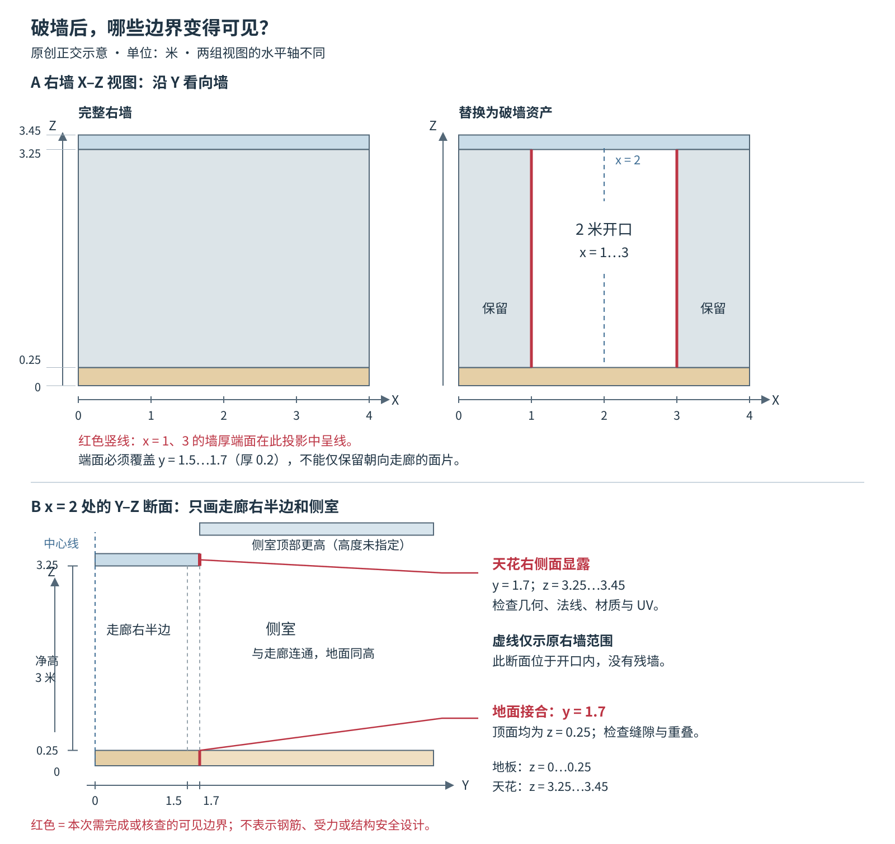
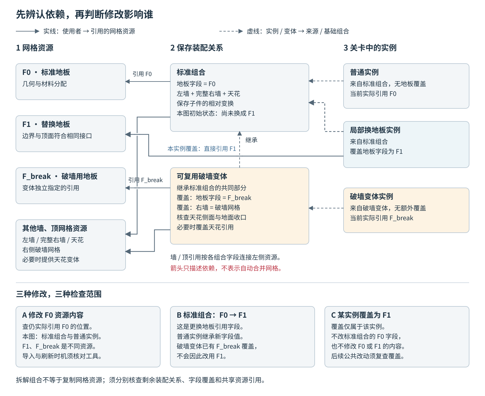

# 模块化环境的分件粒度与预制组合设计

一段走廊已经在关卡里重复使用。现在，一处右墙要破开通向侧室，另一处只换地板，其余位置仍保持完整。如果墙、地、顶全在一个网格里，美术可能得为每种搭配另导出一整段；如果全部拆散交付，关卡人员又要反复摆墙、补顶、查漏面。两种方案都能做出最终空间，难点是把自由修改留在需要它的地方，而不让每次正常搭建都重新解决内部结构。

本文面向掌握基础建模、局部坐标和编辑器装配的环境美术、关卡搭建者与技术美术，讨论三个问题：按什么需求拆件，如何把分件组织成日常使用的标准组合，局部改造之后哪些检查和更新关系必须重新确认。下面的走廊是原创制作方案，不是 Fallout 4 的实际资产，也没有对应的引擎运行或工时测量。

## 模型、摆放和修改不必使用同一种单元

先把“一个模块”说清楚。它可能指一个导出的网格，也可能指在编辑器里一次摆放的一组对象，还可能指允许设计师单独替换的一面墙。这三种单元可以不同。

| 单元 | 本例负责什么 | 它不自动决定什么 |
| --- | --- | --- |
| 网格资产 | 墙、地板、天花各自的几何与材料分配 | 关卡里是否必须逐块摆放 |
| 标准组合 | 保存这些部件的相对位置，作为常规走廊段重复摆放 | 是否合并成一个运行时网格 |
| 局部修改对象 | 某一面墙、某块地板，或整个走廊实例 | 是否把修改写回全部使用者 |

这里把保存一组对象及其装配关系、供人重复使用的内容称为**预制组合**。不同工具可能叫 prefab、组装件或使用项目自己的名称，更新与拆解语义不一定相同。

Bethesda 的 Fallout 4 课件将墙、墙角、地板、天花分别标出，并展示预制组合与拆开的细粒度形式。团队同时指出，更细的粒度提供破损和布局自由度，也增加搭建工作；课件中的一个布局标出旧方式 20 个对象、新方式 123 个对象。[1] 这解释了为何要把“可独立修改的部件”重新组织成“方便日常摆放的组合”，但对象数不是工时，也不是 draw call 数。

因此，决定拆件之前，先列出项目反复发生的修改。只有确实需要单独改变的部分，才有理由获得独立的制作或编辑入口。如果需求只是石材换颜色，材料参数或材质替换可能已经足够；不必为此切开几何。如果某种装饰要改变轮廓、碰撞或是否存在，单独网格才更有意义。

## 用一段走廊确定哪些变化值得支持

本例直走廊沿 X 方向延伸 4 米，根原点在起端地板底面中心。Y 是左右方向，Z 向上。规格如下；这些数值仅用于把制作关系说清，不是推荐的建筑或角色尺度。

- 地板占 `x=0…4、y=-1.7…1.7、z=0…0.25`，行走面为 `z=0.25`。
- 两侧墙厚 0.2 米，内表面位于 `y=±1.5`，外表面位于 `y=±1.7`；墙从行走面延伸到 `z=3.25`。
- 天花板占 `z=3.25…3.45`，俯视范围与地板相同。这里的净高为 3 米。
- 起端与末端不封口，供下一段连接；本例没有额外门框或踢脚线跨越部件边界。

相邻段仍需遵守[模块化环境套件的接口设计与组合验证](模块化环境套件的接口设计与组合验证.md)中的原点、端口、净空和占位约定。拆成几块不会改变这些要求。

先确定三种真实用途，而不是预制所有可能搭配：

| 用途 | 允许改变 | 要保留的关系 |
| --- | --- | --- |
| 正常段 | 整段摆放和允许的旋转 | 墙地顶内部关系、两端接合 |
| 破墙段 | 右墙中间 `x=1…3` 的区域打开至天花下方，接到侧室 | 左墙、原走廊两端、行走面高度 |
| 换地板段 | 地板的外观或地板资产 | 地板平面边界、顶面高度、邻墙接触和碰撞要求 |

破墙处的侧室在本例中已经由关卡设计允许连通，地面也位于 `z=0.25`；侧室顶部高于走廊天花。真正项目仍需验证角色、导航、视线和任务条件。环境美术不能仅凭“墙能删掉”擅自把不可通行区域变成路线。

这三种用途提示：地板与右墙应能独立修改，而普通段不必让搭建者每次从散件开始。左墙和天花也可以作为独立资产，但这不表示必须把每块砖、每个装饰条都继续细分。

## 先做可以复用的内部关系，再包装成标准组合

本例采用地板、左墙、右墙、天花四个网格，以组合根统一摆放。为方便解释，四件在制作和导出时使用同一个走廊局部坐标系，放入组合后局部变换为单位变换。项目也可采用各件独立枢轴，再在组合中保存固定的局部变换；重要的是选择一致，不要让替换地板时顺便改变它相对墙的位置。

组合先在灰盒阶段完成以下制作检查：

1. 地板顶面与墙底相接，天花底面与墙顶相接；没有多放一份楼板或天花。
2. 走廊两端开口保持预定范围，子件的封口、装饰与碰撞没有堵住它。
3. 从正常使用的内侧和需要支持的外侧观察，必要表面都存在；暂时被邻件挡住的边，明确标为未完成或有意省略。
4. 更换地板资产时使用相同局部坐标及边界约定，而不是让接收者凭肉眼拖回原位。

这些都是组合内部的责任。外部端口正确，不能证明内部没有重复面；四个子件各自合格，也不能证明组装时没有漏放或摆反。

为了让组合容易使用，可以将标准组合和可替换的部件分开呈现，给组合根、地板和两面墙使用可辨认的名称。天花难以选取时，可提供不进入游戏的选择标记。Skyrim 团队的制作说明也把灰盒的真实结构特征、常用件的优先级和编辑器辅助标记纳入交接，而不是只交一批外观完成的模型。[2] 标记只是选择与解释工具，不能代替实际几何检查。

## 破墙不是删除右墙后就结束

现在处理右墙中部的缺口。若直接删除完整右墙，开口会从 2 米变成整段 4 米，还会失去两端与相邻走廊连续的墙段。若只在完整网格上删掉中央面片，墙的厚度、断面和其他残留面又可能没有正确处理。

本例制作一份**右侧破墙资产**，替换原右墙。它保留 `x=0…1` 与 `x=3…4` 的两段墙，完成缺口两侧的厚度表面；其原点和外部边界仍与标准右墙相同。若保留既有子对象，只替换它的网格引用，仍须核对碰撞数据与附着内容；删除、增添对象或改变父级则是另一类结构操作，应按目标工具版本核对。这份资产可以包含多个互不相连的网格岛，不要求每段残墙都是一个编辑器对象。拆分依据是需要怎样使用它，而非几何有几块就建几个对象。

图 1：原创正交示意，单位米。上部为右墙的 X–Z 视图，沿 Y 看向墙；下部取缺口中间 `x=2` 的 Y–Z 断面，只画走廊右半边与侧室。红线标出这次改造需要完成或核查的可见边界，不表示钢筋、受力或结构安全设计。

破墙后，需要处理的不只右墙：

- **缺口两侧的竖向断面。** 本例厚度为 0.2 米，要有能从侧室和斜视角看到的端面，并确定材质、法线和 UV；一张朝向走廊的墙面不能代表实体厚度。
- **天花的右侧边。** 侧室顶部较高，原来被墙挡住的 `y=1.7、z=3.25…3.45` 边界会显露。若标准天花已做完整侧面，可以保留；否则需要完成这个可见边，或提供与破墙用途匹配的天花变体。
- **地面相接处。** 走廊地板与侧室地板在 `y=1.7` 接合。两侧顶面应同高，边界不能留缝，也不能让两块顶面大面积共面重叠。两个实体在共同边界上的侧面是否保留，由项目的几何归属和可见性约定处理。
- **原来附着在墙上的内容。** 踢脚线、灯、装饰与碰撞可能仍存在。它们要保留、改放还是移除，需要逐项判断；删除可视墙并不保证碰撞也随之消失。

如果做的是美术破损，而非规则矩形洞口，断裂边缘可以不平整，但仍应留在为这项变化分配的空间内，不侵入约定开口。碎石和残留构件会影响通行，不能因为属于破损装饰便跳过碰撞和净空检查。

这一过程说明了分件的边界：它让右墙容易替换，却不会替作者完成破损后的收口。若大多数变化总要同时修改墙、天花和相邻地面，应该把这种重复变化保存为一个破墙组合，而不是要求每位搭建者独立复原三者关系。

## 换地板时，先判断换的是外观还是空间

另一处走廊需要不同地面。先看变化究竟由什么承载。

**只有颜色、粗糙度和纹理图案变化时**，可以保留原网格，使用适当的材料变体。仍需检查材质分配、UV 与接缝，以及项目是否存在位移等会实际改变几何的着色功能。替换材料不是普遍保证“只改颜色”的操作。

**需要新的几何表面时**，制作可替换地板资产。本例要求新地板的俯视边界仍为 `0…4 × -1.7…1.7`，行走顶面仍在 `z=0.25`。这能让新资产使用原局部位置，不必移动两侧墙或下一段地板。下表面、侧边和碰撞也要满足相应用途；不能只比较俯视轮廓。

假设有人在原地板上再叠 0.04 米的实体铺装，新顶面变为 `z=0.29`。即使外观上很像换材，它也制造了与邻段和侧室的高差。若项目要求接缝同高，应调整地板内部厚度分配或另做符合原顶面要求的替换件，而不是把整个地板向下移后不查底面和侧边。若项目确实接受高差，则它是空间规格的变更，需要重新确认通行、收口与相关玩法，而不是沿用“外观变体”的合格结论。

破墙段恰好提供了一次额外检查：普通走廊里被墙藏住的地板边界，现在可能从侧室看到。一个只在封闭段里看过的替换地板，不能因此宣称也适用于所有破墙组合。

## 给日常摆放保留组合，给例外选择正确的维护范围

完成四件标准组合后，正常搭建以整段操作。局部变化有三个不同去向：

| 变化去向 | 适合本例的哪种情况 | 需要承担的维护责任 |
| --- | --- | --- |
| 保留一个实例的局部修改 | 只有这一处使用特殊地板，其他地方不应改变 | 记录它覆盖了什么，公共修正时检查是否仍会接收 |
| 建立可重复使用的组合变体 | 多处都使用相同破墙、天花收口和地板关系 | 维护变体与基础组合的共同部分及差异 |
| 拆解成可独立编辑的对象 | 这处空间持续偏离标准，组合已不再是合适的修改单元 | 接管被解除的装配关系与后续回归，不能继续假定它跟随标准组合 |

不要用“出现几次”作为建立变体的唯一门槛。一个用途明确、将持续共同修订的破墙结构，即使当前实例少，也可能值得集中维护；许多看似相似但将各自变化的剧情场景，则未必适合放进同一个变体。

图 2：示意把“部件是什么”“怎样装在一起”“哪个实例有例外”分开。箭头表示引用或继承方向，不代表任何引擎会自动合并网格。地板资源内容更新、组合中的地板引用更换、实例对该引用的覆盖，是三种不同修改。

具体工具必须核对自己的规则。例如 Unity 6.0 文档规定，实例的属性覆盖优先于预制资产的同字段值；Prefab Variant 也通过覆盖表达相对基础资产的差异。[3][4] 因而，如果基础走廊把地板引用从 F0 改为 F1，而破墙变体已经将这个字段覆盖为 F_break，就不能假定它会随之改用 F1。

反过来，**覆盖“引用哪块地板”与修改那块地板资源本身并不是同一件事**。一个实例仍引用 F0，源 F0 的几何内容又发生修订时，需要检查资源更新，而不是仅根据组合字段有无覆盖来推断结果。这里不承诺任何工具的热更新时机；要先弄清实际引用和导入结果。

拆解也有层级。Unity 6.0 对普通预制实例执行 Unpack 后，将它变为普通 GameObject，但其中的嵌套预制实例仍保留各自关系。对**变体实例**执行普通 Unpack 时，根却会成为其基础预制的实例，原变体差异转为覆盖；不能把它当成已解除全部根继承。Unpack Completely 则继续解除嵌套或变体的预制关系，将其还原为普通 GameObject 集合。[5] 因此，本例破墙变体即使点过 Unpack，公共地板修订后仍要查剩余的基础关系和字段覆盖。

这些操作也不等于把全部网格和材料复制成独立资源。装配关系可能不再跟随组合，网格与材料却仍可能被共享引用。应分别记录这两种依赖。嵌套修改应用到哪个资产的具体问题，可参见[共享灯具如何管理资产与场景实例的修改](../../../技术美术/环境管线/场景光照/共享灯具如何管理资产与场景实例的修改.md)。

## 用同一组修改验收选定粒度

选择本例的“分件加标准组合”，理由不是分件天然先进，而是两类真实修改需要局部入口，正常段又值得保留重复摆放单元。交付前可以请另一位搭建者在同一个小场景里完成以下任务。它们是验收方法，不是本文已经执行过的测量。

| 任务 | 要观察的制作结果 | 失败时先查什么 |
| --- | --- | --- |
| 摆放并连接两段正常走廊 | 不用重新安排墙地顶，内部无遗漏，两端符合原接口 | 组合内容与相对变换，而非先加补缝件 |
| 将一段改为侧室破口 | 开口范围正确，残墙端面与天花侧边完整，附着物与碰撞得到处理 | 被替换件以外的可见性和附属依赖 |
| 给另一段换地板 | 新外观或几何生效，顶面和邻接关系仍满足约定 | 改的是材料、网格引用还是空间尺寸 |
| 修订公共地板后检查三个用途 | 逐处说明谁应更新、谁保留特例，实际结果与预期一致 | 资源引用、字段覆盖及拆解层级 |
| 从侧室和沿走廊移动检查 | 接缝、背面、断面及通行没有因视角和使用状态暴露新问题 | 实际模型、碰撞与场景关系，不能只看资产缩略图 |

公共地板修订要先说清是哪一种操作：修改 F0 的内容，还是在组合里把 F0 换成 F1。前者应找仍引用 F0 的位置，后者应找继承该引用字段的位置。测试输入不同，预期传播范围也不同。

每次实例修改之后，也应缩小原有保证的范围。只换不改变形状的材料时，原坐标关系可以保留，但画面和材料接缝要复查；改顶面高度时，外部连接与通行要重查；破墙时，开口、显露边界和侧室关系都成为新检查对象。无需把所有已完成工作一律推倒，也不能用“原组合验收过”替代新增检查。

若比较整段、散件和预制组合的操作成本，使用同一布局、同一修改任务，记录实际修改的资产、实例和返工，而不是只数对象。计时还受工具、操作者熟悉度和快捷操作影响，不能从一次试做推导团队效率比例。

## 何时保留整段，何时拆分

整段网格适合形态稳定、内部始终共同变化、局部开口很少的内容。它减少内部编辑入口，也让替换责任集中；代价是每种结构变化可能需要新的整段资产。

分件适合确实独立变化的墙、地、顶或装饰。它提供局部替换能力，但增加内部接合、显露断面、对象选择和依赖维护。没有这些需求，拆得更细只是在转移工作。

分件加标准组合适合常规结构大量复用、部分位置又需要例外的项目。它把常规装配保存下来，让自由编辑成为有明确代价的选择。其效果依赖工具是否便于选择子件、查看依赖和管理变体，并非单凭文件夹中出现一个 prefab 就已经建立了可用流程。

本例的选择也不是永久答案。如果后来每处走廊都要成为独特破损空间，现有组合可能不再适合；如果破墙只剩唯一一次需求，独立制作那处空间可能比扩充全套变体更划算。应按实际修改及其维护范围调整粒度。

最终应交付的不只是四个网格，而是正常组合、明确支持的破墙或地板变化、可见边界的处理、引用与覆盖关系，以及接收者能重做的验收场景。模型文件负责保存几何，标准组合负责保存重复装配，局部例外负责表达这一次为什么不同。让这三者各有清楚职责，才能同时保留重复制作的效率和必要的空间自由度。

## 参考资料

[1] Joel Burgess、Nate Purkeypile / Bethesda Game Studios，*The Modular Level Design of Fallout 4*，GDC 2016，作者上传课件。第 81–99 页的粒度与工作流部分；本文直接查看第 86、88、94、96、99 页原图，引用拆分、对象数量与预制组合展示，不推断未公开的 Pack-In 实现。[课件](https://www.slideshare.net/slideshow/gdc-2016-modular-level-design-of-fallout-4/59770460)。访问日期：2026-11-08。

[2] Joel Burgess、Nathan Purkeypile，*Skyrim's Modular Approach to Level Design*，GDC 2013；作者于 2013-05-01 署名转载。相关部分：The Graybox Phase、The Build-Out Phase、The Polish Phase。[作者署名全文](https://www.gamedeveloper.com/design/skyrim-s-modular-approach-to-level-design)。访问日期：2026-11-08。

[3] Unity Technologies，Unity 6.0 Manual，*Override prefab instances*，Behavior of overrides。[文档](https://docs.unity.com/en-us/engine/6000.0/manual/working-with-gameobjects/prefabs/override/prefab-instance-overrides)。访问日期：2026-11-08。

[4] Unity Technologies，Unity 6.0 Manual，*Create variations of prefabs*，基础预制与覆盖关系。[文档](https://docs.unity.com/en-us/engine/6000.0/manual/working-with-gameobjects/prefabs/prefab-variants)。访问日期：2026-11-08。

[5] Unity Technologies，Unity 6.0 Manual，*Revert a prefab instance to a GameObject*，Unpack 与 Unpack Completely。[文档](https://docs.unity.com/en-us/engine/6000.0/manual/working-with-gameobjects/prefabs/unpacking-prefab-instances)。访问日期：2026-11-08。以上 Unity 内容为指定版本的文档规则，不是本例原生编辑器测试。

[返回模块化环境](README.md)
