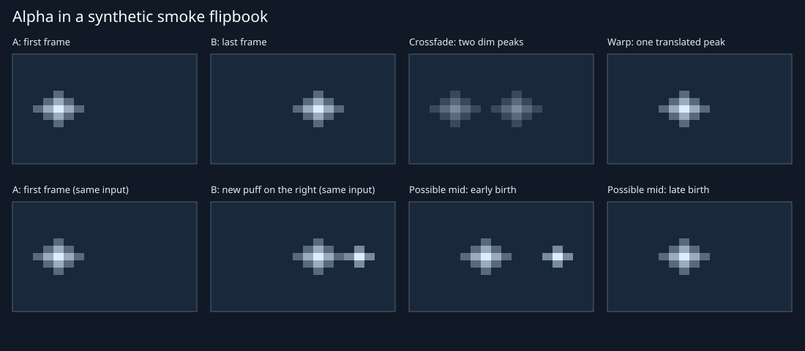

# 低帧率烟雾 Flipbook 的双影：运动矢量烘焙与采样验收

一段横向涌动的烟雾从模拟器导出成 16 帧纹理。打开帧间混合后，播放不卡了，但两张关键帧之间却能看见前后两个半透明烟头。把运动矢量贴图接进材质，有时双影反而拉得更远；某些帧边还会突然亮一下。**先确定是两帧没有对齐、矢量的单位读错了，还是采样跨进了相邻图格。** 三种情况看起来相近，却需要不同的修法。

本文面向制作实时烟火特效的人和实现材质的程序员。讨论的是已经烘焙好的逐帧纹理（flipbook），不是 GPU 用于画面重建、运动模糊的屏幕运动矢量，也不是把运行时粒子速度直接写进纹理。

## 交叉淡化能变平滑，不能自动把烟搬到中间

设一团烟从第 A 帧的像素 x=2 移到第 B 帧的 x=6。直接以 50% 淡化，就是在两帧相同的纹理坐标各采一次，再各取一半。结果在 x=2、6 各留一个透明度 1/2 的峰，没有一个完整的烟头真正移动到 x=4。这两处合起来的透明度总量和重心仍与理想中间帧相同，单看烟整体在哪儿，甚至可能误判为已经对齐。

运动矢量混合先按预计的位移把两帧内容拉到中间，再做混合。以恒定水平位移 +4 像素、时间权重 t 为例，计算输出位置 x 该取什么值时，从 A 框查 x−4t、从 B 框查 x+4(1−t)。两个符号不同，因为在向前搬动 A 的特征、向后搬动 B 的特征；实际采样都是去原图**反查**。t=1/2 且 x=4 时，取的正是 A 的 x=2 和 B 的 x=6。这个公式只覆盖已知恒定平移。即使特征从 x=2 到 x=6 始终有对应，如果它前半段走得慢，在半帧可能只到 x=3，按恒速仍会放错；空间变化的场、烟雾自身变形和遮挡需要用源序列的中间帧另作验证。

| 半帧处的处理 | 非零峰位置和透明度 |
| --- | --- |
| 不移动采样，只交叉淡化 | x=2、6，各 1/2 |
| 用 +4 像素正确重投影 | x=4，透明度 1 |
| 位移方向取反 | x=0、8，各 1/2 |
| 位移只用一半 | x=3、5，各 1/2 |

[复现实验](../../../../管理档案/实验/烟雾帧间重投影/README.md)用整数透明度位置和有理数运算执行这四种比较。二维示意的上排用同一平移测量：直接淡化相对理想半帧的逐像素透明度绝对误差之和为 32/3，已知位移下重投影为 0。这不是实拍烟雾，零误差不适用于一般流场。

图的下排最后两格是两种可能发生的过程，不是两种算法输出。

## 接烘焙数据之前，先用单个可量出的烟点校正

需要核对三件事：**矢量图存的是什么、取出后怎样还原、偏移在哪个坐标系里使用。** 例如，一格 64×32 像素，右移 8 像素、上移 4 像素，在每格局部 UV 中偏移的大小分别是 1/8 和 1/8；纵向符号取决于贴图原点。若这格是 8×4 图集的一格且材质直接偏移图集 UV，大小要再分别除以 8 和 4，变成 1/64、1/32。纹理数组通常使用切片内 UV，不能直接照搬同一套比例。若运行时只提供一个标量比例，它不能独立纠正两轴不同的偏差；应在烘焙端预先换算，或在解码路径上分轴处理。

Unity Visual Effect Graph 17.0 的文档把普通 FlipbookBlend 和额外使用运动图的 FlipbookMotionBlend 分开，后者有 Motion Vector Map 和 Motion Vector Scale。[1] 在另一个已固定、包清单标示 17.7.0 的 Unity Graphics 源码快照中，普通二维纹理和纹理数组的相关代码都从两帧采 RG 并映射到有符号值，再分别乘比例与 −t、1−t；最终在偏移后的坐标采颜色并混合。[2] 这说明了如何核对这一版本的解码和采样，不假定所有版本或材质都用同一套着色器。

SideFX Labs Flipbook Textures 的速度说明用每秒 NDC 位移，导出器可为编码范围压缩整段速度，也可以夹掉高速离群值。文档同时区分常规重映射 R8G8、自定义高精度 R8G8 和未编码 R16G16；专用 R8G8 需要配套解码与不过滤的采样配置。[3] 因此“都是两通道贴图”不代表可以原样对接。如果拿到的是每秒速度，要按导出帧的时间间隔换成每帧位移，并按工具与材质约定处理归一系数、轴方向和 UV 比例；若导出器或配套材质已做过某一转换，不要再乘一次。位移被夹掉的位置没有办法靠事后统一乘比例恢复形状。

首次接入时，特意烘一组长宽不同且含已知右移、上移和静止的测试格。锁定 t=0、1/2、1，先看首尾是否仍与原帧一致，再分别查看重投影后的两帧是否在 1/2 对齐；预测 x 偏移是方向反了还是只差比例。在材质里输出实际解码值并查零位移格。矢量是数据，不能照颜色贴图做 sRGB 解码；也要看实际压缩和滤波后的静止值是否仍接近零，不只看源文件里的 RG。把导出帧率、图格尺寸和实际偏移值一起交接，避免只留一个碰巧好看的比例旋钮。

## 矢量正确之后，检查边界和没有对应的烟

图集采样时，要保护的是**这一格**，不是整张贴图。有一格末端 alpha 为 1/4，紧邻下一格开头的 alpha 为 1。采样位置位于两 texel 中心之间的正中间：普通插值会混出 5/8；若裁到本格最后一个 texel 中心，得到 1/4；若本格外应是透明，则等权插值只能得到 1/8。再向外走，三者可以是 1、1/4、0。整图用 Clamp 仍可能读到下一格。边缘给透明留白、复制边界色和裁切 UV 分别代表不同的边界假设；复制边缘在贴片内容必须消失时还可能拖出一条亮带。

验证方法是给相邻格填一个明显不该出现的测试色，固定当前帧和半帧位置，再分别放大及缩小物体。先确认是否真的越过当前帧的采样范围，然后决定扩大透明留白和安全边、在每格局部空间做边界检查，或换成纹理数组以消除相邻切片串色。使用图集时应核对颜色与矢量图的格子对齐、有足够的位移与滤波余量，并测进了不同 mip 后的实际采样；不要只检查最高分辨率。数组解决跨格取到另一帧的问题，但每个切片自己的边界和 mip 仍需处理。

有时重投影不可能还原正确画面。二维示意下排的两种过程，首帧都没有右边的小烟团，末帧都有；可它可能在中间时刻之前就已形成，也可能在中间时刻之后才出现。两帧本身没有告诉你是哪一种。即使可以标出这团烟“没有对应”，让它在原地按 alpha 淡入也只是约定的退路，不能得到真实的出现时刻。类似地，遮挡、新露出的区域和烟团消散不是稳定平移；只加大矢量比例，常会把轮廓拉出空洞。若这些节奏信息重要，优先在变化发生处多保留源帧或选用原模拟能提供的阶段／遮挡数据；若只是背景软烟，可在低置信区域降级到淡化，再按实际画面判断是否值得增加纹理。置信区要来自导出器、运动估计算法或人工绘制的遮罩；一张只存 XY 分量的 RG 运动图不会额外告诉材质哪些像素有可靠对应。

## 按故障选方案，而不是给所有烟都加一张图

- **拆帧淡化时成双影，受控平移素材重投影后合成单峰：** 运动图确实解决了这个运动问题，再检查成本。额外数据图占显存和带宽，具体采样次数、压缩和画质收益要在目标材质、投射尺寸和设备上量。
- **测试格也错向或偏移量不成比例：** 先修编码、比例、帧间隔、图集坐标或纵轴方向，不先提高贴图分辨率。
- **只有图格边缘跳亮，或缩小时出现邻帧颜色：** 用邻格诊断色确认采样泄漏，修留白与 mip 后复测。
- **测试格和边界都对，真烟仍在突发处断开或闪烁：** 对照模拟序列的原始中间帧。若仍能追踪到同一个形状，先单看前后两次重投影，检查真实运动图的局部方向、变形和前后帧约定，不能用校正格通过证明实际运动场正确。若确认是新生、消散或新露出而没有像素对应，再选择遮罩、额外源帧或阶段数据。关键玩法轮廓不能只拿平均误差或烟的重心验收。

实际验收用同一持续时长和相同源片段，分别比较最近帧、普通淡化、运动图混合和多保留帧。检查慢放半帧、快速转折、循环拼接、典型相机距离和透明轮廓，再拿导入后的显存和目标机开销作选择。若是跨项目交接，运行时材质、烘焙设置和校正测试用的格子要能一起复测。

## 参考资料

1. Unity，[Shared Output Settings and Properties](https://docs.unity3d.com/Packages/com.unity.visualeffectgraph@17.0/manual/Context-OutputSharedSettings.html)，VFX Graph 17.0，UV Mode、Flipbook Layout、Motion Vector Map、Motion Vector Scale。
2. Unity Technologies，Graphics 提交 `0efc28ea742b1966b9dd9cc4489e58b986a13faf`，[包清单](https://github.com/Unity-Technologies/Graphics/blob/0efc28ea742b1966b9dd9cc4489e58b986a13faf/Packages/com.unity.visualeffectgraph/package.json)、[运动图解码与偏移](https://github.com/Unity-Technologies/Graphics/blob/0efc28ea742b1966b9dd9cc4489e58b986a13faf/Packages/com.unity.visualeffectgraph/Shaders/VFXCommonOutput.hlsl#L3-L15)、[偏移后采样与插值](https://github.com/Unity-Technologies/Graphics/blob/0efc28ea742b1966b9dd9cc4489e58b986a13faf/Packages/com.unity.visualeffectgraph/Shaders/VFXCommon.hlsl#L742-L758)。
3. SideFX，[Labs Flipbook Textures 1.0](https://www.sidefx.com/docs/houdini/nodes/out/labs--flipbook_textures-1.0.html)，Motion Vector 中的 Encoding、Padding Ratio、Max Speed Allowed。
