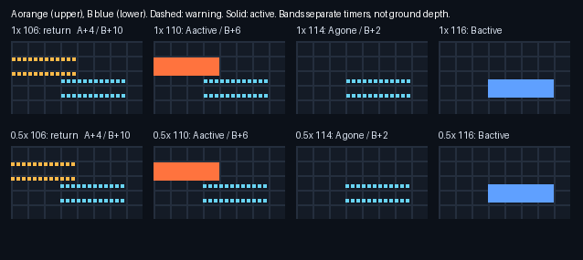
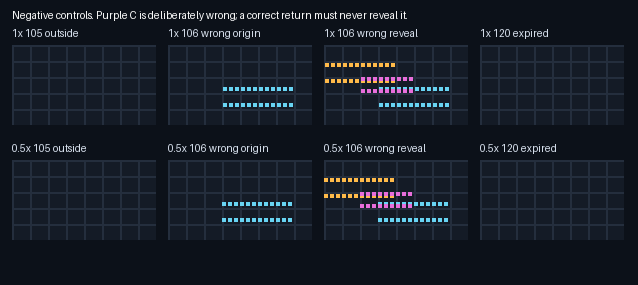
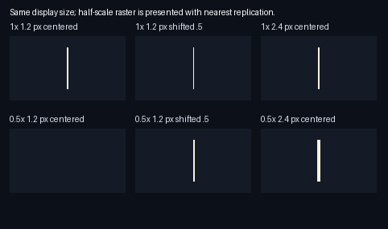

# 特效预算降低时，怎样保住技能预警

俯视战斗里，镜头转回平台时，攻击范围仍有一半在画面里，预警却随着画外的发射器一起没了。提高画质能看见它；最拥挤的战斗反而丢了。即使补上一条便宜的边线，两块危险区重叠时，若统一放一个倒计时，玩家可能仍会在错误的时刻躲避。这个问题不只是「让东西画出来」，而是降级后还要保留**当前危险在哪里、什么时候生效、现在是否已生效**。

本文假定团队已经定好哪些观众有权看到哪种预警，以及预警与世界判定使用的形状。遮蔽、雾区、队伍和预警的玩法规则不属于特效预算，不应在低画质里被绕开。如果不披露本身承担保密职责，服务端也要限制下发，不应把客户端不画当作保密。

## 给便宜版本留出一条不依赖粒子年龄的路

让玩法维护一份活动危险记录：稳定实例标识、可披露对象、空间范围与必要投影视图、预警开始、生效、结束和取消，若形状随时间变化就要可查询当前结果。核心显示只消费**此玩家在此视图允许看、此时仍有效**的记录；状态推进不是由粒子是否存在或播到某年龄决定。廉价轮廓、区域填充或节奏标记表达玩法所需信息；烟、碎屑、柔光和起手爆发是在这套信息之外的装饰。

取四个简化显示名额和二十股先到的普通烟尘。若四个名额谁先来谁占，全部归烟尘；为可见的两条核心警示优先预留两个，才有 A、B 和两股烟。这是具象的选择顺序对照，不是所有项目只要留两个，也不是测出了 GPU 毫秒数。实际预算要验证最大可同时出现的关键警示、便宜形状的屏幕占用和填充成本。没有足够名额时先降饰层，再试把多个标记放进同一批绘制但仍保留各自几何和时序；批数少不等于像素负担少。若连最小表达也不够，应限制并发、预先设计分区替代提示，或重新安排技能流程；不要把最远那条当作默认可丢。

Epic 的 Niagara Effect Type 预算文档描述了全局使用率对距离范围和系统实例数量的缩减。[1] 可把装饰送给这条策略，但离得远或不再运行的粒子组件不是权威的危险域。UE 5.8 的 Cull Reaction 还把停用、立即清粒子和保留状态后继续更新分开。比如 PauseResume 保留暂停时的状态，通过检查后再更新；它不会替项目确认粒子时间是否追上了危险的当前阶段。[4]

Riot 的制作文章强调命中区与效果匹配、重要信息优先；这里只借它的判断标准，不推断它采用 Niagara 或本文的结构。[2] 既有资产如果只是边缘消失，还要区分错误的包围盒、距离与数量预算、遮挡和真相不可见；放宽包围盒不能代替正确的显示优先级。

## 镜头回来的第一帧，重建现在，不播放过去

下面把地面横轴看成一排格。A 的发射器在 −6，覆盖 [−6,4)，第 110 步生效，第 114 步结束。B 覆盖 [3,7)，第 116 步生效，第 120 步结束。半开范围右端不含。玩家在第 105 步看 [8,16)，第 106 步镜头回来看到 [0,8)。另有第三条危险记录与画面相交，但对该玩家不披露。

| 步骤 | 可见的 A | 可见的 B |
| --- | --- | --- |
| 105：镜头还没回来 | 无 | 无 |
| 106：第一帧回来 | [0,4)，还有 4 步 | [3,7)，还有 10 步 |
| 110：A 生效 | [0,4) 已生效 | [3,7) 尚有 6 步 |
| 114：A 结束 | 无 | [3,7) 尚有 2 步 |
| 116：B 生效 | 无 | [3,7) 已生效 |
| 120：B 结束 | 无 | 无 |

用发射器原点代替区域会在第 106 步漏掉 A。改成对有权披露的危险当前形状做视图相交，才会补出它仍可见的部分；第三条仍不显示。裁掉画面外几何时不要额外沿视口边缘画一条假边，标记的是世界范围而不是裁剪矩形。分开时间轴：镜头回来可以补画当前边线、颜色以外的警告/已生效形状和剩余量，但不必补播早已过去的起手爆发或让倒计时从头开始。如果 A 在画外期间被取消，也不能因为最终重获特效名额就让它复活。进视图、画质切换或粒子被裁后重新显示，都从同一活动记录构造，而不是从“播放起点加本地已过时长”反推。

这组离屏 OpenGL 图用上下两条示意带分开 A、B 的时钟，**横轴共用，不是两条不同的世界路径**。虚线表示预警，实心表示已生效；图外的数字是说明文字，不是游戏内实时读数。第 106 步两档均画到两条记录，在 110 步两者样式不同，在 114 步只剩 B。下图的紫色仅是故意错误的披露对照，不是正确模式里给玩家看的第三条提示。

## 预算不够时，范围可以批画，时间不能随便合并

将 A、B 画成一个轮廓，空间并集 [0,7) 没错。但若只标「第 110 步」，[4,7) 三格会被报早；只标「第 116 步」，[0,3) 三格会被报晚；[3,4) 本来先后有两次危险。在第 110 步统一换成已生效的样式，会误标 B 独有的 [4,7)，还会吞掉重叠格 [3,4) 中 B 仍处于预警的独立信息。这个差别不靠“轮廓没丢”就能发现。

优先选择保留不同危险的阶段编码，例如用不同边形或线型加各自的时机提示，与底图上已生效的填充或纹理分开。需要合并时，先问是否真的在同一处、同一时段、对同一观众且有同一语义；不同的就分区或在同一批次保留每个实例的数据。若产品只展示每格下一次最早危险，明确这项取舍，故意重叠测试较晚事件在交接后如何露出，以及它是否还来得及被理解；不能声称一次最早倒计时已传完两条信息。加上形状、线型、文本或时序差异，避免危险阶段只靠两种颜色区分。[3]

## 先看是否有绘制，再看玩家实际看到的像素

逻辑层的覆盖不等于最终画面有可用的提示。内部渲染缩半，本来 1.2 像素宽的线只占 0.6 个内部像素。用像素中心点采样时，一条正好夹在两个中心之间的直线可能完全打不到采样点。相机小幅移动后又命中一列，并不说明玩法形状在跳。抗锯齿、面积覆盖或保留输出像素宽的绘制路径可改变结果；若把线加粗，线中心仍应贴合边界，并在游戏机位检查外沿会不会让玩家误解判定更大。不要凭一条通用的最小宽度就宣布提示达标。

在 Mesa llvmpipe 的 OpenGL 4.5 离屏试件中，1× 为 144×80、0.5× 为 72×40，没有 MSAA，半尺度图最近邻放大到同样的显示大小。1.2 显示像素宽的居中描边在两个渲染目标上分别命中 104 和 0 个**内部**像素；保持半尺度并平移 0.5 个显示像素，命中 26；回到居中并加到 2.4 显示像素宽，命中 52。它实测的是这个无抗锯齿绘制路径中的像素存在，不说明有时间重建、不同抗锯齿后端或复杂背景的实机就会相同。

固定玩法输入、相机轨迹和目标画面输出，把普通档与压力档配对。从第一帧回到画面开始捕捉，再抓 A 刚生效、A 刚结束，以及 B 生效和结束。分层记录每个危险的范围、阶段、剩余量、观众权限、预算裁剪理由、提交记录和最终图像：画不到先定位是候选、阶段还是栅格；画到了则核最低内部尺度、代表性明暗底图、重叠特效以及是否只靠色差。再为玩家实际用得到的反应时间做试玩验收，不以像素存在代替玩家识别率。

[复现：预算选择、时序与软件 OpenGL 读回](../../../../管理档案/实验/技能预警的预算与恢复/README.md)

## 参考资料

[1] Epic Games，[Performance Budgeting Using Effect Types](https://dev.epicgames.com/documentation/en-us/unreal-engine/performance-budgeting-using-effect-types-in-niagara-for-unreal-engine)，Budget Scaling，读取页面标为 UE 5.9。
[2] Riot Games，[Clarity in League](https://www.leagueoflegends.com/en-us/news/dev/clarity-in-league/)，2021-03-12，玩法可读性、层级与命中范围。
[3] Microsoft，[Xbox Accessibility Guideline 103: Additional channels for visual and audio cues](https://learn.microsoft.com/en-us/xbox/accessibility/xbox-accessibility-guidelines/103)，颜色之外的提示。
[4] Epic Games，[ENiagaraCullReaction：UE 5.8](https://dev.epicgames.com/documentation/unreal-engine/API/Plugins/Niagara/ENiagaraCullReaction?application_version=5.8)，Cull Reactions。
