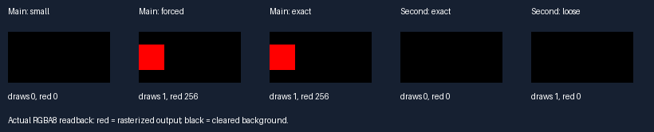

# 粒子输出几何超出包围盒时，怎样修正视锥剔除

一道火花沿地面喷出，特效的根节点移出画面后，原本还在屏幕边缘的亮条跟着整团消失。把镜头往回挪一点，亮条又回来。对于实时特效和技术美术，这时值得检查的不只是粒子飞到哪里，还要看**最终绘制的几何有没有伸出系统用于剔除的盒子**。这两者不一定在同一个阶段得到。

## 先确认消失发生在哪一步

视锥是相机要成像的空间。渲染器可以先用包围盒判断一整个效果有没有可能进入视锥，盒子完全在画外时跳过绘制。这个捷径只在盒子确实罩住可见几何时才安全。盒与视锥相交则只是「可能看得见」：不保证有粒子遮住对应像素，也不保证通过遮挡或其他预算规则。

先在测试副本里重放同一段相机运动。尽量固定特效种子、播放时刻、生成条件和画质，保留原资产作对照。画出生效包围盒，同时确定按原输出参数构造的几何或轮廓应该在哪里。临时只改生效的盒，给它足以覆盖本场景的范围，再重放一次；不要同时改粒子速度、渲染尺寸或离屏模拟开关。即使剔除选项没有改，放宽盒也可能让原来在离屏时暂停的粒子继续模拟。要隔离绘制剔除，得确认对照帧的粒子状态相同，例如两组都用同一种持续模拟设置，并核对粒子位置和寿命。若状态相同且改盒就让边缘轮廓回来，再收紧诊断盒，查它原来缺的是哪一边。若状态不同，只能说范围影响了可见性流程，还不能定位到绘制提交。若没有变化，先查是否改错层级，再看效果是否根本没生成、已暂停模拟、命中距离或数量预算，或者被遮挡。不能用一个可见性开关同时改变模拟和绘制，再把恢复归给包围盒。

Unity Visual Effect Graph 17.0.4 给出了具体的阶段差异：Automatic 和 Recorded 正在录制时，在 Update Context 计算包围范围。同帧 Output Context 对粒子大小、位置、缩放或枢轴的改动不会计入这次计算。[1] 所以单纯多录一遍同一段播放，仍可能漏掉输出阶段加长的亮条。这个说法只针对该版本手册说明的阶段；手写着色器位移或拖尾，应分别查所属实现在哪一步进入包围范围。

## 从输出轮廓算起，而不是从发射点猜

取画面横轴上的一个简化例子，其他两个方向都在相机内。Update 按中心 −2 和半宽 0.25 给出区间 [−2.25, −1.75]。Output 将中心向右移 1，再把半宽加到 2，实际绘制区间于是变成 [−3, 1]。相机看 [0, 4] 时，旧盒完全离屏，最终几何却有 [0, 1] 留在画中。只改变该视图的生效包围盒，不必动一个粒子，也能改变是否提交绘制。

对固定轴的一维区间，先把待比较的形状转换到盒子使用的同一坐标空间。若原盒为 [L, U]，实际输出可达 [l, u]，左边至少补 max(0, L−l)，右边至少补 max(0, u−U)。在这个例子里两侧分别缺 0.75 和 2.75。支持直接指定最小最大值，或中心和半尺寸时，可用 [−3, 1]，也就是中心 −1、半宽 2。如果只能对称加宽，每侧至少补 2.75，于是得到 [−5, 1]。另一相机看 [−5, −4] 时，新宽盒会通过这道检查，但实际几何完全在画外。这个误判意味着后续**可能**做多余的工作，不代表多画了像素，更不等于一个可引用的毫秒数。

我用同一个不透明四边形做了一组离屏 OpenGL 对照：脚本在 CPU 决定是否提交，Mesa llvmpipe 负责实际裁剪和栅格化。64×32 的目标里，主相机用旧盒时没有提交，读回 0 个红像素；强制提交旧盒的几何和使用贴合盒，两次完整读回一致，都有 256 个红像素。第二台相机用贴合盒不提交，用宽盒提交一次，但两次读回全黑。这个试件固定了绘制体，只验证选哪个包围盒的后果；Unity 的阶段差异来自文档，不是这组 OpenGL 试验观察到的。

三维里对三个轴分别求极值。以局部中心 c、半尺寸 e 表示的盒，经仿射变换 x'=Mx+t 后（M 是线性部分，t 是平移），包住变换结果的轴对齐盒中心是 Mc+t，半尺寸是 |M|e，其中 |M| 是矩阵每项取绝对值。等价的简便办法是把八个角都变换过去，在各轴取最小值和最大值。别只变换两个对角，旋转或负缩放时它们未必还是极值。若接口要组件局部空间的盒，就在局部空间求包围；直接把世界空间中心和尺寸填进去，会让引擎把盒再跟着组件变换一次。

需要适配任意朝向的矩形 billboard 时，若枢轴就在中心且有效半宽、半高分别为 a、b，最远角距中心 √(a²+b²)。相机旋转下可用这个半径构造保守上界。这里的半径和被包围的偏移必须在同一空间；世界空间的一米在非均匀缩放的组件各局部轴上对应的长度不同，应先变换保守形状再逐轴求界。枢轴不在中心时用最远角到实际枢轴的距离；拉伸强度、顶点位移、拖尾宽度及仍然存活的历史段另行计入。旧盒已足够的轴不必因另一轴的缺口一起放大。

## 把临时大盒换成资产可验收的范围

对运动有明确上限的特效，先列出全寿命中会改变外形的输入：寿命曲线极值、速度上限和拉伸、加速度和力场、出生偏移、宿主转动或缩放，以及实际会被调用的参数组合。用输出阶段的极值在正确坐标空间求并集，必要时加上已知的采样或插值余量。若粒子留在世界空间、宿主本身还在移动，历史粒子相对当前宿主的位置不等于当前帧的发射范围；这时考虑按效果段拆开，或在运行时更新对应范围，而不是把整条关卡路径塞进一个固定盒。范围是可达位置的上界，不能从「这次录制没超出」反推随机极值永远不会出现。

在上述 Unity 版本中，Manual 可从 Initialize 直接输入盒，也可接 Operator 计算的结果；Recorded 可用 VFX Control 录制基线。已知后输出扩张时，可用 Initialize 的 Bounds Padding 按轴补足，或通过盒的中心和尺寸表达不对称范围。参数应按调试绘出的实际盒校对，而不是把理论里的半宽增量未经换算填入界面。Automatic 会强制资产始终重新计算 bounds 并模拟，且仍存在前述 Update/Output 阶段差异，不是无成本修复。[1]

保留三个对照：先复现原盒丢轮廓，再让修正盒在边缘和回镜头时保住轮廓，最后找一个只有临时大盒和视锥相交、实际输出不相交的视角，看收紧后能否剔除。测试最晚消失的拖尾、最坏偏移、最大的尺寸和不同相机方向。如果修盒同时改变了离屏模拟或重入状态，要另外记录，不能只比较单帧截图。最后在项目的目标设备检查实例及绘制提交、目标特效的时间和实际画面；过度放宽是否值得，由该项目的分布和采样决定。

## 相关知识与复现

- [拆分测量 Niagara 实例、模拟与像素成本](拆分测量Niagara实例与模拟和像素成本.md)：检查 Unreal 中实际生效的盒、实例覆盖以及其他可见性条件。
- [试件脚本、读回数据及复现说明](../../../../管理档案/实验/粒子输出包围盒/README.md)。

## 参考资料

[1] Unity Technologies，[Visual Effect Bounds](https://docs.unity3d.com/Packages/com.unity.visualeffectgraph@17.0/manual/visual-effect-bounds.html)，Visual Effect Graph 17.0.4，Setting Bounds、Bounds Recording，2026-11-20 读取。
