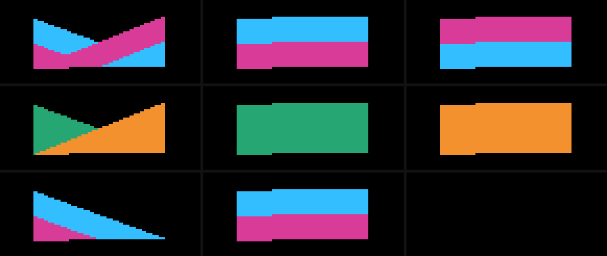

# 拖尾中心线没断，网格为什么会翻面

刀光在同一段回放里有时像剪开了一角，有时只是亮边跳到了另一侧。把拖尾样点画出来，中心线却是连着的。这时不要先提高发射频率，也不要把材质改成双面就算修好。先确定是两侧边接错了、三角形被当成背面，还是镜头把本来就很窄的东西压成了一条线。

这里讨论的是由两侧顶点连接成的带状拖尾（ribbon），例如剑刃行进时留下的刀光。排查不依赖特定引擎，但需要能固定动画回放和镜头，并给网格加一种调试画法。

## 一条中心线，还需要决定哪边是哪边

设拖尾的第 i 个截面中心是 `Pᵢ`，沿拖尾的单位切线是 `Tᵢ`，半宽是 `hᵢ`。对一种朝向相机的构造，取同一坐标空间内指向相机的单位视向 `Dᵢ`，令：

```text
Bᵢ = Dᵢ × Tᵢ
Sᵢ = Bᵢ / |Bᵢ|                        当 |Bᵢ| 足够大时
Eᵢ⁺ = Pᵢ + hᵢ Sᵢ     Eᵢ⁻ = Pᵢ − hᵢ Sᵢ
```

正交相机可用固定视向，透视相机在这个构造中用该截面指向相机位置的向量。叉积顺序是工程约定，换顺序会交换两侧。这里给正边宽度纹理坐标 `v=1`、负边 `v=0`，再按同名边连接相邻截面。正负不只是为了凑出两个点：内侧亮边、颜色渐变、三角形索引都可能依赖它。

当视向和切线接近平行时，叉积长度接近零。固定切线 `T=(0,0,1)`，让单位视向的 X 分量从 +0.005 走到 −0.005，Y 保持为零。采用上面的 `D×T` 约定，归一化后的侧轴从 −Y 翻到 +Y；正对时不能归一化。此例的两侧位置集合在两端不变，变的是哪个位置叫正边。对称材质、双面绘制且没有跨截面的折叠时，这么换未必看得出来。反过来，仅从截图轮廓没变，也不能说 UV 或正反面没变。

## 镜头不动，两段也可能接成交叉形

另一种问题发生在同一帧内部。对于两个相邻截面，若第二个截面的正边跑到第一个截面的负边那侧，固定索引仍然把正接正、负接负，就可能把四边形接成蝴蝶结。此时再小心处理单个截面的零向量也不够：两个侧轴可能都能归一化，却朝向近乎相反。

下面的对照固定正交镜头与路径 `P(s)=(1−s², 0.01s, s)`，从同一曲线取 `s=−1` 和 `s=0.5` 两个截面，用各自的曲线切线，不用两点之间的同一条弦充当两条切线。整段曲线的 `|D×T|` 最小约 0.0099995，所以把后备门槛设到 0.005 也不会触发。每截面半宽 12 像素，放在 96×40 的窗口里；顶点按“第一截面的正、负，第二截面的正、负”编号 0～3，索引用 `(0,1,2)` 和 `(2,1,3)`。



图从左到右是原始宽度轴、按首截面选取同向的符号、再把首截面的符号反过来并对齐后续截面。第一行是宽度 UV（青色是正边一侧，粉色是负边一侧）；第二行关闭剔除，用绿色显示正面、橙色显示背面；第三行开启背面剔除，再看宽度 UV。本对照把窗口里的逆时针三角形认作正面。OpenGL 用窗口坐标中的有向面积判定正反面，正面约定受管线状态控制，不是看顶点法线朝哪边。[1]

| 宽度轴 | 关闭剔除：总覆盖 | 其中覆盖两次 | 只留逆时针 |
| --- | ---: | ---: | ---: |
| 原始 | 1137 | 382 | 759 |
| 与首截面符号对齐 | 1512 | 0 | 1512 |
| 用相反的首截面种子，再对齐 | 1512 | 0 | 0 |

原始组出现一个正面、一个背面，覆盖也发生重叠。改选第二截面的符号，才把两侧边接顺。反种子组与对齐组在关闭剔除时覆盖**同一批像素**，但青粉分区调换，两个三角形也都变成了背面。三种现象可由同一条中心线产生，所以“把材质改成双面后不缺角”不能证明网格已经对了。像素数来自一次 Mesa OpenGL 软件渲染对照；这里仅画两个截面的连接，不代表整条曲线，也不是特定游戏引擎的内置算法。

## 先做三张调试图，再决定修哪里

1. **画中心线与两条带身份的边。** 固定回放帧，暂时拿掉正常透明材质、动效纹理与软粒子。让正边始终是一种颜色，负边另一种，或用宽度 UV 把半幅染成不同颜色。在固定镜头内查边是否跨过去，再锁住中心线与切线，让条带随镜头重新生成后扫一遍，检查同一截面是否在掠视时换边。尽量同时记录相邻侧轴点积与归一化前的叉积长度，二者回答的问题不同。
2. **分开看接错和剔除。** 保留同一顶点及索引，先关闭剔除，按正反面着色；再只切换背面剔除。若同一连接段的两个三角形呈现不同面向，同时两侧边交叉，先查截面方向和索引。若边没交叉、颜色身份正确，只在开剔除时整个连续分段消失，检查绕序、镜像变换或当前观察面；别顺手交换 UV。若整段在开剔除时消失，关剔除后又发现两侧的颜色整体互换，先查首截面的侧轴是否在这一帧反号。若想区分重叠和颜色覆盖，可关闭深度测试，让每个三角形用同一个小常量做加法混合，亮度翻倍对应重复覆盖；不要在这个诊断里沿用会饱和的正式发光材质。
3. **边标签与绕序都稳定时，再看投影。** 用相同世界几何换一个斜侧视角。如果条带沿视线变得很短，或平面本就以侧面朝向镜头，屏幕覆盖会随角度缩小。这不必然是翻面。此时根据效果用途选择保留物理朝向、增加可见性辅助，或换多平面/管状几何；不要为补面积而修一个不存在的索引错误。

## 修复前先定哪项必须保住

**主要给镜头看的拖尾。** 如果侧轴 `S` 和 `−S` 在几何上都可接受，而纹理两侧必须连贯，可先明确正边种子，再从头到尾让候选方向与上一有效侧轴比较，点积为负就取反。重建同一条拖尾时，种子不要随镜头抖动；对会丢弃旧样点的拖尾，用仍存活的样点 ID 对齐上一帧，别用可能整体前移的数组下标。没有共同样点时，重新用明确的素材参考设种子；参考也不可用，就把它视为新段或淡出旧段。叉积太小时，先把参考轴投影到当前切线的垂直平面（用 `R − (R·T)T` 去掉平行分量），确认投影长度有效后再归一化；参考也退化时，短暂淡出或断开这段比任意捏一个方向稳妥。用不同的进入和恢复门槛可减少反复切换。点积非负只说明两个宽度轴没有背向，不保证接起来就不折：拖尾太宽、截面距离太短时，两条横截面本身也可能交叉。仍要检查实际边线和两个投影三角形的绕序，必要时改宽度、转角连接或分段。不应盲目取反：相邻方向真的要扭过 90°，或点积接近零时，几何本身没有告诉你艺术上该把哪侧解释成正边。可保留作者提供的侧向约束，必要时增加有实际曲线依据的中间样点，再验 UV、连接和绕序。空间上逐段选符号也不能替代跨帧种子的管理。

**必须贴着刀刃的拖尾。** 如果亮边必须对应真实刃边，优先从武器/骨骼拿有语义的两侧点，例如直接记录刃根与刃尖，而不是看相机再决定谁是正边。只拿一个武器参考轴时，它也可能平行于切线，仍要检查投影长度。铺在任意空间路径上的带子，可以固定第一个宽度轴，用相邻切线之间的最小旋转把它逐段运过去。近同向时沿用框架并保持正交；近反向时旋转轴不稳定，要分段或提供受控参考。闭环还要检查末截面的宽度轴能否接回首截面，必要时保留接缝或沿弧长分配剩余旋角。平行输运可以保存沿路径的边缘连续性，但不保证面对所有镜头时都有相同的投影面积。[2]

Unity 的 Trail Renderer 提供面向相机的 `View` 与面向物体 Z 轴的 `TransformZ`。它们能用来做朝向对比，但文档并没有把它们定义成本文的叉积和连接算法。[3] 无论最后用组件选项还是自定义网格，验收时都用同一条锁定路径，检查掠视前后、固定镜头内的相邻截面和换视角后的单面可见性。先确认是哪项要求失败，再改该层。

[复现实验与原始读数](../../../../管理档案/实验/拖尾网格的边标签与绕序/README.md) · [出生点偏离中心线的诊断](../粒子模拟与发射/粒子距离发射的路径采样.md)

## 参考资料

1. Khronos，[OpenGL 4.6 Core Specification](https://registry.khronos.org/OpenGL/specs/gl/glspec46.core.pdf)，§14.6.1 多边形面积与剔除，§15.2.2 片元输入 `gl_FrontFacing`。
2. Andrew J. Hanson、Hui Ma，[Parallel Transport Approach to Curve Framing](https://scholarworks.iu.edu/dspace/items/39fbe931-c2c8-43a1-9c9d-a207b92d551e)，TR425，§3 离散运输，§3.1 闭环，§3.2 带状截面。
3. Unity 6.0，[Trail Renderer component reference](https://docs.unity.com/en-us/engine/6000.0/manual/visual-effects/lines-trails-billboards/rendering-trails/class-trail-renderer)，Alignment。

[返回拖尾网格](README.md)
