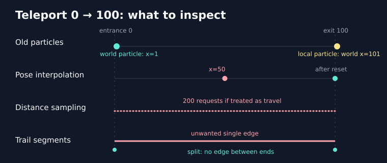

# 发射器传送后，怎样让旧粒子留在该在的位置

角色从一扇传送门穿到另一扇，身边的光环应该跟着走，已经冒出去的烟却应该留在入口。把烟做成独立模拟的世界粒子后，旧烟确实没被捎走，两个门之间还是横出了一道线。这不是一次坐标设置能解决的，因为画面上同时用了粒子的位置、发射器的运动历史和拖尾的连接历史。

## 先决定已经出生的粒子属于哪里

随人物的光环适合局部空间。粒子存的是相对发射器的坐标，画出来时再用发射器当前变换放到世界里。一个局部横向偏移 1 的粒子，发射器从 x=0 传送到 x=100 后，就显示在 x=101。局部速度、朝向也要随所选空间解释，转身后的方向不该只靠改位置猜。

已经和角色分离的烟、火花或尘土适合世界空间。出生时把位置与方向变换到世界空间，后续独立模拟；上述粒子若出生在世界 x=1，传送不会把它拉到 x=101。传送后新发射的粒子仍要用新发射器位置。检查时先停止新发射或用独立标记区分前后两茬；只看传送后还在画面的粒子，很容易把新生误认成旧粒子跟着走。Godot 的 CPUParticles2D 和 GPUParticles2D 都用 `local_coords` 区分这两种行为；不要把切换这个属性当成迁移一组已出生粒子的通用操作。[4]

## 不让运动历史把传送补成一段路

即使旧烟已经留对位置，下列三项也可能出错。排查时分别观察，不要对整个效果一律清空。

| 症状 | 谁还在使用旧位置 | 怎么处理 |
| --- | --- | --- |
| 发射器或其挂件在两扇门间划过 | 渲染用上一次和当前变换插值 | 先设置目的地变换，再按引擎规则重置变换插值；不要把这当成清空所有模拟。 |
| 两扇门之间突然多出一长串粒子 | 按移动距离发射用旧采样点到新点算路程 | 把这一次记作跳变而不是路程，把采样起点重置到目的地。是否另外在目的地发一次，由效果决定。 |
| 只有一条带子横在两个门之间 | 拖尾在原有顶点和新顶点间连边 | 结束旧段，在目的地起新段。要让起点尾巴留着衰减，就保留该段的寿命，不和新段连接。 |

例如 Godot 的节点物理插值文档明确说明传送后可对节点使用 `reset_physics_interpolation()`。Unity 的粒子文档分别提供按距离发射和世界空间拖尾；拖尾点在哪个坐标系与是否连接两点是不同的事。这些接口说明用于辨认机制，不代表某引擎的模块会自动互相重置。[1][2][3] 目的地变换和这三项处理都要在各自模块下一次采样前生效，否则先读到上一位置的模块仍会产出一帧错误。

跑一个只比较合同、不运行引擎的模型：发射器从 0 跳到 100，旧世界粒子仍在 1；普通线性插值到一半时是 50；按每 0.5 单位、不限额、无余量的距离规则误算了 200 个发射点；旧点 0 和新点 100 若仍属同段就连成一条边。真实引擎可能限额、丢发射或使用不同插值，不能把 200 当成它的输出。

示意图的第一行是旧粒子应出现的位置；后面三行是分别查的历史，不是引擎截图。

## 传送过后，再走一小步

把起点移到目的地和清零积累的发射余量不是同一步。假设距离间隔是 0.5，传送前已攒下 0.25。排除传送距离后，目的地第一步正常走 0.25：保留旧余量就在 100.25 发一次；把它当新效果从零开始则不发，要第二步到 100.5 才发。需要在持续移动效果与新租出的实例之间明确做选择。验收不要在传送帧就结束：再走两步，确认节奏也符合想要的效果。

## 不能边留旧粒子边把同一块状态交给下一人

回池时先问旧粒子是否还要显示。想让它们自然消失，应停止旧组的新增并保留其渲染和模拟，等真的结束后才把这一份实例借给下一人；如果新角色现在就需要效果，另借一份。想立刻切断则显式清掉旧粒子，重置自定义距离基线并清零发射余量，同时重置拖尾历史，再在新变换下启用。只把发射节点藏起来或搬到池的停放点，不等于完成其中任何一条。局部粒子可能被一并搬走；也不要用等待墙钟等价于暂停、离屏或休眠时的模拟进度。例如 Godot 这两个节点的 `finished` 信号受一次性模式限制，连续发射器应有独立的结束判据。不要把不可见本身当成已经排空。[4]

需要跨引擎实现时，向特效传递的是“这里发生了一次跳变”，并说明旧组要不要保留。每种特效只重置自己确实持有的历史。测试观察入口有没有剩旧烟、途中是否多发、拖尾有没有桥接、到站后的第一步从哪开始采样；同一组可见结果比让两个引擎的重置函数长得一样更有用。

[模型与复现说明](../../../../管理档案/实验/粒子传送与历史重置/README.md)

## 参考资料

[1] [Godot 4.7 物理插值：传送时重置](https://docs.godotengine.org/en/4.7/tutorials/physics/interpolation/using_physics_interpolation.html#call-reset-physics-interpolation-when-teleporting-objects)。
[2] [Unity 6.0 粒子发射模块](https://docs.unity.com/en-us/engine/6000.0/manual/visual-effects/particle-systems/particle-system-modules/part-sys-emission-module)。
[3] [Unity 6.0 TrailModule.worldSpace](https://docs.unity.com/en-us/engine/6000.0/script-reference/unityengine/particlesystem/trailmodule/worldspace)。
[4] Godot 4.7.2 对应 API 定义：[CPUParticles2D](https://github.com/godotengine/godot/blob/ed1daf0bf/doc/classes/CPUParticles2D.xml) 与 [GPUParticles2D](https://github.com/godotengine/godot/blob/ed1daf0bf/doc/classes/GPUParticles2D.xml)，local_coords 与 finished。
