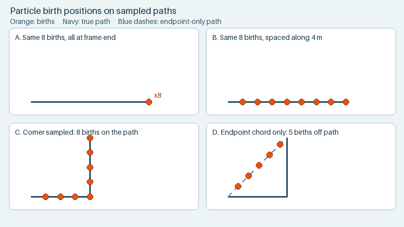

# 低帧率转弯时，按距离发射的粒子为什么会抄近路

车轮沿着直角弯跑，扬起的灰却从弯内斜切过去。调高每米发射量，只会让斜线更密。另一个常见症状是车在直线上快速运动，粒子数没少，却每帧结成一团。前者是发射器没有拿到真实轨迹，后者是拿到了距离，却没把出生点放在路上。把**走过哪条线、生成几个、分别生在哪儿**拆开测，才知道该改哪个环节。

## 发射计数正确，不等于出生位置正确

Unity 6.3 粒子系统的 Rate over Distance 和 Unreal Engine 5.9 Niagara 的 Spawn Per Unit 都提供按移动距离计数的入口。[1][2] 这些描述不能替项目保证用的就是轮胎接地点、仿真中间点或特定的出生插值。先查看实际模块读的是组件、骨骼插槽还是接地点。轮子左右间距较大时，即使车身中心走得很准，内外轮也不走同一条线。

以下是一种间距恒定的实现。设目标间距为 `s`，上段结束时自上一个理论发射点已累计 `r`，其中 `0 ≤ r < s`。连续采样点 A 到 B 的长度为 `L`：

```text
n = floor((r + L) / s)
d(k) = (s - r) + k × s，k = 0 … n-1
出生位置 = A + (B - A) × (d(k) / L)
r = (r + L) mod s
```

新效果若没有起点爆发，从 r = 0 开始，第一个点距起点 s。零长段不除法也不消耗余量。刚好跨到段末时，在 B 发一次；下一段从同一个 B 起算，离它再走一个间距才发。实现中最好用一致的数值边界规则；整数化距离或稳定的浮点容差都要测试接近整倍数的输入，避免一帧多发、下一帧补一个重复点。这里 `r` 记理论网格的相位，不从画面上已存活的粒子倒算。

例如间距 0.5 米，从 0 先走到 0.3，没有出生；第二段走到 1.2，应该在 0.5、1.0 发两枚，余量 0.2。如果每段独自取整，第一段发零枚，第二段只发一枚；如果总数算对但每枚都用帧末位置，两枚都堆到 1.2。直线按帧切开或沿物理步切开，只要路径相同、余量连续，基础公式就给出同一组几何位置。

## 插值沿哪条线走，由上游采多少次决定

相邻两次渲染更新之间实际走了 `(0,0) → (2,0) → (2,2)`。保留中点时，总路程 4 米，以 0.5 米等距发 8 枚。只用屏幕更新的首尾两点时，得到约 2.83 米的对角线，发 5 枚，而且都在弦上。沿弦插 10 次或把发射密度翻倍，仍然不知道中途去过 `(2,0)`。即使外部另给了正确的 4 米总长，不能拿这个长度替代轨迹位置。

要贴回地面，优先从已经计算接触位置的一层取有序样本。如每个物理步记录带时间戳的轮胎接地点，同一渲染帧内按顺序消耗所有新段，发射余量沿段传递；已读过的段不要在下一帧再发一次。若路径本来由样条驱动，可以在曲线上按弧长取点，或递归细分到近似误差够小。细分必须能访问曲线本身；对一根已经取坏的弦再细分没有用。若同一种坐标下的位置来自动画插槽，采样要与实际插槽更新次序一致，不能用同一批旧变换跑几个名义子步。

若只拿到帧首帧尾，就把弦当作有限近似。贴地且方向急变时，宁可拿到真实的转弯点，或对缺少地面接触的区间停发，也不要用速度猜一条穿墙线。传送、对象复用或显式失去连续性的切段，不应当作一段超长运动；如何保留旧粒子与发射余量另见[发射器传送后的处理](发射器传送后，怎样让旧粒子留在该在的位置.md)。

## 发射上限会让点变少，不应把旧位置欠到下一帧

长帧里可能经过 20 个间距，却只容得下 5 枚。可把待发点沿整段均匀抽样，也可在低画质档把目标间距调大；二者都比只发前 5 枚、让后半段空着更适合需要连续轮廓的尘迹。若运行中切换间距，明确从新网格重启，还是按 r/s 的比例映射相位；别把可能超出新间距的旧余量直接带入。若预算策略是丢弃未发点，即使只提交 5 枚，余量仍用 **实际走过的全段距离**计算，不记录那 15 枚为欠账。否则下一帧即使只挪一点，也可能在车旁突然爆发一团，或重新补到玩家已离开的路面。若项目确实要延迟处理候选，就必须保留原始坐标和时间，并制定过期规则；不能在新位置偿还旧距离。下方试件从零开始走 2.25 米、间距 0.5 米、限额 2：应发 4 枚，丢 2 枚，余量 0.25 米。下段再走 0.25 米只在 2.5 米处发一枚，不补发。

空间位置对了，动态外观仍可能错。长帧内的早出生粒子如果全按帧末从年龄零开始，会一起变大和消失。若效果需要校正，对带时间的运动段可在段内近似匀速时用同一个 `d/L` 插值出生时刻，然后由引擎支持的子步更新或可用的初始年龄处理。单改年龄不会重演碰撞、加速度或噪声积分；缺支持时把这视为独立取舍，不把视觉整齐误报为粒子运动完全一致。

## 先关掉漂移和寿命变化，看点落在哪里

先画发射器样本与出生点，用固定尺寸、零初速、同一观察窗口对比；直线要同时看每米计数和点间距，拐弯要叠加车轮实际轨迹。再打开正常材质、寿命和运动，让效果用一次长帧、一次匀速段和一次短暂停车，核对限额后有没有积欠。这样能区分数对但帧末扎堆、只拿到一条弦，以及点数因预算主动降低。

下图用同一套几何量绘制，不运行 Unity 或 Niagara。直线两种方案各发 8 枚，若都用帧末位置只有一个独立出生点；直角弯保留折点有 8 枚，只采首尾有 5 枚且斜切。图展示生成位置，不表示真实烟的扩散或遮挡。



[复现实验](../../../../管理档案/实验/粒子距离发射与路径采样/README.md)

## 资料

- [1] Unity Technologies，[Emission module reference](https://docs.unity.com/en-us/engine/6000.3/manual/visual-effects/particle-systems/particle-system-modules/part-sys-emission-module)，Unity 6.3，Rate over Distance。
- [2] Epic Games，[Emitter Update Group](https://dev.epicgames.com/documentation/en-us/unreal-engine/emitter-update-group-reference-for-niagara-effects-in-unreal-engine#spawning-modules)，Unreal Engine 5.9，Spawning Modules。访问日期：2026-11-23。
