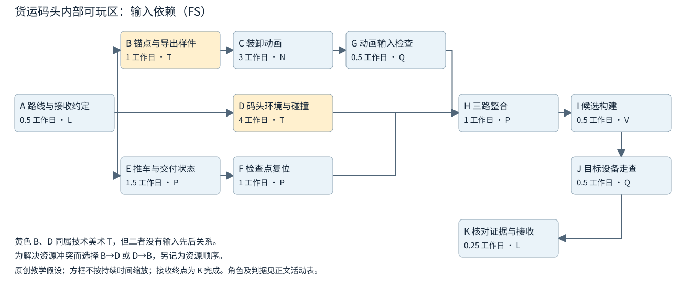
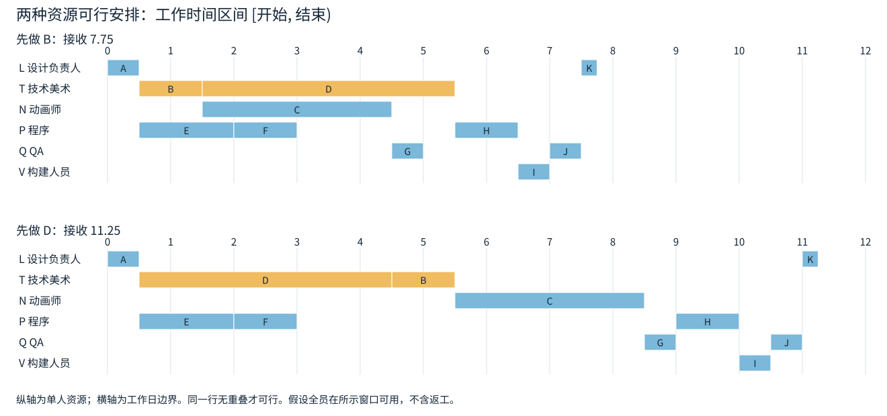

# 小型可玩版本的依赖计划与交付判断

一个内部可玩区还剩环境、动画和玩法接入。技术美术说先把四天的环境做完，动画师却在等他一天就能交出的锚点样件。程序的工作看起来已经接近完成，但候选包之后还有设备走查和接收判断。此时，“各专业还剩几天”不能直接回答何时能交付：先后关系、人手和交付终点都还没有放进同一份计划。

本文面向懂基本游戏生产分工的制作人与专业负责人，不要求预先懂关键路径法。我们沿着一个虚构的货运码头可玩区，从接收条件倒推活动，先算只考虑输入依赖的时间下界，再排出人员不冲突的安排，最后用一次中途变化更新未来工作。读完应能说明某个日期依据什么、哪项调整能改变它，以及还缺谁的什么决定。本文不预测整个游戏的工期，也不教授玩家研究或复杂概率排程。

## 一、先说清楚接收什么，才知道要算到哪里

“可玩”不是统一的质量等级。Double Fine 在《Psychonauts 2》的 Episode 5 中说明，first playable 用于让多个部门的管线、系统和内容在同一区域共同工作；它仍含临时音频和未完成表现，并不等于可发行区域。[1] 对计划有用的是这次交付要回答的问题，而不是照搬里程碑名称。

本例的用途是：让项目组在指定 Windows 测试机上，检查推车运输、货箱装卸、场景碰撞和检查点复位能否共同形成一段可重复运行的流程。它不观察新玩家是否理解玩法，不要求最终美术品质。开始排期前，制作人与接收负责人约定：

| 要接收的内容 | 本轮的判断依据 |
| --- | --- |
| 一份能定位的候选构建 | 记录构建编号 `Dock-FP-01`、所含代码/资产版本、启动场景和键盘操作说明；不是只有编辑器截图或源文件 |
| 一段完整运输流程 | 在指定机器上从装货点出发，推车沿约定路线到交付区，装卸动画事件与交付状态相符，碰撞不阻断路线 |
| 可重复运行 | 从检查点复位后，推车、货箱和交付状态恢复；按清单连续完成两轮，不崩溃、不出现必须手动改状态才能继续的阻断 |
| 明确的表现边界 | 允许复用环境材质、粗灯光和临时音频；装卸事件、路线碰撞与复位逻辑不能用口述或录像替代 |
| 接收记录 | QA 留下该构建、该设备上的走查结果与已知问题；本轮接收负责人核对证据，确认上述条件达到，并记录用途限制 |

这些是原创教学条件，不是 Double Fine 的项目标准。后文所有时长、人数、资源窗口和计划数字也都是假设，不能拿来估算真实团队。

这里有三个不同的事件：**候选构建产生、规定检查通过、接收条件达到**。包已生成，只说明可以开始检查；QA 走查通过，仍需核对版本、范围和问题清单。接收不是把失败项改为通过。如果原本必需的复位失败，负责人可以决定改做另一种演示，但那是改了本轮目标，不能仍称原目标已经完成。

本例由设计负责人 L 兼任本次交付接收人，并获准决定本轮范围；跨项目调人和承诺日期仍由相应负责人确认。真实项目应写明自己的权限，不从“制作人”或“负责人”头衔推定一切决定权。GAO 排程指南强调完成里程碑应有明确条件，而且达到里程碑所需的实际工作不能被一个日期标签代替。[3，印刷11–14页]

## 二、把接收条件变成能安排、能交接的活动

### 由终点往前倒问，再按输入关系连接

先问接收者：“要作出这项判断，你必须拿到什么？”再向每份输入的提供者问同样的问题。这样会从接收记录追到设备走查、候选构建、整合结果，再追到环境、玩法和动画，而不只是列出“美术”“程序”“测试”三个大项。

一项**活动**是占用时间、产生可辨认结果的一段工作。它至少要说明动作和输出、必要输入、完成判据、负责人及所需资源、剩余持续时间与估计依据、可工作窗口。只写“动画完成80%”没有说明谁现在能用什么，也无法排出余下工作。

依赖应由交接过程决定。Double Fine 在 Episode 4 中区分了几种情况：核心移动是建设关卡的必要输入；部分能力可与关卡并行推进，但会带来修订；白盒达到要求后才替换为正式美术。[2] “全部等完”与“全部同时开工”都不足以描述这些关系。

本例已经有可用的原型移动、货箱模型与骨架、基础白盒、动画验证场景、构建流程和测试机。各专业已经提供路线与接口提案，A 是 L 对本轮约定的核定与记录。这些既有条件若不成立，就应补入准备工作，不能把它们当免费输入。

| 编号与活动 | 开始前必须取得 | 完成判据或交给谁的输出 | 执行资源 | 持续时间（工作日） |
| --- | --- | --- | --- | ---: |
| A 确认路线与接收约定 | 已有原型及各专业提案 | L 固定路线、装卸事件约定、接收清单和允许占位范围 | L 设计负责人 | 0.5 |
| B 交出货箱锚点与导出样件 | A | 版本明确的锚点、事件命名与可导入样件，交动画师使用 | T 技术美术 | 1 |
| C 制作装卸动画 | B | 动画师先核输入，再制作、自查并导出约定片段和事件 | N 动画师 | 3 |
| D 完成码头环境与碰撞 | A | 按固定白盒完成本轮环境装配，自查路线碰撞，交程序整合 | T，同一个人 | 4 |
| E 实现推车与交付状态 | A | 用现成占位货箱跑通运输、到达与交付状态，交复位工作使用 | P 程序 | 1.5 |
| F 实现检查点复位 | E | 推车、货箱及状态可恢复到约定检查点，自查后交整合 | P，同一个人 | 1 |
| G 检查动画输入 | C | QA 在已有验证场景检查导入、事件名与时序，留下是否可接入的结果 | Q QA | 0.5 |
| H 整合三路输入 | D、F及G的通过记录 | 核对收到的版本，将环境、状态和通过输入检查的动画接成指定场景，交构建 | P | 1 |
| I 生成并登记候选构建 | H | 产生候选包、版本清单和操作说明，交 QA | V 构建人员、构建机 | 0.5 |
| J 目标设备走查 | I | 在指定测试机执行本轮清单，记录通过项、失败项及未检查项 | Q、测试机 | 0.5 |
| K 核对证据并接收 | J | L 对照第一节条件核对构建和检查证据，记录接收结论 | L | 0.25 |

表中持续时间包含该行明确列出的自查、输入核对和交接整理。G 是整合前的动画输入检查，J 是对最终候选的设备走查，二者不能互相替代。这里暂按检查成功、无需返工计算，所以图中的G完成意味着已经取得通过记录。若检查执行结束但未通过，输入条件仍未满足；失败后的工作在第六节处理。K 本身有核对工作，所以给出持续时间；**K 完成**才是一个不再占用工作时长的终点事件。不要把实际审批或测试藏进零时长里程碑。

活动拆分的尺度由交接决定。B 可以独立交出样件，动画就能开始，因此没有把 B 和 D 合成“技术美术五天”。E 不需要最终动画，因此可以用占位内容推进；H 仍须等动画输入检查。这种拆法保留了实际可用的中间产物，没有用删依赖或提前填写开始日期来制造并行。

每条边都应能回答“缺了它，下游具体哪一步做不了”。如果说不清，应与执行者核对它是必要输入，还是习惯顺序。若“动画必须等环境定稿，环境又必须等动画定稿”，应找双方能先确认的接口或试制结果；找不到可独立接收的阶段，就先请专业负责人决定路线。循环依赖不能直接交给下面的计算。

### 先统一时间含义

**工时**是人实际投入的量，例如 T 在 B 上投入8人时；**持续时间**是活动开始至完成跨越的时间，按指定日历计量；**等待**可能占据这段时间，却不占用同一个人。一天的机器处理不等于工程师工作一天。若工程师提交半小时，机器处理四小时，再由他检查半小时，应分别记录人员、机器和等待；是否合成活动，取决于是否会影响交接和资源安排。

本例采用每天8小时、周末不工作的共同日历；每行人员在该活动的工作区间内专职投入，非工作时段自然暂停，暂不在工作时段内拆开活动，也没有额外切换成本。I 的半天内构建人员与机器均按预留占用处理。这是简化的资源假设，不是所有构建都如此耗人。

用工作时间边界表示区间：`[0, 0.5)` 是从起点到半个工作日，后项可在 `0.5` 接着开始。`[0.5, 1.5)` 长1个工作日，不因跨两个日期标签就算两天。若起点为周一上班，五个工作日的工作可以在周五下班完成；后项从`t=5`开始时，要等到下周一上班。压缩掉非工作时段的时间轴把两者记为同一个边界，真实日历上的完成时刻与下一可开始时刻仍不同。排定真实日期时必须映射到当地节假日、休假、设备和跨地区人员日历。[3，印刷49–50、65–67页]

表里的固定值只供演示。真实估计应由活动负责人依据剩余输出、相似工作和实际可用人员说明；不能为迎合希望日期倒推每项“应该只剩几小时”。也不能把工时一律除以人数：分工是否可拆、技能是否匹配、交接和合并要多久，都会改变持续时间。

## 三、先算只考虑依赖时，最快能到哪里

这一步有意先放开资源限制，包括暂不管 B、D 实际由同一个人做。固定以下条件：活动网络无环；所有边都是完成后才能开始的 **FS（finish-to-start）** 关系；没有额外延迟；活动时长确定；采用共同日历；不含返工、额外固定日期和人员冲突。所得结果是**这些活动与条件下，仅考虑依赖的下界**，还不是能执行的日期承诺。[3，印刷27–30、75、86页]



### 从前往后，汇合处等最晚的必需输入

令活动 i 的持续时间为 `d_i`，最早开始与最早完成为 `ES_i`、`EF_i`。从没有前置的活动起逐项计算：

```text
无前置活动：ES_i = 0
有前置活动：ES_i = max(所有直接前置活动的 EF)
EF_i = ES_i + d_i
```

`max` 的意思是取最大值。H 同时需要 D、F、G，不是任一路到达就能开工。A 在0.5完成，B、D、E于是都可以开始；B后接C与G，动画支路到5才齐备。D到4.5完成，E、F连做则到3完成。因此：

```text
ES_H = max(4.5, 3, 5) = 5
EF_K = 5 + H的1 + I的0.5 + J的0.5 + K的0.25 = 7.25
```

从起点沿依赖走到终点的一串活动叫一条路径。本例三条完整路径分别为：

- A→B→C→G→H→I→J→K：7.25工作日。
- A→D→H→I→J→K：6.75工作日。
- A→E→F→H→I→J→K：5.25工作日。

最长的第一条就是此简化网络的**关键路径**。沿这条路尚有必需工作，终点便不能早于7.25。G只有半天，K只有四分之一天，但都在这条路上；工作短并不意味着对日期无影响。关键路径说的是对这个指定终点的时间约束，不是给各专业的重要性排序。

### 从终点往回，求哪些工作还能挪动

现在把所研究终点固定在刚算出的7.25，而不是把希望日期写成已经能实现的结果。令最晚完成为 `LF_i`、最晚开始为 `LS_i`：

```text
终点活动 K：LF_K = 7.25
其他活动：LF_i = min(所有直接后继活动的 LS)
LS_i = LF_i - d_i
总浮动 TF_i = LS_i - ES_i = LF_i - EF_i
```

`min` 是取最小值：前项必须赶上最早需要它的后继。例如 K 最晚在7开始，J须在7完成；倒推到H，H最晚在5开始。于是D最晚在5完成、1开始；E→F这条链最晚从2.5开始。

| 活动 | d | ES | EF | LS | LF | 总浮动 TF | 自由浮动 FF |
| --- | ---: | ---: | ---: | ---: | ---: | ---: | ---: |
| A | 0.5 | 0 | 0.5 | 0 | 0.5 | 0 | 0 |
| B | 1 | 0.5 | 1.5 | 0.5 | 1.5 | 0 | 0 |
| C | 3 | 1.5 | 4.5 | 1.5 | 4.5 | 0 | 0 |
| D | 4 | 0.5 | 4.5 | 1 | 5 | 0.5 | 0.5 |
| E | 1.5 | 0.5 | 2 | 2.5 | 4 | 2 | 0 |
| F | 1 | 2 | 3 | 4 | 5 | 2 | 2 |
| G | 0.5 | 4.5 | 5 | 4.5 | 5 | 0 | 0 |
| H | 1 | 5 | 6 | 5 | 6 | 0 | 0 |
| I | 0.5 | 6 | 6.5 | 6 | 6.5 | 0 | 0 |
| J | 0.5 | 6.5 | 7 | 6.5 | 7 | 0 | 0 |
| K | 0.25 | 7 | 7.25 | 7 | 7.25 | 0 | 0 |

单位均为工作日或工作日边界。GAO 附录 IV 用首尾日期都包含当天的记法：一天工作可在同一日期开始和结束，所以有 `EF = ES + duration − 1`，后继再到下一工作日。本文使用区间边界，一天从0到1，不减1，后继可以从1开始。两套约定表达同一时间关系，公式不能混用。[3，附录IV，印刷172–178页，图52、56]

### 总浮动不等于“谁都可以各拖这么久”

**总浮动**是在其他条件不变、允许后继相应移动时，一项活动可以延迟而不推迟所研究终点的量。**自由浮动**则要求连直接后继的最早开始也不改变。在当前 FS 网络中：

```text
FF_i = min(直接后继的 ES) - EF_i
终点 K 无后继，本表以目标终点 7.25 代入，故 FF_K = 0
```

E有2天总浮动，但自由浮动为0：它原定在2完成，F就在2开始；E一晚，F就得移动。F在3完成，H直到5才开始，所以F有2天自由浮动。即使终点没变，E的变化仍需要通知F的执行者，确认新窗口可用。[3，印刷91–93、95–96页，图35]

E与F的两个“2天”是同一条支路上的**共享空隙**。若E推迟2天开始，它从2.5做到4，F再从4做到5，终点仍为7.25；这时空隙已经用完。若再在E完成后让F多等2天，F变成6到7，H只能从7开始，终点变为9.25。不能相加两个总浮动，宣称这条链有4天备用。周末等非工作时段也不是浮动，它们首先是日历中不能工作的时间。

### 缩短同一项工作的收益会停止

仍然只看依赖。假设动画负责人确有办法在不改变接收条件的情况下把C从3天减为2.5天，动画支路到4.5齐备，与D同到；终点从7.25提前到6.75。若继续把C减到2天，动画支路虽在4完成，H仍须等D到4.5，终点还是6.75。

| C持续时间 | G完成，动画输入齐备 | D完成 | H最早开始 | K完成 |
| ---: | ---: | ---: | ---: | ---: |
| 3 | 5 | 4.5 | 5 | 7.25 |
| 2.5 | 4.5 | 4.5 | 4.5 | 6.75 |
| 2 | 4 | 4.5 | 4.5 | 6.75 |

中间一行出现两条同长关键路径，最后一行则由环境支路制约。这个比较不是提速方案的批准：减少时长必须说明实际改变了什么、由谁确认质量仍满足。它说明为什么每次变化都要重新算，而不能反复沿用最初标红的名单。[3，印刷75–78、87页]

## 四、把下界改成具体人员可以执行的安排

### 给同一人排出真正不重叠的窗口

现在恢复实际资源：B、D都需要T完整投入。只按依赖时，它们同从0.5开始，区间0.5到1.5要求T同时做两份工作。这段窗口只有8个人时的容量，却安排了16个人时的需求。即使整周合计B的8小时与D的32小时恰好40小时，也不能说明这个重叠窗口可执行。检测粒度必须足以看见实际冲突；整周总量或任务上填了负责人，都不是资源可行性的证明。[3，印刷49、53–61、86–87页]

对这种小网络，可以先比较有限的可行顺序：

1. 固定一种T的工作次序，例如B先于D。
2. 每项开始时，先等齐所有必要输入，再找所需人员、设备同时有空的窗口。
3. 按该窗口放入活动，把实际结束边界传给后继，继续排完整条链。
4. 按人员和关键设备逐行检查重叠，并复核被移动的下游是否仍可用。
5. 换一种有意义的次序，比较同一接收终点及范围代价。

此处假设所有列出的人员和设备在接下来12个工作日的共同工作时段内可用于本计划，除此之外没有排定任务。真实计划须扣除其他项目、会议、休假、设备占用和已知等待。对多人员活动，要取得共同窗口，不是给每人各找一段空闲就算安排成功。

先比较“先交一天样件B”与“先完成四天环境D”。后一种能更早让环境就绪，前一种能更早释放动画工作，两者确实有不同用途，而不是为了比较随意换两个标签。

| 活动 | 先B再D的区间 | 先D再B的区间 |
| --- | --- | --- |
| A | [0, 0.5) | [0, 0.5) |
| B | [0.5, 1.5) | [4.5, 5.5) |
| C | [1.5, 4.5) | [5.5, 8.5) |
| D | [1.5, 5.5) | [0.5, 4.5) |
| E | [0.5, 2) | [0.5, 2) |
| F | [2, 3) | [2, 3) |
| G | [4.5, 5) | [8.5, 9) |
| H | [5.5, 6.5) | [9, 10) |
| I | [6.5, 7) | [10, 10.5) |
| J | [7, 7.5) | [10.5, 11) |
| K | [7.5, 7.75) | [11, 11.25) |



先B时，动画与环境分别在1.5开始，动画检查在5完成，H等环境到5.5即可开始；接收终点为7.75。先D时，虽然环境早一天下来，动画直到5.5才能开始，H等到9，终点为11.25。T在两个方案中都投入五天，差别来自下游动画何时得到输入，不是技术美术突然工作得更快。

检查其他资源也不能省略。先B方案中，P依次做E `[0.5,2)`、F `[2,3)`、H `[5.5,6.5)`，没有重叠；Q做G `[4.5,5)`、J `[7,7.5)`，L做A与K，也各自不重叠。构建机与测试机只在I、J的相应窗口被占用。本例资源可行性的依据是这些具体区间，而不是图看起来稀疏。

**输入依赖图中没有B→D。** 为本次分配T而选择的B→D是可调整的资源顺序，应单独标注；换成D→B时，不是更改了动画或环境的技术要求。GAO 将这类安排选择与工作本身必需的依赖区分开来。[3，印刷60页注20]

在这两个已检查方案中，先B更早，后文采用它作为原计划；这里没有搜索所有拆分、换人或其他资源组合，不称它为全局最优。也没有运行排程软件。软件自动平衡后，仍需检查是否移动了承诺窗口、拆开了不可中断工作，或使用了不存在的人员容量。

### 日期、浮动和希望目标分别保留

本例应同时保存两个不同结果：依赖下界7.25，当前资源安排7.75。B先做使D推迟1天开始；D在依赖网络中只有0.5天浮动，超过的0.5天传播到了终点。资源加入后，不再直接套用第三节的浮动表：T的占用已经改变可移动空间，D成为当前安排中制约H的输入。有固定日期、多种日历或资源平衡时，工具显示的零浮动也可能不等于唯一驱动终点的序列；要沿实际后继和资源窗口重新追踪。[3，印刷77–78、86–87页]

如果团队希望在`t=8`前接收，现计划距离这个目标有0.25工作日。它只是当前预测与目标的差，不是每项任务多出0.25天，也不是按时完成的概率。把目标单列，才能诚实看见以后是否需要改变承诺；把K强制填成8，并不能缩短前面的工作。

## 五、改动应比较完整终点，而不只比较被改的任务

提出调整时，先说改了哪一项：输入、活动范围、持续时间、依赖、资源顺序、可用窗口，还是接收条件。然后重算后续、检查资源，并说明谁批准代价。只报“动画省了半天”没有回答交付会怎样。

对先B的当前安排，若只把C从3天减到2.5天，G从5提前到4.5，但D仍到5.5才结束，H和K不变，接收仍为7.75。第三节中同样的改动能缩短依赖下界，在当前人员安排中却没有交付收益。动画提前仍可用于更早发现输入问题，只是不能把这项价值写成日期已经提前。

反过来，若技术美术通过减少本轮装饰内容将D从4天减到3.5天，而且接收负责人确认这不改变运输和碰撞目标，D可在5完成，与G同时；H到K的尾段仍需2.25天，终点变为7.25。若再把D减到3天，D在4.5完成，仍要等G到5，终点不再提前。这个方案省下什么表现、能否保持碰撞与路线判据，必须由相应专业确认，不能由算式替代。

通常可以从以下几种实际改变中选择，而不是默认加班：

- **确认缺失输入。** 例如B没有固定事件命名，先请技术美术与程序确认具体接口；不要让动画师在未知接口上继续投入。
- **调整资源顺序。** 本例先交B释放动画师；但若动画师那几天不可用，需把他的窗口也放进比较，优势可能改变。
- **交接支援。** 先确认替补能处理该工作、何时可用、交接和复核各需多久，再算时间，不把两个人自动当两倍速度。
- **拆出可接收部分或缩范围。** 将确实能独立使用的输入先交出；暂缓装饰通常不同于删除必要复位检查。范围改变必须保留新旧接收条件的差异。
- **改变日期。** 当剩余必需工作与资源不支持目标时，把差额及可选代价交给有权的人决定。

最终留下的应是一项能执行的行动，例如“T在1.5前交出B，N按约定版本开始C；B交接时发现样件不可导入就重新估计并通知H的负责人”。“关注关键路径”本身没有负责人、接收者或复核时点。安全、质量、成本和其他里程碑也可能比这个终点更重要，不能因为一项工作有浮动就擅自撤掉它的资源。

## 六、工作已经发生以后，只重排未来

### 先记录事实，再修改预测

假设团队按先B的方案开工。到明确的状态时点`t=4.5`，收到两项新信息：动画师在自查时发现货箱接触点漂移，C尚未交出；他根据已定位的问题，估计修正、自查与导出还需1工作日。同时，Q新增另一项已确认任务，在`[7.5,8.5)`不能承担本计划。

先记录到4.5为止的事实，不急着为了维持目标重写开始日期：

| 活动 | 原计划区间 | 4.5时的实际记录 | 从4.5起的剩余估计 |
| --- | --- | --- | --- |
| A、B | [0,0.5)、[0.5,1.5) | 均按原时点完成，对应约定与样件版本已交出 | 已完成，无剩余 |
| E、F | [0.5,2)、[2,3) | 均按原时点完成，自查记录与版本保留 | 已完成，无剩余 |
| C | [1.5,4.5) | 1.5实际开始；4.5仍未完成，接触点问题尚待修正 | N确认还需1天 |
| D | [1.5,5.5) | 1.5实际开始，已做部分有工作记录，尚未交付 | T确认还需1天 |
| G、H、I、J、K | 见原计划 | 尚未开始，G不能因为原计划已到开始点就记为在做 | 仍分别为0.5、1、0.5、0.5、0.25天 |

“C原来排三天，现在已经过了三天”不能推出它完成，更不能推出剩余为零。反过来，已经完成的A、B、E、F也不能为试出更漂亮的次序而倒填另一组实际时间。GAO 区分了用实际事实更新状态和调整未来计划；剩余工作应从状态时点以后安排，进度记录须保留实际开始、完成及剩余估计。[3，印刷121–125页]

### 传播输入变化，再检查新的人员窗口

更新时，已完成前置用实际完成记录；未完成前置用新的预计完成时间。尚未开始的活动要同时满足“不得早于状态时点”“必需输入已经齐备”和“资源窗口可用”。进行中的活动保留实际开始，只对负责人估计的剩余部分安排未来窗口，不再从原起点重做全部时长。

C、D的剩余部分都安排在`[4.5,5.5)`，分别由N、T承担。G等C，改到`[5.5,6)`；H因此从6开始，到7完成；I到7.5产生候选。此时再看Q的日历，J不能在7.5接着做，必须等到8.5。

| 未来活动 | 未加支援的更新安排 | 原因 |
| --- | --- | --- |
| C剩余、D剩余 | 均为[4.5,5.5) | 不同人，各有1天剩余 |
| G | [5.5,6) | 等C交出动画；Q此时可用 |
| H | [6,7) | 等D到5.5、F已完成、G到6 |
| I | [7,7.5) | 等H，构建人员与机器可用 |
| J | [8.5,9) | 候选在7.5已有，但Q到8.5才再次可用 |
| K | [9,9.25) | 等走查结果，由L核对接收 |

候选日期变成7.5，规定检查预计在9完成，接收预计在9.25，三个时间都要保留。相比原计划7.75，终点推迟1.5天：动画变化先使整合后移0.5天，随后恰好撞上Q的一天不可用窗口。不能只在原交付日期上机械加“动画多一天”，也不能仅把J拖到有空的地方却忘了K。

这时真正驱动终点的不仅是动画输入，还有QA窗口。更早完成D不会消除这两处约束；继续催已经完成的E、F也无助于恢复日期。

### 支援方案要把交接也算进去

制作人可以向QA负责人提出具体请求：能否安排具备这台设备和这份走查清单经验的Q2，在`[7.5,8)`执行J？同时请Q、Q2确认`[6,6.25)`有共同窗口，完成0.25天的版本、清单和已知问题交接U。U需取得G的结果，但不必等候选包生成；J则必须同时等I和U。不能把这个请求直接写成已经得到的人力。

**如果上述人员能力、交接工作量与窗口均获确认**，Q先在5.5到6做G，6到6.25参加U，不与其7.5开始的其他任务冲突；Q2参加U后，在7.5到8做J；L若仍能在8到8.25核对，接收终点为8.25。构建和测试机窗口也仍可用。与无支援的9.25相比，这个方案缩短1天，但仍晚于原计划7.75，也晚于希望目标8。

| 可选择的未来安排 | 候选产生 | 规定走查完成 | 接收完成 | 需要的决定 |
| --- | ---: | ---: | ---: | --- |
| 使用已确认的Q窗口 | 7.5 | 9 | 9.25 | 保持范围，接受相应日期变化 |
| 增加已确认的Q2与交接U | 7.5 | 8 | 8.25 | QA负责人确认支援，L确认接收窗口，日期负责人确认新的承诺 |

因此下一步不是宣布“已经追回延期”，而是：制作人现在请求QA负责人在`t=5`前确认Q2的能力与两个窗口，并请日期负责人选择是否接受8.25的条件方案；N在5.5交出C时复核剩余链。若支援未获确认，仍以9.25作为现有资源下的安排，不从表里先借一个人。若目标8不可改变，则还需要真实的范围或资源方案，不能把K的0.25天偷偷删掉。

原计划另存，不被这次预测覆盖。以后比较的是“原计划7.75、当前预测及其理由、实际已经发生的记录”，而不是每次改完表都声称仍按计划。

### 检查不通过时，结束的是一次检查，不是接收条件

如果J实际发现复位后货箱重复生成，可以记录J在某时点执行完毕、该项失败；K的接收条件却未达到。接下来应由程序定位根因，列出修复、再整合、重新构建和复查所需工作，并重新确认资源。需要时给这些工作新的编号，例如R1修复、R2重构建、R3复查，沿未来时间追加，不在既有活动图中画回过去的循环。

没有诊断前，不编“修复默认半天”或把复查设为零。具体信息请求可以是：“请P确认重复生成来自状态恢复还是资源重复实例，指出受影响场景、拟修复范围和估计依据；请Q据此决定哪些原检查须重跑。”此时能承诺的是下一次诊断或决定的时点，接收日期仍待这些输入。负责人若另行同意有限演示，也必须记录新的用途与缺项。

## 七、哪些输入不足时，应先取得信息

这套方法能把已经说清楚的工作连起来，不能替代专业内容决定。遇到以下情况，应把缺口转成具体问题：

| 当前缺口 | 应取得的输入或决定 |
| --- | --- |
| 还没确定推车操控方式或装卸方案 | 请设计与程序负责人确定要比较的方案、可接收试制结果及检查人，先安排能缩小问题的制作工作；不要直接估最终整合日期 |
| 只有“某人有空”“本周共40小时” | 要到具体人员/技能和时段，确认其他项目、设备与交接占用；不能以总量填补相同时段的双重需求 |
| 外部资源只有口头“很快到” | 向交付者确认对象版本、可用条件、最早可确认的到达时点和负责人；到货等待与内部工时分别记录 |
| 已知检查失败，修复范围未知 | 先取得诊断结果、修复与复查范围，再由执行者估剩余工作；保留失败证据 |
| 只给各项平均时长，却要求某日前可靠性交付 | 收集时长变化的依据、共同风险、依赖与日历；另做相应风险分析，不能由均值直接给出承诺概率 |

最后一种尤其容易与“已算过关键路径”混淆。H等待的是每次情境里最晚到的一路。先给每项时长取平均，再对支路取最大值，一般不等于每次先算最晚到达、最后再取平均；共同的技术问题还可能让多项工作一起变慢。均值不能单独告诉我们在8之前交齐的概率。[3，印刷100–102、115–116页] 本文的7.25、7.75与更新日期均是给定条件下的确定性结果，不是概率预测。

在途数量、完成量和平均耗时属于另一种流程度量：它们可以帮助发现积压，却没有指出本次构建还缺哪个输入、哪位人员在哪个窗口能处理。它们也不能直接替代某项剩余工时。估时偏差和在途统计值得分别分析，不应因此把这份近期交付计划扩成整个项目的统计模型。

当人员跨多个项目、活动可拆分、多种资源需要同时满足时，手工比较几个顺序可能不足以找到好的安排，应交给更详细的资源排程；输入仍是这里建立的活动、接收判据、资源与日历。要回答带概率的日期问题，则还要增加可信的风险和联合变化依据，而不是给每项随手加一个统一缓冲比例。

## 八、每次更新，都形成一项有人接手的下一行动

一份小型可玩版本计划最终应能从头走通：为什么接收终点定在这里，哪些输入决定活动可开始，哪些工作共享同一个人，现在哪些结果是真的发生了。计算可以写在表格或任务工具里，但核心判断应由执行者和接收者共同核对。

使用时按这个顺序检查即可：

1. 固定本轮用途、接收条件与有权改变它们的人。
2. 倒推必要产物、构建和检查，把缺失输入与有时长的接收工作补齐。
3. 记录必要输入边；把为了分配同一人而选择的顺序另外注明。
4. 在明确日历和时长假设下算依赖下界，理解关键路径、自由浮动及共享空隙。
5. 排出具体人员/设备窗口，检查至少有意义的候选顺序，并把预测与目标日期分别保留。
6. 变更或状态更新后，从真实的剩余工作重新安排未来；说明终点改变多少、原因是什么、下一行动由谁在何时交给谁。

对货运码头，本轮行动可能是先交样件释放动画，也可能是在4.5时请求替补QA，或在复位失败后先取得修复诊断。它们来自同一条推理链：从接收需要什么，追到还缺什么，再落实为谁能在什么窗口交出它。这样得到的计划既能用于安排，也能在条件变化时说明为何必须改变。

## 复现材料

正文已给出全部活动、依赖、公式和时间安排。[原创案例数据](../../../../管理档案/研究/TASK-2026-0296/复现/case-data.json)、[标准库演算脚本](../../../../管理档案/研究/TASK-2026-0296/复现/reproduce_case.py)与[演算结果](../../../../管理档案/研究/TASK-2026-0296/复现/calculation-results.json)用于复核前后推、路径长度、资源重叠与状态更新。它们只验证这个教学输入的一致性，没有运行实际游戏、排程产品或最优化求解器。

[复现说明](../../../../管理档案/研究/TASK-2026-0296/复现/README.md)列出运行方式、输出文件与验证范围。

## 参考资料

[1] Double Fine Productions. [*Psychonauts 2 — Episode 5: First Playable Milestone*](https://www.doublefine.com/games/psychonauts-2/updates/episode-5-first-playable-milestone). 官方项目更新，发布日期未独立确认，访问于2026-11-06。开篇关于first playable用途、多个部门共同接入、临时内容与未达shippable quality的段落。本文使用团队文字说明，不据其图片或视频判断画面质量。

[2] Double Fine Productions. [*Psychonauts 2 — Episode 4: We're in Full Production!*](https://www.doublefine.com/games/psychonauts-2/updates/episode-4-were-in-full-production). 官方项目更新，发布日期未独立确认，访问于2026-11-06。核心移动与关卡依赖、其他能力并行推进和修订、pipelines、whiteboxing连续段落。与[1]来自同一项目，不作为独立的成效对照样本。

[3] U.S. Government Accountability Office. [*Schedule Assessment Guide: Best Practices for Project Schedules*, GAO-16-89G](https://www.gao.gov/assets/gao-16-89g.pdf). 2015年12月。本文采用的范围：完整活动与里程碑，印刷11–14页；依赖关系，27–30页；资源、工时与资源平衡，49–50、53–61页；估时与日历，65–67页；关键路径及资源约束，75–78、86–87页；总浮动与自由浮动，91–93、95–96页；汇合与相关性，100–102、115–116页；实际进度更新，121–125页；前后推计算，附录IV，172–178页。图26/27、35、52、56分别辅助核对资源冲突、共享浮动与日期计算约定。该指南的公共项目案例不是游戏团队排期数据；本文据其方法构造原创教学案例，不移植整套政府项目治理或合同制度。

[返回交付计划专题](README.md)
