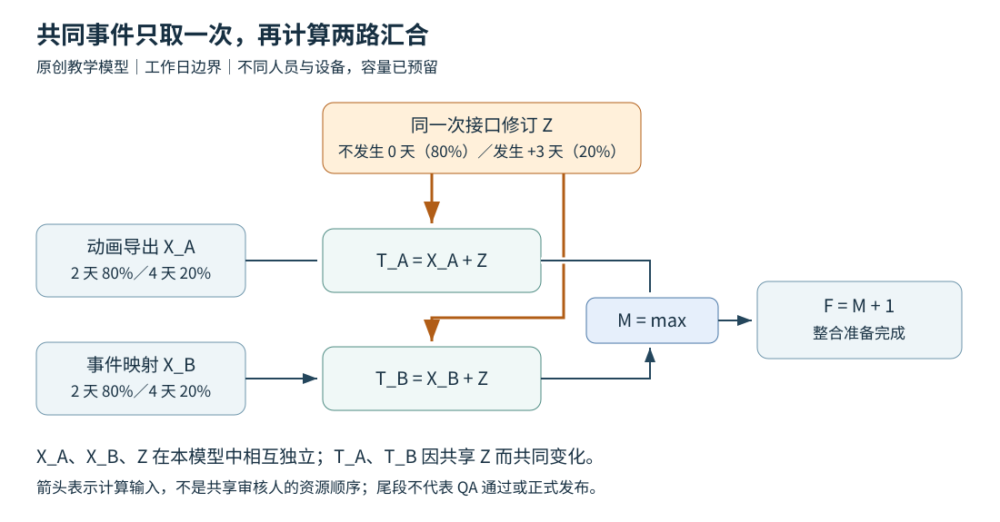
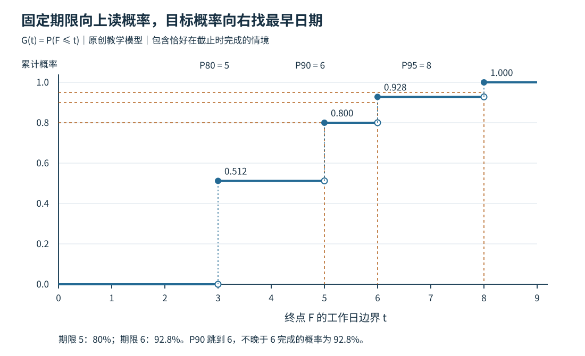

# 并行输入汇合的期限风险判断

内部训练场的候选包要等两份输入：动画导出与玩法事件映射。两位负责人都有独立的人员和设备，接入人员也已留出时间。现在的问题是：如果本周五必须把候选交给 QA，有多大机会赶上？若希望至少有九成机会，应选哪一天？如果只知道两份输入各自的完成概率，还能作什么决定？

这与“依赖关系已经排好”是不同的一步。可执行的计划说明工作怎样接上，期限风险判断还要知道这些工作可能怎样一起变快或变慢。本文面向已经明确接收条件、活动依赖和资源窗口的制作人与专业负责人，处理少量必需输入汇合的有限问题：计算固定期限的就绪概率、反查目标分位日期，以及在信息不足时给出上下界和下一行动。未解决的人员冲突、技术先后关系，应先按[小型可玩版本的依赖计划与交付判断](小型可玩版本的依赖计划与交付判断.md)建立可执行安排。

## 一、把“周五能交”改成一个明确的完成事件

先与接收人确定这次算到哪里。动画师发出文件、接入人确认文件可用、候选包生成、QA 检查通过，是不同的事件。以“全部交付”为名混用这些终点，即使概率算对，也回答了另一个问题。

本文采用以下原创教学场景。所有人员安排、时长和概率都是人为设定，没有来自真实项目的记录。

| 对象 | 到达或完成的判据 | 资源与范围 |
| --- | --- | --- |
| A：训练场动作导出 | 约定版本的骨架、动作片段与事件标记已交出；在已有输入验证场景中完成导入及命名检查，指定的动画输入接收人确认可用 | 动画师及其设备；输入检查时间已包含在到达时间内 |
| B：玩法事件映射 | 映射表和代码版本可定位，覆盖约定的命中、取消和结束事件；通过输入自查并被另一位指定的逻辑输入接收人接收 | 玩法程序及另一套设备；不需要等 A 的最终文件才制作 |
| 两路汇合 M | A、B 都满足上述接收条件 | 早到一路不能代替另一路 |
| 尾段与终点 F | 汇合后完成整合、生成候选并登记输入版本；候选交给 QA，称为“整合准备完成” | 单独的接入与构建资源，固定占用1工作日；本例假设该尾段成功，无额外排队与返工 |

本轮不计算 QA 走查通过、玩家是否理解战斗反馈或正式发布的日期。若实际问题是“周五可以开始玩家测试”，则相应功能检查、设备准备及失败后的工作也必须纳入终点；不能在整合准备后任意加一天，就声称测试条件一定达到。GAO 将测试失败引出的诊断、修复与复测作为可能新增的工作分支，而非原检查完成后自动满足的条件。[1，印刷113页]

### 时间以同一状态点和同一日历计量

令当前状态时点为 `t=0`，`T_A`、`T_B` 是两份输入从该时点算起的**可接收时刻**，不是各自开始之后的纯制作工时。两份工作都在0具备开工条件。为单独研究汇合风险，本例假设不同执行者与设备在所需的前9个工作日内都有足够容量，两路输入检查各有独立预留的人手，接入和构建资源在所有可能的尾段窗口都可用。实际项目若只能预约某个下午，就要把预约条件加入每个情境。

采用每天8小时、周末不工作的共同日历，用工作时间边界表达：从0到1是一工作日，从2到3也是一工作日。若0是无节假日的一周周一上班，完成边界5对应周五下班，6对应下周一下班。边界5之后开始的工作须等下周一上班；压缩工作时间轴不会创造周末产能。落实真实日期时，要再映射休假、节假日、时区和各资源日历。多种日历不能直接用一个整数相加。

只要所有输入都必需，汇合时刻就是其中最晚的一项。固定尾段为 `c` 时：

```text
M = max(T_A, T_B)
F = M + c
```

`max` 表示取最大值。给定终点期限 `D`，两份输入必须都在 `d = D − c` 以前到齐，其中“以前”包含恰好等于截止时刻：

```text
F ≤ D  ⇔  T_A ≤ d 且 T_B ≤ d
```

因此，期限问题是一个**共同发生的事件**。数学上，两路到达的联合累计分布是 `F_AB(a,b)=P(T_A≤a 且 T_B≤b)`；所求概率就是 `F_AB(d,d)`。[2] 这个等价关系不需要独立假设。若尾段也随机、存在预约窗口或可能失败，应在每个完整情境中继续安排尾段，再判断 `F≤D`，不能机械减去一个平均尾段。

## 二、先判断手里的信息允许算到哪一步

一次有用的风险讨论，不必从选择分布或运行模拟开始。先把现有材料分清楚：

| 已有材料 | 目前能回答什么 | 还不能自行补出的东西 |
| --- | --- | --- |
| 只有各路平均耗时 | 检查平均数的含义，识别还缺哪些变化信息 | 指定日期的概率或整组输入的 P90 |
| 同一截止下，各路各自到达的概率 | 算不依赖独立假设的联合概率上下界，见第五节 | 唯一的联合概率；另一个日期的概率 |
| 一组有依据、互不重叠且覆盖全部可能结果的联合情境及权重 | 逐情境排终点，再求期限概率与分位 | 模型以外的风险或权重可信度 |
| 一个共同事件的发生率，以及各条件下的联合情况 | 按条件分别算，再按发生率加权 | 识别出共同事件之后，剩余变化就必然独立 |
| 少量历史记录或专家意见 | 检查可比性，提出条件模型、敏感性范围和信息请求 | 不经检验就把样本频率当作当前项目的稳定真概率 |

**边际概率**是只看一份输入的概率。假如某个截止下 A、B 各有80%机会到达，只有在这两个到达事件独立时，才可相乘得到 `0.8×0.8=0.64`。对于三路以上，若要依据独立性把全部概率相乘，应确认相互独立；只核对每两路独立还不够。[3] 由不同人员做、在图上并排，均不能证明这种独立性。

这也解释了为何不能把每条路的 P80 日期取最大，就称为整组输入的 P80：在上述独立例中，这一天每条路都达到80%，整组却只有64%。我们要先形成整组终点的分布，再从中反查日期。

### 两份平均“两天”，仍然没有给出汇合日期

保留一个最小反例，先看计算顺序。假设 A、B 真正并行，各自以一半概率在1天到达、另一半在3天到达，两者独立，没有尾段：

| A 到达 | B 到达 | 联合概率 | 汇合 M |
| ---: | ---: | ---: | ---: |
| 1 | 1 | 1/4 | 1 |
| 1 | 3 | 1/4 | 3 |
| 3 | 1 | 1/4 | 3 |
| 3 | 3 | 1/4 | 3 |

每份平均都是2天，平均汇合却是 `(1+3+3+3)/4=2.5` 天。要先在每种情境里取最晚到达，再按概率求平均；提前的一份抵消不了另一份未到。这并不说明负责人估错了各自的平均值。

2.5天甚至不是本例可能出现的汇合时刻。在2.5以前到齐仍只有第一行，概率为25%。若两份输入总是同步快慢，即 `(1,1)` 与 `(3,3)` 各占一半，每份平均仍为2天，汇合平均也变为2天。因此“相关一定延长汇合”同样不成立。固定各路分布而改变快慢组合，与在各路上新增一个共同延误，是不同的比较。前例的半天差额不是通用缓冲量。

更一般地，用 `E` 表示按概率加权的平均，即数学期望。只要期望存在，每种情境的 `M` 都不小于任何一路，故 `E[M] ≥ max(E[T_A], E[T_B])`。这个不等式比较的是**同一模型中的计算顺序**，不是不同相关结构之间的快慢。对两路还可写出 `max(A,B)=(A+B+|A−B|)/2`，直接看见两路之间的差距会影响汇合平均。

## 三、把共同变化放进同一张情境表

回到训练场。现有接口约定可用于制作，但还有一次接口评审可能要求两份输入改版。为了展示方法，设定三个相互独立的随机量：

- A 的本身制作、输入检查及交接时间 `X_A`：2工作日，概率0.8；4工作日，概率0.2。
- B 的对应时间 `X_B`：同样为2工作日，概率0.8；4工作日，概率0.2。
- 同一次接口修订带来的追加延迟 `Z`：不修订时为0，概率0.8；修订时两份输入各追加3工作日，概率0.2。

这里将追加延迟简化为影响到达时刻的固定量，`T_A=X_A+Z`、`T_B=X_B+Z`。三者独立、修订对两路都恰好增加3天，均是教学条件，不能从“接口评审”这个名称推得。真实资料若显示难做的动作更容易触发修订，或两路返工幅度不同，就应改用相应的条件情境。已有工期分布若已经包含这次修订，也不能再完整加一次 `Z`。



一个完整情境只选择**一次**这项接口修订是否发生，再将其影响传给全部受影响输入。不能给 A 抽一次“本轮接口是否修订”，给 B 又独立抽一次同一事实。GAO 的共同风险建模同样要求一个风险发生时影响它所关联的多个活动。[1，印刷108、115–117页]

这与另外两种关系有明确区别：

- **技术前后依赖**：B 必须取得 A 的输出才能开始，应先排前后顺序。即使两项自身工作量独立，完成日期仍不能当作同起点的并行时间。
- **共享资源**：A、B 都需要同一个审核人逐项处理，应按该人的容量与窗口安排。给耗时设一个相关系数不会增加审核人。
- **共同变化**：两路由不同人并行制作，仍可能同时受一次规格修订影响。这才是本例 `Z` 所表达的关系。

如果两条路径有一个共同前置活动，该活动的时间也应在同一情境中只取一次，并沿两条路径共享。不要把两条完整路径当成两个无关对象重新抽取共同上游。

### 每一行先排实际终点，再加权

本例只有 `2×2×2=8` 种组合，可以精确列完，无须随机模拟。下表中前三列是原始情境，后四列按它们计算；各行概率相加为1。

| X_A | X_B | Z | 联合概率 | T_A | T_B | M | F=M+1 |
| ---: | ---: | ---: | ---: | ---: | ---: | ---: | ---: |
| 2 | 2 | 0 | 0.512 | 2 | 2 | 2 | 3 |
| 2 | 4 | 0 | 0.128 | 2 | 4 | 4 | 5 |
| 4 | 2 | 0 | 0.128 | 4 | 2 | 4 | 5 |
| 4 | 4 | 0 | 0.032 | 4 | 4 | 4 | 5 |
| 2 | 2 | 3 | 0.128 | 5 | 5 | 5 | 6 |
| 2 | 4 | 3 | 0.032 | 5 | 7 | 7 | 8 |
| 4 | 2 | 3 | 0.032 | 7 | 5 | 7 | 8 |
| 4 | 4 | 3 | 0.008 | 7 | 7 | 7 | 8 |

时间单位均为从0起算的工作日边界。第一行的权重为 `0.8×0.8×0.8=0.512`；第二行为 `0.8×0.2×0.8=0.128`。乘法来自已经写明的 `X_A、X_B、Z` 相互独立，**不是**因为 `T_A、T_B` 独立。后两者共享 `Z`，不能另将各自的边际概率相乘。

观察期限5：前四行满足，后四行全部不满足。无修订时，即使两路都用4天，尾段也能到5结束；有修订时，即使两路都快，终点也只能到6。所以：

```text
P(F≤5) = 0.512 + 0.128 + 0.128 + 0.032 = 0.8
```

观察期限6：除了前四行，还允许“修订发生，但两路本身都快”的第五行，所以 `P(F≤6)=0.8+0.128=0.928`。这个改变来自一组具体情境穿过了期限，而不是均值更接近希望日期。

也可以按共同事件分组来算。设修订发生率为 `r`，事件 `E` 表示满足选定期限，则全概率公式给出：[4]

```text
P(E) = (1−r)P(E | 未修订) + rP(E | 修订)
```

竖线表示“在已知这个条件成立时”。对期限6，未修订时成功概率为1，修订时需要两路都快，按本例的条件独立假设为 `0.8×0.8=0.64`，得到 `0.8×1+0.2×0.64=0.928`。在实际资料中，即使已知是否修订，两路还可能共同受其他因素影响；只有有依据的**条件独立**，才能把条件中的联合概率继续相乘。无条件独立与条件独立互不自动推出。[5]

## 四、用累计分布分别回答期限与分位问题

将终点相同的行合并，并从早到晚累计，得到终点 `F` 的累计分布 `G(t)=P(F≤t)`。它表示“在 t 或更早完成”的概率，不是恰好在 t 完成的概率。

| 终点 F | 恰在此时完成的概率 | 此时或以前完成的累计概率 G(F) |
| ---: | ---: | ---: |
| 3 | 0.512 | 0.512 |
| 5 | 0.288 | 0.800 |
| 6 | 0.128 | 0.928 |
| 8 | 0.072 | 1.000 |

例如 `3≤t<5` 时，累计概率一直为0.512；到 `t=5` 才包含新增的0.288，跳到0.800。不能在3与5之间连一条斜线，凭插值制造本模型不存在的完成时间。



若期限已经固定，就直接查询 `G(D)`。若需要达到目标概率 `α`，则寻找累计概率第一次达到或超过它的日期。本文采用**左分位**约定：[6，印刷4页，命题1]

```text
q_α = inf{t : G(t) ≥ α}
```

这里的 `inf` 是满足条件时间集合的下确界；对上表这种有限情境，实际操作就是从早到晚找到第一行累计概率不小于目标。于是：

- P80 为5：`G(5)=0.800`，更早的累计概率不足80%。
- P90 为6：`G(5)=0.800<0.9`，`G(6)=0.928≥0.9`。
- P95 为8：`G(6)=0.928<0.95`，要等下一跳。

P90 是模型下至少九成机会完成所对应的日期，不是保证日期，也不是“90%置信区间”。离散分布会跳过目标，所以在 P90 日期或更早完成的概率可以是92.8%，不必恰好90%。目标概率由负责人根据用途、失约代价与可选方案决定，不存在所有游戏交付一律用 P80 的默认规则。[1，印刷103、117页]

本例两路的平均到达时间均为 `2×0.8+4×0.2+3×0.2=3`，先取均值再汇合会得到终点4；逐情境计算后的终点均值则是：

```text
E[F] = 3×0.512 + 5×0.288 + 6×0.128 + 8×0.072 = 4.32
```

均值4.32、期限5的80%、P90日期6，各自回答不同问题。在均值4.32以前完成的概率仍只有51.2%。不能因为平均日期早于周五，就给周五附上九成把握。

有限情境的计算步骤可以直接在普通表格中完成：核对权重非负且总和为1；逐行按真实依赖和资源安排求终点；合并相同终点；按时间排序累加；最后查询固定期限或第一个达到目标的日期。如果不是互斥且完整的情境，先修正情境划分，不能把几个重叠的风险描述直接当成总和为1的结局表。

## 五、只有边际概率，也能给出有用的界

现在考虑另一份资料：A、B 各有80%机会在2天到达、20%在5天到达，尾段仍为1天。它与前面的共同修订模型是**不同的教学输入**。接入负责人只拿到了两份各自的分布，没有同一批交付中快慢怎样配对的信息。要判断终点期限3，必须问两路在输入期限2前同时到达的概率。

令 `E_A`、`E_B` 表示各路在输入截止前到达，边际概率为 `p_A`、`p_B`。联合成功不可能超过任何一路单独成功，因此上界为 `min(p_A,p_B)`。至少一路失败的概率不超过两路失败概率之和，所以联合成功至少为 `1−[(1−p_A)+(1−p_B)]`，负数再截为0。于是：[6，印刷24页，联合分布界]

```text
max(0, p_A+p_B−1) ≤ P(E_A 且 E_B) ≤ min(p_A,p_B)
```

这个推导只用了事件包含关系和失败概率相加的上界，没有用独立性。两路各为0.8时，终点期限3的概率在 `[0.6,0.8]` 之间。相乘得到0.64只是独立时的一种可能。

可以直接构造出边际完全相同、答案不同的联合表。令两路都快的概率为 `q`：

| A、B 到达组合 | 概率 | q=0.60 | q=0.64 | q=0.80 |
| --- | ---: | ---: | ---: | ---: |
| (2,2) | q | 0.60 | 0.64 | 0.80 |
| (2,5) | 0.8−q | 0.20 | 0.16 | 0 |
| (5,2) | 0.8−q | 0.20 | 0.16 | 0 |
| (5,5) | q−0.6 | 0 | 0.04 | 0.20 |

任何 `0.6≤q≤0.8` 都使四行非负、总和为1，并保持每份输入在2天到达的概率为0.8。只有第一行能赶上终点3，故答案恰为 `q`。这说明即使知道每条路的完整边际分布，仍未必能确定联合期限概率。

把这个界与目标比较，已经可以采取不同的行动：

- 若目标90%，上界80%仍不够，可以排除“当前这些边际下期限3达到90%”的说法，转而研究改期或真正改变输入条件的方案。
- 若目标60%，下界已达到它；在这些边际概率可信、终点与尾段条件成立时，不必再假定独立就能判断达标。
- 若目标70%，目标落在界内，资料不能区分达标与不达标。应索取联合信息，不能选中点或独立乘积作唯一答案。

这不是统计置信区间，而是在**把给定边际概率当真**时，由未知配对方式产生的范围。边际概率本身若只是估计值，它们的误差不会自动被这个范围包住。若只知道一个截止下的边际概率，也不能据此算其他截止或完整的 P90 日期。

对 n 个必需输入，同样的推导给出：

```text
max(0, Σp_i−(n−1)) ≤ P(所有输入按期到达) ≤ min_i p_i
```

在其余联合模型不变时，增加一个必需输入只会让成功事件缩小，概率不会增加，但未必严格下降。若新增输入同时导致调人、改范围或改日期，就要重新计算，不能套这个“其余不变”的比较。

这里要区分两种相关。把“在输入截止前到达”记为1、否则记为0，得到两个指示量 `I_A、I_B`。当 `0<p_A,p_B<1` 时，若另知它们的精确 Pearson 线性相关系数 `ρ_I`，就能确定该截止的联合成功概率 `q`：

```text
q = p_A p_B + ρ_I √[p_A(1−p_A)p_B(1−p_B)]
```

这是相关系数定义的直接结果：两个指示量相乘，只有两路都到达时才为1，所以乘积的平均就是 `q`；各自的平均为 `p_i`，方差为 `p_i(1−p_i)`。[6，印刷6页] 这个系数已经是额外的联合信息，不能由两个边际概率自行填出。若某路概率为0或1，相关系数因方差为0而没有定义，联合概率则由前面的上下界直接确定。

上表的完成时刻只有2天、5天两种值，可写成 `T_A=5−3I_A、T_B=5−3I_B`。两路同时作这种换算不改变相关系数。[6，印刷7页] 因而若另知两路完成时刻的精确相关系数 `ρ`，就有 `q=0.64+0.16ρ`，四格随之确定。例如 `ρ=0.5` 给出 `q=0.72`，四格依次为0.72、0.08、0.08、0.12，可以判断期限3达到70%目标；`ρ=0` 时，这两个完成时刻确实独立。这是本节完整二点分布的特性。这里说的是总体的精确系数，样本估计或一句“相关较高”不能直接当作它；输入系数还须使四格非负，与已知边际相容。

一般完成时刻有更多可能值或连续变化时，其相关系数通常不等于某一截止的指示量相关系数。即使给出完整边际分布，完成时刻的一个 Pearson 相关系数一般仍不足以确定联合分布；完成时刻零相关一般不保证独立，正相关也不保证每个截止的共同到达概率都高于独立乘积。[6，印刷8、20–22页] 若只知道单一截止的边际概率及该截止的 `ρ_I`，能确定的仍只是该截止的联合概率，不能据此反推完整到达分布或 P90。收集资料时，应说明相关算的是完成时刻还是按期与否，并保留同批配对及共同变化事件。

## 六、比较能改变期限事件的可行方案

回到共同修订主例，假设当前最关心终点期限5、目标90%。考虑两项**仍须取得依据与批准**的改动：

1. 动画工具改进若确实能使 A 的本身时间总为2天，而 B、共同修订、接收条件和资源安排不变。
2. 接口方案提前澄清若确实能把共同修订发生率从0.2降到0.1，而其他条件不变。

将这些改变放回完整情境，重新汇合和累计，得到：

| 条件方案 | 平均终点 | P(F≤5) | P(F≤6) | P90 日期 | P95 日期 |
| --- | ---: | ---: | ---: | ---: | ---: |
| 原模型 | 4.32 | 0.800 | 0.928 | 6 | 8 |
| A 本身时间恒为2 | 4.00 | 0.800 | 0.960 | 6 | 6 |
| 修订发生率降为0.1 | 4.02 | 0.900 | 0.964 | 5 | 6 |

A 的改进让平均完成更早，也改善期限6及 P95，却没有提高期限5的机会。原因很具体：未修订时本来就全部能赶上5；修订发生时，即使 A 已最快，两路最早也要到5齐，固定尾段仍到6。没有情境因这项改进跨过期限5。

第二项改动改变了期限5真正依赖的事件。在本例中 `P(F≤5)=1−r`，将 `r` 降为0.1才变成90%。但“在表里把0.2改成0.1”不是缓解措施。需要接口负责人解释什么决定或验证工作减少了修订可能、覆盖哪些未决问题、依据是什么；还要排进这项工作的人员、持续时间、交接和副作用。如果它先占去一天并把制作整体推迟，表中的结果就不再适用。工具改进也一样，开发与部署成本不能凭空消失。

GAO 将风险与总工期的相关排名视为分析线索，而不视为缓解收益；实际优先级还要比较风险变化后的目标日期与代价。[1，印刷110–113页] 对小型汇合，除了看平均值，至少同时看决策期限的概率、所需分位日期，以及实施该方案会改变的资源与接收条件。选择了一项改动后再比较下一项，不能把各自相对原模型算出的收益简单相加。

如果不改工作，只将候选交付从期限5改为6，原模型的就绪概率由80%升到92.8%。这不是提高了生产效率，而是接受了较晚的候选；对应的 QA 和接收窗口仍须重新确认。若通过暂缓一份输入提高了概率，交付范围也已经改变，必须由有权的人确认它是否仍回答本轮问题。

### 发生率不确定时，找出会改变决定的门槛

假如接口负责人只能提出 `0.1≤r≤0.3` 的情境范围，没有依据选一个精确值，对期限6可写成：

```text
P(F≤6) = (1−r)×1 + r×0.64 = 1−0.36r
```

因此结果在0.892至0.964之间，90%落在范围内部。将 `r=0.2` 代入虽然得到92.8%，却不能用中点掩盖这项不确定性。这里的范围是对输入假设的敏感性结果，也不是统计置信区间。

更有用的是解出达标条件：`1−0.36r≥0.9`，即 `r≤5/18≈0.2778`。现在信息请求有了明确对象：“请接口负责人核对这批剩余未决项，现有证据是否足以支持本轮修订发生率不高于约27.8%；若不能，能否通过已排定的评审减少不确定性，或应改候选日期？”不应要求负责人为了通过这个门槛而报出更小的数。若连发生率范围都无依据，则保留修订与未修订的条件结果，不给加权总概率。

## 七、少量记录怎样进入判断，而不被当成保证

概率输入应能追到具体工作与条件。GAO 要求风险数据来自对工作负责者及相关专家的评估，并反对随意给工期增加百分比。[1，印刷105–106页] 对这里的小型交付，可以围绕以下几项收集资料：

- **先对齐完成含义。** 历史“动画完成”是否也含导入检查和接收，还是只记首次发出？失败后重交是否算在同一次到达里？
- **保留同一轮的配对。** 记录交付批次、同一起点、A 和 B 的可接收时刻、共同规格版本与事件。分开打乱两组历史耗时会消除原有的共同变化。
- **检查工作与容量是否可比。** 内容规模、技能、工具、资源窗口、外部等待、允许占位范围是否与本轮相似？已知不同的情况应分条件分析，而不是混成一个平均数。
- **留下尚未完成的记录。** 只收集成功或按时的交付，会系统性遗漏慢的一端。尚未完成只说明其到达晚于当前观察点，不等于已经以当前历时完成。
- **区分意见与测量。** 专家给出的三点时长、发生率或区间应注明提供者、依据和适用范围。它们可以支持条件分析，但填写了百分比不意味着经过历史校准。

例如六次同类记录都按期，也不能仅据此宣布当前交付有至少90%机会成功。即使额外假设各次独立、成功概率固定为0.7，连续六次成功仍有 `0.7⁶=0.117649` 的概率。这个反例只说明六次全成功没有排除明显低于90%的可能，不是在为真实项目估计0.7。

要由样本推断概率，还需说明抽样、独立性和过程稳定性，并采用适合的统计方法。NIST 对小样本或极少失败数提醒，常见的对称正态近似区间可能不够准确。[7] 本文不以六条记录拟合分布，也不把一次经验分位数称为带置信保证的日期。历史数据不足时，明确给出条件结果、可能范围及最值得补的资料，比输出看似精确的 P90 更有用。

### 更新判断时，更新的是剩余条件

状态变化后应记录已经发生的事实，并重算未完成部分。若现在已知修订发生，`Z=3` 是本轮事实，不应再以20%混合“可能没发生”；此时在原模型其他条件保持不变的情况下，终点只能为6或8，到6完成的条件概率为64%。若 A 已经接收，之后不再让它随机迟到。若 B 已经过了原来“快”的完成时点仍未交出，也不能重新从0抽一次原分布。

已知 A 的到达时刻，也可能改变对共同事件及 B 的判断。若原联合模型仍适用，应保留符合事实的情境，并将它们的权重除以其总和，使条件概率重新合计为1；不能只固定 A，却照用 B 原来的无条件分布。若实际出现了原表未包括的结果，则须补充诊断和新的条件估计。

更新应向执行者取得剩余工作和新窗口，再用符合已知事实的条件情境继续计算。旧模型中的完成记录、未决风险与原计划保留，新的概率绑定新的状态时点。重大规格变化、资源挪动或新发现的失败工作，都是重新判断的理由。[1，印刷119页]

## 八、把结果写成一个能执行的决定

使用这套方法时，最后的交付应是一项明确判断，而不是一张只有 P80、P90 的图：

1. 写出接收终点、全部必需输入、状态时点、时间日历、固定尾段及其成功条件。
2. 说明输入材料是什么：联合情境、条件事件、边际概率，还是只有不足以加权的意见。
3. 逐情境求终点，或在仅有边际时求界；报告固定期限概率和真正需要的目标分位，避免用均值代替。
4. 针对期限比较可行改变，并把成本、资源、范围及未确认条件一起交给有权的人。
5. 留下一项有对象、负责人和复核时点的信息请求或行动，在条件变化后重算剩余部分。

对训练场主例，一份条件判断可以是：“在给定输入模型及资源窗口下，周五整合准备完成的概率为80%，未达到本轮90%目标；保持工作条件并改到下周一，模型结果为92.8%。请交付负责人选择日期，并确认 QA 的新窗口。若仍要求周五，请接口负责人在下一次排期决定前提交可实施的风险处理方案及依据，重新计算后再决定。”

若只取得第五节那样的边际信息，就应改写为：“当前期限概率只能确定在60%至80%；70%目标尚不能判断。请两位输入负责人按同一交付批次补充配对记录，并确认是否受同一规格变化影响；在取得资料前保留这个区间。”如果新信息无法及时取得，有权的人仍可在范围、日期与成本之间决定，但不能将未识别的概率写成已证明达标。

这样，期限风险分析才接回制作工作：先确定需要什么，再看哪些情境能把它按期交到接收者手里，最后决定改变什么或先弄清什么。概率计算提供判断依据，不能替代专业接收责任或承诺权限。

## 相关知识

- [小型可玩版本的依赖计划与交付判断](小型可玩版本的依赖计划与交付判断.md)：建立活动、输入关系与资源可行安排，处理变化和已发生的工作。
- [制作人如何协调任务依赖与交付](../岗位与协作/制作人如何协调任务依赖与交付.md)：目标、跨专业接收、范围取舍与决定权限。

## 复现材料

正文已经给出全部教学条件、联合表、公式和关键计算。[原始输入](../../../../管理档案/研究/TASK-2026-0298/复现/case-data.json)、[Python 标准库程序](../../../../管理档案/研究/TASK-2026-0298/复现/reproduce_case.py)与[真实运行输出](../../../../管理档案/研究/TASK-2026-0298/复现/results.json)用于复算主例、两项条件方案、边际配对和旧均值反例。两幅图由同一程序生成，表示原创模型，不转载外部来源图。

[运行说明](../../../../管理档案/研究/TASK-2026-0298/复现/README.md)列出隔离输出方式与验证范围。程序进行有限情境的精确有理数枚举，没有随机抽样，也没有实施真实游戏项目或验证参数的预测效果。

## 参考资料

[1] U.S. Government Accountability Office. [*Schedule Assessment Guide: Best Practices for Project Schedules*, GAO-16-89G](https://www.gao.gov/assets/gao-16-89g.pdf). 2015年12月。印刷100–103页：汇合、期限及累计概率；105–106页：风险数据；108、115–117页：共同风险；110–113页：缓解比较及失败分支；117、119页：目标概率与更新。指南用于核对方法条件，其公共项目案例与数值不是游戏团队数据。

[2] Hossein Pishro-Nik. [*Introduction to Probability, Statistics, and Random Processes*, §5.1.2 Joint Cumulative Distribution Function](https://www.probabilitycourse.com/chapter5/5_1_2_joint_cdf.php). Kappa Research LLC, 2014，作者开放教材；访问于2026-11-06。联合累计分布的交集事件定义。本文据此推导汇合事件的等价表达。

[3] Hossein Pishro-Nik. [同书 §1.4.1 Independence](https://www.probabilitycourse.com/chapter1/1_4_1_independence.php). 2014；访问于2026-11-06。两事件独立与三事件、n事件的相互独立条件。教材不提供本文游戏工作的独立性证据。

[4] Hossein Pishro-Nik. [同书 §1.4.2 Law of Total Probability](https://www.probabilitycourse.com/chapter1/1_4_2_total_probability.php). 2014；访问于2026-11-06。按互斥且完整条件加权的公式。

[5] Hossein Pishro-Nik. [同书 §1.4.4 Conditional Independence](https://www.probabilitycourse.com/chapter1/1_4_4_conditional_independence.php). 2014；访问于2026-11-06。定义式(1.8)及条件独立与无条件独立不互相蕴含的说明。

[6] Paul Embrechts, Alexander McNeil, Daniel Straumann. [*Correlation and Dependency in Risk Management: Properties and Pitfalls*](https://people.math.ethz.ch/~embrecht/ftp/pitfalls.pdf). 所用原作者稿日期为1998年11月，共37页。印刷4页命题1：左分位；6–8页：线性相关定义、换算性质与局限；20–22页：正依赖概念及边际与相关不足以一般确定联合分布；24页定理4证明中的 Fréchet 联合分布界。本文只使用概率定义与界，并给出固定期限事件的初等推导，不采用其金融参数或风险决策制度。

[7] NIST/SEMATECH. [*e-Handbook of Statistical Methods*, §7.2.4.1 Confidence Intervals](https://www.itl.nist.gov/div898/handbook/prc/section2/prc241.htm). 访问于2026-11-06。Exact Intervals for Small Numbers of Failures and/or Small Sample Sizes 段落。仅用于说明小样本比例推断需要合适的方法，本文没有实施置信区间估计。

[返回交付计划专题](README.md)
