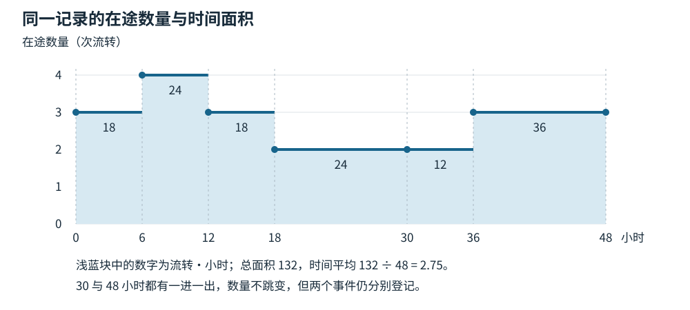
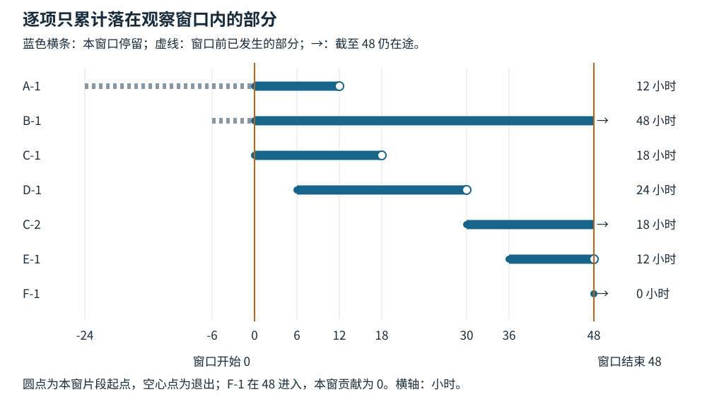

# 有限观察窗口中的在途数量与完成时间

接入周报写着：过去48小时成功完成3项，完成项平均用了24小时。把完成率乘以平均耗时，得到 `3 ÷ 48 × 24 = 1.5项`。另一张按状态历史计算的表，却说平均有2.75项留在流程里。期末看板上还剩3项。这三个数量可以同时正确：它们分别使用了完成样本、整段数量变化和一个时刻的状态。

要解释差异，需要回到工作何时真正进入、何时真正退出，以及观察开始前和结束后各截掉了什么。本文用一份原创的关卡音频接入记录，完成从事件到报表的计算。读者只需会读时间表和做加减乘除，不必先学排队论。所有工单、候选版本、时间与人员投入都是教学设定，不是工作室实践数据。

## 先约定一项工作是什么，什么时候仍在流程内

本例的交付对象是一个**关卡音频触发包**：约定的一组音频事件、对应关卡对象及触发和复位规则。音频文件本身、程序子任务和父级关卡需求不另算一项。一个包可以包含多份文件，也可以需要多人配合。

流程入口是接入负责人确认材料与要求齐备，正式接收该包。创建需求、上传文件或开始画任务卡，都不自动等于进入。入口前尚未被接收的需求属于另一份积压记录。接收后才发现的新缺口可能产生内部等待，但不回改最初的接收时间。

成功出口需要同时满足：指定候选已经包含该包；约定的触发、复位检查有可定位的结果，没有缺失事件或音频库引用；接入负责人接受这些结果。仅提交修改、完成本地检查或把工单改成绿色，都不足以构成这个出口。这里的成功只覆盖接入约定，不代表整个关卡的声音品质、玩家体验或发行条件已经通过。

接收之后，处理中、等设计确认、等构建和内部退回修改，都仍在这条流程内。若负责人正式取消本次接入，流程不再承担该次交付，则记为一次**取消退出**，与成功完成分开。取消后重新接收同一个包，使用新的流转编号。

因此要同时保存两个身份：工单号识别工作对象，流转编号识别一次连续的流程经历。例如 AUD-43 的第一次经历是 C-1，取消后再次接收是 C-2。内部退回不换编号；真正退出之后重新接收才换。下文的“项”指一次这样的流转，完成次数也不能未经核对就改称不同资产的数量。

这些记账关系不要求每项工作等大。小音效包和大音效包都可以各计一项；但如果要比较两周的生产率，包的规模、风险和构成变化就会影响解释。把一个包拆成三张子单后完成数增加，不能直接称为效率提升。发生拆分、合并或改计数单位时，应先重建明确的对象关系，或分开报告，不能把新旧单位混算成连续趋势。[1]

## 把窗口、事件和快照放在同一时间轴上

观察从周一09:00到周三09:00，共48个**自然小时**。为便于复算，将起点记为0，终点记为48；负数表示起点以前。完整时间原点为2026年6月1日09:00，时区 UTC+08:00。夜间、午休和等构建时，公共时钟都继续走。

一次流转从进入时刻 `s` 到退出时刻 `e` 占据 `[s,e)`：进入就计入，退出就不再计入。方括号表示包含进入瞬间，圆括号表示不包含退出瞬间。期初、期末快照都取**该时刻全部事件处理之后**的状态；本期进入、退出数统计 `(0,48]`，即不含0，包含48。

这套约定意味着：恰在0进入的工作已经包含在期初快照中，不再算本期新增；恰在0退出的工作不在期初快照里，也不算本期退出。恰在48进入的工作算本期进入且在期末在途，但本窗口尚未为它累计正的停留时间。恰在48退出的工作算本期退出，不在期末在途。边界瞬间没有长度，不改变面积，却会改变事件应记在哪一期。

六张工单对应城门开启（A／AUD-41）、祭坛（B／AUD-42）、支线门开启（C／AUD-43）、升降台（D／AUD-44）、检查点复活（E／AUD-45）和战斗结束（F／AUD-46）的触发包。接收与状态记录如下。C 的两次接收对应同一个包，没有发生拆包或合包。

| 时刻（小时） | 实际记录 | 对在途数量的影响 |
|---:|---|---:|
| -24 | 接收城门包，建立 A-1 | +1 |
| -6 | 接收祭坛包，建立 B-1 | +1 |
| 0 | 接收支线门包，建立 C-1；随后取得期初快照 | +1，纳入期初 |
| 4 | A-1 提交后等候构建 | 0 |
| 6 | 接收升降台包，建立 D-1 | +1 |
| 8 | B-1 等待设计确认重复触发规则 | 0 |
| 12 | A-1 在候选 C17 的检查被接受，成功退出 | -1 |
| 16 | D-1 检查发现复位时未停止旧事件，内部退回 | 0 |
| 18 | 支线暂撤，负责人取消 C-1，本次接入正式退出 | -1 |
| 20 | D-1 修复后重新提交，等候构建 | 0 |
| 30 | D-1 在候选 C18 的检查被接受；同时支线恢复，重新接收原包为 C-2 | 一出一进，合计0 |
| 36 | 接收检查点包，建立 E-1 | +1 |
| 40 | C-2 提交后等候构建 | 0 |
| 48 | E-1 在候选 C20 的检查被接受；同时接收战斗结束包为 F-1；随后取得期末快照 | 一出一进，合计0 |

期初快照是 A-1、B-1、C-1，共3项。期末快照是 B-1、C-2、F-1，也为3项；已确认三项截至48仍在途。这里的“仍在途”是已核实的状态，不能仅凭退出字段为空就认定。若日志缺了一次退出，空值可能表示记录缺失，而不是工作未完成。

## 按事件之间的持续时间，计算平均在途

从期初3项出发，按时间先后合并同一时刻的进入和退出。两个事件时刻之间，在途数量不变。每一段用“数量乘这段持续的小时数”，再把所有段相加。

| 时间段 | 持续小时数 | 该段在途项数 | 数量乘时间（项·小时） |
|---|---:|---:|---:|
| `[0,6)` | 6 | 3 | 18 |
| `[6,12)` | 6 | 4 | 24 |
| `[12,18)` | 6 | 3 | 18 |
| `[18,30)` | 12 | 2 | 24 |
| `[30,36)` | 6 | 2 | 12 |
| `[36,48)` | 12 | 3 | 36 |
| 合计 | 48 | — | **132** |

30时刻的数量仍为2，但应保留“一出一进”两条记录。只保存数量净变化，会丢失真实流量。48时刻同样如此。

横轴是时间，纵轴是在途项数。每一块的宽度乘高度就是这一段的“项·小时”，合起来称为数量曲线下的面积。记总面积为 `H`，观察长度为 `T`，**时间平均在途数量**为：

`L = H ÷ T = 132项·小时 ÷ 48小时 = 2.75项。`

它的意思是，这48小时内的在途数量按各自持续时间加权后，平均为2.75项。它不是出现过一张“2.75项”的看板，也不是期末3项，更不是2.75个人一直工作。

不要把事件后的七次数量 `3、4、3、2、2、3、3` 直接取算术平均。它们代表的持续时间不同，终点快照本身还没有持续时间。这样得到的 `20/7` 只是七次取样的平均，不是本窗口的时间平均。完整事件能让我们计算每一段；零散截图则未必能恢复截图之间发生了什么。

## 换个方向相加：每项在窗口里待了多久

同一份面积还可以沿着每项工作来数。A-1 从-24开始，完整经历有36小时，但落在本窗口里的只有0到12，共12小时。B-1 到48仍未退出，在本窗口贡献48小时；未来何时完成并不影响这48小时已经发生的记录。

| 流转 | 真实进入 | 退出或截止状态 | 本窗口停留 | 本期退出的完整耗时 | 期末在途年龄 |
|---|---:|---|---:|---:|---:|
| A-1 | -24 | 12成功退出 | 12 | 36 | — |
| B-1 | -6 | 截至48仍在途 | 48 | — | 54 |
| C-1 | 0 | 18取消退出 | 18 | 18，取消 | — |
| D-1 | 6 | 30成功退出 | 24 | 24 | — |
| C-2 | 30 | 截至48仍在途 | 18 | — | 18 |
| E-1 | 36 | 48成功退出 | 12 | 12 | — |
| F-1 | 48 | 截至48仍在途 | 0 | — | 0 |

表中时间单位均为自然小时。“年龄”指从本次真实进入到观察截止已经过去的时间，不是距离完成还剩多久。B-1 的本窗停留48小时、当前年龄54小时，都不是其最终完整耗时。

对任意窗口起点 `a`、终点 `b`，要求 `b>a`，窗口长度 `T=b−a`。一项从 `sᵢ` 进入、在 `eᵢ` 退出，其窗口停留 `hᵢ` 为：

`hᵢ = max(0, min(eᵢ,b) − max(sᵢ,a))。`

也就是取“较早的终点”减去“较晚的起点”，没有重叠时记0。对于**已确认截至b仍未退出**的项，只把本次累计的右端截到b；不为它填写一个未来退出日期。例如 C-2 是 `48−30=18`，F-1 是 `48−48=0`。

逐项累计得到：

`H = Σhᵢ = 12 + 48 + 18 + 24 + 18 + 12 + 0 = 132项·小时。`

这里 `Σ` 表示把各项相加，每项的小时数乘以1项。为什么它一定与前一节的面积相同？在途中的一项每停留一小时，就为总数量贡献一个“项·小时”。先按时间段分组，或先按工作项分组，都是把同一批小块重新排列。这也是 Little 在有限记录中解释数量与停留关系的核心理由。[1]

实际做表时，可以先用期初快照与事件计算面积，再用各项区间计算一次。两者不同，应检查漏项、边界处理、重复事件和时间换算；两者相同，只证明这份输入的两种加法一致，还没有证明输入中的“一项”或“退出”定义正确。

## 进入、全部退出和成功完成，分别回答不同问题

本期 `(0,48]` 进入的是 D-1、C-2、E-1、F-1，共4次；退出的是 A-1、C-1、D-1、E-1，共4次，其中成功3次、取消1次。C-1 在0的接收已在期初，不能再加一次。

设进入数为 `I`，全部退出数为 `O`，初末在途数量分别为 `n(a)`、`n(b)`，就应满足：

`n(b) = n(a) + I − O；本例为 3 = 3 + 4 − 4。`

| 要回答的问题 | 本例数量 | 除以48小时后的速率 |
|---|---:|---:|
| 本期接收了多少次流转 | 4 | 4/48 = 1/12 次/小时 |
| 本期有多少次流转离开流程 | 4 | 4/48 = 1/12 次/小时 |
| 其中成功接受了多少次 | 3 | 3/48 = 1/16 次/小时 |
| 其中取消了多少次 | 1 | 1/48 次/小时 |

数量守恒使用全部退出。若拿成功数3代替退出数4，会算成期末应有4项；差的那一项是取消，不是“漏做的交付”。反过来，把全部退出数4称为成功产出，也会夸大交付。

成功完成项的完整耗时是 A-1 的36、D-1 的24、E-1 的12小时。因此，**本期成功完成样本的平均完整耗时**是 `(36+24+12)/3 = 24小时`。它包含接收后的等待，也包含 A-1 在窗口开始前的24小时。取消的 C-1 不进入这个成功平均，未完的 B-1、C-2、F-1 也不进入。

若关心所有退出，包括取消，则完整耗时总和为 `36+18+24+12=90项·小时`，平均为 `90/4=22.5小时`。两个平均值都可以报告，但名称必须说明样本是谁。

### 相邻窗口怎样衔接

把同一记录分成0至30、30至48两段，第一段的期间事件是 `(0,30]`，第二段是 `(30,48]`。30时刻 D-1 退出和 C-2 进入只计入第一段；第二段从已处理完这两件事的快照开始，初始在途为 B-1、C-2。

第一段进入2、退出3，期末2项，面积84项·小时；第二段进入2、退出1，期末3项，面积48项·小时。进入、退出和面积相加，分别恢复整段的4、4、132。平均数量则应按30与18小时加权，不能把两个窗口的平均值简单取平均。若某项恰在第二段的起点退出，它已经不在该段初始快照中，退出事件也不再重复计一次。

## 报表差异来自两端年龄，而不只来自期末未完

只把完成项的完整耗时相加，会纳入一部分窗口之前的时间，却漏掉期末仍在途的时间。我们可以把这两边放回同一份账。

定义三个总量，单位都是“项·小时”：

- `Q退出`：本期**全部退出项**从真实进入到退出的完整耗时之和，取消也包括在内。
- `B初`：期初仍在途的各项，在窗口开始前已经累计的年龄之和。
- `B末`：期末仍在途的各项，截至窗口结束已经累计的年龄之和。

期初的年龄，加上本期新累计的停留，最终分为两部分：已经退出的项带走其完整耗时，剩余项把年龄留到期末。逐项相加就是：

`B初 + H = Q退出 + B末`，因此 **`H = Q退出 + B末 − B初`**。

这是本文依据逐项停留作出的双边界记账推导，不是 Little 原文直接列出的公式。它要求所用流转身份一致，并知道计算全年龄与完整耗时所需的真实进入时刻。

本例期初年龄为 A-1 的24、B-1 的6和 C-1 的0，总计30。期末年龄为 B-1 的54、C-2 的18和 F-1 的0，总计72。因此：

`90 + 72 − 30 = 132项·小时。`

初末数量同为3项，并没有让边界影响抵消。3个对象不能告诉我们它们已经各待了多久；真正需要比较的是年龄总和30与72。

当 `O>0` 时，把公式除以窗口长度，可以写成：

`L = (全部退出数/T) × (全部退出项的平均完整耗时) + (B末−B初)/T。`

所以全部退出率乘22.5小时得到的 `90/48=1.875项`，还要加上边界年龄差 `42/48=0.875项`，才能得到2.75项。开篇采用的成功完成平均连取消也没有包括，完整对账是：

`1.5（成功完整耗时/48） + 0.375（取消完整耗时/48） + 0.875（边界年龄差/48） = 2.75项。`

**完成率乘完整耗时也可能偏高。** 假设只把 A-1 的历史进入从-24改成-96，窗口内的所有事件保持原样。数量曲线和面积仍为132，平均在途仍是2.75；但 A-1 完整耗时变为108小时，成功样本平均变为48小时，成功率乘它得到3项，反而高于2.75。此时期初年龄总和是102，期末仍为72，全部退出完整耗时总和162，仍有 `162+72−102=132`。

两端年龄总和相等时，这个边界修正才为零；两端都空是充分条件，却不是必要条件。即使某次恰好算得相等，也不能据此断定所有口径正确。若 `O=0`，退出完整耗时总和可以是0，但“退出项平均耗时”没有样本，不能把 `0×未定义的平均` 当作计算在途面积的方法。

## Little 的有限窗口关系，到底用了哪一批项目

常见的 `L=λW` 中，`L` 是时间平均数量，`λ` 是按相应计数定义的每单位时间数量，`W` 是同一批项目的平均停留。三个符号不是让人从任意三张表中各取一个数。Little 的2011年回顾先给出两端为空的有限记录，再讨论两端允许留有项目的情况。[1]

对于后一种情况，原文 LL.2 的 `S(T)` 包含**期初已经在系统中的项目，加上截至终点的累计到达**。按本文的端点约定，这个计数是：

`S = n(a) + I = 3 + 4 = 7次流转。`

它包括 C-1、C-2 两次经历，也包括恰在48进入、本窗停留为0的 F-1。在 `S>0` 时，用同一份窗口面积定义：

`窗口所涉流转的平均本窗停留 = H/S = 132/7小时`；

`(S/T) × (H/S) = (7/48) × (132/7) = 2.75项。`

这里 `S/T` 既不是本期新增率 `4/48`，也不是成功完成率 `3/48`；`H/S` 也不是已经完成项的24小时，更不是这7次流转最终会经历的平均完整耗时。它平均的是这批流转**在本窗口里累计的部分**。Little 随即提醒，代数相容之后，仍要判断这样的模型是否回答了使用者真正想问的问题。[1]

制作报告可以保留“平均在途”“成功完成平均”“未完当前年龄”等有用名称，无须强迫它们组成同一个乘积。有限、已发生记录的面积记账不要求工作流长期稳定，也不要求先来先服务或先等看板清空；这些条件并未用于上述逐项相加。[1] 未来预测则需要额外的数据和判断，不能从这次等式自动得到。

## 缺少数据时，保留还能计算的部分

正式计算前，先检查期初身份清单、入口和出口事件是否完整，时间是否能换到同一时区与公共尺度，同一流转是否重复出现，期末实际状态是否与按事件推算的状态相符。相同事件被多次导出时，应核对事件身份再去重；只按工单号去重会把 C-2 的真实再次接收一起删掉。

数据不完整，不一定意味着整张报表都作废，也不意味着可以把缺失字段填成0。

| 已有记录 | 仍能计算什么 | 应留下什么空缺 |
|---|---|---|
| 知道期初 A-1、B-1、C-1 在途，之后事件完整，但 A-1、B-1 的真实进入时间丢失 | 本窗事件面积132、平均2.75、进入4、退出4、成功3，以及各项本窗停留 | A-1 的完整耗时、B-1 的当前年龄及两端年龄总和不可得；全部3个成功样本的完整平均不可得 |
| 只剩 B-1 一项，已知从-6进入，整个48小时均在途，无任何退出 | 面积48、平均1、期末年龄54，期间退出数0 | 没有完成耗时样本，不能把完成平均填为0 |
| 窗口全程为空且事件完整 | 面积0、平均在途0、各流量0 | 没有观察到任何一项的耗时，逐项平均仍无样本 |
| 仅有起止快照，没有中间完整事件 | 快照时刻的身份和数量 | 通常不能精确得到期间流量和面积 |
| 退出字段为空，却未确认期末实际状态 | 可保留已经确认的事件 | 不能把未知状态当成未完；受影响时间段的精确数量面积也未确定 |

第一行中，A-1 本窗12小时仍可从初始存在与12时刻退出算出；只是不能把起点0冒充它的真实进入。D-1、E-1 的完整耗时仍已知，二者平均18小时可以标为“已知完整时长的2个成功样本”，不能悄悄替代全部3个成功样本的平均。

快照为什么不够？设另一份教学记录在0时刻只看到 P，在48时刻只看到 Q。可能是 P 在24退出、Q 在24进入，全程都有1项，面积48；也可能是 P 在6退出、Q 在42进入，中间空了36小时，面积只有12。起止身份与数量完全一样，答案却不同。若决定插值或抽样估算，应明确这是另一个估计方法及其假设，不能把结果写成由完整事件算出的精确值。

还有一种错误不会被加法发现：把 C-1 和 C-2 错并成0到48的一条连续流转。这会把18到30期间已取消、不在流程内的12小时也加进去，算出面积144、平均3；按错误区间求和和按错误事件求面积仍能一致，甚至数量守恒也能成立。要识别它，必须回查取消和重新接收的事实。**两种算法相等，是计算核对，不是流程含义的认证。**

## 流程时间、人时和后来扩大的窗口，不要相互代替

本例另外给出一组独立的人工投入记录：窗口内 A-1 投入2人时，B-1 为3，C-1 为1.5，D-1 为4，C-2 为2，E-1 为2.5，F-1 为0，共15人时。它与132项·小时记录的是不同东西：前者累计人的实际投入，后者累计工作留在流程里的时间。

B-1 在8时刻开始等设计确认，到48仍未等到，跨夜持续了40个自然小时。这不等于设计人员连续投入40小时，更不等于还需要40小时。缺少人员可用日历、其他工作和具体阻塞原因时，不能由平均在途2.75判断人员忙闲或该加几个人。

若团队要改用公共工作时间，例如只累计某条统一日历的工作小时，那么窗口长度、所有停留、各段面积和速率分母都要使用这同一时钟。不能用48自然小时作分母，却把等待中的夜间从耗时中删掉；每个人不同的工时也不能替代一条公共时间轴。

后来取得新记录，可以**事后另算更长窗口**。例如确实继续观察到60时刻，确认48到60没有新进入，B-1、C-2、F-1 都恰在60成功退出，则新增面积为 `3×12=36`，0到60的面积为168，平均在途为 `168/60=2.8`。这不改写原来0到48的2.75，也不说明48时刻已经能知道三项会在60完成。更长窗口仍有原来的期初年龄30，不能因为期末清空就忘记起点以前的经历。

## 把核对结果变成一次可行动的沟通

对本例接入负责人，可以给出这样的报告：

> 本次统计音频触发包从正式接收到指定候选接入检查被接受，取消单列，等待和内部退回仍计在途。周一09:00至周三09:00的48自然小时内，期初3项，接收4次，退出4次，其中成功3次、取消1次，期末3项。累计132项·小时，平均在途2.75项；成功完成样本的完整平均为24小时，不能替代未完项的最终耗时。期末 B-1、C-2、F-1 的本窗停留分别为48、18、0小时，当前年龄分别为54、18、0小时。B-1 需要确认重复触发规则由谁决定、何时给出；C-2 需要确认已提交资源将进入哪份候选、由谁接收检查；F-1 刚被接收，继续按同一边界记录。本窗人工投入另记15人时。

这份报告把需要追问的对象落到了具体流转上。B-1 等待较久，是进一步核查的线索，不足以单独证明设计岗位是整条流程的瓶颈。若要比较下一期，先确认接收范围、取消政策、包的构成和记录完整性没有改变，再讨论数量与等待为何变化。

历史平均也不给出某一项何时完成、整个版本何时交齐，或把在途上限减半就能快一倍。具体交付计划还要检查依赖、人员日历和接收条件；多个并行输入何时汇合，又涉及各自变化如何共同发生。这里的等式为记录提供约束，不替团队选择干预、排定资源或作出日期承诺。[1]

## 复现材料

[教学记录与复算说明](../../../../管理档案/研究/TASK-2026-0297/复现/README.md)包含原始输入、标准库 Python 程序和两幅原创 SVG。程序分别计算事件面积与逐项停留，复算双边界年龄及文中的数据变化。核心定义与计算均在正文，附件用于复现这些数字，不是学习本方法的必经前置材料。

## 参考资料

[1] John D. C. Little. *Little’s Law as Viewed on Its 50th Anniversary*. Operations Research, 59(3), 536–549, 2011. DOI：[10.1287/opre.1110.0940](https://doi.org/10.1287/opre.1110.0940)。[大学托管的原作者论文副本](https://people.cs.umass.edu/~emery/classes/cmpsci691st/readings/OS/Littles-Law-50-Years-Later.pdf)。本文采用§2.1.1–2.1.4（印刷537–538页）的计数对象、有限窗口面积和不同平均；§2.2.1–2.2.3（538–540页）的边界非空及 LL.2 定义；§2.3（540页）的应用与管理判断范围。游戏记录、端点记账安排、双边界年龄推导和复算图由本文构造，不是该论文报告的游戏案例。

[返回流程度量专题](README.md)
