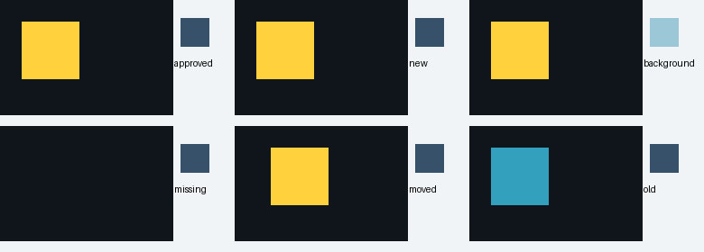

# HUD 截图回归：从画面采集到基线审批

一个冷却图标完全消失，截图测试却是绿的。也可能刚好相反：图标没动，背后的水面变化让 CI 报红。调全屏阈值只能决定允许多少像素变化，不能说明变化发生在哪儿，也不能证明截图里曾经有图标。对负责游戏 UI 的 QA 和程序，实用的顺序是：先证明采到了要测的画面，再给不同风险选比较区域，最后核对用来判定的参考图。

## 用一次肯定会变的画面验证采集

在固定构建和设备上加载同一个场景，固定分辨率、显示缩放、安全区与 HUD 状态。选一个醒目的测试标记，让它随真正的 HUD 路径绘制（例如在目标 Widget 内加一个小方块，不是在截完图后给 PNG 加标记）。分别打开和关闭，按实际回归入口各取一张原始截图。先确认两张是否包含完整 HUD，且标记确实出现和消失，再看差异统计。拿不到应有的变化时，这是测试准备失败，应检查采集层、实际帧和状态，不能把结果算作 HUD 通过。

例如 Unreal 的普通 Take Automation Screenshot 节点不采集 UI。官方文档另列了用于 UI 画面的 Functional UI Screenshot Test，以及 Take Automation Screenshot Of UI 节点。[1][2] 仍应检查本项目截图里的目标层，而不是从节点名称推断所有覆盖层都会进入截图。取图应关联目标状态，例如确认该状态的界面已经渲染；在转场或异步更新中，固定多等一帧可能仍抓到上一个状态。若要验证闪帧或过渡过程，另做多帧观察，不拿静态基准替代。

## 同样的全屏差异，可能是两种不同的结果

以下用原创合成 PNG 说明比较的机制，不模拟抗锯齿、动画或设备差异。画面为 1280×720，图标是 32×32 的黄色方块。固定裁切框覆盖 HUD 面板，大小 96×64，且不会随图标移动。比较按同一位置的 RGB 值是否相等计数。

| 候选画面（对比批准的黄色目标） | 变化的全屏像素 | 变化的 HUD 区域像素 |
| --- | ---: | ---: |
| 改为批准的黄色，位置不变 | 0 | 0 |
| 只改变 HUD 外的背景块 | 1,024 | 0 |
| 图标消失 | 1,024 | 1,024 |
| 颜色正确，图标向右偏移 8 px | 512 | 512 |
| 位置正确，仍为旧色 | 1,024 | 1,024 |

仅背景变化与图标消失同为 1,024/921,600，约占全屏 0.111%；只看这个比例，阈值设多高都无法把两者分开。固定区域内，丢失的图标占 1,024/6,144，即 16.67%，而背景块不参与该项判定。右移案例中，左边露出八列、右边新增八列，所以有 2×8×32=512 个差异像素。如果分别裁掉每张图里除图标本身以外的区域，两块图标依旧一模一样，这个差异会降到零。

要测位置，就从视口、安全区或已确认独立稳定的参照物定义裁切框，不从候选图标本身取框。如果面板也可能移动，就不能以面板当唯一参照。先确认视口、缩放和安全区属于参考图对应的配置，再将预期局部窗口换算为像素坐标；候选采用同一个窗口。图标可能移出窗口时，另外断言应出现的控件及其相对锚点的位置，或保留全屏检查来抓越界和意外重复。窗口应留出能够观察预期位置附近的余量，但几何判据不应靠扩大窗口代替。

还要分开两个阈值：单个像素差多少才计为变化，以及累计变化多少才允许通过。[3] 用同一正确构建重复拍图，记录在该设备上的正常波动；再刻意注入缺失、错位或旧色，看每个缺陷是否仍会失败。若允许的波动与缺陷混在一起，先固定针对性测试的背景或改用独立几何判据，不先把全套阈值放宽。半透明 HUD 依赖底层画面，可保留一组固定背景检查图形和位置，再以代表性动态背景检查组合后的表现；两组判据不同，不能用隔离截图宣布真实场景也正确。Unreal 的局部误差选项可辅助发现热点，但其自动分块不等于上述业务定义的固定 HUD 区域。[2]

## 改设计时，先改预期再看候选

批准了蓝图标换黄色，并不等于批准图标移动或消失。改色测试的预期应来自已经独立核定的规格、资源样张或受控参考构建：颜色允许变化，位置和尺寸继续按原约定检查。不要将首次失败的候选图直接设为新基线，否则同一次提交夹带的错位也会被接受。

保留基准、候选、差异图和关键区域坐标，并标注构建、设备和测试状态。审批人先查预期改动区域是否符合规格，再查改动之外的区域和锚点是否仍符合旧约定，最后更新对应配置的基线。一次像素比较只会说它看到了什么变化，不会替团队决定这次变化是否合规。

可从本例这三步开始：用标记开关证明采集覆盖；用固定 HUD 窗口分别跑背景变化和图标缺失；在审批改色时再跑一次故意错位，验证新的参考没有掩盖旧要求。

## 复现与参考

[合成图及像素比较脚本](../../../../管理档案/研究/HUD截图回归/fixture.py) 可生成六张 PNG 和对照图，使用 RGB 精确比较，仅验证本文的空间与判据示例。真实构建需另行确定采集状态、像素容差及平台基线。

[1] Epic Games，[Take Automation Screenshot](https://dev.epicgames.com/documentation/en-us/unreal-engine/BlueprintAPI/Automation/TakeAutomationScreenshot) 与 [Take Automation Screenshot Of UI](https://dev.epicgames.com/documentation/en-us/unreal-engine/BlueprintAPI/Automation/TakeAutomationScreenshotOfUI)，蓝图节点及其采集范围说明。

[2] Epic Games，[Screenshot Comparison Tool](https://dev.epicgames.com/documentation/unreal-engine/screenshot-comparison-tool-in-unreal-engine)，Functional Screenshot Test Actor、Maximum Local/Global Error、Ground Truth Screenshot。

[3] Microsoft Playwright，[PageAssertions.toHaveScreenshot](https://playwright.dev/docs/api/class-pageassertions#page-assertions-to-have-screenshot-1)，threshold 与 maxDiffPixels/maxDiffPixelRatio 参数。该资料说明两类阈值的区别，上表并不使用 Playwright 实现。
