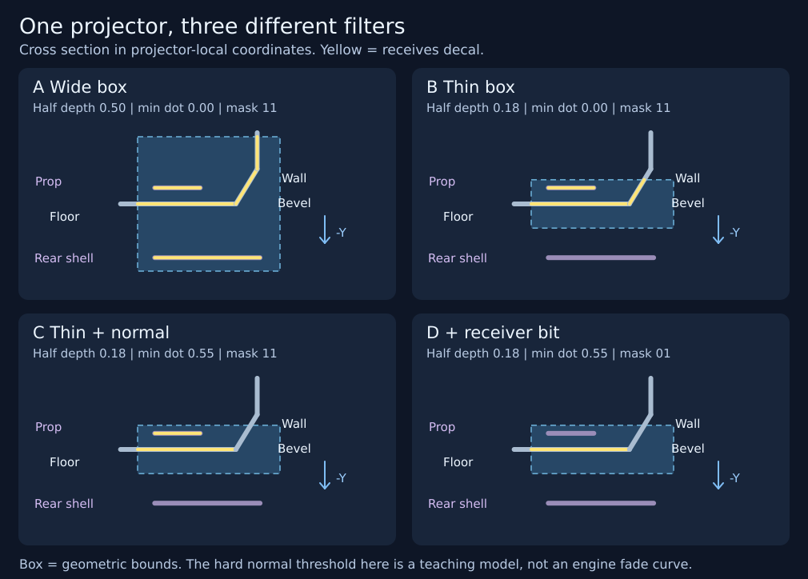

# 投影贴花的接收边界

配合正文[地面贴花为什么投到了道具上](../../../GameLibrary/技术美术/环境管线/纹理与材质/地面贴花为什么投到了道具上.md)阅读。

运行 `python3 plot.py`。脚本输出每条仍接收贴花的线段在投影盒内的具体端点，并以同一结果生成 `cross-section.svg`。已在 Python 3.12.14 运行断言，并由 Inkscape 1.4 渲染后检查四个面板。下列 X/Y 以投影器为原点；剖面里不单独改变 Z。

- A：半深 0.50，五种表面都接收；直壁只在 Y = 0.26 至 0.50 的部分接收。
- B：半深 0.18，后壳、直壁不再接收，但箱盖在 Y = 0.12，倒角保留从 (0.19, 0) 至 (0.293846, 0.18) 的一段。
- C：加法线点积下限 0.55，去掉约 60° 的倒角，保留法线相同的地面和箱盖。
- D：可接收位从 `11` 改为 `01`，箱盖的 `10` 不再匹配，地面仍有标记。

这是正交投影的几何剖面，不做视线遮挡、真实引擎衰减曲线或像素混合。图以黄色表示接收段，以蓝灰/紫灰表示原表面及其不同接收类别。图中英文标签与正文和上方列表一一对应；`Rear shell` 指盒后方模型壳，`Bevel` 指倒角。
