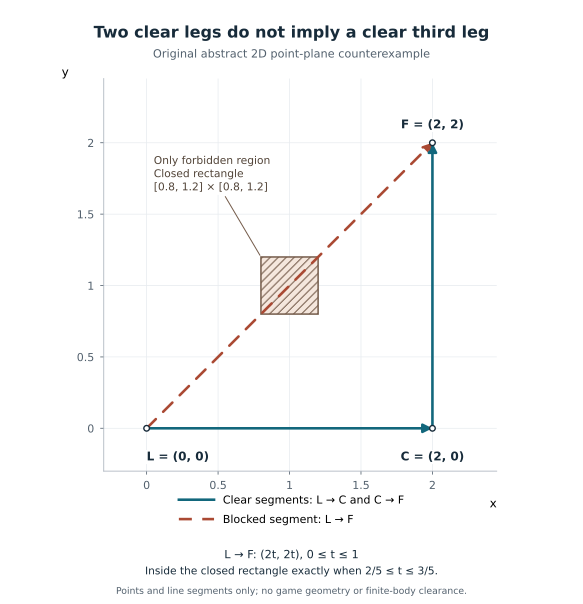

# 最后生还者的同伴跟随，为什么要多查一段路

玩家沿着院墙慢慢前进，同伴离他不远，站的位置也能走到；可玩家再往前几步，两人之间就隔了一段墙。对于做同伴 AI 的程序和设计人员，这类假设场景提醒我们：**“现在离得近”没有回答“接着往前走，彼此还处在怎样的位置关系中”。**

本文不替代路径完整性、角色碰撞或实际到达的检查，也不要求更换寻路算法。

## 为什么不是只查当前位置

Max Dyckhoff 在2015年章节中，介绍了原版《最后生还者》的三组导航网格射线：[1]

1. 带路角色→周围的环形区域：射线抵达区域时，产生候选位置。
2. 候选位置→前方：检查是否面向墙。
3. 带路角色→该前方端点：检查前进后两者之间是否被障碍隔开。

作者报告，第三组改善了门口或栅栏两侧的分隔问题。[1] 这是该项目的历史经验，不是任何地图都能保持同伴不掉队的保证。三组射线用于产生位置，也不是要求角色依次走完三条线。

## 一个点能到，向前一步后的关系仍可能不同

下面完全是原创纸面例子，不是原书插图、游戏地图或实际坐标的复原。把地面简化为二维平面，角色只当作点；除一个障碍矩形外，其他位置都可通行。

- 带路角色位于 L＝(0, 0)。
- 正在检查的候选位置是 C＝(2, 0)。
- 本例选定“向前”为正 Y 方向，试探终点是 F＝(2, 2)。这个方向与两单位长度都是示意约定，不是原作公开的方向定义或参数。
- 障碍是闭矩形：X 和 Y 坐标都在 0.8 到 1.2 之间。进入矩形或接触其边界，均算该线段受阻。

本图自行选定正 Y 方向，以点表示角色；不表示身体宽度或真实导航网格。[图形与适用范围](同伴跟随几何示意/README.md)

现在分别检查三条直线段：

| 检查 | 为什么通过或受阻 |
|---|---|
| L→C | 整段的 Y＝0，低于障碍的 Y 范围，因此通过 |
| C→F | 整段的 X＝2，超过障碍的 X 范围，因此通过 |
| L→F | 经过矩形中心 (1, 1)，因此受阻 |

第三条还可以写成 (2t, 2t)，其中 t 从0变到1。当 t 在0.4到0.6之间时，两个坐标同时落入障碍范围。由此可见，**前两条通过，并不能推出第三条也通过。**

这不意味着 F 无路可达。L→C→F 就是一条避开矩形的折线。第三条提供的是 L 与 F 之间的直连关系，而不是对“有没有任何绕行路线”的再次回答。

为让结果明确，本例另规定：三条线段都通过才接收当前 C。依这条示意规则，C 不被接收。它表达的是比“当前能走到 C”更多的要求；并不是宣称原作在失败时采用同样的丢弃流程、采样数量或备用方案。

实际接入时，先说清楚这个附加要求服务什么体验，再决定如何处理失败。例如，换候选、缩短前方试探距离和改走绕行路线，会改变不同的条件，不能只为让检查通过就随意互换。这里没有为它们选出通用最优方案。

## 这张示意图还缺少什么

回到纸面例子，三条线段只帮助判断一个候选。即使项目随后找到了另一个可接受位置，也还不知道当前同伴在哪里、是否已经满足跟随要求，以及此时移动是否有必要。因此，这组几何检查不能自行发出“现在必须移动”的结论。

排查时可以先显示 L、C、F 和每条检查的结果，再单独记录实际选中的位置与开走原因。如果候选本身不符合要求，查生成规则；如果位置只变了一点、角色却频繁重新起步，再查移动触发条件。不要把这两类问题都压成“距离阈值太小”，也不要把少动当作永不需要响应。

纸面几何没有角色体积、台阶、动态障碍或导航网格数据，更没有执行游戏；线段通过不证明身体能通过。需要检查路径结果与实际移动时，可回到[如何判断导航路径是否真正可用](../../GameLibrary/游戏人工智能/移动导航/路径查询/如何判断导航路径是否真正可用.md)。

## 原始来源与范围

[1] Max Dyckhoff，[*Ellie: Buddy AI in The Last of Us*](https://www.gameaipro.com/GameAIPro2/GameAIPro2_Chapter35_Ellie_Buddy_AI_in_The_Last_of_Us.pdf)，*Game AI Pro 2*，2015，第35章。采用 §35.3.1，印刷页433–434；另读 §35.4 开头，印刷页435，确认该跟随说明主要针对非战斗情境。2026-11-04读取上述文字，未实际看到图35.1，未观看演讲或运行游戏；这里不是《The Last of Us Part II》案例，也不扩展为完整战斗掩体方案。

[返回路径查询书架](../../GameLibrary/游戏人工智能/移动导航/路径查询/README.md)
