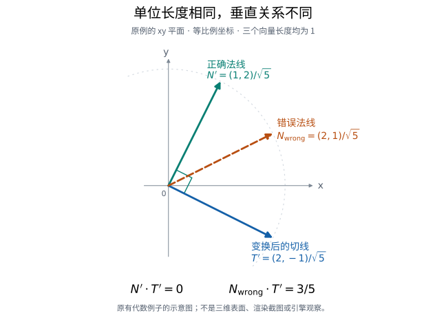

# 非均匀缩放后，为什么单位法线仍可能指错方向

模型沿一个轴拉长以后，表面形状已经改变，照明计算用的方向也要随之改变。假如位置变换正确，却把法线当作普通方向向量一起缩放，再把它恢复成单位长度，是否就够了？问题不在长度，而在它是否仍然垂直于新的表面。下面用一个可以手算的例子说明这个区别，不把它当成任何引擎的实测故障。

**法线**指向垂直于表面的方向；**切线**沿着表面。更准确地说，这里考察顶点处的一组局部基向量：法线 N 与切向量 T 垂直。沿表面移动的一小段位移会随模型一起变换，而法线需要保持对变换后切平面的垂直关系，两者因此不一定使用同一矩阵。

[矩阵布局和乘法约定](../../GameLibrary/图形渲染/着色器开发/数据传递/CPU与着色器之间的矩阵布局和乘法约定.md)解释数据怎样存储、上传和参与计算；这里讨论的是数据正确传递以后，**不同几何方向应该怎样变换**。这也不同于[读取 glTF 顶点属性](../../GameLibrary/技术美术/环境管线/模型导入/读取glTF交错顶点数据时的偏移与步长.md)：读出正确的数值，还不能证明后续照明使用了正确的方向。

## 先看切线的第四个分量

固定 glTF 2.0 规范要求 NORMAL 和 TANGENT.xyz 是单位向量；TANGENT 的第四个分量 w 为 +1 或 −1，表示切线基的手性。局部副切线按 `B=(N×T)w` 重建，同一三角形的 w 应（SHOULD）一致，否则其切线空间未定义。[1]

约定列向量与右手叉积，取原创局部输入：

\[
N=\frac{(1,1,0)}{\sqrt2},\qquad
T=\frac{(1,-1,0)}{\sqrt2},\qquad w=+1.
\]

N 与 T 都长为 1，且点积为 0。此时 `B=N×T=(0,0,−1)`。只把 w 改成 −1，B 就变成 `(0,0,+1)`，N 与 T.xyz 却完全不变。因此，保留前三个分量而丢掉 w，会丢失副切线方向的区别；不能把第四个分量当成冗余数据。这并不表示已经观察到某个转换器丢失了它。

## 拉长模型后，法线怎样继续垂直

现在只把 x 方向拉长为原来的两倍，线性变换为：

\[
A=\operatorname{diag}(2,1,1).
\]

切向量随表面变成 AT。对于这个可逆变换，法线使用 A 的**逆转置**，记为 A⁻ᵀ，便能保留垂直关系：

\[
(A^{-T}N)^T(AT)=N^TT=0.
\]

这里的转置不是为了修补行优先、列优先存储错配，而是由几何上的垂直要求得到的。在本例中：

\[
A^{-T}N=\frac{(1/2,1,0)}{\sqrt2},\qquad
AT=\frac{(2,-1,0)}{\sqrt2}.
\]

分别单位化后，正确方向为：

\[
N'=\frac{(1,2,0)}{\sqrt5},\qquad
T'=\frac{(2,-1,0)}{\sqrt5}.
\]

两者点积为 `(2−2)/5=0`，叉积为 `(0,0,−1)`。

若把法线也直接乘 A，然后单位化，则得到另一方向：

\[
N_{\rm wrong}=\frac{(2,1,0)}{\sqrt5},\qquad
N_{\rm wrong}\cdot T'=\frac{4-1}{5}=\frac35.
\]

**两个候选法线都长为 1，但只有前者仍垂直于本例的切向量。** 单位化只改变长度，不会把后者修正为正确方向。这是精确的纸面代数例子，不是浮点精度测量、渲染截图或设备结果。

图中浅灰圆弧是单位圆的一部分；橙色方向另用虚线标出，说明长度相同不等于方向正确。图只画上述例子的 xy 分量，并非三维表面、照明截图或引擎测量。[图形与重画说明](../支持资料/法线变换示意/README.md)。

## 在导入与着色代码之间查什么

先确认属性所在空间，以及 N、T 和 w 是否完整保留；再沿实际变换路径分别查看法线与切线使用的矩阵。只检查长度为 1，或者只证明矩阵字节上传正确，都可能漏掉上面的方向错误。在项目允许的可逆变换下，可以用明确的输入核算变换后的点积，而不是只在均匀缩放时看模型是否“正常”。这是本文提出的排查方法，不是完整资产检查器。

固定 Khronos 示例渲染器提供了一个具体代码对照：renderer.js 构造逆转置法线矩阵；所选 primitive.vert 分支用它变换法线，用模型矩阵变换切线，再构造副切线。[2] 这说明一种实现如何区分两种方向，不代表所有引擎都采用相同代码。

前述非均匀缩放代码对照选择的路径已有 N/T、对象静态、没有形变目标（morph）或骨骼蒙皮（skin）、未启用着色器的 USE_INSTANCING 分支，也未启用法线贴图的UV变换分支（normal-UV transform）；只讨论顶点处的基向量。“未启用该分支”不等于禁止普通 glTF 节点实例化。两份源提交的时间分别为 2026-10-30（规范）与 2026-10-26（示例实现），仅用于标识修订，不作为独立发布版本日期。

## 镜像以后，绕序与着色法线要分开检查

把模型的 X 坐标取反后，一面突然看不见，是否只要把法线反过来？先别把“哪个面会被画出来”和“照明使用什么方向”合并成一个问题。以下另用反射矩阵 `R=diag(−1,1,1)`，不是前面的拉伸矩阵 A；仍是纸面例子，没有观察实际画面。

取三角形三个顶点依序为 `(0,0,0)`、`(1,0,0)`、`(0,1,0)`，给定着色法线 `N=(0,0,1)`。约定右手叉积，观察者从 +Z 正交看向原点，屏幕向右、向上分别对应 +X、+Y，不额外引入翻转屏幕方向的变换。原来的顶点顺序在屏幕上是逆时针，两条边的叉积为 +Z。保持索引顺序不变，镜像后顶点变成 `(0,0,0)`、`(−1,0,0)`、`(0,1,0)`：顺序变成顺时针，边的叉积成为 −Z；但给定法线按逆转置变换后，`R⁻ᵀN` 仍为 +Z，仍垂直于表面。

这不是两个计算互相矛盾。边的叉积还携带了**顶点排列的定向**，逆转置变换的是事先给定的着色法线。这里没有封闭物体，不能只凭这个孤立三角形宣布哪一侧是物体“外部”。如果保持 +Z 这一侧为镜像后希望呈现的正面，就必须让正面判定与新的顺时针排列相容。若三角形在可见裁剪范围内，仍将逆时针设为正面并启用背面剔除，它就会被按背面剔除；这只是给定规则后的推论，不是实际画面观察。只改用于照明的法线，而不改位置、索引或正面状态，不会改变这个分类；这里不包括用法线驱动顶点位移的自定义效果。

固定 glTF 规范按节点的**全局变换**行列式规定实例的正面绕序：正值对应逆时针，负值对应顺时针。[3] 全局变换包含父节点的变换，不能只看当前节点某个局部缩放框里的负号。固定示例渲染器也把两件事分开：先构造逆转置法线矩阵，再独立设置 `frontFace`；按单面或双面材质决定是否剔除背面。[2] 此处只对照提供 NORMAL、没有 TANGENT，且没有 skin、morph、USE_INSTANCING 的普通单面绘制路径，不含拾取绘制。

把材质改成双面也不是含义不变的修复。glTF 的双面规则不仅关闭背面剔除，还要求将背面三角形的法线取反。[3] 排查时先说明希望哪一侧被当作正面，再分别核对顶点变换、正面状态和着色方向，而不是见到负缩放便同时翻法线、改索引或翻切线 w。本节只补充绕序与法线的区别，不给出副切线重建的统一修法。

## 正面已经对了，副切线还可能朝反方向

假设前面的镜像实例已经按预期显示正面，法线也仍然垂直于表面。若它还有法线贴图，是否就能不加检查地沿用资产里的 w？还要看副切线是在变换之前生成，还是到了新空间才重建。w 说明的是它所在基的定向，不是一个脱离空间约定的“镜像开关”。[1]

沿用正交反射 `R=diag(−1,1,1)`，另取最简单的局部基 `N=+Z、T=+X、w=+1`，所以 `B=N×T=+Y`。这次明确一个目标：让原来的三个轴都随 R 一起映射到新空间。因为 R 是正交反射，法线的逆转置变换也等于乘 R，得到：

| 原方向 | 直接随 R 变换后的方向 |
|---|---|
| N = +Z | +Z |
| T = +X | −X |
| B = +Y | +Y |

但是，只带着变换后的 N、T 与**未调整的旧 w**重建，会得到 `(+Z×−X)×(+1)=−Y`，与表中直接变换的 B 相反。在本例约定下，重建使用 −1 才能得到目标 +Y。这里改变的是新空间中重建所用的符号，不是在要求改写所有资产中的 w。

为什么这个区别值得查？若一个切线空间方向恰好沿副切线轴，它在两种基下会被映到相反方向。即使 N、T 都长为1，而且三角形没有被错误剔除，仍不能据此证明法线贴图使用了预期的基。这只是方向映射的纸面比较，没有观察渲染出的凹凸或高光。

接入时，把两种处理路径画清楚：是先求出 B，再与其他轴一起变换；还是只传 N、T，在新空间里借助符号重建？定向变化是否已在某一步处理过？如果已经携带了符合目标的 B，或者另一层已修正重建符号，再无条件翻转一次反而会改变结果。正面绕序的设置解决三角形分类，不能代替这项检查。[3]

这段推导只选择了一个正交反射和明确的基映射目标；它不把直接变换旧 B 当成任意非均匀缩放、剪切后重建正交基的通用算法，也不据所选示例着色器片段宣称某个渲染器有缺陷。应先对照项目的完整路径与烘焙约定，再决定修正应在哪个空间、哪一步发生。

## 这个例子还没有解决什么

前述 A 缩放例可逆且行列式为正；R 反射例分别解释绕序、着色法线，以及在指定正交基映射目标下重建副切线的区别。它没有完成任意负变换下的切线基处理。[3] 不能从这里推出所有负缩放都应该统一翻转 w，也不能据此宣称示例渲染器存在缺陷。

顶点处方向正确，还不等于插值后的基一定正交、法线贴图重建一定正确，或最终画面没有伪影。奇异或近退化变换、剪切、蒙皮、morph、切线生成、双面材质与纹理变换不在本例验证范围内；实际材质和设备上的表现仍须另外检查。本文没有执行数值模型、导入器、着色器或引擎渲染，也没有生成或导入游戏资产；新增平面插图只呈现已有代数关系。

如果问题发生在生成切线之后、重新组织顶点索引之前，可另读[面角切线输出与重索引](../../GameLibrary/技术美术/环境管线/模型导入/接收MikkTSpace面角切线后，怎样重建顶点与索引.md)：旧索引能提供输入属性，却未必能保存新增切线的逐面角区别。那是属性共享的问题，不是这里的空间变换问题。

如果问题出在两张法线图的细节叠加，可选读[没有细节的法线，为什么还会改掉底层方向](../支持资料/没有细节的法线，为什么还会改掉底层方向.md)：平坦细节是否保留底层方向，是组合运算的要求，不是逆转置变换要解决的问题。

## 参考来源

[1] Khronos，glTF 2.0 固定规范提交 `59ecbdba704206bb656965ab4e202881806066f1`：[属性表](https://github.com/KhronosGroup/glTF/blob/59ecbdba704206bb656965ab4e202881806066f1/specification/2.0/Specification.adoc#L1661-L1662)与 [Using Primitive Data](https://github.com/KhronosGroup/glTF/blob/59ecbdba704206bb656965ab4e202881806066f1/specification/2.0/Specification.adoc#L1813-L1830)。局部 NORMAL、TANGENT 与副切线的含义。

[2] Khronos，glTF-Sample-Renderer 固定提交 `6e8a3d1aaa6f07e9f1310a488453e21325677786`：[renderer.js 1835–1872](https://github.com/KhronosGroup/glTF-Sample-Renderer/blob/6e8a3d1aaa6f07e9f1310a488453e21325677786/source/Renderer/renderer.js#L1835-L1872)及 [primitive.vert 83–161](https://github.com/KhronosGroup/glTF-Sample-Renderer/blob/6e8a3d1aaa6f07e9f1310a488453e21325677786/source/Renderer/shaders/primitive.vert#L83-L161)。分别对照非均匀缩放的 N/T 分支与反射说明的仅 NORMAL 分支，以及独立的正面、剔除设置；不是运行观察或通用实现保证。

[3] Khronos，同一 glTF 规范快照的[全局变换定义](https://github.com/KhronosGroup/glTF/blob/59ecbdba704206bb656965ab4e202881806066f1/specification/2.0/Specification.adoc#L912)、[实例化条款](https://github.com/KhronosGroup/glTF/blob/59ecbdba704206bb656965ab4e202881806066f1/specification/2.0/Specification.adoc#L2195-L2203)与[双面材质条款](https://github.com/KhronosGroup/glTF/blob/59ecbdba704206bb656965ab4e202881806066f1/specification/2.0/Specification.adoc#L2917-L2924)。分别说明全局变换、行列式符号与绕序、剔除及背面法线，不能合并为一个翻转操作。

原笔记来源核对日期为 2026-11-01；最初的读者向整理保留了原数学例子与固定来源范围。

2026-11-02 增加平面示意图，数学例子与固定来源范围不变。

2026-11-02 补充 R 反射的纸面例子与上述固定来源对照；未新增运行、导入或渲染观察。

2026-11-03 补充同一 R 正交反射下的副切线重建比较；重新核对固定规范相关条款，仍为原创纸面推导，未新增程序、导入或渲染运行。
